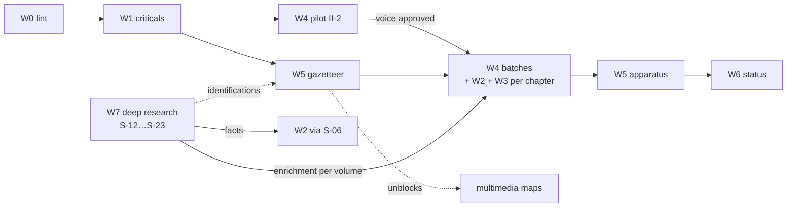

# Content Revision Plan — *The Book of the Million*

**Status:** implementation in progress (2026-11-21) · **Source:** critique pass, `critique/vol-1.md`, `critique/vol-2.md`, `critique/vol-3.md` (full findings with `file:line`, evidence and suggested rewrites)

## Implementation progress

**Updated:** 2026-11-23

[Follow-up chat prompts](next-session-prompts.md#voice-v3-rollout-2026-11-21) cover the series-wide voice pass, the Notes and companions, and illustrations with targeted research.

- **Voice Guide v3 adopted:** [II-3 *Feasts, Robes, and the Twelve Thousand Keshican*](../vol-2/ch-03-feasts-keshican.md) is the approved benchmark. The canonical file matches the approved prototype and passes targeted lint with zero errors and warnings. The prototype's banquet plate, Appendix C and numbered ledger references still need companion matching. For the next apparatus pass, recover the checked distinction between the club-bearing attendants and the tall palace guards in the previous Note 5, and the limit of the witness comparisons in the previous Note 15.
- **First v3 continuation:** [II-4 *Hunt, Hounds, Litter, and the Traffic of a Million*](../vol-2/ch-04-hunt-traffic.md) bridges from the White Feast to the spring hunt, with claim-level anchors, manuscript provenance in the Notes, and links to the volume companions. The narrator invites the reader into the hunt, singles out the hawk’s label, and stays at the city gates when the court moves on. The outro leads from the silk carts to the summons that opens Achmath’s story. Targeted lint passes with zero errors and warnings (2,012 words, 2% Yule overlap).
- **Earlier pass:** II-2 was the S-01 pilot. II-3, II-8, and II-4 passed the previous standard in Batch A. The v3 pass on II-8 is recorded under W4.
- **Batch B — complete:** II-14 *Fuju & Zayton*, II-10 *Manzi & the Sung*, and II-6 *Pulisanghin & Sindafu* are re-voiced. Each passes targeted lint; II-6 retains the non-blocking place-name warning that “Jiangzhou” is close to “Liangzhou.”
- **Earlier W4 pass — II-12 complete:** *Kian, Suju, and the Approach to Heaven’s City* is re-voiced, its Mar Sargis reports are distinguished, and its Ramusio additions are flagged. Targeted lint passes with 0 errors and 0 warnings (1,832 words; 3% Yule overlap; Ramusio 2/2); `git diff --check` passes.
- **Earlier W4 pass — II-1 complete:** *Cublay Kaan: Puissance, Nayan, and the Ordo of Victory* is re-voiced with Nayan’s Temüge Otchigin descent corrected and the Ramusio passages flagged. Targeted lint passes with 0 errors (1,800 words; 2% Yule overlap; Ramusio 4/4); targeted `git diff --check` passes.
- **Earlier W4 pass — II-11 complete:** *Yanju and Saianfu* is re-voiced with the Polo governorship claim, Nanghin identification, siege chronology, and engine authorship kept distinct. Targeted lint passes with 0 errors and 0 warnings (1,800 words; 2% Yule overlap); targeted `git diff --check` passes.
- **Earlier W4 pass — II-9 complete:** *Caugigu, Anin, Coloman, Cuiju — and Back* is re-voiced with the southwest identities, distances and tiger-dog set-piece kept as reported. Targeted lint passes with 0 errors and 0 warnings (1,851 words; 2% Yule overlap); targeted `git diff --check` passes.
- **Cross-file critical/factual corrections started:** factual corrections applied in II-1, II-10, II-11, II-14, II-15, I-11, I-12, III-3, III-10, and III-12, with III-12 and II-11/court chronology also tightened for provenance and open questions.
- **Next work:** audit the earlier Vol. II passes and follow the Vol. I and Vol. III queues in W4. Preserve and revalidate the existing factual passes.
- **Completion for v3:** a chapter passes lint and its voice and Notes receive a read against the II-3 benchmark, including a check of the claim at each anchor and each companion reference.

## Verdict in one paragraph

The draft is **accurate and complete in structure**. Every outline beat is covered, every chapter epigraph checks out against Yule–Cordier, citation numbering is almost entirely sound, and the asides handle most big disputes well. But SERIES-STATUS calls the storyteller rewrite "complete", and it isn't. **Most chapters are Yule's 1903 English with storyteller phrases spliced in.** Measured narrative overlap with Yule (7-word verbatim runs, epigraphs excluded) is 45–80% in 29 of 40 chapters, and 30–45% in 6 more. Only I-1 (7%) and I-12 (16%) read as true retellings, plus the reception chapters III-11 and III-12, which have no Yule text to copy. On top of that, the last-written chapters (III-10 to III-12) leak drafting scaffolding, and a small set of factual errors repeats across volumes.

| | Critical | Major | Minor | Nit |
|---|---|---|---|---|
| Vol. I | 3 | 12 | 12 | 10 |
| Vol. II | 3 | 13 | 15 | 9 |
| Vol. III | 3 | 13 | 14 | 10 |
| **Total** | **9** | **38** | **41** | **29** |

## Workstreams

### W0 — Lint tool (do first; it defines "done")

**Built (S-02, 2026-10-21).** `book/tools/lint.py` implements the checks below, with these final adjustments:
- three profiles: narrative / essay / front-back (see README § Definition of done);
- the Soft-label pattern is `\bSoft\b[^.:\n]{0,40}:` (`Soft \w+:` found 36 labels; the new pattern finds 153, in line with W1's ~155);
- gazetteer labels match only in label form (`Gazetteer: *visited*`);
- quotation verification splits at "…" and reports invented vs misquoted;
- "≤ 2 per scene" is checked per paragraph, because the chapters have no scene breaks;
- v3 checks numeric anchor and Note pairing even if the Notes section is missing, rejects bold labels immediately after a verdict, and looks for provenance in the Notes for near-verbatim Ramusio matches. Unanchored matches are review warnings. Compare paraphrases to the bracketed source and first-draft manifest by hand;
- place names are checked as warnings only (S-04 closed: aliases exist, so `name_policy` flags bare non-canonical forms and unglossed first mentions; it becomes an error when the last chapter has had its naming pass);
- people's names follow the same rule and the same check (S-05 closed: `plans/registry/characters.yaml`; warnings tagged *(S-05)*, 120 bare variants in 26 people at close).

Baseline: `plans/status/lint-baseline.md` (1/49 files pass). The original table:

| Check | Pass threshold |
|---|---|
| Verbatim Yule share (7-gram, narrative only, epigraph and marked quotations included) | **≤ 15%** (S-01; pilot II-2 = 3%) |
| Book-voice first person outside quotation marks ("I tell you", "I will", "we will quit") | 0 |
| Archaisms outside quotation marks (hath, 'tis, wot, natheless, trowed, gat, fain, wist, existeth…) | 0 |
| "Anyway" / formula hinges in total / "You must know" outside quotes / "Here the asides have to be honest" | ≤ 1 / ≤ 3 / 0 / 0 (S-01) |
| Asides | ≤ 80 words each, ≤ 4 per chapter (S-01) |
| Marked quotations | ≤ 2 per scene, ≤ 8 per chapter, ≤ 25 words each (S-01) |
| Opening recap / closing recap | 0 / ≤ 1 sentence (S-01) |
| Scaffolding: `Soft \w+:`, `/workspace`, `outline`, `drafter`, `SERIES-STATUS`, `placeholder`, `dispute hook`, gazetteer reliability labels in Notes (any case; *visited* / *likely_visited* / *uncertain* / *reported_only*) | 0 |
| Citation integrity (body ↔ Notes 1:1, sequential) | pass |
| Epigraph and quotation verification (string found in `refs/`) | pass, or marked *(adapted)* |
| Markers in Notes limited to ✓ ~ ✗ ◇ ? (no ★); every Note opens with one; no "Dispute:" label (S-03) | pass |
| Tag line `**[V]**` / `**[R]**` / `**[M]**` / `**[reception]**` on Vol. II–III narrative/essay files, none elsewhere (S-03) | pass |
| Narrative length | 1,800–3,200 words (essay ≤ 3,500) |
| Place names match a gazetteer `book_name` or alias | pass |

### W1 — Cross-file critical fixes (small, high-stakes; one commit each)

1. **Invented or misquoted epigraphs** (13 files). Replace each with a verified Yule line; the critique gives each replacement and its Yule line number.
   - Vol. I: `front-01`, `front-02`, `back-01` (embellished Jacopo).
   - Vol. II: `front-01`, `front-02`, `back-01`.
   - Vol. III: `front-01`, `front-02`, `back-01`, `ch-02`, `ch-11` (two), `ch-12`.
   - For III-12, use the Book's own method line: *"things seen as seen, and things heard as heard only"* (`yule-vol1.txt:12463`).
2. **"Po-lo" = Bolad, not Marco.**
   - II-5 body and Note [7] (✓ → ✗).
   - II-11 Note [5] (the 1282 date rests on it).
   - III-12 hits list and open question 5.
3. **Scaffolding leaks:**
   - about 155 "Soft …:" labels (III-10: 24, III-11: 41, III-12: 72, plus scattered others);
   - Vol. II drafting instructions to self (II-4:17, II-6:17, II-7:47, II-10:17, II-11:31, II-13:53, II-14:15, II-14:27);
   - pasted outline-beat lists (II-7:53, II-8:51, II-9:49, II-10:73, II-11:53, II-13:87, II-14:71);
   - III meta-references ("the drafter", "first-draft prose … complete", SERIES-STATUS, open questions 13–14);
   - `/workspace/…` paths in Notes;
   - stale "placeholder" captions.
4. **Curzola misattributed to Jacopo d'Acqui** (I-back-01:15, :33; I-front-01 [6]; III-12:30 and [4]). Jacopo puts the capture at Ayas; Curzola is Ramusio plus inference.
5. **Two false points in the III-12 ledger:** the Xi'an stele "miss" (the stele was unearthed c. 1623–25) and the Bolad "hit" above.

### W2 — Factual corrections (do them during W4 when the chapter is open)

Verdicts and sources: `registry/facts.md` (S-06; updated by S-14 on 2026-11-11; rows F-01…F-44). Rows below marked *(S-06)* were changed by it.

| Ch. | Fix |
|---|---|
| I-2 | Berke–Hulagu outcome is backwards: Hulagu's army under Abaqa was routed beyond the Terek in the winter of 1262–63 (Yule's own Bk IV note, F-01): note ✓ → "✓ war / ✗ outcome". The family biography comes from Venetian records, not "the book". |
| I-7, I-8, I-back, I-front-01, I-front-02 | The Hormuz "turning back" is Yule's inference, not the Book's words. Delete "bad faith in the haven". |
| I-11 | Jiayuguan pass is Ming, founded in 1372; do not imply the same fort existed during Polo’s visit. Earlier remains at that exact site remain open (S-14, F-24). |
| I-12 | Aung Khan's final defeat: Jeje'er Heights, 1203. |
| II-1 | Nayan descends from Temüge Otchigin, not Belgutai. |
| II-2 | Develop the silences aside; the Ming Jiayuguan pass dates to 1372, while exact-site earlier structures remain open (S-14, F-24). |
| II-10 | Bayan's dispatch: 1274, not 1268 (Parker in Yule–Cordier, F-29). *(S-06)* |
| II-11 | Saianfu engineers: sent by Abaqa; their origins differ inside Yule–Cordier (Yule: Miafarakain and Herat; Parker in the addenda: Mosul and Shiraz), so give both *(S-06, F-07)*. Polos at court "about May 1275", not "end of 1274". |
| II-14 | Tyunju may be Dehua, but the identification has alternatives; Yule reports local histories crediting men “from the West”, whereas “Babylonia” is Ramusio’s (S-14, F-12, F-13). |
| II-15 | Kiacatu was Arghun's brother; Ghazan acceded 1295; Baidu was a cousin. |
| II-front, gazetteer | Cachanfu = Puzhou/Hezhong at the Yellow River; **Kenjanfu** = Xi'an. |
| III-3, III-9 | The Samara stockade and 2,000 men are Ramusio-only, yet the text calls them "the autobiographical hinge". |
| III-9, III-11, III-12 | Jackson reports that the Chinese and Persian embassy records name no Polos; Ma reports Yang’s late-1290/early-1291 inference, against Yule’s early 1292. Attribute the reports and distinguish preparation from departure (S-14, F-15). |
| III-10 | His wife is **Donata**, "usually identified as a Badoer" (the surname rests on leads; S-15). Pipino's Latin: "in Marco's lifetime, probably the 1310s"; Ramusio said 1320 and Yule suggests 1315, so "Ramusio thought about 1315–1320" is wrong *(S-06, F-16, F-18)*. |
| III-11 | Columbus’s copy is Leeu’s Latin (Gouda 1483–84); notes by him and his circle are undated and do not establish use before 1492. Omit the unsupported Catalan Atlas Chipangu claim, qualify Toscanelli, and make no first-map claim for Japan; add print dates and Ricci’s Cathay identification and Góis’s journey; cut the Jesuits “measuring” Polo’s silences (F-19–F-22; S-20). |
| III-12 | State Wood's case fully (no Chinese or Persian record names the Polos; Persianised names); date the works (1995, 1997, 2006, 2013). Then add "since Vogel": the field has answered Wood and now asks which layer of the text is whose; open questions re-marked moved / unchanged / new *(S-13, `registry/scholarship.md`)*. |
| III-back | Adam's Peak: **in the Book** Muslim and Buddhist only. *(S-06, overturned in part: outside the Book there are Hindu (Siva) and Portuguese Christian (St Thomas, or the eunuch of Candace) claims, per Tennent in Yule. Fix the "in the book's telling" list; the others may appear only as later traditions, F-23.)* |

**Still open after S-06; the chapter uses the hedge** (wording in `registry/facts.md`; library checks in S-06 *Findings*):
- Mosul fell in 1262, supported by Jackson and Yürekli; exact manner and date of al-Ṣāliḥ’s death remain open (F-02).
- Maffeo: Jacoby reads the 1310 will as showing no wife or offspring then; earlier family and the will-date discrepancy remain open (F-17).
- Chingkim's death: "mid-1280s" (II-2 Note [6], F-06).
- Ahmad episode in Z: make no Z claim (II-5, F-09).
- Mar Sargis: the translated gazetteer attributes seven foundations, dating two to 1279 and one to 1281; do not date all seven at once (F-10).
- 1291 departure: Ma reports Yang’s late-1290/early-1291 inference, versus Yule’s 1292; Cleaves’s and Haw’s exact arguments remain unread (F-15).
- Pipino date: "probably the 1310s" (III-10, F-18).
- Quanzhou wreck: twelve bulkheads and thirteen compartments confirmed; sinking year remains approximate (F-14).
- Also open: Badoer’s documentary basis (F-16), the Catalan Atlas and provenance (F-20), exact-site pre-Ming remains at Jiayuguan (F-24), postil dating and Toscanelli (F-19), the Vogel/Haw/Rossabi “pillar” (F-26), Rudrama Devi (F-31).
- Settled by S-06: the Mongol Empire map is a 1206–1294 animation; caption the 1294 frame (F-25).

### W3 — Manuscript provenance in Notes

Anchor Ramusio, Pipino, Jacopo d'Acqui, and Zelada additions directly beside the relevant detail. Record the witness and scope in the matching Note, using “Ramusio-only” or the corresponding witness label where supported. The reliability marker gives the verdict and the prose carries the scene.

Check Yule's brackets, the chapter backlog, and `tools/ramusio-manifest.json`. The manifest is a first-draft audit aid. N-gram detection identifies near-verbatim borrowings. Review paraphrases and the scope of the labels against the source.

### W4 — Re-voicing pass

**Standard:** [Voice Guide v3](../VOICE-GUIDE.md). **Benchmark:** [II-3, *Feasts, Robes, and the Twelve Thousand Keshican*](../vol-2/ch-03-feasts-keshican.md).

1. Keep the exact Yule–Cordier epigraph. Use the first paragraph to pick up a concrete detail from the preceding chapter and take the reader into the new scene with immediate scale, danger, or sensory detail.
2. Use Marco's eye for trade and practical detail and Rustichello's feel for spectacle. Give the modern narrator Ramusio’s curiosity as an editor and a sense of which details are worth stopping for. Stage catalogues as actions and let the narrator shift the reader’s viewpoint or offer a comparison at natural pauses. Keep the established budgets for verbatim overlap, length, and marked quotations.
3. Apply W2 factual findings and W3 witness provenance. Put each sequential `[n]` beside its claim. Use an in-scene clause for any correction a listener needs.
4. Put each anchor at its claim and give it one matching Note — split a paragraph that makes several distinct claims rather than leaving one trailing anchor (the split renumbers the chapter; update `plans/registry/locators.md` pointers and the task file when it does). Begin with a verdict (✓ ~ ✗ ?) and write two or three sentences of curiosity, witness contrast, or authority and navigation. Give checked citations and send extended debates or definitions to the relevant companion.
5. End with a short outro that carries a detail into the next chapter’s first event or question. Run targeted lint and read for voice, source fidelity, anchor placement, and companion references. Review in batches of three or four chapters.

**v3 rollout:** II-3 (benchmark promoted) → II-4 (re-voiced) → II-8 → II-15 → II-7 → II-13 → II-5.

- **Vol. I — I-2 complete (2026-11-23):** *The House of Polo and the Elder Voyage* is re-voiced to v3 with the Terek-outcome correction (F-01: the Book's winner reversed; routed across the frozen Terek, winter 1262–63), the house background re-attributed to Venetian records (m8), the notes re-anchored claim-by-claim (25 Notes: [1]–[3] records / Andrea tradition / brothers and Maffeo), the Maffeo marriage claims hedged per F-17 (no bachelor, no childless claim, no will year printed), and Pipino/Ramusio provenance labels in Notes [24]–[25]. All S-04/S-05 name glosses applied (Barca, Alaü, Cublay, Sigatay, Barac, Abaga). Targeted lint passes with 0 errors and 0 warnings (1,893 words; 12% Yule overlap; 5 quotes; 3 asides); `tools/build/build.sh ch02` places the A3 map with no placeholders or size warnings.

**Vol. II v3 batch (2026-11-23)**

| Chapter | Voice and Notes | Targeted lint |
|---|---|---|
| [II-8](../vol-2/ch-08-mien-bangala.md) | Opens at the Zardandan exchange. The two 1277 operations stay separate in the prose and table. Thirty Notes distinguish the battle reports, the descent, the tower story and Bangala, including the Ramusio tomb addition. | 1,841 words, 2% Yule overlap, 0 errors, 0 warnings |
| [II-15](../vol-2/ch-15-great-turkey-ponent.md) | Court wagers, the Persian succession and the northern fur route. Thirty Notes preserve the disputed Nomogan battle and separate Polo’s winner from the historical Terek outcome. | 1,833 words, 2% overlap, 0 errors, 1 name-similarity warning (Caidu/Caindu are distinct) |
| [II-7](../vol-2/ch-07-tebet-carajan.md) | Campfire, mould, cowries and tally stick frame the trip. Thirty-seven Notes restore the separate Yachi/Talifu claims, retain the crocodilian hedge and attribute Vogel’s presence argument. | 1,937 words, 1% overlap, 0 errors, 0 warnings |
| [II-13](../vol-2/ch-13-kinsay.md) | Tracks the workings of the city from bridge approaches to the revenue account. Forty-two Notes distinguish the accounts behind the figures and mark the individual Ramusio additions. | 1,820 words, 2% overlap, 0 errors, 0 warnings |
| [II-5](../vol-2/ch-05-ahmad-paper-coal.md) | Leads from the summons into the palace, mint and post road. Forty Notes distinguish Bolad, the rival murder accounts and the base coal passage from Ramusio’s baths, and give provenance for the red seal and relief details. | 1,890 words, 1% overlap, 0 errors, 0 warnings |

Targeted command from `book/`: `python3 tools/lint.py -v vol-2/ch-{07,08,15}-*.md`. Compared the closes and openings at II-6→7→8→9 and II-14→15→III-1, using British-English speech renders to check cadence. Recheck each outer joint when the adjacent chapter receives its v3 pass.

**Apparatus handoff for this batch**

- **II-8.** A11 resolves to the southwest circuit in II-7. Check the suggested Vochan battle plate caption against Notes 2, 9, 13 and 14 before using an exact site or identifying Polo’s battle with the third-month fight. The direct Burmese chronicle check remains open under S-17. The chapter identifies the tomb plating as the retained Ramusio addition (Note 22).
- **II-15.** C8 resolves to the succession diagram. Keep the separate Book and historical chronologies, especially Argon’s 1284 accession, the 1295 successions and the corrected Terek outcome (Notes 29–30). “Caidu” and “Caindu” are separate entries in the character and place systems.
- **II-7.** A11 and C9 resolve. The old salt-cake Note 7 is now Notes 13–15 and its S-26 locator points to the new range. The direct check of Wen et al. (1980) remains open. The species hedge rests on the scope of the Iijima supplementary table (Note 25).

- **II-13.** The bridge comparison uses the reported figures; Mascherpa’s underlying Chinese sources and counting boundaries remain open. Moule’s 117/230 split is known on relay and needs an inspected passage. The published West Lake plate exists, with placement in the media workstream.
- **II-5.** The Z question remains open under F-09. The comparison table distinguishes Cai’s identification of the two titles from the additional conspirator in the Chinese account Yule relays. C1 and C2 resolve; the 1287 conversion is official, in *guan*, with both issues continuing to circulate.

**Audit of earlier Vol. II passes.** Targeted lint ran on II-1, II-2, II-3, II-4, II-6, II-9 to II-12 and II-14. All ten passed. II-1 flagged Kublai used bare and the Caidu/Caindu similarity; II-6 flagged Jiangzhou/Liangzhou. The benchmark and continuation remain the models. The v2 chapters still need work beyond lint: II-1/2 have broad paragraph-end anchors; II-6, II-12 and II-14 have paragraphs whose later-witness label and Note come apart; II-9 to II-12 and II-14 have compressed captions or route summaries where the narrator needs a scene. II-9 now opens on the tribute kingdom’s tattoos and turns at Juju; II-14 now hands the Zayton customs to Caidu’s demand. Their remaining v3 apparatus and voice work is open.

**First Vol. I and Vol. III passes (2026-11-23)**

| Chapter | Voice and Notes | Targeted lint |
|---|---|---|
| [I-7](../vol-1/ch-07-kerman-hormos.md) | Kerman’s workshops lead into the low country, stitched ships and the road back. Twenty-eight Notes keep the Sigatay correction and separate the two shared Zelada/Ramusio details from Ramusio’s army story. | 1,822 words, 0% Yule overlap, 0 errors, 0 warnings |
| [I-9](../vol-1/ch-09-balc-badashan.md) | Melon strips, salt picks, stones and unshod horses carry the route. Thirty Notes distinguish the Dogana reading, the monopoly from the geology, and Ramusio’s horses and mountain recovery. | 1,812 words, 2% overlap, 0 errors, 0 warnings |
| [I-8](../vol-1/ch-08-arbre-sec-old-man.md) | Desert water, the furnace and the tree lead into a legend told to Polo. Twenty-four Notes separate the fortress campaign from the garden, including V’s destruction of the castle and Ramusio’s addition of the garden. | 1,807 words, 2% overlap, 0 errors, 0 warnings |
| [III-4](../vol-3/ch-04-necuveran-seilan.md) | Sailors’ reports lead to Sendemain’s ruby, the climb and the account of Sagamoni. Twenty-six Notes distinguish the peak’s two traditions and leave the relic embassy and royal ruby open. | 1,836 words, 2% overlap, 0 errors, 0 warnings |
| [III-3](../vol-3/ch-03-java-less-sumatra.md) | The raised rudder leads to the island, the camp and the tree that makes bread. Twenty-seven Notes distinguish the claims about the camp across witnesses, the rhino descriptions and the party’s claim to have eaten sago. | 1,830 words, 2% overlap, 0 errors, 0 warnings |

| [III-8](../vol-3/ch-08-aden-hormos.md) | Cargo moves between ships, camels and ports. Twenty-four Notes distinguish the Red Sea route estimates, the Ramusio canal account and the archaeology at Calatu. | 1,815 words, 3% Yule overlap, 0 errors, 0 warnings |
| [III-6](../vol-3/ch-06-mutfili-kesmacoran.md) | A customs charter leads to the diamond stories, then the coast is read from the deck. Forty-three Notes distinguish Rudrama Devi’s succession, ascetic practices, the pepper trade and the successive reported sightings of the Pole Star. | 1,976 words, 4% overlap, 0 errors, 0 warnings |

| [I-5](../vol-1/ch-05-mausul-baudas.md) | Cloth and the river route lead into the two Calif stories. Twenty-eight Notes keep the date of the siege, distinct accounts of the Calif’s death and later commemoration separately anchored. | 1,816 words, 1% Yule overlap, 0 errors, 0 warnings |
| [I-6](../vol-1/ch-06-tauris-persia.md) | Market, tombs and fire lead to the road and its cargo. Twenty-seven Notes keep the exact road-stage witnesses, provincial identifications and horse valuation in view. | 1,816 words, 1% Yule overlap, 0 errors, 0 warnings |
| [III-1](../vol-3/ch-01-ships-chipangu.md) | The trader’s deck gives way to the reported gold roof and the fleet. Twenty-nine Notes separate the excavated ships, Ramusio’s additions and the Book’s historical and legendary claims. | 1,852 words, 3% Yule overlap, 0 errors, 0 warnings |

| [III-2](../vol-3/ch-02-chamba-java.md) | The elephant tribute opens the route. Twenty-nine Notes distinguish Polo’s dates and claims from the Yuan records, and the market for Java spices from the question of cultivation. | 1,812 words, 3% Yule overlap, 0 errors, 0 warnings |
| [III-7](../vol-3/ch-07-male-abash.md) | The crossings at Male and Female lead to Scotra, the Ruc and the bishop’s account. Thirty-one Notes separate the whale witnesses, the textual case for Mogadishu and the Abash embassy evidence. | 1,821 words, 2% Yule overlap, 0 errors, 0 warnings |
| [I-13](../vol-1/ch-13-chandu.md) | The cranes at the last stop lead into the park, its portable palace and the rituals of the court. Twenty-four Notes distinguish the roofing variants, the palm-fibre tower and the separate Palm Hall. | 1,816 words, 2% Yule overlap, 0 errors, 0 warnings |

| [III-5](../vol-3/ch-05-maabar-st-thomas.md) | The diver’s catch leads to the trade in pearls and horses and to the shrine at Mailapur. Thirty-four Notes distinguish the fishery shares, the claims about the horses and the shrine traditions. | 1,816 words, 4% Yule overlap, 0 errors, 0 warnings |
| [III-9](../vol-3/ch-09-cocachin-return.md) | Gold tablets lead from the court to the fleet and back to Venice. Twenty-eight Notes keep the witnesses’ passenger and loss figures separate, and identify the limits of the Persian and Chinese embassy accounts. | 1,810 words, 3% Yule overlap, 0 errors, 0 warnings |

| [III-10](../vol-3/ch-10-ca-polo-milione.md) | Homecoming, the household, early readers and the will to 1324. Thirty-one Notes keep the Malipiero tradition, the household records and the documentary and literary evidence distinct. | 2,324 words, 3% Yule overlap, 0 errors, 0 warnings |
| [III-11](../vol-3/ch-11-afterlives.md) | The history of readers, from the 1375 Atlas to the 2024 Foligno announcement. Thirty-three Notes distinguish the cartographic and print evidence, the dates of the Columbus copy and notes, and the later debate. | 2,436 words, 3% Yule overlap, 0 errors, 0 warnings |
| [III-12](../vol-3/ch-12-reliability-essay.md) | Nine argumentative sections with an evidence ledger. Thirty-seven Notes separate the factual claims from the basis of competing readings, and locate the full Wood discussion here. | 2,861 words, 1% Yule overlap, 0 errors, 0 warnings |

| [I-1](../vol-1/ch-01-genoa-prison.md) | The public reading opens the prison story. The battle and competing capture traditions have separate Notes, alongside the 1301 testimony and the Franco-Italian manuscript evidence. | 1,823 words, 3% Yule overlap, 0 errors, 0 warnings |
| [I-3](../vol-1/ch-03-second-setting-forth.md) | The court audience and Ayas quay are joined by the flask. Separate Notes cover the two road reconstructions, Gregory’s friars and the disputed scripts. | 1,825 words, 0% Yule overlap, 0 errors, 0 warnings |
| [I-4](../vol-1/ch-04-hermenia-georgiania.md) | Ayas trade leads to the mountain route. The Notes distinguish Paipurth, the provenance of reported material, the Baku gloss and Sasanian Derbend. | 1,808 words, 1% Yule overlap, 0 errors, 0 warnings |
| [I-10](../vol-1/ch-10-pamier-cotan.md) | Fire, high pasture and the stones of Cotan carry the route. The hanging pillar, its witnesses and the uncertain Pamier identifications have their own Notes. | 1,835 words, 2% Yule overlap, 0 errors, 1 warning |
| [I-11](../vol-1/ch-11-lop-tangut.md) | Provisions lead into the Lop crossing, its voices and desert travellers’ reports. The Notes separate Mogao, Chingintalas and the Great Wall debate. | 1,803 words, 2% Yule overlap, 0 errors, 0 warnings |
| [I-12](../vol-1/ch-12-caracoron-tenduc.md) | A single chapter follows the ordered scenes from Caracoron and the cane to the moving household, the trade in musk and camlets, and the cranes at Chagannor. | 2,306 words, 1% Yule overlap, 0 errors, 0 warnings |

I-2 passed targeted lint as found (1,893 words, 12% overlap, zero errors and warnings) and has its own completed v3 entry above. III-10, III-11 and III-12 follow their separate section plans.

- **I-7 apparatus.** A4 resolves. The sewn-plank parallels have an uncertain original date (Note 20). C13 remains a media item and Canosalmi an unfixed site. The text attributes the abandoned sea plan to Yule and Haw (Note 27); the Book gives a change in narrative direction.
- **III-4 apparatus.** Sendemain stays unresolved (Note 9). The Lee abridgment gives the ascent with iron pins and chains (Notes 14–15). The report of the 1284 embassy still needs a matching independent record, and the earliest Christian association of the peak remains open under F-23. Keep the Adam and Sagamoni claims as the two the Book itself gives.

- **I-8 and I-9 apparatus.** C6 and A5 resolve. Check the A5 label for Dogana against the suspected copying error in I-9, Note 6. Keep the Dry Tree unfixed and the historical fortress distinct from the garden. The direct Boyle/Juvaini passage remains an open lead.
- **III-3 apparatus.** F and V have wooden defences; Z and Ramusio have the ditches and about two thousand men. The source of the coconut praise in Yule is Ramusio; its distribution across witnesses is open. Keep the account of the camp and the separate Prologue wait distinct in the A16 and C11 captions. The two arguments about the rhino’s species are attributed in Notes 7–9; the claim of seeing it remains open.

- **III-6 apparatus.** The Motupalli charter is the 1244–45 inscription in Hultzsch (Note 3). Keep the Rudrama succession separate from Polo’s widow story (Note 2), the two kinds of claims about diamond extraction (Notes 4–8), and the uncertainties over the Chughi accounts (Notes 14–15). Check the C10 heights against Notes 28, 31, 33 and 40 and their anchors.
- **III-8 apparatus.** A16 resolves. Keep late thirteenth-century archaeology at Calatu distinct from Polo’s unnamed refuge in the customs story (Notes 18–19). The canal detail is from Ramusio as quoted by Yule (Note 3), and Sanudo’s stages are a separate account (Note 4).

- **I-5 apparatus.** F-02 is now Note 4. The table follows the restricted S-16 comparison. In particular, Rashīd’s account of execution at Waqf gives no method and the Ṭūsī attribution is debated (Note 14). A4 should continue to show the route via Mausul and Baudas as a variant. Any treasure tower or moving mountain caption needs to identify the respective story.
- **I-6 apparatus.** F-54 is now Note 17, and the proposed copying error in Istanit has its own Note 18. Note 19 uses Yule’s £193 directly. Later Genoese activity in Note 2 leaves the date of Polo’s visit open. The precise sites of St Barsamo and the fire castle remain open.
- **III-1 apparatus.** The A15 map and C12 plate resolve. Retain the twelve bulkheads, thirteen compartments and limber holes in the Quanzhou comparison (Note 4). Keep the Takashima hull interpretation and scorch marks separate from historical accounts of the storm (Notes 21–22). The date and attribution of the Columbus marginalia stay qualified (Note 14). Yule’s statement of Polo’s absence closes the base Sea of Chin narrative, before his quoted Ramusio passage (Notes 28–29).

- **III-2 apparatus.** Keep the F-51 and F-52 Yuan evidence in Notes 6–7 and 18–20. Keep F-43 conditional (Note 26). A16 can show Pelliot’s proposed reading of Pentam and the Singapore Strait as such (Note 27), with Malaiur unresolved (Note 29). The Book’s Java spice list and the evidence for trade have separate anchors (Notes 15–16).
- **III-7 apparatus.** The single floating cask is from Ramusio’s 1559 print; Zelada’s version has multiple small casks and boards in the published transcription (Note 9). Pelliot’s Toyo Bunko scan for the Madeigascar argument is at vol. II, scans 184–185 (Note 13); Andreose gives variant readings with different transcription of F’s index. Keep the Ruc caption as a reported marvel (Note 15). The Abash campaign and the 1290 embassy stay on distinct footing (Notes 28–30).
- **I-13 apparatus.** The roof detail in C16 can distinguish the split canes shared across witnesses, the nails in Ramusio and L and the details of the dragons in Ramusio (Notes 6–8). Keep Sa Dula’s tower distinct from the Palm Hall in the western garden at Cambaluc (Notes 9–10), and use Note 11 for C17. UNESCO’s extent is that of the property (Note 2).

- **III-5 apparatus.** A17 resolves and the geographical sequence has its own anchor (Note 2). S18-F10 dates distinguish the kings named Sundara (Note 3). The fishery claims, later charm office and Mannar archaeological comparison are in Notes 4–8. The evidence for the horse trade and Polo’s explanation for losses remain distinct (Notes 12–15).
- **III-9 apparatus.** A16 and C11 resolve. Keep the 1290 preparations, subsequent sailing proposals, the Prologue’s “Java” and the separate five-month wait at Samara distinct (Notes 12–15). Keep the counts in Notes 16–17 separate and the loss in Maffeo’s edited will distinct from the reconstruction of what happened in Trebizond (Note 27). The embassy comparison names its actual source access (Notes 21–22) and leaves the Polos’ appearance in the outside records unconfirmed.

- **III-10 apparatus.** The homecoming is Ramusio’s tradition (Notes 1–4). Preserve the 1319 identification and the uncertainty over the 1305 namesake (Notes 5–7), the qualified Agnese evidence (Note 13), and the documentary limits of the marriage, will and inventory (Notes 10–12, 24–25, 28–30).
- **III-11 apparatus.** B5 resolves. Keep the Marciana map’s date separate from the 1459 despatch, and the Gouda printing date separate from the dates of the marginalia (Notes 6–7, 11, 14–17). The Foligno count is reported by the project for 2024 (Note 33). For the next B5 review use the printed edition sequence in Notes 10–13 and 18–20, and the Jesuit chronology in Notes 21–22.
- **III-12 apparatus.** The ledger points to the narrative chapters. The Ahmad comparison gives Bolad’s identity and no support for a Polo office (Note 15). The replies to Wood distinguish the 1997 publication from the 2002 text read for its specific arguments (Note 25). Notes 29–32 give edition-specific comparator citations. Two newly keyed editions are Rockhill’s 1900 Rubruck and the 1992 reprint of the 1929 Gibb selection.

Targeted lint also covered the two transition edits. II-9 recorded 1,809 words and 3% overlap, II-14 recorded 1,816 words and 2% overlap, each with zero errors and warnings. The neighbouring closes and openings were compared with British-English speech renders for I-4→5→6→7→8→9→10, I-12→13→II-1, II-4→5→6, II-8→9→10, II-12→13→14→15→III-1 and III-1→2→3→4→5→6→7→8→9→10→11→12. Recheck the earlier-draft joins when those chapters are revised.

**Earlier passes and outstanding order:** II-2 was the S-01 pilot. The earlier Vol. II pass also covered II-14, II-10, II-6, II-12, II-1, II-11, and II-9. Use v3 for the remaining worst-first work:
  - Vol. II: finish the v3 revisions identified in the audit for II-1, II-2, II-6, II-9 to II-12 and II-14.
  - Vol. I: all thirteen have v3 drafts or an approved v3 pass. Independent reader review remains open on the revised chapters.
  - Vol. III: all twelve have v3 drafts. Reader review remains open.
- **I-12** gets a separate structural fix: it is a telegraphic catalogue, not a transcription. **S-07 (2026-11-10): no split.** Both halves would fall under the 1,800 floor and renumbering touches 85 files; the customs list is retold as scenes instead (section plan in `I-12.T3`).
- **III-10 to III-12** (S-07): re-voice with section plans, no rebuild. III-10 ends at 1324; III-11 tells the reception as events; III-12 argues (home of Wood's full case and of the series' principles). Plans in each `.T3`.

- **I-1 apparatus.** Notes 5, 7–8 and 20 separate the command tradition, Ramusio's Curzola, Jacopo's Ayas and the October 1298 inference. Check A18, B1 and related front/back discussion against them. Note 16 retains the checked Larner argument and Note 22 gives Andreose's composition account.
- **I-3 apparatus.** Keep the Venetian bailie (Note 7) separate from the Polos' itinerary. Note 10 follows the F-39 Yule hedge. Notes 14–15 retain the two outbound routes and the source-specific chronology. The scripts table compares candidates and corroborated regional usage (Note 20).
- **I-4 apparatus.** Keep Paipurth as proposed (Note 12), the Georgian source layer at Note 14, the Baku gloss at Note 16 and the Derbend claims at Notes 21–22.
- **I-10 apparatus.** For A5, retain the qualifications on the route and on the candidate site in Note 24. Fire and Wood are in Notes 8–9 and the F-50 pillar comparison is in Notes 15–18. The Caidu/Caindu near-spelling warning concerns different proper names.
- **I-11 apparatus.** Keep the witnesses to the desert story distinct (Notes 5–8), the reference to Mogao conditional (Note 10), and the Chingintalas and textile arguments separate (Notes 20–22). F-24 and F-59 are in Notes 25–26.
- **I-12 apparatus.** A6 should leave Caracoron as an excursion in the text and Tenduc unfixed. The temple and hypothetical palace are in Note 5, the final defeat in Note 13, the limit on the funeral comparison in Note 17 and the disputed Natigay reading in Note 25. The silk, yak and musk passages remain scoped to their witnesses.

**Length follow-up:** Re-measure II-2 in its v3 pass.

The critique gives a cut plan for each. Most of the cuts come out of the recaps.

**S-01 finding:** a full re-voice shrank II-2 by 40% (3,167 → 1,894) with no fact lost. Re-voice first, then re-measure; apply a cut plan only if a chapter is still over 3,200. Watch the 1,800 floor instead. I-1 (two "Anyway" exits, two-paragraph closing recap) still gets a T3; I-2's pass is done (2026-11-23).

### W5 — Apparatus normalisation

- **Markers (S-03 decided):** ★★★ → ✓, ★★ → ~, ★ → ? (✗ or ◇ when the clause itself says wrong or myth; a ★ beside an existing marker is deleted); drop "Dispute:" labels and merge those Notes into their anchors. A script proposes, a person confirms each of the ~81 (`APP.T2`).
- **Tags (S-03 decided):** [V]/[R]/[M] are defined in a 150-word "How to read this book" box in Vol. I front matter (short forms in II-F1 and III-F1). Compounds [V/M] and [R/M] fold into [M]. Tag lines restored on III-7 [R], III-8 [M], III-9 [V]; **[reception]** on III-10 to III-12. Vol. I and front/back matter carry no tag.
- **Notes hygiene:**
  - Fix the I-4 orphan [15].
  - Fix the I-5 [16] mismatch.
  - Fix the III-5 [13]/[15] swap.
  - Renumber I-front-01 (out of order).
  - Fix the II-7 [10] drift.
  - Fill or remove placeholder Notes (II-2 [6], [15]; II-4 [7], [21]; II-5 [18], [24]; III-6 [9], [13], [20]; III-2 [13] …).
- **Gazetteer** (S-04 decided; rows and policy done 2026-10-22, front-02 tables still to regenerate):
  - ✓ `book_name` is the Yule form the chapters use, with modern and other forms as aliases;
  - ✓ 86 rows added (Vol. I 34, Vol. II 41, Vol. III 11, including five region labels), 112 → 195, three old rows merged away;
  - ✓ conflicts resolved (see `GAZ-gazetteer.md`): Cachanfu = Puzhou, Cacanfu = Hejian, Caugigu = Kiang Hung, Nanghin = Anqing, two Vujus, two Sinjus, Male and Female unplotted;
  - regenerate the front-02 place tables from it (`GAZ.T5`).
- **People** (S-05 decided 2026-10-22): `plans/registry/characters.yaml` is the authority for names and dates (Yule's form where Polo names the person: *Cublay*, *Alaü*, *Argon*, *Casan*; the modern form where he does not), with the gloss rule of the gazetteer. The naming pass runs inside each chapter's `.T3` (**People (S-05 ✓)** step); the factual items about people sit in the chapter backlogs for `.T1`.
- **Front and back matter de-duplication (S-07 decided):** F1 frames, F2 orients, chapters narrate, B1 points (one-line dispute shortlist plus trivia). Each topic has one home: matrix in `spikes/S-07-structure-length.md`, rules in `VOICE-GUIDE.md` § Front and back matter, per-file cuts in each front/back `.T3`. Front/back files are capped at 1,200 words (lint).

### W6 — Status truthfulness

Rewrite `SERIES-STATUS.md` and the volume READMEs to match reality. Retire the `/workspace` paths.

### W7 — References and enrichment (phase R)

Upgrade the scholarship from Yule–Cordier plus names to a verified bibliography, post-2013 scholarship, checked facts and sourced enrichment. Twelve external deep-research runs (S-12 … S-23), plus per-work deep dives from S-23, each brought back through an intake session that checks the sources before anything reaches the text. Workflow: `research/README.md`.
- S-12 → bibliography and citation policy (closed 2026-11-10: 162 entries, `registry/sources.md`; the policy itself was settled in S-24); S-14 → closes S-06 (W2); S-13 → III-12 debate update (closed 2026-11-11: `registry/scholarship.md`; 57 works added).
- S-16/17/18 → per-volume enrichment: at most 2–3 items per chapter go into the re-voice, the rest to Notes or back matter. S-16 and S-17 have best-effort intakes; for Vol. II use `registry/enrichment.md` S17-E1–E7 and `registry/facts.md` S17-F1–F6, retaining the qualifications and open research in `research/results/S-17-intake.md`. S-18 remains open.
- S-19 → Comparative clauses; S-20 → reception and myth-check; S-21 → natural history; S-22/S-23 → visual references for the plates (multimedia side).

## Sequencing

## Scale estimate

- W0, W1 and W5's gazetteer are mechanical and small.
- **W4 is the bulk:** ~37 chapters × ~2,800 words of re-voicing (≈ 100k words). It parallelises well, one agent per chapter against the pilot as the reference, but every chapter needs a human read for voice.
