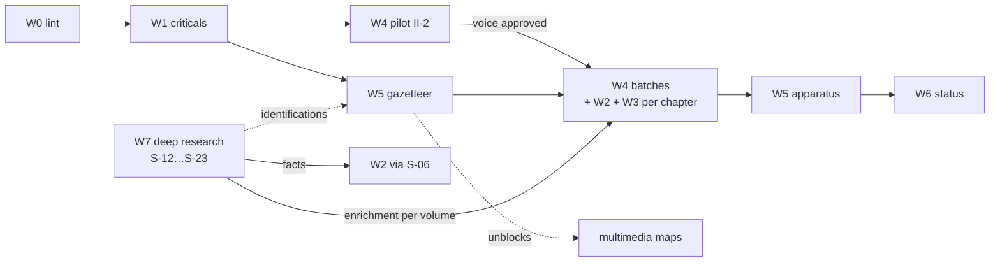

# Content Revision Plan — *The Book of the Million*

**Status:** implementation in progress (2026-11-21) · **Source:** critique pass, `critique/vol-1.md`, `critique/vol-2.md`, `critique/vol-3.md` (full findings with `file:line`, evidence and suggested rewrites)

## Implementation progress

**Updated:** 2026-11-21

[Follow-up chat prompts](next-session-prompts.md#voice-v3-rollout-2026-11-21) cover the series-wide voice pass, the Notes and companions, and illustrations with targeted research.

- **Voice Guide v3 adopted:** [II-3 *Feasts, Robes, and the Twelve Thousand Keshican*](../vol-2/ch-03-feasts-keshican.md) is the approved benchmark. The canonical file matches the approved prototype and passes targeted lint with zero errors and warnings. The prototype's banquet plate, Appendix C and numbered ledger references still need companion matching. For the next apparatus pass, recover the checked distinction between the club-bearing attendants and the tall palace guards in the previous Note 5, and the limit of the witness comparisons in the previous Note 15.
- **First v3 continuation:** [II-4 *Hunt, Hounds, Litter, and the Traffic of a Million*](../vol-2/ch-04-hunt-traffic.md) bridges from the White Feast to the spring hunt, with claim-level anchors, manuscript provenance in the Notes, and links to the volume companions. The narrator invites the reader into the hunt, singles out the hawk’s label, and stays at the city gates when the court moves on. The outro leads from the silk carts to the summons that opens Achmath’s story. Targeted lint passes with zero errors and warnings (2,012 words, 2% Yule overlap).
- **Earlier pass:** II-2 was the S-01 pilot. II-3, II-8, and II-4 passed the previous standard in Batch A. II-8 is next in that batch for v3.
- **Batch B — complete:** II-14 *Fuju & Zayton*, II-10 *Manzi & the Sung*, and II-6 *Pulisanghin & Sindafu* are re-voiced. Each passes targeted lint; II-6 retains the non-blocking place-name warning that “Jiangzhou” is close to “Liangzhou.”
- **Earlier W4 pass — II-12 complete:** *Kian, Suju, and the Approach to Heaven’s City* is re-voiced, its Mar Sargis reports are distinguished, and its Ramusio additions are flagged. Targeted lint passes with 0 errors and 0 warnings (1,832 words; 3% Yule overlap; Ramusio 2/2); `git diff --check` passes.
- **Earlier W4 pass — II-1 complete:** *Cublay Kaan: Puissance, Nayan, and the Ordo of Victory* is re-voiced with Nayan’s Temüge Otchigin descent corrected and the Ramusio passages flagged. Targeted lint passes with 0 errors (1,800 words; 2% Yule overlap; Ramusio 4/4); targeted `git diff --check` passes.
- **Earlier W4 pass — II-11 complete:** *Yanju and Saianfu* is re-voiced with the Polo governorship claim, Nanghin identification, siege chronology, and engine authorship kept distinct. Targeted lint passes with 0 errors and 0 warnings (1,800 words; 2% Yule overlap); targeted `git diff --check` passes.
- **Earlier W4 pass — II-9 complete:** *Caugigu, Anin, Coloman, Cuiju — and Back* is re-voiced with the southwest identities, distances and tiger-dog set-piece kept as reported. Targeted lint passes with 0 errors and 0 warnings (1,851 words; 2% Yule overlap); targeted `git diff --check` passes.
- **Cross-file critical/factual corrections started:** factual corrections applied in II-1, II-10, II-11, II-14, II-15, I-11, I-12, III-3, III-10, and III-12, with III-12 and II-11/court chronology also tightened for provenance and open questions.
- **Next work:** apply v3 to II-8 and use v3 for the next chapters in the worst-first queue (II-15, II-7, II-13, II-5). Preserve and revalidate the existing factual passes.
- **Completion for v3:** a chapter passes lint and its voice and Notes receive a read against the II-3 benchmark, including a check of the claim at each anchor and each companion reference.

## Verdict in one paragraph

The draft is **accurate and complete in structure**. Every outline beat is covered, every chapter epigraph checks out against Yule–Cordier, citation numbering is almost entirely sound, and the asides handle most big disputes well. But SERIES-STATUS calls the storyteller rewrite "complete", and it isn't. **Most chapters are Yule's 1903 English with storyteller phrases spliced in.** Measured narrative overlap with Yule (7-word verbatim runs, epigraphs excluded) is 45–80% in 29 of 40 chapters, and 30–45% in 6 more. Only I-1 (7%) and I-12 (16%) read as true retellings, plus the reception chapters III-11 and III-12, which have no Yule text to copy. On top of that, the last-written chapters (III-10 to III-12) leak drafting scaffolding, and a small set of factual errors repeats across volumes.

| | Critical | Major | Minor | Nit |
|---|---|---|---|---|
| Vol. I | 3 | 12 | 12 | 10 |
| Vol. II | 3 | 13 | 15 | 9 |
| Vol. III | 3 | 13 | 14 | 10 |
| **Total** | **9** | **38** | **41** | **29** |

## Workstreams

### W0 — Lint tool (do first; it defines "done")

**Built (S-02, 2026-10-21).** `book/tools/lint.py` implements the checks below, with these final adjustments:
- three profiles: narrative / essay / front-back (see README § Definition of done);
- the Soft-label pattern is `\bSoft\b[^.:\n]{0,40}:` (`Soft \w+:` found 36 labels; the new pattern finds 153, in line with W1's ~155);
- gazetteer labels match only in label form (`Gazetteer: *visited*`);
- quotation verification splits at "…" and reports invented vs misquoted;
- "≤ 2 per scene" is checked per paragraph, because the chapters have no scene breaks;
- v3 checks numeric anchor and Note pairing even if the Notes section is missing, rejects bold labels immediately after a verdict, and looks for provenance in the Notes for near-verbatim Ramusio matches. Unanchored matches are review warnings. Compare paraphrases to the bracketed source and first-draft manifest by hand;
- place names are checked as warnings only (S-04 closed: aliases exist, so `name_policy` flags bare non-canonical forms and unglossed first mentions; it becomes an error when the last chapter has had its naming pass);
- people's names follow the same rule and the same check (S-05 closed: `plans/registry/characters.yaml`; warnings tagged *(S-05)*, 120 bare variants in 26 people at close).

Baseline: `plans/status/lint-baseline.md` (1/49 files pass). The original table:

| Check | Pass threshold |
|---|---|
| Verbatim Yule share (7-gram, narrative only, epigraph and marked quotations included) | **≤ 15%** (S-01; pilot II-2 = 3%) |
| Book-voice first person outside quotation marks ("I tell you", "I will", "we will quit") | 0 |
| Archaisms outside quotation marks (hath, 'tis, wot, natheless, trowed, gat, fain, wist, existeth…) | 0 |
| "Anyway" / formula hinges in total / "You must know" outside quotes / "Here the asides have to be honest" | ≤ 1 / ≤ 3 / 0 / 0 (S-01) |
| Asides | ≤ 80 words each, ≤ 4 per chapter (S-01) |
| Marked quotations | ≤ 2 per scene, ≤ 8 per chapter, ≤ 25 words each (S-01) |
| Opening recap / closing recap | 0 / ≤ 1 sentence (S-01) |
| Scaffolding: `Soft \w+:`, `/workspace`, `outline`, `drafter`, `SERIES-STATUS`, `placeholder`, `dispute hook`, gazetteer reliability labels in Notes (any case; *visited* / *likely_visited* / *uncertain* / *reported_only*) | 0 |
| Citation integrity (body ↔ Notes 1:1, sequential) | pass |
| Epigraph and quotation verification (string found in `refs/`) | pass, or marked *(adapted)* |
| Markers in Notes limited to ✓ ~ ✗ ◇ ? (no ★); every Note opens with one; no "Dispute:" label (S-03) | pass |
| Tag line `**[V]**` / `**[R]**` / `**[M]**` / `**[reception]**` on Vol. II–III narrative/essay files, none elsewhere (S-03) | pass |
| Narrative length | 1,800–3,200 words (essay ≤ 3,500) |
| Place names match a gazetteer `book_name` or alias | pass |

### W1 — Cross-file critical fixes (small, high-stakes; one commit each)

1. **Invented or misquoted epigraphs** (13 files). Replace each with a verified Yule line; the critique gives each replacement and its Yule line number.
   - Vol. I: `front-01`, `front-02`, `back-01` (embellished Jacopo).
   - Vol. II: `front-01`, `front-02`, `back-01`.
   - Vol. III: `front-01`, `front-02`, `back-01`, `ch-02`, `ch-11` (two), `ch-12`.
   - For III-12, use the Book's own method line: *"things seen as seen, and things heard as heard only"* (`yule-vol1.txt:12463`).
2. **"Po-lo" = Bolad, not Marco.**
   - II-5 body and Note [7] (✓ → ✗).
   - II-11 Note [5] (the 1282 date rests on it).
   - III-12 hits list and open question 5.
3. **Scaffolding leaks:**
   - about 155 "Soft …:" labels (III-10: 24, III-11: 41, III-12: 72, plus scattered others);
   - Vol. II drafting instructions to self (II-4:17, II-6:17, II-7:47, II-10:17, II-11:31, II-13:53, II-14:15, II-14:27);
   - pasted outline-beat lists (II-7:53, II-8:51, II-9:49, II-10:73, II-11:53, II-13:87, II-14:71);
   - III meta-references ("the drafter", "first-draft prose … complete", SERIES-STATUS, open questions 13–14);
   - `/workspace/…` paths in Notes;
   - stale "placeholder" captions.
4. **Curzola misattributed to Jacopo d'Acqui** (I-back-01:15, :33; I-front-01 [6]; III-12:30 and [4]). Jacopo puts the capture at Ayas; Curzola is Ramusio plus inference.
5. **Two false points in the III-12 ledger:** the Xi'an stele "miss" (the stele was unearthed c. 1623–25) and the Bolad "hit" above.

### W2 — Factual corrections (do them during W4 when the chapter is open)

Verdicts and sources: `registry/facts.md` (S-06; updated by S-14 on 2026-11-11; rows F-01…F-44). Rows below marked *(S-06)* were changed by it.

| Ch. | Fix |
|---|---|
| I-2 | Berke–Hulagu outcome is backwards: Hulagu's army under Abaqa was routed beyond the Terek in the winter of 1262–63 (Yule's own Bk IV note, F-01): note ✓ → "✓ war / ✗ outcome". The family biography comes from Venetian records, not "the book". |
| I-7, I-8, I-back, I-front-01, I-front-02 | The Hormuz "turning back" is Yule's inference, not the Book's words. Delete "bad faith in the haven". |
| I-11 | Jiayuguan pass is Ming, founded in 1372; do not imply the same fort existed during Polo’s visit. Earlier remains at that exact site remain open (S-14, F-24). |
| I-12 | Aung Khan's final defeat: Jeje'er Heights, 1203. |
| II-1 | Nayan descends from Temüge Otchigin, not Belgutai. |
| II-2 | Develop the silences aside; the Ming Jiayuguan pass dates to 1372, while exact-site earlier structures remain open (S-14, F-24). |
| II-10 | Bayan's dispatch: 1274, not 1268 (Parker in Yule–Cordier, F-29). *(S-06)* |
| II-11 | Saianfu engineers: sent by Abaqa; their origins differ inside Yule–Cordier (Yule: Miafarakain and Herat; Parker in the addenda: Mosul and Shiraz), so give both *(S-06, F-07)*. Polos at court "about May 1275", not "end of 1274". |
| II-14 | Tyunju may be Dehua, but the identification has alternatives; Yule reports local histories crediting men “from the West”, whereas “Babylonia” is Ramusio’s (S-14, F-12, F-13). |
| II-15 | Kiacatu was Arghun's brother; Ghazan acceded 1295; Baidu was a cousin. |
| II-front, gazetteer | Cachanfu = Puzhou/Hezhong at the Yellow River; **Kenjanfu** = Xi'an. |
| III-3, III-9 | The Samara stockade and 2,000 men are Ramusio-only, yet the text calls them "the autobiographical hinge". |
| III-9, III-11, III-12 | Jackson reports that the Chinese and Persian embassy records name no Polos; Ma reports Yang’s late-1290/early-1291 inference, against Yule’s early 1292. Attribute the reports and distinguish preparation from departure (S-14, F-15). |
| III-10 | His wife is **Donata**, "usually identified as a Badoer" (the surname rests on leads; S-15). Pipino's Latin: "in Marco's lifetime, probably the 1310s"; Ramusio said 1320 and Yule suggests 1315, so "Ramusio thought about 1315–1320" is wrong *(S-06, F-16, F-18)*. |
| III-11 | Columbus’s copy is Leeu’s Latin (Gouda 1483–84); notes by him and his circle are undated and do not establish use before 1492. Omit the unsupported Catalan Atlas Chipangu claim, qualify Toscanelli, and make no first-map claim for Japan; add print dates and Ricci’s Cathay identification and Góis’s journey; cut the Jesuits “measuring” Polo’s silences (F-19–F-22; S-20). |
| III-12 | State Wood's case fully (no Chinese or Persian record names the Polos; Persianised names); date the works (1995, 1997, 2006, 2013). Then add "since Vogel": the field has answered Wood and now asks which layer of the text is whose; open questions re-marked moved / unchanged / new *(S-13, `registry/scholarship.md`)*. |
| III-back | Adam's Peak: **in the Book** Muslim and Buddhist only. *(S-06, overturned in part: outside the Book there are Hindu (Siva) and Portuguese Christian (St Thomas, or the eunuch of Candace) claims, per Tennent in Yule. Fix the "in the book's telling" list; the others may appear only as later traditions, F-23.)* |

**Still open after S-06; the chapter uses the hedge** (wording in `registry/facts.md`; library checks in S-06 *Findings*):
- Mosul fell in 1262, supported by Jackson and Yürekli; exact manner and date of al-Ṣāliḥ’s death remain open (F-02).
- Maffeo: Jacoby reads the 1310 will as showing no wife or offspring then; earlier family and the will-date discrepancy remain open (F-17).
- Chingkim's death: "mid-1280s" (II-2 Note [6], F-06).
- Ahmad episode in Z: make no Z claim (II-5, F-09).
- Mar Sargis: the translated gazetteer attributes seven foundations, dating two to 1279 and one to 1281; do not date all seven at once (F-10).
- 1291 departure: Ma reports Yang’s late-1290/early-1291 inference, versus Yule’s 1292; Cleaves’s and Haw’s exact arguments remain unread (F-15).
- Pipino date: "probably the 1310s" (III-10, F-18).
- Quanzhou wreck: twelve bulkheads and thirteen compartments confirmed; sinking year remains approximate (F-14).
- Also open: Badoer’s documentary basis (F-16), the Catalan Atlas and provenance (F-20), exact-site pre-Ming remains at Jiayuguan (F-24), postil dating and Toscanelli (F-19), the Vogel/Haw/Rossabi “pillar” (F-26), Rudrama Devi (F-31).
- Settled by S-06: the Mongol Empire map is a 1206–1294 animation; caption the 1294 frame (F-25).

### W3 — Manuscript provenance in Notes

Anchor Ramusio, Pipino, Jacopo d'Acqui, and Zelada additions directly beside the relevant detail. Record the witness and scope in the matching Note, using “Ramusio-only” or the corresponding witness label where supported. The reliability marker gives the verdict and the prose carries the scene.

Check Yule's brackets, the chapter backlog, and `tools/ramusio-manifest.json`. The manifest is a first-draft audit aid. N-gram detection identifies near-verbatim borrowings. Review paraphrases and the scope of the labels against the source.

### W4 — Re-voicing pass

**Standard:** [Voice Guide v3](../VOICE-GUIDE.md). **Benchmark:** [II-3, *Feasts, Robes, and the Twelve Thousand Keshican*](../vol-2/ch-03-feasts-keshican.md).

1. Keep the exact Yule–Cordier epigraph. Use the first paragraph to pick up a concrete detail from the preceding chapter and take the reader into the new scene with immediate scale, danger, or sensory detail.
2. Use Marco's eye for trade and practical detail and Rustichello's feel for spectacle. Give the modern narrator Ramusio’s curiosity as an editor and a sense of which details are worth stopping for. Stage catalogues as actions and let the narrator shift the reader’s viewpoint or offer a comparison at natural pauses. Keep the established budgets for verbatim overlap, length, and marked quotations.
3. Apply W2 factual findings and W3 witness provenance. Put each sequential `[n]` beside its claim. Use an in-scene clause for any correction a listener needs.
4. Give each anchor one matching Note. Begin with a verdict (✓ ~ ✗ ?) and write two or three sentences of curiosity, witness contrast, or authority and navigation. Give checked citations and send extended debates or definitions to the relevant companion.
5. End with a short outro that carries a detail into the next chapter’s first event or question. Run targeted lint and read for voice, source fidelity, anchor placement, and companion references. Review in batches of three or four chapters.

**v3 rollout:** II-3 (benchmark promoted) → II-4 (re-voiced) → II-8 (next v3 pass).

**Earlier passes and outstanding order:** II-2 was the S-01 pilot. The earlier Vol. II pass also covered II-14, II-10, II-6, II-12, II-1, II-11, and II-9. Use v3 for the remaining worst-first work:
  - Vol. II: II-15 → II-7 → II-13 → II-5.
  - Vol. I: I-7 (70%) → I-9 → I-8 → I-5 → I-6 → I-13 → I-10 → I-4 → I-11 → I-3 → I-2.
  - Vol. III: III-4 (77–78%) → III-3 → III-8 → III-6 → III-1 → III-2 → III-7 → III-5 → III-9 → III-10.
- **I-12** gets a separate structural fix: it is a telegraphic catalogue, not a transcription. **S-07 (2026-11-10): no split.** Both halves would fall under the 1,800 floor and renumbering touches 85 files; the customs list is retold as scenes instead (section plan in `I-12.T3`).
- **III-10 to III-12** (S-07): re-voice with section plans, no rebuild. III-10 ends at 1324; III-11 tells the reception as events; III-12 argues (home of Wood's full case and of the series' principles). Plans in each `.T3`.

**Over length:**
- II-13 (3,432): cut about 350.
- III-6 (3,637): cut about 500.
- III-10 (3,339): cut about 500.
- III-12 (3,784): cut about 900.
- II-2 and II-5 sit at the ceiling.

The critique gives a cut plan for each. Most of the cuts come out of the recaps.

**S-01 finding:** a full re-voice shrank II-2 by 40% (3,167 → 1,894) with no fact lost. Re-voice first, then re-measure; apply a cut plan only if a chapter is still over 3,200. Watch the 1,800 floor instead. I-1 (two "Anyway" exits, two-paragraph closing recap) and I-2 (28% verbatim) also get a T3.

### W5 — Apparatus normalisation

- **Markers (S-03 decided):** ★★★ → ✓, ★★ → ~, ★ → ? (✗ or ◇ when the clause itself says wrong or myth; a ★ beside an existing marker is deleted); drop "Dispute:" labels and merge those Notes into their anchors. A script proposes, a person confirms each of the ~81 (`APP.T2`).
- **Tags (S-03 decided):** [V]/[R]/[M] are defined in a 150-word "How to read this book" box in Vol. I front matter (short forms in II-F1 and III-F1). Compounds [V/M] and [R/M] fold into [M]. Tag lines restored on III-7 [R], III-8 [M], III-9 [V]; **[reception]** on III-10 to III-12. Vol. I and front/back matter carry no tag.
- **Notes hygiene:**
  - Fix the I-4 orphan [15].
  - Fix the I-5 [16] mismatch.
  - Fix the III-5 [13]/[15] swap.
  - Renumber I-front-01 (out of order).
  - Fix the II-7 [10] drift.
  - Fill or remove placeholder Notes (II-2 [6], [15]; II-4 [7], [21]; II-5 [18], [24]; III-6 [9], [13], [20]; III-2 [13] …).
- **Gazetteer** (S-04 decided; rows and policy done 2026-10-22, front-02 tables still to regenerate):
  - ✓ `book_name` is the Yule form the chapters use, with modern and other forms as aliases;
  - ✓ 86 rows added (Vol. I 34, Vol. II 41, Vol. III 11, including five region labels), 112 → 195, three old rows merged away;
  - ✓ conflicts resolved (see `GAZ-gazetteer.md`): Cachanfu = Puzhou, Cacanfu = Hejian, Caugigu = Kiang Hung, Nanghin = Anqing, two Vujus, two Sinjus, Male and Female unplotted;
  - regenerate the front-02 place tables from it (`GAZ.T5`).
- **People** (S-05 decided 2026-10-22): `plans/registry/characters.yaml` is the authority for names and dates (Yule's form where Polo names the person: *Cublay*, *Alaü*, *Argon*, *Casan*; the modern form where he does not), with the gloss rule of the gazetteer. The naming pass runs inside each chapter's `.T3` (**People (S-05 ✓)** step); the factual items about people sit in the chapter backlogs for `.T1`.
- **Front and back matter de-duplication (S-07 decided):** F1 frames, F2 orients, chapters narrate, B1 points (one-line dispute shortlist plus trivia). Each topic has one home: matrix in `spikes/S-07-structure-length.md`, rules in `VOICE-GUIDE.md` § Front and back matter, per-file cuts in each front/back `.T3`. Front/back files are capped at 1,200 words (lint).

### W6 — Status truthfulness

Rewrite `SERIES-STATUS.md` and the volume READMEs to match reality. Retire the `/workspace` paths.

### W7 — References and enrichment (phase R)

Upgrade the scholarship from Yule–Cordier plus names to a verified bibliography, post-2013 scholarship, checked facts and sourced enrichment. Twelve external deep-research runs (S-12 … S-23), plus per-work deep dives from S-23, each brought back through an intake session that checks the sources before anything reaches the text. Workflow: `research/README.md`.
- S-12 → bibliography and citation policy (closed 2026-11-10: 162 entries, `registry/sources.md`; the policy itself was settled in S-24); S-14 → closes S-06 (W2); S-13 → III-12 debate update (closed 2026-11-11: `registry/scholarship.md`; 57 works added).
- S-16/17/18 → per-volume enrichment: at most 2–3 items per chapter go into the re-voice, the rest to Notes or back matter. S-16 and S-17 have best-effort intakes; for Vol. II use `registry/enrichment.md` S17-E1–E7 and `registry/facts.md` S17-F1–F6, retaining the qualifications and open research in `research/results/S-17-intake.md`. S-18 remains open.
- S-19 → Comparative clauses; S-20 → reception and myth-check; S-21 → natural history; S-22/S-23 → visual references for the plates (multimedia side).

## Sequencing

## Scale estimate

- W0, W1 and W5's gazetteer are mechanical and small.
- **W4 is the bulk:** ~37 chapters × ~2,800 words of re-voicing (≈ 100k words). It parallelises well, one agent per chapter against the pilot as the reference, but every chapter needs a human read for voice.
