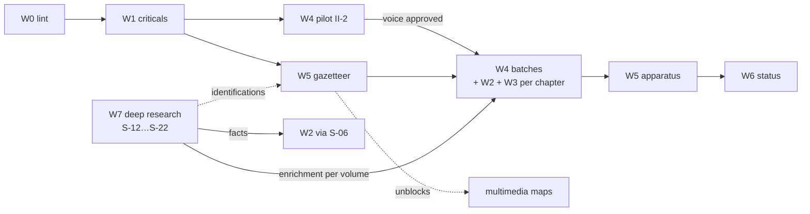

# Content Revision Plan — *The Book of the Million*

**Status:** draft v1 (2026-10-21) · **Source:** critique pass, `critique/vol-1.md`, `critique/vol-2.md`, `critique/vol-3.md` (full findings with `file:line`, evidence and suggested rewrites)

## Verdict in one paragraph

The draft is **accurate and complete in structure**. Every outline beat is covered, every chapter epigraph checks out against Yule–Cordier, citation numbering is almost entirely sound, and the asides handle most big disputes well. But SERIES-STATUS calls the storyteller rewrite "complete", and it isn't. **Most chapters are Yule's 1903 English with storyteller phrases spliced in.** Measured narrative overlap with Yule (7-word verbatim runs, epigraphs excluded) is 45–80% in 29 of 40 chapters, and 30–45% in 6 more. Only I-1 (7%) and I-12 (16%) read as true retellings, plus the reception chapters III-11 and III-12, which have no Yule text to copy. On top of that, the last-written chapters (III-10 to III-12) leak drafting scaffolding, and a small set of factual errors repeats across volumes.

| | Critical | Major | Minor | Nit |
|---|---|---|---|---|
| Vol. I | 3 | 12 | 12 | 10 |
| Vol. II | 3 | 13 | 15 | 9 |
| Vol. III | 3 | 13 | 14 | 10 |
| **Total** | **9** | **38** | **41** | **29** |

## Workstreams

### W0 — Lint tool (do first; it defines "done")

**Built (S-02, 2026-10-21).** `book/tools/lint.py` implements the checks below, with these final adjustments:
- three profiles: narrative / essay / front-back (see README § Definition of done);
- the Soft-label pattern is `\bSoft\b[^.:\n]{0,40}:` (`Soft \w+:` found 36 labels; the new pattern finds 153, in line with W1's ~155);
- gazetteer labels match only in label form (`Gazetteer: *visited*`);
- quotation verification splits at "…" and reports invented vs misquoted;
- "≤ 2 per scene" is checked per paragraph, because the chapters have no scene breaks;
- unflagged Ramusio passages are detected by n-gram only while text is near-verbatim. After a re-voice, a warning compares the flag count with the first draft's passages (`tools/ramusio-manifest.json`);
- place names are checked as warnings only, until S-04 supplies aliases.

Baseline: `plans/status/lint-baseline.md` (1/49 files pass). The original table:

| Check | Pass threshold |
|---|---|
| Verbatim Yule share (7-gram, narrative only, epigraph and marked quotations included) | **≤ 15%** (S-01; pilot II-2 = 3%) |
| Book-voice first person outside quotation marks ("I tell you", "I will", "we will quit") | 0 |
| Archaisms outside quotation marks (hath, 'tis, wot, natheless, trowed, gat, fain, wist, existeth…) | 0 |
| "Anyway" / formula hinges in total / "You must know" outside quotes / "Here the asides have to be honest" | ≤ 1 / ≤ 3 / 0 / 0 (S-01) |
| Asides | ≤ 80 words each, ≤ 4 per chapter (S-01) |
| Marked quotations | ≤ 2 per scene, ≤ 8 per chapter, ≤ 25 words each (S-01) |
| Opening recap / closing recap | 0 / ≤ 1 sentence (S-01) |
| Scaffolding: `Soft \w+:`, `/workspace`, `outline`, `drafter`, `SERIES-STATUS`, `placeholder`, `dispute hook`, gazetteer reliability labels in Notes (any case; *visited* / *likely_visited* / *uncertain* / *reported_only*) | 0 |
| Citation integrity (body ↔ Notes 1:1, sequential) | pass |
| Epigraph and quotation verification (string found in `refs/`) | pass, or marked *(adapted)* |
| Markers in Notes limited to ✓ ~ ✗ ◇ ? (no ★); every Note opens with one; no "Dispute:" label (S-03) | pass |
| Tag line `**[V]**` / `**[R]**` / `**[M]**` / `**[reception]**` on Vol. II–III narrative/essay files, none elsewhere (S-03) | pass |
| Narrative length | 1,800–3,200 words (essay ≤ 3,500) |
| Place names match a gazetteer `book_name` or alias | pass |

### W1 — Cross-file critical fixes (small, high-stakes; one commit each)

1. **Invented or misquoted epigraphs** (13 files). Replace each with a verified Yule line; the critique gives each replacement and its Yule line number.
   - Vol. I: `front-01`, `front-02`, `back-01` (embellished Jacopo).
   - Vol. II: `front-01`, `front-02`, `back-01`.
   - Vol. III: `front-01`, `front-02`, `back-01`, `ch-02`, `ch-11` (two), `ch-12`.
   - For III-12, use the Book's own method line: *"things seen as seen, and things heard as heard only"* (`yule-vol1.txt:12463`).
2. **"Po-lo" = Bolad, not Marco.**
   - II-5 body and Note [7] (✓ → ✗).
   - II-11 Note [5] (the 1282 date rests on it).
   - III-12 hits list and open question 5.
3. **Scaffolding leaks:**
   - about 155 "Soft …:" labels (III-10: 24, III-11: 41, III-12: 72, plus scattered others);
   - Vol. II drafting instructions to self (II-4:17, II-6:17, II-7:47, II-10:17, II-11:31, II-13:53, II-14:15, II-14:27);
   - pasted outline-beat lists (II-7:53, II-8:51, II-9:49, II-10:73, II-11:53, II-13:87, II-14:71);
   - III meta-references ("the drafter", "first-draft prose … complete", SERIES-STATUS, open questions 13–14);
   - `/workspace/…` paths in Notes;
   - stale "placeholder" captions.
4. **Curzola misattributed to Jacopo d'Acqui** (I-back-01:15, :33; I-front-01 [6]; III-12:30 and [4]). Jacopo puts the capture at Ayas; Curzola is Ramusio plus inference.
5. **Two false points in the III-12 ledger:** the Xi'an stele "miss" (the stele was unearthed c. 1623–25) and the Bolad "hit" above.

### W2 — Factual corrections (do them during W4 when the chapter is open)

| Ch. | Fix |
|---|---|
| I-2 | Berke–Hulagu outcome is backwards (Hulagu routed at the Terek, 1263): note ✓ → "✓ war / ✗ outcome". The family biography comes from Venetian records, not "the book". |
| I-7, I-8, I-back, I-front-01, I-front-02 | The Hormuz "turning back" is Yule's inference, not the Book's words. Delete "bad faith in the haven". |
| I-11 | Great Wall aside: the masonry wall at Suzhou/Jiayuguan is **Ming** (1372). |
| I-12 | Aung Khan's final defeat: Jeje'er Heights, 1203. |
| II-1 | Nayan descends from Temüge Otchigin, not Belgutai. |
| II-2 | The silences aside needs substance (tea, foot-binding, Ming wall), not a pointer. |
| II-11 | Saianfu engineers per Cordier's addendum (Mosul / Shiraz; sent by Abaqa); Polos at court "1275", not "end of 1274". |
| II-14 | Tyunju is probably Dehua (a real Yuan export kiln); only the "sole source" boast fails. |
| II-15 | Kiacatu was Arghun's brother; Ghazan acceded 1295; Baidu was a cousin. |
| II-front, gazetteer | Cachanfu = Puzhou/Hezhong at the Yellow River; **Kenjanfu** = Xi'an. |
| III-3, III-9 | The Samara stockade and 2,000 men are Ramusio-only, yet the text calls them "the autobiographical hinge". |
| III-9, III-11, III-12 | Add **Yang Zhijiu 1941** (*Yongle dadian* notice naming the three envoys, 1290). Neither it nor Rashid names the Polos. Departure 1291 vs 1292 is debated. |
| III-10 | His wife is **Donata Badoer**. Pipino's Latin dates to the 1310s. |
| III-11 | Columbus's copy = Leeu Latin (c. 1483–85); add Toscanelli 1474; dating of the postils is debated. The Catalan Atlas likely has no Chipangu (Fra Mauro first). Add print dates and Góis. |
| III-12 | State Wood's case fully (no Chinese or Persian record names the Polos; Persianised names); date the works (1995, 1997, 2006, 2013). |
| III-back | Adam's Peak traditions: Muslim and Buddhist (not Christian). |

**Unverified; check before print:**
- Mosul's fall 1262 (I-5 [1]).
- Maffeo's marital status (I-2).
- Chingkim's death date (II-2).
- Ahmad episode in Z (II-5).
- Mar Sargis at Zhenjiang (II-12; possible ✓ upgrade).
- Haw/Cleaves 1291 departure.
- Pipino date.
- Quanzhou wreck: 13 compartments.
- Date range of the Mongol Empire map.

### W3 — Ramusio flagging (systemic)

Yule brackets everything peculiar to Ramusio. About 60 bracketed passages are narrated as plain Book fact. The full list is in each critique's Ramusio section (I-M5, II-M1, III-M7).
- **Rule (S-03):** a 3–6-word inline flag ("Ramusio's text adds…") plus the label "Ramusio-only." in the Note. The label is provenance and sits beside a reliability marker; ◇ now means only *marvel or hearsay*.
- **Model:** II-13:53, which opens a wholly Ramusian paragraph honestly.
- `critique/brackets.txt` in the scratchpad holds the extracted bracket list. Port it into the lint as a check.

### W4 — Re-voicing pass (the big one; chapter by chapter)

This is the work SERIES-STATUS claims is done. **Model: II-2** (S-01 pilot; rules in `VOICE-GUIDE.md` v2). Per chapter:

1. Retell in the storyteller's own words. Keep **1–2 short marked quotations per scene** as flavour (e.g. "Sire! Look out for Cranes!").
2. Convert every Book first-person line to reported speech or to a marked quotation.
3. Asides ≤ 80 words. Move lists of named travellers (Gordon, Younghusband, Timkowski…) to Notes.
4. Vary openers (start on place or action). At most one "Anyway". Close asides by simply resuming.
5. Cut the closing recap paragraph (≤ 1 forward sentence), and cut mid-chapter "So/Thus X…" restatements. This recovers about 6,000 words across the series.
6. Apply that chapter's W2 and W3 findings in the same pass, so each chapter is touched once.
7. The chapter passes lint; then commit.

**Order: worst first, in batches of 3–4 chapters per human-read session.** Pilot one chapter for your sign-off on voice before batching (S-01: II-2 approved 2026-10-21; `.T3` tasks written in every narrative chapter file with order and batch):
- **Pilot:** II-2 *Person & Palace* (80% verbatim, Ramusio-heavy, at the length ceiling).
- Then by verbatim share:
  - Vol. II: II-3 (80%) → II-8 → II-4 → II-14 → II-10 → II-6 → II-12 → II-1 → II-11 → II-9 → II-15 → II-7 → II-13 → II-5.
  - Vol. I: I-7 (70%) → I-9 → I-8 → I-5 → I-6 → I-13 → I-10 → I-4 → I-11 → I-3 → I-2.
  - Vol. III: III-4 (77–78%) → III-3 → III-8 → III-6 → III-1 → III-2 → III-7 → III-5 → III-9 → III-10.
- **I-12** gets a separate structural fix: it is a telegraphic catalogue, not a transcription. Either split it (I-12a / I-12b, which the outline allows) or turn its customs list into scenes.

**Over length:**
- II-13 (3,432): cut about 350.
- III-6 (3,637): cut about 500.
- III-10 (3,339): cut about 500.
- III-12 (3,784): cut about 900.
- II-2 and II-5 sit at the ceiling.

The critique gives a cut plan for each. Most of the cuts come out of the recaps.

**S-01 finding:** a full re-voice shrank II-2 by 40% (3,167 → 1,894) with no fact lost. Re-voice first, then re-measure; apply a cut plan only if a chapter is still over 3,200. Watch the 1,800 floor instead. I-1 (two "Anyway" exits, two-paragraph closing recap) and I-2 (28% verbatim) also get a T3.

### W5 — Apparatus normalisation

- **Markers (S-03 decided):** ★★★ → ✓, ★★ → ~, ★ → ? (✗ or ◇ when the clause itself says wrong or myth; a ★ beside an existing marker is deleted); drop "Dispute:" labels and merge those Notes into their anchors. A script proposes, a person confirms each of the ~81 (`APP.T2`).
- **Tags (S-03 decided):** [V]/[R]/[M] are defined in a 150-word "How to read this book" box in Vol. I front matter (short forms in II-F1 and III-F1). Compounds [V/M] and [R/M] fold into [M]. Tag lines restored on III-7 [R], III-8 [M], III-9 [V]; **[reception]** on III-10 to III-12. Vol. I and front/back matter carry no tag.
- **Notes hygiene:**
  - Fix the I-4 orphan [15].
  - Fix the I-5 [16] mismatch.
  - Fix the III-5 [13]/[15] swap.
  - Renumber I-front-01 (out of order).
  - Fix the II-7 [10] drift.
  - Fill or remove placeholder Notes (II-2 [6], [15]; II-4 [7], [21]; II-5 [18], [24]; III-6 [9], [13], [20]; III-2 [13] …).
- **Gazetteer** (this also unblocks the maps):
  - switch `book_name` to the Yule forms the chapters use, keeping modern and other forms as aliases;
  - add about 70 missing rows (Vol. I ~27, Vol. II ~32, Vol. III ~8);
  - resolve conflicting identifications (Caugigu, Cacanfu, Nanghin, the two Vujus, Male ≠ Maldives);
  - regenerate the front-02 place tables from it.
- **Front and back matter de-duplication:** front matter frames, chapters narrate, back matter gives a dispute shortlist plus trivia. Remove the triple explanations (paper money, coal, conversion pledge).

### W6 — Status truthfulness

Rewrite `SERIES-STATUS.md` and the volume READMEs to match reality. Retire the `/workspace` paths.

### W7 — References and enrichment (phase R)

Upgrade the scholarship from Yule–Cordier plus names to a verified bibliography, post-2013 scholarship, checked facts and sourced enrichment. Eleven external deep-research runs (S-12 … S-22), each brought back through an intake session that checks the sources before anything reaches the text. Workflow: `research/README.md`.
- S-12 → bibliography and citation policy; S-14 → closes S-06 (W2); S-13 → III-12 debate update.
- S-16/17/18 → per-volume enrichment: at most 2–3 items per chapter go into the re-voice, the rest to Notes or back matter.
- S-19 → Comparative clauses; S-20 → reception and myth-check; S-21 → natural history; S-22 → visual references for the plates (multimedia side).

## Sequencing

## Scale estimate

- W0, W1 and W5's gazetteer are mechanical and small.
- **W4 is the bulk:** ~37 chapters × ~2,800 words of re-voicing (≈ 100k words). It parallelises well, one agent per chapter against the pilot as the reference, but every chapter needs a human read for voice.
