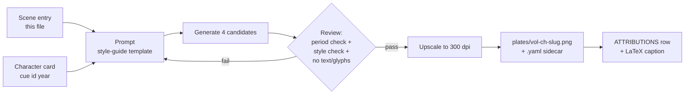

# Illustration Plan — Event Plates

**Status:** draft v1 (2026-10-21) · **Rules:** `illustration-style-guide.md` · **Scene research:** `critique/vol-*.md` §4 (anchors, period notes and cautions for about 120 candidate scenes) · **Recurring figures:** `registry/character-cards.yaml` (S-05)

## Sourcing: real first, generated second

For several events, **a genuine public-domain artwork of that very subject exists**, made by people of Polo's era or by his first readers. A real artifact always beats a generated imitation. It is the strongest possible plate, and it avoids manufacturing look-alike "artifacts". So each slot is one of:

- **PD:** a real public-domain artwork, reproduced with caption and provenance. *Check the image licence before print:* the work is PD, but some holders restrict commercial use of their scans (e.g. BnF Gallica). Prefer Wikimedia Commons copies with PD-Art tags.
- **GEN:** a generated plate in the regional tradition (style guide).

**Rule clarification:** the tradition follows **where the scene takes place**, not the chapter. Example: I-3's hero is set at Kublai's court, so it uses Yuan court painting even though the chapter starts in Acre.

**Count:** 41 hero slots (40 chapters + the Vol. II frontispiece): **34 GEN + 7 PD**, plus about 25 optional secondaries. That is roughly 34–59 plates to commission, plus 5 cutaway bases for the multimedia plan (C12–C16).

## Hero plates

**Recurring figures (S-05).** Every plate showing a recurring person takes that person's card from `registry/character-cards.yaml`: `tools/characters.py cue <id> <year>` gives the `[PERIOD]` and `[AVOID]` lines. The ages in the "must get right" column come from `tools/characters.py ages` (table in `registry/characters.md` § Plate ages); scenes with figures are listed in the cards file, so the co-presence check covers them.

Abbreviations:
- **JT** = *Jami' al-Tawarikh* (Ilkhanid);
- **LdM** = *Livre des merveilles* (BnF fr. 2810), used as the marvel lens;
- **YC** = Yuan court painting;
- Format: **P** portrait 3:4 · **L** landscape 4:3 · **H** handscroll 3:1.

### Volume I — *From Venice to the Khan*

| Ch. | Hero scene | Src | Tradition | Fmt | Must get right | Caution in caption |
|---|---|---|---|---|---|---|
| I-1 | Marco dictating to Rustichello | GEN | Italian Gothic illumination | P | Rustichello a **layman**; loose quires, quill, ink-horn; a civic room, not a dungeon; *gonella* and mantle | Setting is tradition |
| I-2 | The brothers before Kublai | **PD** | LdM miniature of the Polos at the Khan's court | P | — | European imagining, c. 1410 |
| I-3 | "Sire, 'tis my son and your liegeman" | GEN | YC | L | Kaiping c. 1275; timber hall on a platform; oil flask and papal letters; Kublai about 60 | Prologue theatre |
| I-4 | The quay at Layas | GEN | Cilician Armenian illumination | P | Sea castle; lateen ships; spice and cotton bales; Italian and Armenian merchants | — |
| I-5 | Hulagu shuts the Caliph in the treasure tower | GEN | LdM marvel lens | P | Abbasid black robes; Mongol lamellar armour | Exemplum: Muslim sources differ |
| I-6 | Marco questions the townsfolk at the Magi tombs of Saba | GEN | Ilkhanid (JT) | L | Brick domed tombs; Persian dress | Local tradition |
| I-7 | Marco escapes the Caraunas in the darkness | GEN | Ilkhanid (JT) | L | **Dust storm**, not magic; mud-walled village; date palms | Uncorroborated personal claim |
| I-8 | The Dry Tree alone on the plain | GEN | LdM marvel lens | P | A single *chinar*; passing caravan | Legendary landmark |
| I-9 | The balas-ruby mines under royal seal | GEN | Ilkhanid (JT) | L | Badakhshan highland dress; oil lamps; officers sealing stones | — |
| I-10 | Crossing the Pamier: wild sheep and a fire that won't cook | GEN | Persianate (JT) | H | *Ovis poli*; snow plateau | Omit the horn cairns (Ramusio-only) |
| I-11 | The straggler hears spirit voices in the Lop desert | GEN | **Dunhuang Mogao murals** (Yuan caves 3 and 465) | L | Night dunes; lone rider; phantom caravan faint | Folklore; "cavalcade" is Ramusio |
| I-12 | Cane divination before Chinggis's battle | GEN | Ilkhanid (JT) | L | Nestorian clerics, split canes, psalter; 1203 | Book theatre; site and date wrong |
| I-13 | Mare's-milk libation as the court leaves Chandu | GEN | YC | H | White mares; shamans and lamas; cane palace with silk guy-cords and gilt dragon columns | — |

### Volume II — *The Realm of Kublai*

| Ch. | Hero scene | Src | Tradition | Fmt | Must get right | Caution in caption |
|---|---|---|---|---|---|---|
| II-front | Frontispiece: portrait of Kublai | **PD** | Yuan imperial portrait album (NPM Taipei) | P | — | — |
| II-1 | Kublai on the elephant-borne tower at the Nayan battle | GEN | YC (Liu Guandao manner) | H | Kublai about 72 and heavy; white *tug* standard; modest host | Spectacle numbers inflated |
| II-2 | Elephants carry trees up the Green Mount | GEN | *jiehua* ruled-line architecture | H | Qionghua island, Taiye lake; green-tiled hall; **no Qing White Dagoba** | Polo's vignette |
| II-3 | The White Feast procession | GEN | YC | H | Everyone in white; tribute in nines; a *handful* of elephants and camels | "5,000 elephants" inflated |
| II-4 | Kublai hunting | **PD** | Liu Guandao, *Khubilai Khan Hunting* (1280) | H | — | Secondary GEN: "Sire! Look out for Cranes!" from the elephant litter |
| II-5 | Printing the Kaan's paper money | GEN | Yuan woodblock (*pinghua*) | L | Mulberry-bark sheets; vermilion seal; clerks | Pair with a PD photo of a real Zhiyuan note |
| II-6 | Caravan crossing the Pulisanghin bridge | GEN | Yuan landscape / *jiehua* | H | Jin bridge, 11 arches; archaic lions | Polo says 24 arches |
| II-7 | Green bamboo exploding in the night camp, Tebet marches | GEN | Dali kingdom scroll | L | Hobbled, hooded horses; Kham forest | — |
| II-8 | Battle of Vochan: dismounted archers vs war elephants | GEN | **Pagan temple murals** | L | Howdah castles breaking into the trees; dozens, not 2,000 | Numbers inflated |
| II-9 | Two great dogs hold a tiger at bay on the Cuiju road | GEN | Dali kingdom scroll | L | A **tiger** (the Book says "lion") | — |
| II-10 | Song envoys surrender the seal to Bayan, 1276 | GEN | Southern Song academy (elegiac) | P | Lin'an outskirts; Empress Dowager Xie's envoys | Book compresses events; no "Hundred Eyes" |
| II-11 | Counterweight trebuchet at Xiangyang | GEN | Ilkhanid (JT siege idiom, apt for Persian engineers) | L | Hinged box counterweight; Song walls across the Han | **No Venetians**: the Polos weren't there |
| II-12 | Trackers haul a junk up the Kiang | GEN | Yuan landscape | H | Bamboo hawsers; Golden Island monastery | — |
| II-13 | Pleasure barges on the West Lake | GEN | Song–Yuan city-genre scroll | H | Leifeng Pagoda; **no Qing pavilions** | Ramusio's description |
| II-14 | Zayton harbour: junks unloading pepper | GEN | Song–Yuan city-genre scroll | H | Quanzhou ship type; Kaiyuan stone pagodas; Arab and Tamil merchants | 100:1 ratio is rhetoric |
| II-15 | Aijaruc throws the prince | GEN | Ilkhanid (JT) | L | Kaidu's court; wagered horses | Folkloric; historical name Khutulun |

### Volume III — *Seas, Return, and After*

| Ch. | Hero scene | Src | Tradition | Fmt | Must get right | Caution in caption |
|---|---|---|---|---|---|---|
| III-1 | The 1281 typhoon wrecks the Yuan fleet | **PD** | *Mōko Shūrai Ekotoba* (c. 1293) | H | — | Secondary GEN: Chipangu's golden palace *as imagined* (LdM lens) |
| III-2 | Junks lift their rudders in the shoal strait | GEN | Javanese temple relief | L | Raisable axial rudders; mangrove coast; Malay perahu | — |
| III-3 | Five months stranded at Samara | GEN | Javanese / Sumatran relief | L | Junks at anchor; toddy-tappers; monsoon sky; a **modest** camp | Stockade and 2,000 men are Ramusio-only |
| III-4 | Pilgrims climbing Adam's Peak on iron chains | GEN | Polonnaruwa murals | P | Buddhist and Muslim pilgrims together | Dual tradition; don't resolve it |
| III-5 | Pearl divers and the shark-charmer | GEN | Chola temple mural | L | Gulf of Mannar boats; stone weights; Brahman charmer on deck | The charm is belief |
| III-6 | Corsair cordon off Malabar | GEN | Western Indian (Jain) palm-leaf | strip 4:1 | Smoke-signal relay; families aboard | — |
| III-7 | The rukh carrying off an elephant | **PD** | al-Qazwini, *'Aja'ib al-makhluqat* | P | — | Legend; Aepyornis in caption |
| III-8 | The wind-catchers of Hormos at noon | GEN | Baghdad school (al-Wasiti) | L | Old mainland Hormuz; *bād-gīr* towers as a type | — |
| III-9 | Kublai gives the Polos golden tablets; Cocachin and the fleet | GEN | YC | H | 'Phags-pa paiza; Cocachin **unmarried: braids, no *boqta*** (S-05); Cublay c. 75; 13 junks | Port and year (1291 vs 1292) debated |
| III-10 | Jewels ripped from the seams of the Tartar coats | GEN | Venetian Gothic | P | 1295 Veneto-Byzantine interior; **no Salute domes** | Ramusio's legend |
| III-11 | Columbus's annotated copy | **PD** | Postils, Biblioteca Colombina (or the 1477 Creussner woodcut) | P | — | Annotation date debated |
| III-12 | Caravan of the Catalan Atlas (1375) | **PD** | Cresques workshop | H | — | Often read as the Polos; that is uncertain |

### Secondary plates (optional, about 25; pick after the heroes)

- **Vol. I:**
  - Dawn at Curzola (I-1)
  - Golden tablet given (I-2)
  - Friars turn back at Layas (I-3)
  - Mountain moves at the cobbler's prayer (I-5, LdM)
  - Stitched ships of Hormos (I-7; also cutaway C13)
  - Garden of the Old Man (I-8, LdM)
  - Jade gatherers of Cotan (I-10)
  - Reclining Buddha at Campichu (I-11, after the real Zhangye Dafo Si)
  - Steppe camp with ger-carts (I-12)
  - Kublai with a leopard on his crupper (I-13)
- **Vol. II:**
  - Cranes from the litter (II-4)
  - Yam runner with bells (II-5)
  - Roofed bridge market, Sindafu (II-6)
  - Salt-cake money (II-7)
  - Fire alarm in Kinsay (II-13)
  - Silkie fowls (II-14)
  - Dog-sledge post (II-15)
- **Vol. III:**
  - Chipangu imagined (III-1, LdM)
  - The "unicorn" split panel: LdM unicorn vs a Sumatran rhino (III-3)
  - Relics arrive at Cambaluc (III-4)
  - Arab horses landed in Maabar (III-5)
  - Diamond valley (III-6, LdM)
  - Cocachin's farewell (III-9, JT)
  - Marco's will, 1324 (III-10)
  - Fra Mauro at his map (III-11; or PD of the map itself)

## Pipeline



The review step uses the scene's "must get right" and "caution" columns as a checklist. Usual failures:
- garbled script appearing anyway;
- Ming/Qing architecture in Yuan scenes;
- European ships in Asian harbours;
- the wrong number of people (crowds where the text implies a few).

## Pilot (before commissioning all 34)

Three plates across very different traditions test whether the chosen generator can hold a regional idiom at all:

**Pilot 1 — I-7, Ilkhanid**

```
[SCENE] Mounted Carauna raiders emerge from a brown dust-darkness on a plain of
        date palms; a small party of Venetian merchants on horseback flees toward
        a mud-walled village; one young rider looks back.
[STYLE] Painted in the manner of Ilkhanid Persian manuscript painting, Rashid
        al-Din's Jami' al-Tawarikh (Tabriz, c. 1306–14): horizontal band
        composition, Chinese-influenced swirling sky, mineral pigments on paper,
        figures with Mongol-type faces, minimal ground line, red and ochre accents.
[PERIOD] Mongol-era riders in lamellar coats and fur-trim hats; Venetians in
        travel tunics and hooded cloaks; Kerman date palms; sun-dried brick walls.
        The young rider is Marco, about 18: slim, dark-haired, at most a first
        beard, a merchant's belt-purse, no paiza; the two older Venetians are
        bearded, one heavy-set and greying (Niccolò), one lean with a long dark
        beard (Maffeo). Franks as the JT shows them: bareheaded or soft caps.
        (S-05 cards: tools/characters.py cue marco 1272)
[FORMAT] Landscape 4:3, paper ground, light even aging, framed rule border.
[AVOID] legible text or inscriptions, signatures, seals, modern objects,
        photographic realism, magical effects (it is a dust storm), a paiza
        or knightly arms on the Venetians.
```

**Pilot 2 — II-13, Song–Yuan city-genre scroll**

```
[SCENE] Roofed pleasure barges glide on West Lake; boatmen pole from the roof
        decks; a family party feasts at the open windows; temples and willows on
        the far shore; the brick Leifeng Pagoda on its hill.
[STYLE] Painted in the manner of a Song–Yuan city-genre handscroll in the
        Qingming shanghe tu tradition: ink and light colour on silk, fine line,
        high oblique viewpoint, mist bands separating scenes, many small
        figures in daily activity.
[PERIOD] Southern Song / early Yuan dress (round-collared robes, soft caps);
        Song timber architecture; no Ming/Qing pavilions or queues.
[FORMAT] Handscroll 3:1, silk ground, light even aging.
[AVOID] legible text, seals, colophons, signatures, Qing-style architecture,
        photographic realism.
```

**Pilot 3 — III-5, Chola mural**

```
[SCENE] Pearl divers leap from small boats into a green gulf, net bags at their
        waists and stones in hand; on the lead boat a Brahman charmer chants with
        raised hands while merchants watch; sharks circle below.
[STYLE] Painted in the manner of Chola temple murals (Brihadishvara, Thanjavur):
        flat ochre, red, green and black, strong outline, figures in profile
        and three-quarter view, frieze-like registers, plaster ground.
[PERIOD] 13th-century Tamil coastal dress (dhoti, bare torso, sacred thread on
        the Brahman); Gulf of Mannar boats.
[FORMAT] Landscape 4:3, plaster ground with light even weathering.
[AVOID] legible script, deities as decoration, modern objects,
        photographic realism.
```

Judge each pilot plate on idiom fidelity, period errors, and whether a reader could mistake it for a real artifact (the caption must prevent that). Lock the generator and settings only after all three pass.
