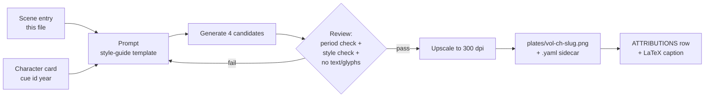

# Illustration Plan — Event Plates

**Status:** Hero plates and cutaway diagrams placed and proofed (2026-11-23) · **Rules:** `illustration-style-guide.md` · **Scene research:** `critique/vol-*.md` §4 (anchors, period notes and cautions for about 120 candidate scenes) · **Recurring figures:** `registry/character-cards.yaml` (S-05)

## Sourcing: real first, generated second

For several events, **a genuine public-domain artwork of that very subject exists**, made by people of Polo's era or by his first readers. A real artifact always beats a generated imitation. It is the strongest possible plate, and it avoids manufacturing look-alike "artifacts". So each slot is one of:

- **PD:** a real public-domain artwork, reproduced with caption and provenance. *Check the image licence before print:* the work is PD, but some holders restrict commercial use of their scans (e.g. BnF Gallica). Prefer Wikimedia Commons copies with PD-Art tags.
- **GEN:** a generated plate in the regional tradition (style guide).

**Rule clarification:** the tradition follows **where the scene takes place**, not the chapter. Example: I-3's hero is set at Kublai's court, so it uses Yuan court painting even though the chapter starts in Acre.

**Licences (S-11, 2026-11-10):** sources, masters, captions and credit lines for every PD slot are in `registry/pd-sources.md`. BnF scans need a paid licence for commercial print, so I-2 and III-12 use free facsimiles instead (user's decision, 2026-11-10): Omont's 1907 monochrome reproduction for I-2, the Library of Congress's 1959 hand-coloured facsimile for III-12. III-7 found no commercial-use source and is now GEN.

**Placed and proofed:** 41 hero plates (35 generated and 6 historical reproductions) for 40 chapters and the Vol. II frontispiece, plus all five multimedia cutaway diagrams (C12–C16).

The [November 23 proof snapshot](status/visual-placement-2026-11-23.md) records the placements and links to their chapter anchors. The [November 25 editorial review](status/visual-placement-2026-11-23.md#editorial-review--25-november-2026) records the revised plates, caption qualifications, and the decision to leave the fleet draft unplaced.

## Hero plates

**Recurring figures (S-05).** Every plate showing a recurring person takes that person's card from `registry/character-cards.yaml`: `tools/characters.py cue <id> <year>` gives the `[PERIOD]` and `[AVOID]` lines. The ages in the "must get right" column come from `tools/characters.py ages` (table in `registry/characters.md` § Plate ages); scenes with figures are listed in the cards file, so the co-presence check covers them.

Abbreviations:
- **JT** = *Jami' al-Tawarikh* (Ilkhanid);
- **LdM** = *Livre des merveilles* (BnF fr. 2810), used as the marvel lens;
- **YC** = Yuan court painting;
- Format: **P** portrait 3:4 · **L** landscape 4:3 · **H** handscroll 3:1.

### Volume I — *From Venice to the Khan*

| Ch. | Hero scene | Src | Tradition | Fmt | Must get right | Caution in caption |
|---|---|---|---|---|---|---|
| I-1 | Marco dictating to Rustichello | GEN | Italian Gothic illumination | P | Rustichello a **layman**; loose quires, quill, ink-horn; a civic room, not a dungeon; *gonella* and mantle | Setting is tradition |
| I-2 | The brothers before Kublai | **PD** | LdM fol. 2v, the Polos at the Khan's court, from Omont's 1907 monochrome facsimile (pl. 3) | L, half width | — | European imagining, c. 1410; credit the 1907 facsimile |
| I-3 | "Sire, 'tis my son and your liegeman" | GEN | YC | L | Kaiping c. 1275; timber hall on a platform; oil flask and papal letters; Kublai about 60; S-22 cue C1 | Prologue theatre |
| I-4 | The quay at Layas | GEN | Cilician Armenian illumination | P | Sea castle; lateen ships; spice and cotton bales; Italian and Armenian merchants | — |
| I-5 | Hulagu shuts the Caliph in the treasure tower | GEN | LdM marvel lens | P | Abbasid black robes; Mongol lamellar armour; S-22 cue C6 | Exemplum: Muslim sources differ |
| I-6 | Marco questions the townsfolk at the Magi tombs of Saba | GEN | Ilkhanid (JT) | L | Brick domed tombs; Persian dress | Local tradition |
| I-7 | Marco escapes the Caraunas in the darkness | GEN | Ilkhanid (JT) | L | **Dust storm**, not magic; mud-walled village; date palms | Uncorroborated personal claim |
| I-8 | The Dry Tree alone on the plain | GEN | LdM marvel lens | P | A solitary tree and passing caravan; plane is one interpretation, species disputed | Legendary landmark; exact site and species uncertain |
| I-9 | The balas-ruby mines under royal seal | GEN | Ilkhanid (JT) | L | Badakhshan highland dress; oil lamps; officers sealing stones | Balas rubies are spinels. Mining and dress are conjectural. |
| I-10 | Crossing the Pamier: wild sheep and a fire that won't cook | GEN | Persianate (JT) | H | *Ovis poli*; snow plateau. Omit the horn cairns (Ramusio-only). | Clothing and pack train are conjectural. |
| I-11 | The straggler hears spirit voices in the Lop desert | GEN | Dunhuang wall painting | L | Night dunes, lone rider, faint phantom caravan. The landscape and traveller are conjectural. | The ghostly caravan follows Ramusio. The traveller and landscape are imagined. |
| I-12 | Cane divination before Chinggis's battle | GEN | Ilkhanid (JT) | L | Nestorian clerics, split canes, psalter; 1203; S-22 cue C5, C6 | Book theatre; site and date wrong |
| I-13 | Mare's-milk libation as the court leaves Chandu | GEN | YC | H | White mares; shamans and lamas; cane palace with silk guy-cords and gilt dragon columns; S-22 cue C1, C2, C3 | — |

**S-16 caption sources:** Alamut: distinguish Maymundiz and Alamut surrenders as Daftary dates them (`daftary2000khorshah`); identify the garden as a legend (`virani2021garden`). Shangdu: UNESCO's 25,000 ha is the protected property, not the palace footprint (`unesco2012xanadu`). The I-13 libation scene is Polo's report; detailed ritual staging remains an illustration, not independently confirmed.

### Volume II — *The Realm of Kublai*

| Ch. | Hero scene | Src | Tradition | Fmt | Must get right | Caution in caption |
|---|---|---|---|---|---|---|
| II-front | Frontispiece: portrait of Kublai | **PD** | Yuan imperial portrait album (NPM Taipei) | P | — | — |
| II-1 | Kublai on the elephant-borne tower at the Nayan battle | GEN | YC (Liu Guandao manner) | H | Kublai about 72 and heavy; white *tug* standard; modest host; S-22 cue C3, C5 | Spectacle numbers inflated |
| II-2 | Elephants carry trees up the Green Mount | GEN | *jiehua* ruled-line architecture | H | Qionghua island, Taiye lake; green-tiled hall; **no Qing White Dagoba** | Polo's vignette |
| II-3 | The White Feast procession | GEN | YC | H | Everyone in white; tribute in nines; a *handful* of elephants and camels; S-22 cue C1, C2, C8 | "5,000 elephants" inflated |
| II-4 | Kublai hunting | **PD** | Liu Guandao, *Khubilai Khan Hunting* (1280), a hanging scroll | P | — | Secondary Omont 1907, pl. 47, reproduces the later French elephant-litter scene |
| II-5 | Printing the Kaan's paper money | GEN | Yuan woodblock (*pinghua*) | L | Mulberry-bark sheets; vermilion seal; clerks; check printing-block material for the scene | Pair with the licensed photo of a Zhiyuan plate and sheet; sheet's age unverified |
| II-6 | Caravan crossing the Pulisanghin bridge | GEN | Yuan landscape / *jiehua* | H | The printed plate follows the 1698 Kangxi rebuilding, with eleven arches and lion-topped posts. | Earlier accounts give thirteen arches. Polo gives twenty-four and describes columns resting on lower lions. [Printed caption](../vol-2/ch-06-pulisanghin-sindafu.md#fig-ii-6-pulisanghin-bridge) |
| II-7 | Green bamboo exploding in the night camp, Tebet marches | GEN | Dali kingdom scroll | L | Hobbled, hooded horses; Kham forest | Clothing, tack, and camp arrangement are conjectural. |
| II-8 | Battle of Vochan: dismounted archers vs war elephants | GEN | **Pagan temple murals** | L | Howdah castles breaking into the trees; dozens, not 2,000 | Numbers are inflated and identification is debated. Towers, equipment, and dress are conjectural. |
| II-9 | Two great dogs hold a tiger at bay on the Cuiju road | GEN | Blue-green scroll interpretation from a Dali scroll brief | L | A **tiger** (the Book says "lion") | Onlookers and dress are imagined. |
| II-10 | Song envoys surrender the seal to Bayan, 1276 | GEN | Southern Song academy (elegiac) | P | Lin'an outskirts; Empress Dowager Xie's envoys | Book compresses events; no "Hundred Eyes" |
| II-11 | Counterweight trebuchet at Xiangyang | GEN | Ilkhanid (JT siege idiom, apt for Persian engineers) | L | Hinged box counterweight; Song walls across the Han | The siege ended in 1273. Keep the Polos out of the scene. The engine and dress are conjectural. |
| II-12 | Trackers haul a junk up the Kiang | GEN | Yuan landscape | H | Bamboo hawsers; Golden Island monastery | — |
| II-13 | Pleasure barges on the West Lake | GEN | Song–Yuan city-genre scroll | H | Barges and lakeside pavilions. The placed pilot uses a generic tower. For a revision, verify Leifeng Pagoda and keep the architecture within the Song–Yuan brief. | Ramusio supplies the fuller account. The architecture is imagined. |
| II-14 | Zayton harbour: junks unloading pepper | GEN | Song–Yuan city-genre scroll | H | Quanzhou ship type; Kaiyuan stone pagodas; Arab and Tamil merchants | 100:1 ratio is rhetoric |
| II-15 | Aijaruc throws the prince | GEN | Ilkhanid (JT) | L | Kaidu's court; wagered horses; S-22 cue C5, C6 | Folkloric; historical name Khutulun |

### Volume III — *Seas, Return, and After*

| Ch. | Hero scene | Src | Tradition | Fmt | Must get right | Caution in caption |
|---|---|---|---|---|---|---|
| III-1 | Takezaki Suenaga's men board a Yuan ship, 1281 | **PD** | *Mōko Shūrai Ekotoba* (c. 1293), scroll 2, Kyushu University copy | H | — | The scroll paints the fighting, not the typhoon (S-11: no storm scene exists). Secondary GEN: Chipangu's golden palace *as imagined* (LdM lens) |
| III-2 | Junks lift their rudders in the shoal strait | GEN | Javanese temple relief | L | Raisable axial rudders; mangrove coast; Malay perahu | — |
| III-3 | Five months stranded at Samara | GEN | Javanese / Sumatran relief | L | Junks at anchor; toddy-tappers; monsoon sky; a **modest** camp | Wooden defences appear in F and V; 2,000 men and ditches appear in Z and Ramusio. The scene illustrates textual accounts; no period Samara camp reference is established. |
| III-4 | Pilgrims climbing Adam's Peak on iron chains | GEN | Polonnaruwa murals | P | Buddhist and Muslim pilgrims together | Dual tradition; don't resolve it |
| III-5 | Pearl divers and the shark-charmer | GEN | Chola temple mural | L | Gulf of Mannar boats; stone weights; Brahman charmer on deck | The charm is belief |
| III-6 | Corsair cordon off Malabar | GEN | Western Indian (Jain) palm-leaf | strip 4:1 | Fire or smoke relay. Family aboard a corsair craft. | Vessel forms, clothing, handheld signals, and close spacing are conjectural. |
| III-7 | The rukh carrying off an elephant | GEN | Persian *'aja'ib* painting (al-Qazwini manuscripts); S-11 found no PD copy free for commercial use | P | Elephant in the bird's talons; sea and coast below | Legend; Aepyornis in caption |
| III-8 | The wind-catchers of Hormos at noon | GEN | Baghdad school (al-Wasiti) | L | Old mainland Hormuz; *bād-gīr* towers as a type; S-22 cue C7 | Tower forms draw on later examples. The harbour ship and rig are conjectural. |
| III-9 | Cocachin’s court farewell and the Polos’ two tablets | GEN | YC | H | Two blank gold *paiza* for the three Polos. Cocachin **unmarried: braids, no *boqta*** (S-05), Cublay c. 75, S-22 cues C1 and C4. | Venue and staging are conjectural. The Polos’ participation rests on their account. Map A16 and Diagram C11 cover the voyage. |
| III-10 | Jewels ripped from the seams of the Tartar coats | GEN | Venetian Gothic | P | 1295 Veneto-Byzantine interior; **no Salute domes**; S-22 cue C8 | Ramusio tradition: not a documented homecoming |
| III-11 | Columbus's annotated copy | **PD** | Postils, Biblioteca Colombina (CC BY-SA photograph); alternative: the 1477 Creussner woodcut in Dibdin's 1822 facsimile | P | — | Notes by Columbus and his circle; dates and hand(s) visible in the crop uncertain. Do not imply the copy or postils were used before 1492; credit photographer. [Caption](registry/pd-sources.md) |
| III-12 | Caravan of the Catalan Atlas (1375) | **PD** | Cresques workshop, from the LoC 1959 hand-coloured facsimile | H | — | Often read as the Polos; that is uncertain. Its inscription says it left Sarai for Cathay. Credit as a facsimile: its colours are not the original's |

### Printed secondary plates

- **II-3:** [The Khan at table](../vol-2/ch-03-feasts-keshican.md#fig-khan-at-table), from Omont 1907, pl. 43, after fr. 2810, fol. 39r.
- **II-4:** [The elephant litter](../vol-2/ch-04-hunt-traffic.md#fig-elephant-litter), from Omont 1907, pl. 47, after fr. 2810, fol. 42v. Polo supplies the crane and cast.

### Optional secondary candidates

- **Vol. I:**
  - Dawn at Curzola (I-1)
  - Golden tablet given (I-2)
  - Friars turn back at Layas (I-3)
  - Mountain moves at the cobbler's prayer (I-5, LdM)
  - Stitched ships of Hormos (I-7; also cutaway C13)
  - Garden of the Old Man (I-8, LdM)
  - Jade gatherers of Cotan (I-10)
  - Reclining Buddha at Campichu (I-11, after the real Zhangye Dafo Si)
  - Steppe camp with ger-carts (I-12)
  - Kublai with a leopard on his crupper (I-13)
- **Vol. II:**
  - Yam runner with bells (II-5)
  - Roofed bridge market, Sindafu (II-6)
  - Salt-cake money (II-7)
  - Fire alarm in Kinsay (II-13)
  - Silkie fowls (II-14)
  - Dog-sledge post (II-15)
- **Vol. III:**
  - Chipangu imagined (III-1, LdM)
  - The "unicorn" split panel: LdM unicorn vs a Sumatran rhino (III-3)
  - Relics arrive at Cambaluc (III-4)
  - Arab horses landed in Maabar (III-5)
  - Diamond valley (III-6, LdM)
  - Cocachin's farewell (III-9, JT)
  - Marco's will, 1324 (III-10): caption “Marco Polo’s will, dated 9 January 1324, provided for his family and freed Pietro, described as of the Tartars.” The manuscript survives at the Marciana, Cod. Lat. V, 58 (=2437), no. 33 (Bartoli Langeli’s 2019 edition). Do not imply Pietro came from Asia with Marco or that the pictured witnesses and setting are documented; S-15 #19.
  - Fra Mauro at his map (III-11; or PD of the map itself, from Naya's 1873 photographic facsimile, since a Marciana image carries an Italian heritage fee: `registry/pd-sources.md`)
- **Licence note (S-11):** a secondary that reproduces a real LdM miniature takes it from Omont's 1907 facsimile, which has all 265 (free, monochrome); a BnF scan would need the paid licence. GEN plates in the LdM idiom need neither.

## Pipeline



Generation routes, per-plate tasks and the full review checklist (S-10): `tasks/cross/PLT-plates.md`, `image-generation-guide.md` and `illustration-style-guide.md` § Review checklist.

The review step uses the scene's "must get right" and "caution" columns as a checklist. Usual failures:
- garbled script appearing anyway;
- Ming/Qing architecture in Yuan scenes;
- European ships in Asian harbours;
- the wrong number of people (crowds where the text implies a few).

## S-10 pilot

The pilot tested whether the available generators could reproduce three distinct regional idioms.

**Pilot 1 — I-7, Ilkhanid**

```
[SCENE] Mounted Carauna raiders emerge from a brown dust-darkness on a plain of
        date palms; a small party of Venetian merchants on horseback flees toward
        a mud-walled village; one young rider looks back.
[STYLE] Painted in the manner of Ilkhanid Persian manuscript painting, Rashid
        al-Din's Jami' al-Tawarikh (Tabriz, c. 1306–14): horizontal band
        composition, Chinese-influenced swirling sky, mineral pigments on paper,
        figures with Mongol-type faces, minimal ground line, red and ochre accents.
[PERIOD] Mongol-era riders in lamellar coats and fur-trim hats; Venetians in
        travel tunics and hooded cloaks; Kerman date palms; sun-dried brick walls.
        The young rider is Marco, about 18: slim, dark-haired, at most a first
        beard, a merchant's belt-purse, no paiza; the two older Venetians are
        bearded, one heavy-set and greying (Niccolò), one lean with a long dark
        beard (Maffeo). Franks as the JT shows them: bareheaded or soft caps.
        (S-05 cards: tools/characters.py cue marco 1272)
[FORMAT] Landscape 4:3, paper ground, light even aging, framed rule border.
[AVOID] legible text or inscriptions, signatures, seals, modern objects,
        photographic realism, magical effects (it is a dust storm), a paiza
        or knightly arms on the Venetians.
```

**Pilot 2 — II-13, Song–Yuan city-genre scroll**

```
[SCENE] Roofed pleasure barges glide on West Lake; boatmen pole from the roof
        decks; a family party feasts at the open windows; temples and willows on
        the far shore; the brick Leifeng Pagoda on its hill.
[STYLE] Painted in the manner of a Song–Yuan city-genre handscroll in the
        Qingming shanghe tu tradition: ink and light colour on silk, fine line,
        high oblique viewpoint, mist bands separating scenes, many small
        figures in daily activity.
[PERIOD] Southern Song / early Yuan dress (round-collared robes, soft caps);
        Song timber architecture; no Ming/Qing pavilions or queues.
[FORMAT] Handscroll 3:1, silk ground, light even aging.
[AVOID] legible text, seals, colophons, signatures, Qing-style architecture,
        photographic realism.
```

**Pilot 3 — III-5, Chola mural**

```
[SCENE] Pearl divers leap from small boats into a green gulf, net bags at their
        waists and stones in hand; on the lead boat a Brahman charmer chants with
        raised hands while merchants watch; sharks circle below.
[STYLE] Painted in the manner of Chola temple murals (Brihadishvara, Thanjavur):
        flat ochre, red, green and black, strong outline, figures in profile
        and three-quarter view, frieze-like registers, plaster ground.
[PERIOD] 13th-century Tamil coastal dress (dhoti, bare torso, sacred thread on
        the Brahman); Gulf of Mannar boats.
[FORMAT] Landscape 4:3, plaster ground with light even weathering.
[AVOID] legible script, deities as decoration, modern objects,
        photographic realism.
```

The pilot assessed idiom fidelity, period errors, and whether a reader could mistake the image for a historical artifact.

*S-10 result (2026-11-10):*
- **Passed:** Pilot 2 (II-13) and Pilot 3 (III-5) with Akool Flux Krea plus a negative prompt (`media/plates/`).
- **Failed:** Pilot 1 (I-7). The model draws Safavid-style turbaned riders, not *Jami' al-Tawarikh* Mongols, in 8 of 8 seeds.
- **Ilkhanid, resolved the same day:** Gemini chat with `media/plates/prompts/I-7-chat.txt` plus one corrective follow-up passed for I-7. The pilot informed the original routes in the plate ledger. The sidecars identify the generator used for each placed master.

## S-17 caption and object handoff (2026-11-11)

The CUHK catalog (`cuhkzhiyuanblocks`) describes *bronze* Zhiyuan printing blocks for 200 and 500 *wen*. It does not establish that an individual block was made in exactly 1287, nor identify the familiar 2-*guan* image; check a selected object's catalog and image rights before reproducing it. The Met paiza (`metpaiza1993256`) is late thirteenth-century iron with silver inlay, not Marco's identifiable personal tablet. These are caption references, not authorization to reuse images.

S-17 left the Jin-era bridge details open. The November 23 production review documented which features belong to the 1698 rebuilding and how the caption should describe the different arch counts. [Production findings](registry/visual-references.md#exemplum-divination-bridge-and-shore-camp--production-findings-23-november-2026)

## S-22 period cues (2026-11-13)

**Supplement reference leads:** The Met's helmet 1999.158 and *Mongol with Horse and Camel* 47.18.139 have catalogue records but uncertain date/attribution for these scenes; see `registry/visual-references.md` § Supplement. No image was inspected for this handoff and no new cue is authorized. For III-04, Khalili MSS 727 fol. 34a is a later Ilkhanid Buddhist-subject image to inspect for a possible secondary, not evidence for Polo's version.

**Gap-source ledger (2026-11-13, later):** six more draft cues, C43–C48: a Genoese counting house, a harbour with galleys and round ships, a council room, the trebuchets and camp at Savona in 1227, Singhasari temple dress, and a sea-chart prop. They are in `registry/visual-references.md` § Gap-source ledger and are **not** copied here until accepted. The same section adds `[AVOID]` lines for the Ekotoba's 18th-century Mongol figures and Morgan M.500's restored folios. It also records that no ger-cart image before 1350, no Xiangyang engine, and no in-window image of Badakhshan, the Pamir, Lop, Adam's Peak or pearl diving was found.

Eight `[PERIOD]` lines worded from period objects or museum descriptions (not from any modern work); C8 comes from a museum description and its textile has not been viewed. A row's "Must get right" cell names the cues that apply to it; paste those lines into the prompt's `[PERIOD]` block after the scene's own cues. A recurring figure's card (`tools/characters.py cue`) wins over a cue line where they differ. Sources, what was and was not viewed, and limits: `registry/visual-references.md` § Draft `[PERIOD]` cues.

| Cue | Source seen | Line |
|---|---|---|
| C1 Mongol court men | Met 1992.54 (c. 1330–32) | `[PERIOD] Mongol court men: long robe with a crossed collar; a short-sleeved outer robe over an under-robe whose long red sleeves carry gold dragon-and-cloud brocade; small rounded pale hat with a narrow brim and a knob on top; hair in looped braids hanging behind each ear.` |
| C2 Married court women | Met 1992.54; Diez A fol. 70 | `[PERIOD] Married Mongol court women: the tall red boqta, a close cap that hides all the hair and rises in a narrow column flaring to a flat top; long pearl pendants hanging from the ears to the chest; a very wide red-orange robe with gold pattern and a patterned band along the crossed collar.` |
| C3 Khubilai outdoors | *Khubilai Khan Hunting* (1280) | `[PERIOD] The Khan on horseback: a white fur coat flecked with black tufts, dark fur collar and cuffs, over a red robe patterned in gold; a red-topped cap; a dark, stocky horse with a round blue saddle-cloth.` |
| C4 A court woman riding | *Khubilai Khan Hunting* | `[PERIOD] A court woman on horseback wears no tall headdress: a plain white robe, a small dark cap with a red band, hair in looped braids at the ears.` |
| C5 Hunt and riders | *Khubilai Khan Hunting* | `[PERIOD] Riders unarmoured in long belted robes, brimmed hats and boots; bow in a case and arrows in a quiver, both hung from the belt at the hip; horses small and stocky, with red tassels on the breast-strap and crupper and round saddle-cloths; a falconer with a white falcon on a gloved fist; a spotted hunting cat sitting on a striped pad on a horse's croup behind its handler; one rider carrying a tall pole topped with a black tuft.` |
| C6 Mongol court in Persian drawing | Diez A fol. 70, p. 23 | `[PERIOD] Ruler and consort seated side by side on a wide, low-backed throne with bolster cushions, set on a low platform; court women standing in ranks, each in a tall plumed boqta; men in brimmed hats with feathers, looped braids at the ears, long belted robes, some holding sabres or staffs; a low table with long-necked flasks and cups; a kneeling cupbearer offering a bowl.` |
| C7 Sea-going ship of the Gulf | BnF Arabe 5847, image f248 | `[PERIOD] A double-ended planked hull with raked stem and stern; a stern rudder worked by lines; one mast with a lookout's box at the masthead; a small domed cabin amidships; a four-fluked grapnel anchor hanging at the bow; turbaned passengers at a row of arched ports; dark-skinned crew in waist-cloths hauling ropes and bailing with jars.` |
| C8 Cloth of gold | Cleveland 1989.50, museum description only | `[PERIOD] Gold-on-silk cloth patterned with pairs of winged lions in touching roundels, griffins in the spaces between.` |
| C23 A lord's camp (comparandum) | Met 1973.120.3, Ming copy (early 15th c.) of a 12th-c. composition; Khitan dress (viewed) | `[PERIOD] A lord's camp on the steppe: a round domed felt tent with a square flap at the crown and a white scalloped valance under the roof, set inside a rectangle of tall cloth screens on poles; in front, an open cloth pavilion on posts with guy-ropes over a carpet; furled banners racked on a stand outside; a two-wheeled cart with tall red spoked wheels, a railed body and a pitched canopy parked beside it.` |
| C24 Dragon cloth | Met 2012.399, "late 13th–14th century" (viewed) | `[PERIOD] Cloth with a blue-green ground woven in gold: scalloped roundels each holding a coiled five-clawed dragon chasing a pearl, set in rows over a fine honeycomb field; the roundels in the next row hold birds among flowers.` |
| C25 Gilt silver service | Met 1997.33.1–.6, "late 13th–early 14th century" (viewed) | `[PERIOD] Silver tableware gilded in the engraving: a scalloped-rim dish with a bamboo-and-flower design in a central ring, a stem-cup standing on a scalloped saucer, a small deep conical cup; the gilding lies in the engraved pattern and the field stays silver.` |
| C26 Ritual wine cup | Met 2020.122, dated 1294 (viewed) | `[PERIOD] A bronze ritual wine cup: a wide flaring mouth with a long pouring lip, a narrow waist banded with relief ornament, a small ring handle ending in an animal head, three tall splayed legs.` |
| C27 Lacquer box | Met 2015.500.1.21, "late 13th–14th century" (viewed) | `[PERIOD] A round lidded box of black lacquer moulded in tall rounded lobes like a melon or lotus bud, the seams picked out in thin pewter wire, a small round medallion set in the centre of the lid.` |
| C28 Armenian soldiers | Walters W.539, fol. 116v, 1262 (viewed) | `[PERIOD] Cilician Armenian soldiers: pointed steel-blue caps, some with a nose-guard; tall spears with three-pronged heads and red tufts below the blade, carried in a bundle; a round dark shield; a curved sword raised; one man in a padded or scaled tunic with a skirt, red leggings and boots; the rest in long belted robes of blue and green with grey hoods.` |
| C29 A feast in an Armenian court | Walters W.539, fol. 66r, 1262 (viewed) | `[PERIOD] A seated ruler in a blue patterned robe with red, crowned, on a chair at the end of a round dark table set with red dishes and a lit candle, a fringed cloth hanging to the floor; attendants in rose tunics, one with a sword; domed red roofs, blue arched doorways, a red curtain hung across the top.` |
| C30 Riders in cloaks | Walters W.539, fol. 19r, 1262 (viewed) | `[PERIOD] Riders at the gallop: three haloed figures in red cloaks on grey horses with red harness, an escort behind them in pointed helmets carrying tall spears with pennants.` |
| C31 A writer at work (comparandum) | Smithsonian F1956.11 (inferred), Evangelist page, 1263 (viewed) | `[PERIOD] A bearded writer seated in a high-backed chair with a patterned cushion and a footstool, leaning over a codex held open on a sloped stand and writing with a pen; behind him a red cloth draped from a hook, and a small tower with a conical blue-tiled roof and an arched blue window; a gold ground.` |
| C32 Armenian men's civil dress | Smithsonian F1932.18 (inferred), 2nd half 13th c. (viewed) | `[PERIOD] Armenian townsmen in Biblical dress: long full robes in purple, blue and green, a darker cloak over the shoulders; full beards; heads covered by a hood or by a cloth wound in pink and blue with an end hanging down the back; low dark shoes; a mount drawn as a grey donkey with a red saddle-cloth.` |
| C33 A meal at table | Smithsonian F1932.18 (inferred) (viewed) | `[PERIOD] Diners seated shoulder to shoulder behind a long table covered with a green cloth and set with round dishes, a domed tower behind them.` |
| C34 Paiza (safe-conduct tablet) | Met 1993.256, late 13th c. (viewed) | `[PERIOD] A safe-conduct tablet (paiza): a flat round plaque of dark metal with a cusped crest at the top bearing a fierce, wide-eyed face between curling forms, and a hinged ring for hanging; the plaque carries five vertical lines of raised silver script (Phags-pa).` |
| C35 Ilkhanid phoenix tile | Met 12.49.4, late 13th c. (viewed) | `[PERIOD] A square wall tile of the Persian Mongol court: a phoenix in flight with long wavy tail feathers in white and turquoise among spiral clouds on a dark ground, over a frieze of palmettes and flowers in blue, turquoise and white lustre; Chinese motifs in Persian tilework.` |
| C36 Persian man and woman, 1266 | Cleveland 1915.524, dated 1266 (viewed) | `[PERIOD] A seated Persian couple, both haloed, with a cypress between them and birds at their shoulders: the man bearded, in a long robe patterned with roundels, a cup in his hand; the woman beside him in a robe patterned in a honeycomb of hexagons, her hair parted; a band of Persian verse round the star.` |
| C37 Ilkhanid horsemen, c. 1299 | Cleveland 1944.480, c. 1299 (5 yr later) (viewed) | `[PERIOD] Mounted warriors of the Persian Mongol world: round helmets with a gold rim and a ring of blue studs framing the face; coats in horizontal bands of gold and brown with blue and red stripes; black quivers of black-feathered arrows at the back; a curved sabre raised; horses black, white and grey, a saddle with a pale rounded pommel and red cloth.` |
| C38 Palace halls (comparandum) | Cleveland 1915.704, "1271–1368" (viewed) | `[PERIOD] A palace compound seen from above: rows of halls under dark grey tiled roofs with upturned ridge ends and gabled fronts, a tall two-tier hall at the back, lattice windows, raised terraces joined by long ramped walkways, blue-grey cloth screens hung in doorways, small figures in pale robes in the courtyards.` |

- **Dates:** C1, C2 and C6 come from objects of c. 1300–1332; C3–C5 from 1280; C24–C27 from objects dated late 13th–14th century, C26 exactly 1294; C28–C33 from Cilician Armenian Gospels of 1262–63 and the second half of the 13th century; C34 and C35 late 13th century; C36 dated 1266; C37 c. 1299 (four years after the window); C38 "1271–1368".
- **C23–C27 (viewed 2026-11-13 through the Met's open-access images).** C23 is a layout comparandum only: a Ming copy of a Song picture of Khitan-style nomads, so take camp layout, not Mongol dress. C24 and C8 are different cloths (Chinese dragon roundels against Central Asian winged lions). The faded ground of C24 may not be its original colour.
- **C13 size is wrong.** The Quanzhou report (Green 1997, ch. 4) reconstructs about 28 m by 10 m, not 34.6 m; C13 is also not a cue. See `research/results/S-23-gaps-intake.md`.
- **C28–C38 (viewed 2026-11-13).** C28–C33 are Gospel scenes, not merchants or a quay; C31 serves I-1 for posture and furniture only (the writer is a haloed Evangelist, Rustichello is a layman); C31–C33 come from user screenshots taken to be Smithsonian F1956.11 and F1932.18 by inference, not by label. C34 is an iron plaque, not the gold tablets Polo names. C37 is c. 1299 and a small miniature. C38's roofs are dark grey, not green glaze. Full limits are in `registry/visual-references.md`.
- **C17 is disproved:** the Lady Wenji scroll (Met 1973.120.3) shows no tent on a cart. The ger-cart rests on Rubruck's text alone; do not use C17.
- **Rejected cues C9–C20 have been removed from this active table.** Their source descriptions failed intake and must not be used; the [intake](research/results/S-22-followup-intake.md) and raw report preserve the record. A different source or an independently checked object is needed before drafting replacements.
- **I-5** takes C6 for Mongol court figures only. Verify armour against the S-23 gap-source ledger before drawing it.
- **II-4** is a PD plate of the painting itself; the accompanying litter miniature comes from Omont pl. 47. C4 and C5 remain costume and tack comparisons.
- **III-6** gets no ship cue from C7: it is a Gulf ship, not a west-Indian one. No stitching is visible in C7.
- **`[AVOID]` candidates**, to adopt with the S-22 use rules: late samurai armour and curved katana in 1274 · the Forbidden City or a yellow-tiled Ming hall for Dadu · the bent-pole Turkic yurt for a Mongol ger · fur-and-leather "barbarian" dress for Mongol nobles · loose hair or tiaras for Mongol court women.
