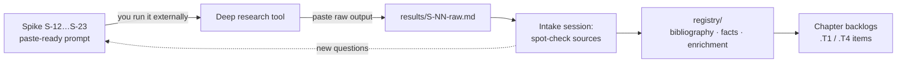

# Phase R — References and enrichment (deep research)

The manuscript's scholarship stops at Yule–Cordier (1903–1920) plus a set of modern names cited "by well-known position": Larner, Vogel, Haw, Wood, Pelliot, Moule, Rossabi, Allsen, de Rachewiltz, Critchley, Olschki, Jackson. It has no bibliography. Nothing it cites postdates 2013, and several of its corrections rest on the critics' general knowledge (see S-06).

This phase sends ten questions to an external deep-research tool, brings the answers back, checks them, and turns them into four things:
- a real bibliography;
- verified facts;
- updated scholarship;
- a pool of enrichment material (asides, Notes, trivia, plate captions) for the re-voice.

## How it works

1. **Run.** Copy the prompt block from the spike verbatim into the research tool. Each prompt is self-contained, because the tool cannot see this repo. If the tool asks clarifying questions, answer from the spike's *Question* and *Why it matters*.
2. **Return.** Paste the full output, untouched, into `results/S-NN-raw.md`. Add one header line: tool, model and date. If the tool gives a source list separately, paste that too. Never edit the raw file afterwards; it is the audit trail.
3. **Intake** (one session per spike, in this repo). Run the trust checks below, then write the outputs the spike names into `registry/`. Update the chapter backlogs and close the spike with the usual checklist (`plans/README.md` § Closing a spike).
4. **Follow-ups.** A gap or contradiction in the results becomes a short follow-up prompt, saved in the spike under *Follow-up prompts*. It is not a guess written into the manuscript.

## Trust rules (intake)

Deep-research output is a **lead, not a source**. Nothing reaches the manuscript on the tool's word alone.

| Check | Rule |
|---|---|
| Every cited work | Must exist. Resolve the DOI, URL, publisher page or library catalogue record (WorldCat or similar). If it doesn't resolve, mark it `unconfirmed` and don't use it. |
| Quotations | Use one only if you or the intake session can see the passage: in `refs/`, an open-access scan, or a publisher preview. Otherwise paraphrase it and attribute the position. |
| Page numbers | Keep the voice-guide rule: none unless seen in the source. Tool-supplied page numbers count as unseen. |
| Contested claims | Record each side with its named proponent. The tool's own verdict is never the verdict. |
| Dates and numbers | Two independent sources, or one primary source, before a ✓. |
| Wikipedia and blogs | Can lead you to a source; never cited in the book. |
| Newer than Yule | Wherever a modern source contradicts Yule–Cordier, record both. The Note says which one the book follows and why. |

Each intake session spot-checks at least **10 citations or all of them, whichever is fewer**, and writes the hit rate in the spike's *Findings*. If fewer than 80% check out, re-run the prompt with a stricter instruction rather than salvaging the output.

## Where things land

| File | What | Fed by |
|---|---|---|
| `results/S-NN-raw.md` | Raw tool output, never edited | each spike |
| `registry/bibliography.bib` | BibTeX master for the LaTeX build (`biblatex`); keys `authorYEARword`, e.g. `vogel2013marco` | S-12, then every spike adds to it |
| `registry/sources.md` | Human-readable index: key → full citation → status (`confirmed` / `unconfirmed`) → open-access link → used in | S-12 |
| `registry/facts.md` | Claim → verdict → source key → files affected (the S-06 sheet) | S-14 first; then S-15 … S-18 |
| `registry/enrichment.md` | Per-chapter candidates: new corroboration, archaeology, trivia, plate-caption facts, each with a source key and a suggested slot (aside / Note / back-matter / caption) | S-15 … S-21 |
| `registry/scholarship.md` | State of the field since 2013, by question: who argues what, and where | S-13 |

The registry files are created by the first spike that needs them.

## The output contract

Every prompt ends with the same contract, so results come back in a shape the intake can process mechanically. If you edit it, edit all the prompts. S-22 and S-23 (media references) use variant contracts with columns for works and visual problems; keep its rules clause in step.

> **OUTPUT FORMAT (required).** (1) A findings table with columns: `#` · claim or topic · finding · verdict (confirmed / corrected / disputed / not found) · sources (author, title, year, and DOI or stable URL) · confidence (high / medium / low) · book sections affected (use the IDs I give). (2) Under each table, short prose only where a disagreement needs explaining: name who holds which position. (3) A bibliography of every source you used, each with a BibTeX entry and a note on whether it is open access. (4) A list of questions you could not resolve. **Rules:** do not invent page numbers, quotations, DOIs or URLs; if you did not see a passage, paraphrase and say so. Prefer peer-reviewed scholarship, critical editions and museum or archive records over popular sites. Say "not found" rather than guess. Flag anything published after 2013 as **NEW**.

## Run order

The prompts are independent, so you can run them in any order or all at once. Intake order matters a little:

1. **S-12 first.** It sets the bibliography keys the others reuse.
2. **S-14 next.** It closes most of S-06 and unblocks the factual `.T1` items.
3. The rest in any order. A volume's enrichment spike (S-16, S-17, S-18) should come in **before that volume's W4 re-voice batch**, so the new material goes in during the rewrite rather than after it.

| Spike | Prompt focus | Main consumers |
|---|---|---|
| [S-12](../spikes/S-12-bibliography-editions.md) | Master bibliography, editions and translations | `registry/bibliography.bib`; `BLD`; back matter; citation policy |
| [S-13](../spikes/S-13-scholarship-update.md) | State of the field 2013–2026, including the 2024 anniversary | III-12, III-11, III-B1, I-01 |
| [S-14](../spikes/S-14-fact-verification-sweep.md) | The unverified-claims list | S-06; factual `.T1` in 15 files |
| [S-15](../spikes/S-15-venice-genoa-family.md) | Venetian and Genoese documents, the family, Rustichello, Pipino | I-01, I-02, III-10, `CHR` |
| [S-16](../spikes/S-16-overland-route.md) | Overland route: archaeology and identifications (Vol. I) | Vol. I chapters; `GAZ`; `MAP` |
| [S-17](../spikes/S-17-yuan-china.md) | Yuan institutions, cities and corroborations (Vol. II) | Vol. II chapters; `DIA`; `TBL` |
| [S-18](../spikes/S-18-maritime-return.md) | Ships, ports and the return voyage (Vol. III) | Vol. III chapters; `MAP`; `DIA` |
| [S-19](../spikes/S-19-primary-comparanda.md) | Comparative primary sources: best translations and citable passages | every Comparative clause; III-12 |
| [S-20](../spikes/S-20-reception-afterlives.md) | Manuscripts, print history, cartography, myths, modern afterlives | III-11, III-B1, I-B1, II-B1 |
| [S-21](../spikes/S-21-natural-history-marvels.md) | Natural history, commodities and marvels | trivia back matter; asides; `PLT` captions |
| [S-22](../spikes/S-22-media-visual-references.md) | Modern media as visual references: manga, anime, film, games, reconstruction art; and the sources behind them | `registry/visual-references.md`; plate `[PERIOD]` cues; S-05 costume; S-10 checklist |
| [S-23](../spikes/S-23-media-scouting.md) | Wide scouting for more media references (all markets, media and hero scenes); per-work deep-dive template | shortlist; scene coverage in `registry/visual-references.md`; S-10 |
