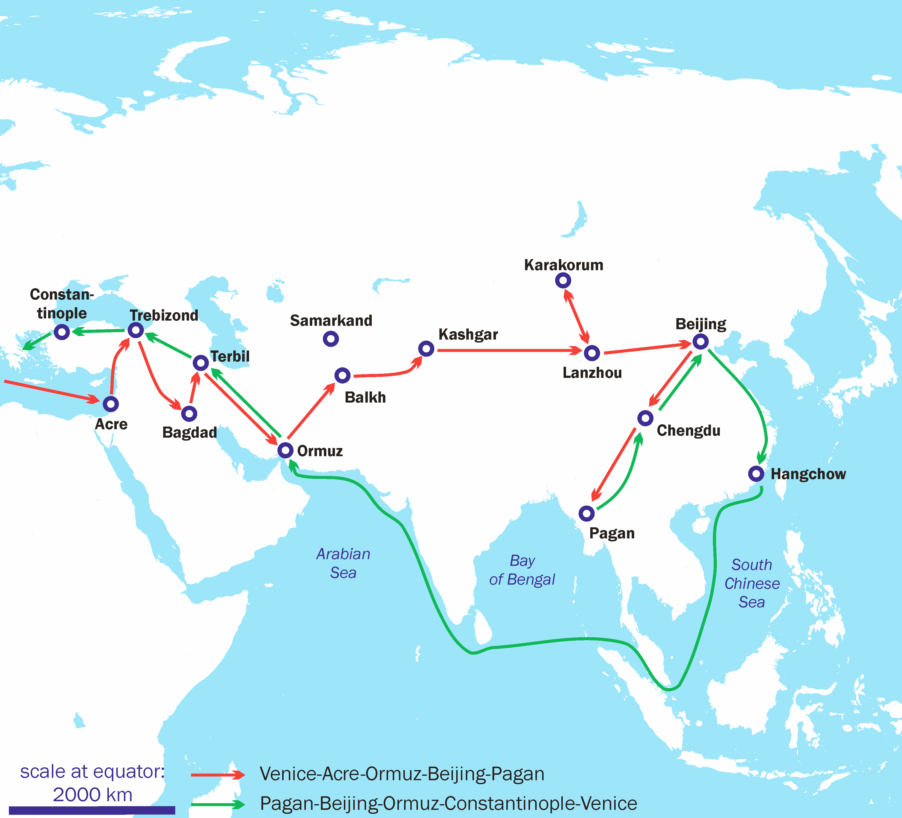

# Back Matter I-1
## Trivia and Disputes — Volume I

> *“…he had not told one-half of what he had really seen!”*
> — Jacopo d’Acqui, *Imago mundi* (c. 1330), in Yule–Cordier, Introduction, § 37

---

Volume I ends at Chandu, and readers usually leave with pockets full of questions. This companion gathers short trivia worth keeping and a plain list of disputed claims that the chapters flag inline. Think of it as the storyteller lingering after the lamp is trimmed — the part where someone at the table asks whether the Assassins’ garden was real.

### Trivia worth keeping

**The book has many books.** What English readers call Marco Polo is a family of manuscripts — Franco-Italian, Old French “Geographic” texts, Tuscan, Latin Pipino, and later Ramusio’s Italian print tradition. Benedetto and Moule–Pelliot mapped that family; Yule–Cordier still mediates it for many Anglophone readers. This retelling leans on Yule–Cordier while staying eclectic toward the Geographic Old French line; Ramusio’s banquet-and-jewels colour is marked when it appears, never silently absorbed as early fact [1].

**Rustichello of Pisa** is the prison collaborator named by tradition: a romance writer who helped turn Marco’s memories into a dictated book during a Genoese captivity in 1298, traditionally after Curzola (Korčula). How much polish is Rustichello’s chivalric ear and how much is Marco’s merchant memory remains a live scholarly sport. The collaboration explains why the Book sometimes sounds like a courtly “ye must know” and sometimes like a ledger of days and duties [2].

**Niccolò and Maffeo went first.** Young Marco did not invent the family’s eastern career. The elder voyage — Soldaia, Berke’s country, Bocara, the first audience, the golden *paiza*, the unfinished papal errand — is the Prologue’s spine. Marco inherits a commission, a household story, and a boyhood wait on the lagoon, not a blank map.

**Did Hormuz turn them around?** Yule inferred that the Polos meant to take ship at Hormos and gave it up; the book itself only says “let us return by another road to Kerman.” The stitched hulls and the deadly summer wind make the inference attractive, not certain. If they did turn back, that choice sent them through the Persian deserts toward the Pamir. Old Hormuz is mainland near Minab — not the later island city.

**Pamir enters Europe’s ear.** Polo is one of the first widely read Latin sources to make the Pamir plateau a named place for European audiences. Climbers and geographers still argue which cols fit his days’ journeys; the name’s European career is clearer than any single saddle.

**Spirit voices in the Lop.** The Desert of Lop’s false camps and calling spirits are among the book’s most haunting marvels. Similar desert-mirage and wind-voice motifs appear in other travellers; the motif is not unique, but Polo’s telling stuck in Europe’s nightmare geography.

**Prester John flickers at Tenduc.** Volume I’s Caracoron–Tenduc stretch folds Mongol origin history together with Christian-king legend. King George of Tenduc is a softer, more localised cousin of the old Prester John dream — useful as book colour, treacherous as geopolitics.

**Chandu before Cambaluc.** The Volume I climax is the summer court — bamboo palace, white horses, bacsi and sensin — not yet the full winter capital bureaucracy of Volume II. Readers who expect Beijing’s paperwork on the last page of Volume I are a volume early; they have arrived at the right empire’s door.

**Oil of the Sepulchre.** Among the stranger errands in the Prologue is the request for oil from the lamp at Jerusalem’s Holy Sepulchre. It is Latin piety attached to an eastern commission — easy to remember, hard to over-interpret as the whole meaning of the embassy.

### Disputed claims — a short list

**Curzola and the prison frame.** That Marco dictated the book in a Genoese prison in 1298 is the book’s own claim. Curzola as the battle is later tradition (Ramusio), which Yule accepted as the best fit for the year; Jacopo d’Acqui, the nearest witness, puts the capture at Ayas, under 1296. Exact capture circumstances, how long he sat, and whether every folio was born in one winter remain discussed. The prison frame is how Europe received the book; treat operational details as tradition, not as a naval logbook; see I-1, Notes 5–8 [3].

**Manuscript date “1250” for the elder crossing.** Many texts say 1250; that cannot stand beside a 1269 return and Marco aged fifteen. Yule’s correction to about 1260 is the working chronology here. Chronology quarrels will return whenever round years meet Ilkhanid or Yuan synchronisms; see I-2, Note 6 [4].

**The Great Khan’s conversion pledge.** The Prologue’s letter asking for a hundred learned Christians — and implying imperial conversion if they prevailed — has no surviving Mongol original. The request for skilled men and for oil of the Sepulchre is plausible diplomacy-plus-piety; the blanket baptism promise is the weak joint. Yule already doubted purely religious motives; de Rachewiltz’s administrative readings push the same way; see I-2, Notes 17–18 [5].

**Baudas and the mountain that moved.** The fall of the Caliph (Mostas’im) in 1258 is history. The pious “mountain miracle” tale attached to the Baudas material is another genre — wonder-story riding beside report. Whether the Polos personally lingered at Baghdad is debated; Cordier and Yule already hedge itinerary weight. Read the Caliph’s ruin as corroborated background; read the mountain’s obedience as medieval Christian marvel grammar; see I-5, Notes 7–15 and 22–28 [6].

**Old Man of the Mountain / Assassins.** Polo’s Alamut-flavoured legend of the Old Man, gardens of paradise, and devoted killers is folkloric storytelling about the Nizari Ismaili strongholds the Mongols had already broken. Alamut is the classic scholarly locus; Polo’s version is entertainment with a historical shadow, not a field report from inside the castle. The Assassins’ reputation in Latin and Persian sources is older than Marco; he inherits a thriller; see I-8, Notes 11–23 [7].

**Arbre Sec geography.** The Dry Tree is a landmark with deep medieval legendary roots (crusader and romance geography alike). Pinning it to one GPS coordinate in the Dasht-e Kavir / Tonocain country is guesswork dressed as cartography. Broad desert-edge localisation is as honest as the evidence gets; see I-8, Notes 7–10 [8].

**Great Wall silence (seed).** Polo never describes the Great Wall as modern tourists expect. That silence becomes a major quarrel in later volumes’ afterlives and in Frances Wood’s scepticism. Volume I only plants the seed: the outbound road enters Cathay through Tangut oases and court circuits, not through a single stone curtain set-piece. Full argument waits for Volume III’s reception chapters and the reliability essay. Do not let the seed grow into a verdict early; see I-11, Notes 25–26 [9].

**Visited vs reported in Book I.** Mausul, Baudas marvels, Camul customs, Caracoron history, Assassin legend — these often read as report layered into an itinerary. Balkh, Badashan, Pamier, Tarim oases, Lop, Tangut towns, Chandu read stronger as travel. The split is a judgement, not a record; chapter Notes use ✓ ~ ✗ ◇ ? for the same honesty in motion [10].

**Numbers and days’ journeys.** Forty days of desert, three years at Bocara, one year to the Khan — round literary numbers do real narrative work. Some will be roughly right; few should be sworn as a surveyor’s chain. Medieval days’-journeys compress with fear and expand with memory.

**Pipino’s first-meeting melodrama.** Some later Latin tradition heightens Niccolò’s 1269 return as a first sight of a son he had never seen. The early French understatement is preferred here; Pipino’s pathos is flagged when it appears, not promoted to fact; see I-2, Note 24.

{#fig-b6-book-vs-history}

---

## Notes

[1] ✓ The manuscript family typology was established by Benedetto [-@benedetto1928milione] and Moule and Pelliot [-@moule1938description; @pelliot1959notes], building on the Yule–Cordier introductions [@yc, Intro. §§ 56–66]. For Ramusio’s 1559 Italian redaction, see the Burgio–Simion critical edition [-@ramusio2015viaggi].

[2] ~ The collaboration between Marco Polo and Rustichello of Pisa in 1298 is grounded in the oldest Franco-Italian preamble [@yc, Prol. preamble; @eusebi2018devisement, p. 35]. How far Rustichello's Arthurian prose habits shaped individual scenes remains an active debate in modern textual scholarship [@larner1999marco, ch. 3; @andreose2024textual].

[3] ? Curzola (1298) is Ramusio’s capture tradition, accepted by Yule, whereas Jacopo d’Acqui places the capture at Ayas under 1296 (often read as the 1294 battle there, before the Polos’ return) [@yc, Intro. § 37; @bolognari2026venezia]. No surviving Genoese muster roll or prison register names Marco; see [Chapter I-1, Notes 5–8](ch-01-genoa-prison.md#notes).

[4] ~ The manuscript date “1250” for the elder brothers' crossing to Soldaia is chronologically untenable beside their 1269 return [@yc, Prol. 1 n. 1]. Yule’s emendation to about 1260 serves as the standard working date, while Haw proposes a slightly compressed timeline from Chagatai reign dates [@haw2006marco, ch. 3]; see [Chapter I-2, Note 6](ch-02-house-of-polo.md#notes).

[5] ? The Prologue's claim that Cublay promised baptism if a hundred Christian scholars proved their law superior is unlikely as literal Yuan policy [@yc, Prol. 7 n. 3]. Mongol rulers regularly recruited foreign religious and technical specialists without pledging dynastic conversion [@allsen2001culture, ch. 1]; see [Chapter I-2, Notes 17–18](ch-02-house-of-polo.md#notes).

[6] ~ Hulagu’s capture of Baghdad and the execution of the Caliph al-Mustaʿṣim in 1258 are firm historical events, whereas the starvation-in-the-treasure-tower story and the one-eyed cobbler's moving mountain belong to Eastern Christian legend [@yc, 1.15 n. 2; @yc, 1.16–17]. Whether the Polos visited Baghdad personally remains uncertain; see [Chapter I-5, Notes 7–15 and 22–28](ch-05-mausul-baudas.md#notes).

[7] ✗ Polo’s garden-of-paradise legend of the Old Man of the Mountain (Aloadin) is a folkloric romance attached to the Nizari Ismaili strongholds broken by Hulagu's forces in 1256 [@yc, 1.23–25]. The historical surrender of Alamut and Maymun-Diz differs sharply from the castle-and-garden thriller in the Book; see [Chapter I-8, Notes 11–23](ch-08-arbre-sec-old-man.md#notes).

[8] ? The Arbre Sec (*Solitary Tree* or *Dry Tree*) combines Khorasan frontier topography around Tun and Qāʾen with medieval Alexander romance lore [@yc, 1.22 nn. 1–2]. It marks a regional desert threshold rather than a single surveyed tree; see [Chapter I-8, Notes 7–10](ch-08-arbre-sec-old-man.md#notes).

[9] ? Polo’s silence on the Great Wall is a central point in Frances Wood’s [-@wood1995did, ch. 11] sceptical case, answered by Haw [-@haw2006marco, ch. 4], Larner [-@larner1999marco, ch. 3], and de Rachewiltz [-@derachewiltz1997marco; -@derachewiltz2002wood]. What decayed pre-Ming earthworks stood along his Tangut and Onggud approaches is weighed in [Chapter I-11, Notes 25–26](ch-11-lop-tangut.md#notes) and [Chapter III-12](../vol-3/ch-12-reliability-essay.md#misses-and-silences).

[10] ~ Distinguishing personally traversed stages from second-hand reports across Book I requires testing each chapter's geography, products, and manuscript variants [@yc, Intro. § 11]. The chapter Notes record those local verdicts step by step.
