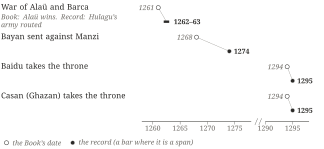

# Back Matter I-1
## Trivia and Disputes — Volume I

> *“I have not told the half of what I saw.”*
> — Jacopo d’Acqui, *Imago mundi* (c. 1330), reported deathbed words *(adapted)*

---

Volume I ends at Chandu (Shangdu), and readers usually leave with pockets full of questions. This companion gathers short trivia the chapters do not tell and a shortlist of disputed claims flagged inline.

### Trivia worth keeping

**The book has many books.** What English readers call Marco Polo is a family of competing manuscripts and later redactions; for how those texts divide and why this retelling works eclectically from them, see [Chapter III-12](../vol-3/ch-12-reliability-essay.md#method-visited-reported-mixed-manuscripts-the-ramusio-problem).

**Did Hormos turn them around?** Yule inferred that the Polos meant to take ship at Hormos (Hormuz) and gave it up; the book itself only says they returned by another road to Kerman. The stitched hulls and the deadly summer wind make the inference attractive, not certain [1].

**Pamier enters Europe’s ear.** Polo is one of the first widely read Western sources to make the Pamier (Pamir) plateau a named place for European audiences. Climbers and geographers still argue which cols fit his days’ journeys; the name’s European career is clearer than any single saddle.

**“Roof of the world.”** Readers who associate that phrase with Marco’s Pamier crossing are hearing a Victorian echo. In Yule’s commentary the words belong to Captain John Wood (1838), translating the Persian *Bam-i Dunya*, not to Polo’s medieval text [2].

**Spirit voices in the Lop.** The Desert of Lop’s false camps and calling spirits are among the book’s most haunting marvels. Similar wind-voice and mirage motifs appear in other travellers, yet Polo’s telling stuck in Europe’s nightmare geography.

**Prester John flickers at Tenduc.** Volume I’s Caracoron (Karakorum) to Tenduc stretch folds Mongol origin history together with Christian-king legend. King George of Tenduc is a softer, more localised cousin of the old Prester John dream — useful as book colour, treacherous as geopolitics.

**Chandu before Cambaluc.** Volume I closes at the summer court — bamboo palace, white horses, *bacsi* and *sensin* — not yet the winter capital bureaucracy of Volume II. Readers who expect Cambaluc’s (Beijing’s) paperwork on the last page are a volume early; they have arrived at the right empire’s door.

**Oil of the Sepulchre.** Among the stranger errands in the Prologue is the request for oil from the lamp at Jerusalem’s Holy Sepulchre. It is Latin piety attached to an eastern commission — easy to remember, hard to over-interpret as the whole meaning of the embassy.

### Disputed claims — a short list

**Curzola and the prison frame.** Dictation in Genoa (1298) is the book’s own claim; Curzola is Ramusio’s later tradition (accepted by Yule), whereas Jacopo d’Acqui puts the capture at Ayas under 1296; see I-1, Notes 5–8 [3].

**Manuscript date “1250.”** Untenable beside the 1269 return and Marco aged fifteen; Yule’s emendation to about 1260 is the working chronology here; see I-2, Note 6 [4].

**The Great Kaan’s conversion pledge.** No Mongol original survives; skilled envoys and Sepulchre oil fit Chinghizide diplomacy, whereas the blanket baptism promise is contested (Yule; de Rachewiltz, *Papal Envoys to the Great Khans*, 1971); see I-2, Notes 17–18 [5].

**Baudas and the mountain miracle.** The Caliph’s fall at Baudas (Baghdad) in 1258 is history; the moving-mountain story is Christian marvel grammar, and a personal visit remains uncertain; see I-5, Notes 11–16 and 17–28 [6].

**Old Man of the Mountain.** Polo’s garden-of-paradise thriller is folkloric romance attached to Nizari strongholds the Mongols broke in 1256, not an eyewitness report; see I-8, Notes 12–24 [7].

**Arbre Sec geography.** The Arbre Sec blends Khorasan desert-edge topography with Alexander romance; pinning it to one modern site is guesswork; see I-8, Notes 8–11 [8].

**Pipino’s first-meeting melodrama.** That Niccolò met his fifteen-year-old son for the first time in 1269 is Pipino’s Latin heightening, not early French tradition; see I-2, Note 24 [9].

For the full ledger of hits, misses, and silences across all three volumes, see [Chapter III-12](../vol-3/ch-12-reliability-essay.md).

{#fig-b6-book-vs-history}

---

## Notes

[1] ? The outbound sea plan at Hormos is Yule’s inference from the stitched hulls and summer heat rather than an explicit statement in the Book [@yc, 1.19; @yc, Intro. § 13 n. 13]. The mainland port near Minab is weighed in [Chapter I-7, Notes 17, 20, and 27](ch-07-kerman-hormos.md#notes).

[2] ✓ Yule quotes Captain John Wood’s [-@wood1841personal] *Bam-i Dunya* (“Roof of the World”) in his note on the Pamier plateau [@yc, 1.32 n. 2]; the phrase is Wood’s nineteenth-century English rendering, not Polo’s text.

[3] ? Curzola (1298) is Ramusio’s capture tradition, accepted by Yule, whereas Jacopo d’Acqui places the capture at Ayas under 1296 (often read as the 1294 battle there, before the Polos’ return) [@yc, Intro. § 37; @bolognari2026venezia]. No surviving Genoese muster roll or prison register names Marco; see [Chapter I-1, Notes 5–8](ch-01-genoa-prison.md#notes).

[4] ~ The manuscript date “1250” for the elder brothers’ crossing to Soldaia is chronologically untenable beside their 1269 return [@yc, Prol. 1 n. 1]. Yule’s emendation to about 1260 serves as the standard working date, while Haw proposes a slightly compressed timeline from Chagatai reign dates [@haw2006marco, ch. 3]; see [Chapter I-2, Note 6](ch-02-house-of-polo.md#notes).

[5] ? The Prologue’s claim that Cublay promised baptism if a hundred Christian scholars proved their law superior has no surviving Mongol original [@yc, Prol. 7 n. 3]. De Rachewiltz [-@derachewiltz1971papal] and Allsen [-@allsen2001culture, ch. 1] read Mongol recruitment of foreign specialists as administrative diplomacy rather than dynastic conversion; see [Chapter I-2, Notes 17–18](ch-02-house-of-polo.md#notes).

[6] ~ Hulagu’s capture of Baudas and the execution of the Caliph al-Mustaʿṣim in 1258 are firm historical events, whereas the starvation-in-the-treasure-tower story and the one-eyed cobbler’s moving mountain belong to Eastern Christian legend [@yc, 1.15 n. 2; @yc, 1.16–17]. Whether the Polos visited Baudas personally remains uncertain; see [Chapter I-5, Notes 11–16 and 17–28](ch-05-mausul-baudas.md#notes).

[7] ✗ Polo’s garden-of-paradise legend of the Old Man of the Mountain (Aloadin) is a folkloric romance attached to the Nizari Ismaili strongholds broken by Hulagu’s forces in 1256 [@yc, 1.23–25]. The historical surrender of Alamut and Maymun-Diz differs sharply from the castle-and-garden thriller in the Book; see [Chapter I-8, Notes 12–24](ch-08-arbre-sec-old-man.md#notes).

[8] ? The Arbre Sec (*Solitary Tree* or *Dry Tree*) combines Khorasan frontier topography around Tun and Qāʾen with medieval Alexander romance lore [@yc, 1.22 nn. 1–2]. It marks a regional desert threshold rather than a single surveyed tree; see [Chapter I-8, Notes 8–11](ch-08-arbre-sec-old-man.md#notes).

[9] ✗ Pipino-only. The claim that Niccolò left Venice before Marco was born and met him for the first time in 1269 rests on Pipino’s Latin, whereas the oldest French texts report only that the mother was dead and the son was fifteen [@yc, Prol. 9 n. 3]; see [Chapter I-2, Note 24](ch-02-house-of-polo.md#notes).
