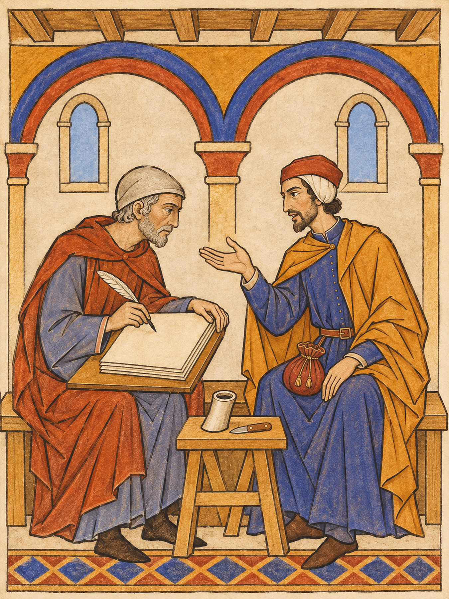

# Chapter I-1
## In a Genoese Prison: How This Book Was Made

> *“Take this Book and cause it to be read to you.”*
> — Marco Polo, Prologue, preamble (Yule–Cordier)

---

Someone has to read this Book aloud. The man speaking in its first lines expects to be heard by people who have a great deal else to do. Listen for the burgesses when he calls on his audience. They come in behind emperors and kings, but a man who makes a living by trade will find plenty here to reward his attention. The voice has travelled some way to reach them. The old French prologue places the merchant Marco Polo and the writer Rustichello of Pisa in prison in Genoa in 1298 [1].

How a Venetian merchant came to be there is a question the Book doesn't answer. Later tellers had a sea-fight in mind. First put yourself in the place of a man with a ship to send out from Venice.

In 1298 Venice and Genoa were at war again. For decades the two republics had fought over markets and honour from Acre to the Bosphorus. After Acre fell in 1291, the southern routes of Indian trade were half closed to the Franks, while Genoa’s strength in the Black Sea pressed on Venetian access to the northern roads by Trebizond (Trabzon) and Tana (on the Sea of Azov). In 1294 a Genoese convoy had already smashed a Venetian fleet in the bay of Ayas (Yumurtalık) [2]. By 1298 Genoa meant to strike Venice in her own waters [3].

Try reckoning the year's business before hearing what happened next. A ship that waits for safer weather may still take its cargo to market, even if its owner sells for less than he meant to. A ship kept in port by news of a hostile fleet has an owner paying for a crew he cannot send out. He needs people to tell him which ports he can still use. And the man who has borrowed against a cargo due to come in may find himself listening for a ship as anxiously as anyone waiting for a son.

The Genoese fleet went out under Lamba Doria. After Messina the galleys steered for the Adriatic; storm scattered them at the gulf’s mouth; then the admiral gathered some seventy sail, raided the Dalmatian shore, and fell on the island of Curzola (Korčula). The chief town was taken and burned. Word came that the Venetian fleet was in sight [4].

Venice answered with haste and pride. Andrea Dandolo sailed with a great armament; further galleys were raised until Venetian strength approached a hundred vessels. Among the gentlemen who commanded, according to the tradition that has shaped Polo’s biography ever since, was Messer Marco Polo of Venice, lately returned from long years in the East, serving as *sopracomito* — gentleman-commander — of a galley [5]. A man who backed a voyage could name the goods he stood to lose. A man putting out on one of Dandolo's crowded galleys had the vessel, the crew and his own skin to think about. The fortunes of the city would depend on how many ships came home.

On the afternoon of Saturday the sixth of September the fleets sighted one another near the eastern end of Curzola. Sunset was near; both sides waited for morning. Venetian report says the Genoese were staggered and sought terms; Genoese song denies it and remembers a council of captains who voted to attack. At dawn on Sunday the seventh the Venetians advanced with the wind behind them and the morning sun in their eyes. They struck hard and took ten Genoese galleys; then their own line broke into confusion. In the afternoon the missing ships of Doria’s fleet — fifteen or sixteen sail — appeared on the Venetian flank. The action was decided. Almost the whole Venetian armament fell into Genoese hands. Prisoners numbered more than seven thousand [6]. In Ramusio the prisoner is Marco Polo of San Giovanni Grisostomo [7].

— Jacopo d’Acqui also makes Marco a prisoner after a fight at sea, but places it at Ayas in 1296 [8]. There was a battle there in 1294. Moving the date to fit that battle would put the capture before the usual date of Marco’s return. The French preamble gives us a prison and a year. The best a reader can do with the battle is weigh the two stories.

{#fig-a18-adriatic-inset}

At dusk you might have thought the business was as good as decided. By the following evening most of the men who had come expecting to put a stop to a raid had a different port ahead of them. Count the ships, as the chroniclers do, and there are galleys to be valued, equipped and crewed again. Count the people and every ship has brought the victors men whose households have to discover what has happened to them.

The captives were carried west. Dandolo, in despair, is said to have refused food and ended his life; Genoa received the fleet on the evening of the sixteenth of October with public rejoicing. The returning captains had an audience. What it meant to come into Genoa in their company depends on whose account of the prisoners you read [9].

There, tradition says, he met Rustichello of Pisa, a man already known as a compiler of Arthurian romance. Years earlier he had abridged and rearranged tales of Tristan, Lancelot, and the Round Table from a book associated with Prince Edward of England. His French was the French of courts and prose romance: formulas of address to emperors and barons, set pieces of marvel and prowess, the industrious haste of a scribe who preferred fullness to perfect order [10]. Whether he had languished among the Meloria captives of 1284 — when Pisa’s manhood was swept into Genoese prisons — or had come into custody by some other turn, the oldest Polo preamble places him in the same prison as Messire Marc in the year 1298 [11].

One man could tell you what a merchant would buy in a port, what would pay its freight, or why a great ruler could print money on something lighter than the money you were used to. The other could make a hall full of knights stop for a speech. Put the two men together for a moment. The merchant has to find a way of telling someone who has never made the crossing why a place matters. The writer can bring him before a lord and give the listener a place in the audience. Franco-Italian, the language of the resulting book, can do both jobs [12]. The person who reads it aloud has the advantage of seeing which bits hold the room.

Day by day, as the tradition has it, Marco spoke of what he had seen with his own eyes and of what he had heard from men of credit; Rustichello set it in narrative succession. The preamble announces — at least as an ideal — that things seen would be set down as seen and things heard as heard only, so that no jot of falsehood might mar the truth of the book [13]. Whether that ideal was kept in every chapter is another question; later notes will say so chapter by chapter. It asks to be judged by that promise.

{#fig-i-1-genoa-dictation width=78%}

Yet the meeting of voices was never a simple transcription. The scribe who had once invited the world to delight in the adventures of errant knights now framed a merchant’s testimony with the same ceremonial music. The book opens with an address like the preambles to Rustichello’s romances [14].

:::: parallel-text

::: witness
**Franco-Italian · Witness F**

Seingnors, enperaor et rois, dux et marquois, cuens, chevalers et borgiois, […] si prennés cestui livre et le feites lire

BnF fr. 1116, fol. 4a, Prologue § 1. Eusebi’s critical text [-@eusebi2018devisement, p. 35], [CC BY 4.0](https://creativecommons.org/licenses/by/4.0/).
:::

::: witness
**English · Yule–Cordier**

Great Princes, Emperors, and Kings, Dukes and Marquises, Counts, Knights, and Burgesses! […] take this Book and cause it to be read to you.

Prologue, opening address [@yc, Prol. preamble].
:::

::::

The address promises the countries of the East, beginning with Greater Hermenia (Armenia), and says that there has never been anyone since Adam who has seen or learnt as much about the world. The Book allows its Venetian a good twenty-six years to acquire such knowledge [15]. Listen to the time it takes to read out those names and titles before he even gets the two brothers out to sea.

— Those superlatives are worth a brief aside. Imagine the same voice introducing a knight at a strange court. Larner heard the resemblance between the Great Kaan’s welcome and the welcome given to Tristan in Rustichello’s romance [16]. The turn of a sentence can make a court you know only by report feel as familiar as the one where an old story left you.

Between them, merchant and romancer made something neither could have made alone: a geography that could sit beside a chanson, a merchant’s memory dressed for the court. Peace came sooner than Meloria’s Pisans had known it. On the twenty-fifth of May 1299 ambassadors of Venice and Genoa signed terms, mediated by Matteo Visconti of Milan — equal and reciprocal — from which one may gather that Curzola had wounded Venetian pride more than Venetian power [17]. The Doge ratified the treaty on the first of July; before the end of August, it is reasonable to believe, Marco Polo was restored to the family mansion in the parish of San Giovanni Grisostomo [18]. A separate truce between Genoa and Pisa at the end of July 1299 freed what remnant of Pisan prisoners remained. Among them, no doubt, was Rustichello — though that is inference, not a release roll with his name [19]. The man who wrote the Book leaves no certain later life. The man who spoke it left testimony in Venice in 1301 that may help to place him in the city as early as October 1298. That is Bolognari’s reading of a transaction mentioned in the testimony [20].

For the book did not wait upon libraries. Copies moved as books then moved: lent, recopied, dictated again, translated, abbreviated, enlarged by scribes who loved a fuller marvel. Within a generation the Dominican Francesco Pipino of Bologna would turn a version into Latin for clerical readers and preface it with assurances of the traveller’s Christian faith. Chroniclers would speak of the Venetian called *Milione* — as Jacopo d’Acqui has it, a name suggesting wealth beyond counting. Manuscripts in French, Tuscan, Venetian and Latin would reshape episodes, omit others, and sometimes add colour the prison winter never knew [21]. Andreose places the early Franco-Italian witness among manuscripts copied at Genoa by Pisan prisoners and traces subsequent reworkings in Venice [22]. Ramusio, centuries later, would dress the Genoese captivity with a kindly local gentleman who helped the writing — likely a distorted memory of the Pisan scribe whose name Ramusio strangely ignored [23].

A copy read in a new place could acquire another detail. A man interested in what a mission could do in the East might copy the churches and the number of Christians he was told were there. A man who wanted a winter evening's reading might give more space to the emperor's welcome or the story of a ruler and his treasure. Give the same words to two people who read for different reasons and see which pieces of the story they choose to carry away. Try to work backwards through the versions and you reach related texts and layers of revision, with the first writing in Genoa beyond recovery [24].

| Witness | Capture or place claimed | Independent evidence | Verdict |
|---|---|---|---|
| Old French preamble / F | Marco in Genoa prison in 1298; Rustichello also in prison | Peace and prison context fit the 1298–99 period | ✓ Genoa captivity; ? exact prison and meeting |
| Jacopo d’Acqui | Captured at Ayas in 1296, then held in Genoa | A Genoese victory at Ayas in 1294 | ? Place disputed, with a proposed change to the date |
| Pipino | Dominican Latin reception of the captivity tradition | No separate capture record identified here | ? tradition only |
| Ramusio | Marco captured at Curzola in 1298 | Curzola was fought 7 September 1298 and brought prisoners to Genoa | ~ / ◇ later tradition fills a place not named by F |
| Yule–Cordier | Curzola accepted as the best fit for the received Genoese-captivity story | Chronicles and verse describe the battle and prisoners | ~ accepted editorial fit, not proven presence |

Now let the reader turn the page and get to the Venetian house that sent two brothers with jewels to trade across the Greater Sea.

---

## Notes

[1] ~ The French preamble places Marco and Rustichello together in prison in Genoa and gives 1298 as the year of composition. It leaves the daily method of working open [@yc, Prol. preamble].

[2] ✓ Yule discusses the chronology of Genoa’s victory in the bay of Ayas in 1294 [@yc, Introduction, § VI, § 31]. That action cost Venice a valuable merchant convoy in Cilician waters and deepened the commercial war that led to the Adriatic campaign of 1298.

[3] ✓ Yule draws on the chronicles and Genoese verse for the war and the conditions of Venetian commerce [@yc, Introduction, § VI]. After the loss of Acre in 1291, competition over the Black Sea and Levantine termini turned every fleet movement into a struggle for survival.

[4] ✓ Yule reconstructs Doria’s route, the storm and the burning of the town from the chronicles and verse [@yc, Introduction, § VI, §§ 32–33]. Raiding Curzola forced the Venetian fleet to give battle on the Dalmatian coast.

[5] ? The early French preamble places Marco in a Genoese prison in 1298 without naming a battle or naval rank. His service as *sopracomito* (gentleman-commander) of a galley at Curzola comes from later Venetian biographical tradition, notably Ramusio, combined with inference from the year [@yc, Introduction, § 33, § 37].

[6] ✓ The battle was fought on 7 September 1298. Yule compares the Venetian and Genoese reports of the engagement and gives the reported haul of prisoners [@yc, Introduction, § VI, §§ 34–35].

[7] ~ Ramusio’s account makes the capture part of the Curzola tradition. The early French preamble supplies neither the battle nor a command at sea [@yc, Introduction, § 37].

[8] ? Jacopo places the capture at Ayas and dates it to 1296, where the known battle of 1294 is the proposed substitution. Yule rejects the place while allowing the notice some weight as an early account of capture, and Bolognari discusses the chronology [@yc, Introduction, § 37; @bolognari2026venezia].

[9] ~ Yule places the arrival on 16 October 1298 and gives the rival accounts of the prisoners’ treatment. Dandolo’s reported death after refusing food belongs to the same reconstruction [@yc, Introduction, § VI, § 35].

[10] ✓ Paulin Paris, Yule, and Benedetto [-@benedetto1928milione] identify Marco's collaborator with the Arthurian romance compiler “Maistre Rusticien de Pise” [@yc, Intro. § 37]. Both the romance compilation and the Franco-Italian *Devisement* open with the same distinctive address to emperors, kings, dukes, and burgesses.

[11] ~ Meloria captivity since 1284 is a fair conjecture rather than a documented fact: Cigni makes a contextual case that Rustichello was among the Pisan prisoners taken at Meloria, though no individual capture roll names him [-@cigni2017rustichello]. The oldest Polo preamble places him in the Genoa prison with Marco in 1298 [@yc, Prol. preamble].

[12] ✓ The preamble survives in the Franco-Italian literary register of the early manuscript tradition [@eusebi2018devisement, p. 35]. That hybrid French served across northern Italy as a prestige language for secular prose and chivalric storytelling.

[13] ~ The preamble announces a method of distinguishing things seen from things heard [@yc, Prol. preamble]. It sets the standard of eyewitness and reported testimony by which the whole Book asks to be judged.

[14] ✓ The public address stands in witness F and appears at the head of Yule’s translation [@eusebi2018devisement, p. 35; @yc, Prol. preamble]. See the parallel-text box in this chapter for the Franco-Italian wording alongside Yule's English.

[15] ~ The comparison with Adam and the twenty-six years in the East belong to the preamble's opening claim about the traveller’s unequalled experience [@yc, Prol. preamble]. From the 1271 departure to the 1295 homecoming runs twenty-four years, rounded up in the opening flourish.

[16] ~ Larner [-@larner1999marco, chs. 3, 5] defends the 1298 Genoa collaboration and argues that Rustichello cast Marco’s geography in the conventions of Arthurian prose, noting that the Great Kaan’s welcome echoes Tristan’s arrival at Camelot in Rustichello’s *Meliadus*. He also suggests Rustichello shaped the self-promoting Yangzhou and Saianfu episodes while Marco’s own commercial and administrative matter stayed largely impersonal. How far that literary shaping extends remains debated, as romance diction can colour set-pieces even where the underlying notice is mercantile.

[17] ✓ On 25 May 1299 Venice and Genoa signed peace terms mediated by Matteo Visconti of Milan [@yc, Introduction, § 36]. The treaty was equal and reciprocal and provided for the mutual release of prisoners.

[18] ~ The Doge ratified the treaty on 1 July 1299; Polo’s return to San Giovanni Grisostomo by the end of August is a reasonable inference from the ratification dates, not a dated document. The exact day is unknown [@yc, Introduction, § 36].

[19] ~ A separate Genoa–Pisa truce at the end of July 1299 freed the remaining Pisan prisoners [@yc, Introduction, § 36]. That Rustichello left Genoa under that truce is an inference rather than a surviving release roll bearing his name.

[20] ? Bolognari reads Marco’s February 1301 testimony about a payment in October 1299 as implying a contract made in October 1298, and infers Marco’s presence in Venice then. The reported testimony supplies an argument about his whereabouts [@bolognari2026venezia].

[21] ✓ Pipino’s Latin and Jacopo’s notice attest early circulation. The dates of Pipino’s work are discussed in Chapter III-10 [@yc, Introduction, § 18, § 37].

[22] ✓ Andreose places witness F among French manuscripts copied by Pisan prisoners at Genoa and traces subsequent reworkings in Venice [@andreose2024textual]. That workshop setting explains how copies could begin circulating quickly in both French and Italian dialects.

[23] ? Ramusio-only in Yule. Ramusio supplies a Genoese gentleman as helper. The early French preamble names the Pisan writer Rustichello [@yc, Introduction, § 37; @yc, Prol. preamble].

[24] ? The textual witnesses preserve separate versions, with differences in what they give and the order in which they give it. The early stages of their relationship remain debated [@benedetto1928milione; @moule1938description; @dutschke1993francesco; @andreose2024textual].
