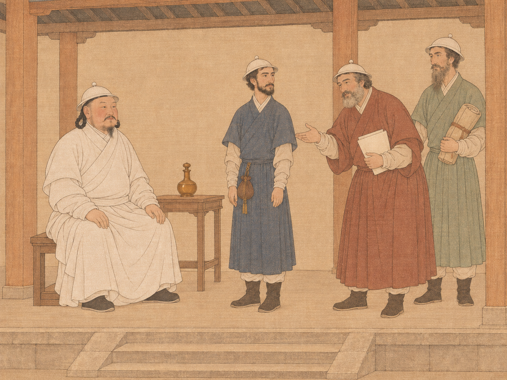

# Chapter I-3
## The Second Setting-Forth: Pope, Oil, and the Boy Marco

> *“…’tis my son and your liegeman.”*
> — Marco Polo, Prologue, ch. 14 (Yule–Cordier)

---

The cardinals at Viterbo are still shut up with the question of who will be Pope. In Venice, Niccolò Polo has to decide how much longer a promise to an emperor can be left waiting on their deliberations. There is a new member of the party this time. Marco, the son he found at home when he came back, is about seventeen by the usual reckoning when the three leave in 1271 [1].

First to Acre (Akko), where the brothers have already put their case to Tedaldo Visconti, Archdeacon of Liège. The Book calls him a legate. The title is disputed, but he is in a position to let the Polos go about the half of the commission they can fulfil themselves. They ask to go up to Jerusalem for oil from the lamp at the Sepulchre [2].

Picture the smallest item the brothers mean to carry back across Asia. A blessing from the Sepulchre lamp was something pilgrims had taken away before, and the place where it burnt was worth a journey of its own. Here, though, the oil has a particular customer: Cublay (Kublai) had asked for it, and no one in Jerusalem needs to know quite how far the flask is going [3].

Back at Acre, the brothers have a second request. They mean to set out, and they would like something to show for the time spent waiting. Tedaldo has letters drawn up to explain their predicament to the emperor. A seal can attest to their good faith, even if they must carry it in place of the answer they came for [4].

A letter carried by hand takes the same beating as everything else in a pack. Think of the man looking after it at each landing and each departure: the lamp oil is no use to him on the road, and the writing bears a message he has no authority to alter. Both things become precious again only when they reach the person who asked for them.

At Ayas (Yumurtalık) word catches up with them. Their archdeacon was elected Pope on 1 September 1271 and has taken the name Gregory X [5]. Imagine how that news sounded to men who had just declared themselves tired of waiting. Worse — or better — he wants them back in Acre. The ruler of Lesser Hermenia (Cilician Armenia) supplies a galley for the turnabout [6].

— A Venetian waiting in Ayas could find a resident bailie appointed to look after his country's business. That official belongs to the history of the port, and his presence reminds us how ordinary a Venetian arrival could be in a story so fond of extraordinary ones [7].

This time the meeting in Acre takes the form the brothers had hoped for. Gregory receives them, hears the errand, and writes his answer. The emperor had asked for a hundred learned Christians; the Pope provides two Dominicans, Niccolò (Nicolas) of Vicenza and William of Tripoli. William had written on Islam and dedicated his work to the very man now sending him east [8]. In Ramusio, there are delicate gifts to pack as well — vessels of crystal for the emperor — and the friars carry powers to ordain bishops and give absolution in the Pope's place [9].

It comes to very little at Ayas. Bundukdar (Baibars), the Mamluk sultan, marches against Hermenia just as the travellers land [10]. The Dominicans promptly decide to turn back with the Master of the Temple. The brothers take over the credentials, and the party is down to three Polos again; young Marco has seen the embassy change shape twice without getting beyond the harbour [11].

Watch the little party on the quay as the friars' sails pull away. A churchman going home can hand his commission back to a superior. A merchant going forward has to hire pack-beasts from a local broker, find a guide who knows the watering places, and agree on silver or credit before a single bale is strapped on. Down at the harbour gate he can stop an inbound caravan coming out of the hills and ask what the passes look like: whether snow still blocks the ridges, or whether raiders have been seen along the road. One man's report will decide whether to gamble on the next day's march.

Which news might have sent two travellers looking for an escort home? Yule found evidence of serious alarm along the Syrian frontier in the autumn of 1271. The burning of Ayas and Sis belongs to the later campaign of 1275. The Book has managed to put all the terror of a sultan's name into the moment the friars turn back [12].

### Map of the outbound road

Between that quay and the Kaan's court lie three and a half years of snow, rain, and swollen rivers. Polo keeps the towns for the chapters that follow. Once you have watched a galley race back to Acre for a letter, the speed with which the Prologue sweeps a caravan across a continent is quite a feat [13].

If you were doing the journey, a spell of bad weather would cost more than time. It would mean another night of food for the men and fodder for the animals, and another day before whatever you carried could be sold. What looks on the map like a tiny shortening of the route might be worth less than a day's keeping within reach of a town.

Put a finger on the map and there is more than one way to make the connection. Yule read the later descriptions as an itinerary through Savast (Sivas), Mardin, Mausul (Mosul) and Baudas (Baghdad), with an attempt to embark at Hormos (Old Hormuz). Then he sent the travellers back through Kerman and across the high country by Badashan (Badakhshan) and Pamier (Pamir Plateau), on to the Tarim and the desert. The other reconstruction takes them through Tauris (Tabriz). Even a plausible line on paper can run through towns the traveller knew by hearsay [14].

Count from the second departure from Acre in about November 1271 and Yule's arithmetic gets the Polos to court around May 1275. Haw puts their arrival in China in 1274 or 1275. There is a larger dispute about whether Marco made the second journey at all. That question needs the evidence of the whole Book, and will have its turn in Volume III [15].

See [the map of the highlands and Tarim, I-9](ch-09-balc-badashan.md#map-of-the-highlands-and-tarim). The road east continues on [the map of the desert and Tangut road, I-11](ch-11-lop-tangut.md#map-of-the-desert-and-tangut-road).

An escort rides out to meet them — forty days' journey from court, by the Book's reckoning — to see that every want is supplied. The elder brothers already know how an imperial road treats its guests; this time they have a young man beside them to watch the difference a royal welcome makes [16].

At the summer court of Chandu (Shangdu or Kemenfu), the emperor sits in his palace with his barons around him. The three Venetians drop to their knees. Cublay bids them rise and asks how they have fared, and they answer that it is good to find him safe and well [17].

{#fig-i-3-presentation-at-kaiping}

Now the things they have guarded across Asia are laid before him: first the Pope's letters and credentials, then the oil from the Sepulchre. Cublay is pleased with both. Then his eye falls on the stranger for whom the brothers brought no letter. Who is that? Niccolò steps forward and introduces his son: *“’tis my son and your liegeman.”* Cublay welcomes the boy into his household [18].

Give the scene a moment before the court returns to business. The brothers have delivered what they promised. The youth presented in those words has his own career ahead of him — his father has given him a name and a standing in a single breath, and how useful he proves is for the emperor to discover.

There is a change of pace after that. Young Marco learns the ways of the court, picks up languages, and, says the Book, masters four scripts. Before picturing him bent over four different alphabets, ask which four: the Prologue leaves their names blank. In a chancellery where edicts travelled in several tongues, the gap between speaking, reading, and keeping a clerk at your elbow is worth remembering [19].

| Pauthier's proposal | Yule and Cordier's discussion | What the comparison establishes |
|---|---|---|
| 'Phags-pa Mongol | A likely candidate | A script used under the Yuan |
| Arabic | A likely candidate, with Persian in a related hand as another possibility | Both Arabic and Persian in imperial communications |
| Uighur | A likely candidate | An established script under the Mongols |
| Chinese | Yule doubts it. Cordier considers speech separately. Tibetan is another possibility. | Chinese and Tibetan occur in Yuan inscriptions |

The scholars have several possibilities, and the inscriptions show how many kinds of writing the empire used. They cannot fill in a surviving list in Marco's hand [20].

The emperor tries him on a commission to a distant province, six months' ride away by the Prologue's reckoning; Ramusio names the place Carajan (Yunnan), while the early French text leaves it unnamed [21]. For the reader, the distance is the point: six months out and six months back give a young envoy ample time to learn how to bring home more than a dry receipt.

Cublay has had plenty of commissioners ride out on an errand, stare only at the ledger or garrison they were sent to inspect, and return without a word to say about the country itself. Imagine sitting through a royal audience where an envoy reports only that the job is done. What the emperor wants are the things an envoy notices while waiting for a local governor to answer him — the strange customs, the fruits, the way people bury their dead or bargain in the market, details too ordinary for a local man to mention and too curious for a visitor to miss. Marco sees what delights his master and comes back ready to tell him [22].

In the Book he reports on his mission first, and only then offers the court the strange things he has seen and heard. His listeners are impressed, and the youth acquires the dignity of *Messer Marco Polo*. Seventeen years of service follow, along with envious eyes at court — and the habit of keeping his ears open on a road even when the official errand is already settled [23].

Ramusio allows him journeys on private business, with Cublay's leave. There is a long way between an emperor sometimes allowing a man to attend to his own affairs and letting his whole household go home for good [24].

The three try for that permission to return to Venice and are refused. In Ramusio they have grown rich in jewels and gold, and fear what will happen to them and their goods if the old emperor dies while they are still under his sole protection. Their chance to get away will have to wait for an embassy bound for Persia [25].

For now leave them all in the hall at Chandu, among the silk robes and painted beams. Marco has been welcomed and will have his chance to find out what he can bring a listener from a long road. On the emperor's side of the room there is still that small flask from Jerusalem. The Book is about to take us back to the port where the men who carried it had to choose between a ship and the road inland.

---

## Notes

[1] ~ The Prologue's ages and its two-year wait give the conventional departure in 1271 and birth c. 1254 [@yc, Prol. 9–10]. Both dates rest on counting forward from the 1269 return to Venice.

[2] ? The Book calls the archdeacon a legate. Yule and Cordier give conflicting outside accounts of his formal position [@yc, Prol. 9, Prol. 11 n. 1].

[3] ~ Earlier accounts attest the lamps at the Holy Sepulchre and the pilgrim practice of obtaining blessed oil there [@yc, Prol. 10 n. 1]. Cublay's specific request and the flask carried east belong to the Prologue narrative [@yc, Prol. 7].

[4] ~ The request and the letters of excuse are in the Prologue. The text of the letters is unavailable [@yc, Prol. 10].

[5] ✓ Clement IV died on 29 November 1268. The subsequent election was on 1 September 1271 [@yc, Prol. 11 n. 1].

[6] ~ The recall from Ayas and the royal galley lent by the Armenian king belong to the Prologue narrative [@yc, Prol. 11]. Cilician Armenia regularly cooperated with papal legates and Western envoys travelling toward the Mongol courts.

[7] ✓ Yule gives the resident bailie. The Genoese deeds give independent evidence of Italian commerce in the 1270s [@yc, Prol. 8 n. 2; @balletto1989laiazzo; @lin2019cilician].

[8] ~ William of Tripoli and his treatise on Islam dedicated to Tedaldo are independently attested in the material cited by Yule [@yc, Prol. 12 n. 1]. Nicolas of Vicenza and the joint papal commission to the Great Kaan come from the Book's account.

[9] ~ Ramusio-only in Yule. Yule suspects exaggeration of the faculties and cites analogous bulls [@yc, Prol. 12 n. 2].

[10] ~ Bundukdar is Baibars, the Mamluk sultan (Yule: reigned 1259–1276). The chronology of the attack as told is disputed [@yc, Prol. 12 n. 3].

[11] ~ The friars' departure with the Master of the Temple is in the Book. Yule gives Thomas Bérard as the master then in office [@yc, Prol. 12 n. 4].

[12] ~ The Mamluk burning of Ayas and Sis in 1275 cannot explain the friars' turnabout in late 1271 [@yc, Prol. 12 n. 3]. Yule instead points to Makrizi's report of serious Mamluk frontier alarms along the Syrian border in the autumn of 1271.

[13] ~ Three and a half years on the outbound road is the Prologue's figure, with bad weather, snow, and swollen rivers given as the explanation [@yc, Prol. 13]. The narrative defers the stops along the route to the descriptive chapters of Book I.

[14] ? Yule constructs the route from the descriptions in Book I. The routes through Tauris and through Mausul and Baudas are reconstructions [@yc, Introduction, § 11; @yc, bk. 1].

[15] ? Yule calculates c. May 1275 at Kaipingfu. Haw's range is 1274 or 1275, inside that window. Wood doubts the second journey [@yc, Prol. 13 n. 1; @haw2006marco, chs. 3 and 5 (pp. 50, 68 in the 2009 paperback); @wood1995did, conclusion].

[16] ~ Sending an escort forty days out to meet the returning party and supply its needs comes from the Prologue [@yc, Prol. 13]. Such advance reception parties matched Mongol diplomatic hospitality along the post roads.

[17] ✓ Yule identifies the Prologue's Kemenfu with Kaipingfu, the summer court later styled Shangdu [@yc, Prol. 13 n. 1]. The formal welcome inside the crowded palace hall follows the Prologue's court scene [@yc, Prol. 14].

[18] ~ The Book presents the papal letters, the credentials, and the Jerusalem oil in this sequence before introducing young Marco as the emperor's *“liegeman”* (French *vostre homme*) [@yc, Prol. 14 n. 2]. That feudal phrasing casts the Venetian youth as a personal retainer of the throne.

[19] ? The Prologue asserts that Marco learned the Tartar customs, languages, and four distinct scripts without naming which alphabets they were [@yc, Prol. 15]. That omission has invited centuries of scholarly conjecture over his actual linguistic command.

[20] ? Pauthier, Yule, and Cordier debate candidate scripts including 'Phags-pa Mongol, Uighur, Arabic or Persian, Tibetan, and Chinese [@yc, Prol. 15 n. 1]. They compare the six-language Yuan inscription at the Juyong Pass and the chancellery practice of issuing orders in several scripts, though none of these comparisons settles which four the Prologue meant.

[21] ~ The six months are the Prologue's estimate. Ramusio-only in Yule. The name Carajan is in his version [@yc, Prol. 15 n. 2].

[22] ~ The envoy's education in observing local customs and novelties to satisfy the Kaan's curiosity comes from the Prologue [@yc, Prol. 15]. It supplies the Book's own explanation for why a young commissioner took note of strange manners and cities along his roads.

[23] ~ The return, title, length of service, and court envy are the Book's account, while Pauthier's identification of a court official called *Po-lo* in 1277 with Marco is unproved and refers instead to Bolad [@yc, Prol. 15 n. 1; @yc, Prol. 16].

[24] ~ Ramusio-only in Yule. The private business is in the bracketed passage [@yc, Prol. 16].

[25] ~ The requests and refusal are in the Prologue. Ramusio-only in Yule. The wealth and apprehension about the emperor's death are in bracketed passages [@yc, Prol. 17 n. 1; @yc, Prol. 18].
