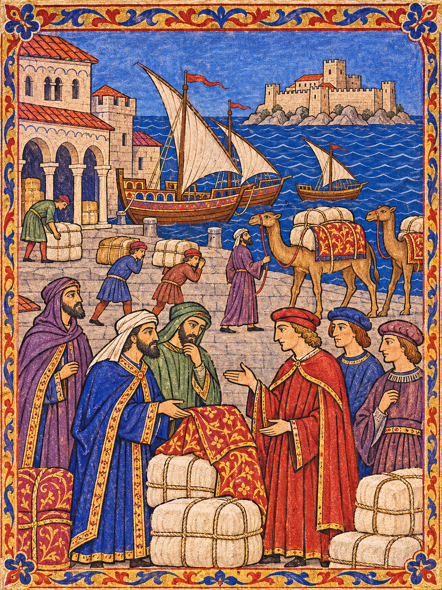

# Chapter I-4
## Lesser and Greater Hermenia; Turcomania; Georgiania

> *“Whatsoever persons would travel to the interior… they take their way by this city of Layas.”*
> — Marco Polo, Book 1, ch. 1 (Yule–Cordier)

---

The flask of oil has reached the emperor. Go back now to the port where the men who carried it had the sea at their backs and the road inland before them. Ayas (Yumurtalık) is where you buy silk, gold cloth, and spices coming down from the interior, and where a merchant off a galley from Venice or Genoa can find a buyer for his own bales [1]. Take a bolt of cloth still carrying the name of the inland town that wove it: pack-animals hauled it down through the passes, and here on the quay factors weigh it, mark it, and stow it in hulls big enough for the Mediterranean. From this busy mole, traders of every tongue bargain beside stacked crates and coiled hawsers. For the Polos, this was the last harbour where they could still send word home on a familiar deck — and the first where they could ask inbound caravans what lay ahead on the mountain road.

See [the map of the outbound road, I-3](ch-03-second-setting-forth.md#map-of-the-outbound-road).

The port sits in Lesser Hermenia (Cilician Armenia). Its king governs his own towns and castles while bowing to the Mongols. Those two loyalties sit together comfortably enough until the ruler of Egypt marches north [2]. Then a merchant on the quay discovers that his road inland depends on more than harbour tariffs. A border raid can shut the passes overnight and leave his pack-beasts eating their own value in fodder at the inn. Away from the docks, Polo praises the country's hunting in the hills — hawking and chasing game through open valleys — though its flat coast has a grim reputation for fever [3]. As for the Armenian nobles, once famed for valour in the field, he says they now excel chiefly at drinking. That is the sharp verdict of an observer looking for a moral decline to explain a precarious kingdom.

For a merchant unloading bales on the quay, however, the king's troubles and the nobles' cups matter less than the mules waiting outside the gate and the armed escort ready to take his silk up into the Anatolian hills.

{#fig-i-4-layas-quay width=78%}

Up in Turcomania (central Anatolia), three peoples divide the country: Turcoman herdsmen keep the high pastures with their flocks and horses, while Armenian and Greek craftsmen fill the walled towns. Ask to see the local mounts and a breeder will bring out the stout, sure-footed horses buyers know as *Turquan*, alongside strong, valuable mules that can carry a heavy pack over rocky tracks without stumbling [4]. Spread out the weavers' work in the bazaars and you see what Polo calls the finest carpets in the world, beside silks dyed in rich crimson and other vivid colours [5]. Between the horse-yard and the loom, a caravan has plenty to load before it ever leaves the plateau.

Picture the contrast between those two worlds in a single day's ride. Up on the breezy uplands, felt tents shift with the grass while shepherds guard their strings of *Turquan* colts. Down in the walled towns, dye-vats steam and looms clack in shaded courtyards. A merchant needs both: the herdsmen's beasts to carry his packs, and the townsmen's textiles to fill them.

Down in the leading towns — Conia (Konya), Savast (Sivas), and Casaria (Kayseri) — the Mongol ruler of Persia holds sway through his governors and garrisons [6]. Polo knows who weaves the cloth and who commands the citadel, though he has little patience for the hill herdsmen, calling them a rude folk with an ugly speech [7]. A drover looking for clean pasture, a smithy, and water for his beasts might have judged them more kindly than a Venetian gentleman passing through on his way to grander courts.

---

Climb into Greater Hermenia (the Armenian Highland) and stop at Arzinga (Erzincan). Polo notes an archbishopric there, along with churches and monasteries, but the first thing that catches his eye is the buckram. That cloth turns up in later trade lists, sometimes under the town's own name [8]. Think of something light, fine, and worth hauling over mountain passes, rather than the stiffened lining we call buckram today — the sort of fabric a merchant could pack into a saddlebag, wrap in oiled felt against mountain rain, and sell at a handsome profit on the coast.

Hot springs bubble near the town for bathers seeking relief from aches and road-weariness [9], and Polo names Arziron (Erzurum) and Arzizi (Erciş) as the other chief cities of the highland [10]. In summer the Mongol armies drive their vast herds of horses, sheep, and cattle up into these cool pastures to graze; in winter the bitter cold and deep snow drive them down again to warmer plains, because no beast can survive out in the open [11]. Anyone keeping a stall or a stable along this road learns to read the turning of the year from the traffic of hooves at the gate: a quiet street means snow on the passes, and a crowded market means the grass has greened.

Ramusio adds a castle called Paipurth on the road from Trebizond (Trabzon) to Tauris (Tabriz), with a rich silver mine beside it. The castle is Baiburt; which exact mine the report means is harder to pin down [12]. Rumours of silver travel faster than surveyors, and a merchant might know the castle's name long before he could point to the seam in the rock.

Look up now to the peak of Ararat (Mount Ararat), where Polo places Noah’s Ark resting high above the plain [13]. The Zelada Latin and Ramusio describe eternal snow barring anyone from reaching the summit, while Ramusio also lowers his gaze to the foothills: meltwater feeds lush grass for the flocks all summer, and churns the tracks into deep mud that slows every cart [14]. A shepherd looking for summer graze has a very different use for the mountain than a pilgrim looking for the Ark; Ramusio lets us walk the slope from one man's ground to the other's.

Pause at those muddy foothills for a moment. Every pack-train crossing Greater Hermenia has to time the passes: too early in spring and snow blocks the high saddles; too late in autumn and an early blizzard traps the mules before they reach the plain. The mountain is not merely a biblical landmark on the horizon; it is the weather-cock for every caravan on the road.

---

Near the Georgian border, oil springs straight out of the earth without a press in sight — enough, Polo says, for *"a hundred shiploads"* at a time. It is no good in a stewpot, he warns, but it burns brightly in a lamp and cures a camel of the mange [15]. Try hearing that from a drover leading a scabby beast out at dawn: he cares less about the geology than the name of the dealer who sells it by the jar.

Wait beside that spring for a moment and watch how a single natural curiosity serves two different worlds. A townsman buys a clay jar of oil to light his courtyard after dark; a caravan master buys it by the skin to keep his pack-camels on their feet across the next range of hills. Neither man needs to know how deep the seam runs underground.

Putting that spring on a map is another matter. Polo sets it on the borders of Georgiania (Georgia), whereas the great oil-wells of Baku (Bakı) lie east on the Caspian and were already famous centuries before him [16]. A merchant buying naphtha in a frontier market may well name it for the country whose caravans brought it over the pass.

Across the border in Georgiania, men crop their hair short, carry bows, and worship as Christians of the Greek rite [17]. Their king is David Melic — a title common enough in Georgian royal lists to leave scholars arguing which David is meant [18]. Polo adds that the old kings bore an eagle birthmark on the right shoulder [19], and Ramusio notes that the Mongols subdued the open country while the king held fast in his mountain fortresses [20]. Behind those stone walls, a garrison could afford to take a dimmer view of Mongol supremacy.

Listen to how Polo's eye shifts from one detail to the next in Georgiania: clerical haircuts, archery, Greek Christian churches, a royal birthmark, and mountain castles that kept the conquerors out. Each detail belongs to a traveller asking who holds the country and how safe the road is for a stranger.

Ride into the narrow defile between the Caucasus and the Caspian and see how few men it takes to cork the bottle. Here Polo places Alexander's barrier — which Yule compares to Derbend (Derbent, the Iron Gate) — four leagues of peril where a handful of defenders can hold off an army. The Book takes care to note that the tribes shut behind the pass were Comanians and others, since Tartars did not yet exist in Alexander's day [21]. The real walls at Derbend are Sasanian frontier works, built centuries after Alexander for a different empire's enemies [22].

Even so, the legend clings to the stonework because the pass itself feels built for a siege. With steep crags rising on one side and the Caspian surf breaking on the other, a column of horse has nowhere to fan out. Anyone who rides through that bottleneck understands why storytellers reached for Alexander's name to explain who first barred the gate.

Even where fortresses bar the road, silk and cloth of gold still move out of Georgiania, alongside prized goshawks for the fist [23]. Before leaving the shore, Polo pauses over a lakeside convent of St Leonard's where fish appear on the first day of Lent and vanish on Easter Eve [24]. Whether you bring a net or a fishing line, the church calendar tells you which morning to arrive.

It is the kind of local marvel Rustichello loved to drop between two stretches of geography: a quiet monastery lake that keeps Lent better than most monks, appearing on cue for forty days and vanishing before Easter Sunday.

Now look out from the peaks over the Sea of Ghel — the Caspian. Polo hears that Genoese merchants carried ships overland from the nearest sea, twelve days away, to launch and sail it. Hauling timber across twelve days of mountain roads is no small gamble unless you know what cargo awaits on the far shore: the prized silk called *Ghellé* comes from these coasts [25]. Both V and the Zelada Latin stock the waters with sturgeon, Zelada adds salmon, and Ramusio places the catch at the river-mouths [26]. Polo also sends the Euphrates emptying into the Caspian, which it does not [27]. A dealer who knows *Ghellé* silk by touch can still get his river basins muddled.

Every valley here offers something you can pack onto a mule: *Turquan* horses from the plateau, fine buckram from Arzinga, naphtha from the border springs, or *Ghellé* silk from the Caspian shore. Yet these mountain chapters stitch together several caravan roads rather than one straight track.

These mountain chapters stitch together several caravan roads and the goods that travelled them. Ayas belongs to the Polos' own departure, even if we cannot trace every pass they crossed [28]. Follow the bolts of silk and cloth of gold south-east out of the highlands, and the fabric itself gives you the name of the next city: Mausul (Mosul).

---

## Notes

[1] ✓ The Book’s Layas is Ayas, the port used in the Prologue. Yule cites Pegolotti and other sources for its trade and place on the road inland [@yc, 1.1 n. 4].

[2] ✓ The Cilician king’s own rule and his submission to the Mongols were compatible. Yule describes the Hetumid relationship and the pressure from Egypt [@yc, 1.1 n. 1].

[3] ~ Sanudo and other writers also report the unhealthy coast. The account of the nobles’ past and present behaviour is the Book’s [@yc, 1.1 n. 3].

[4] ✓ Yule discusses the horses and mules as goods people could buy in the region. The tariff he cites gives evidence of the trade at Ayas [@yc, 1.2 n. 2].

[5] ~ The Book singles out carpets and rich coloured silks. Yule compares how Hayton describes the people of the region and their different occupations [@yc, 1.2 n. 2].

[6] ✓ These are the towns named by Polo. Yule relates Turcomania to the Seljuk country of Rûm and gives the context for Mongol overlordship [@yc, 1.2 n. 2].

[7] ~ Ricold offers a similarly hostile characterisation. These are judgements of their authors, alongside the particular information the two writers give about the people [@yc, 1.2 n. 1].

[8] ✓ Yule and Cordier compare trade notices and later accounts of cloth from Arzinga. The term buckram covered fabrics with uses and values different from the modern stiffened textile [@yc, 1.3 n. 1].

[9] ~ Yule has a report of local confirmation through Lazari and discusses other springs on the proposed route. The Book places the baths in Arzinga [@yc, 1.3 n. 1].

[10] ✓ Yule compares the forms of the town names. Arzizi lies by Lake Van [@yc, 1.3 n. 2].

[11] ~ Summer pasture and winter departure are the pattern described by Polo. Its reach over the whole host is the Book’s account [@yc, 1.3].

[12] ~ From Ramusio in Yule’s edition. The castle stands on the road from Trebizond. Yule discusses silver-bearing lead in the region and reports of mines, without establishing the precise working in the description [@yc, 1.3 n. 3].

[13] ~ The Ark is in the base text, and Yule compares the tradition reported in Josephus. This is the story attached to the mountain [@yc, 1.3 n. 4].

[14] ~ The snow barring the summit is shared by Zelada and Ramusio. The pasture, flocks and mud are the development in Ramusio [@moule1938description, ch. 22, p. 97; @yc, 1.3].

[15] ~ The fuel and treatment for mange are given by the Book. The hundred shiploads are its estimate of abundance [@yc, 1.3 n. 5].

[16] ✗ The placement on the Armenian and Georgian border is difficult to reconcile with the best-known sources around Baku. Floor reports tenth-century notices of the oil and its transport [@yc, 1.3 n. 5; @floor2005lighting].

[17] ~ The cropped hair, archery and rite are the Book’s observations or reports. Yule compares Barbaro on the hairstyle [@yc, 1.4 n. 2].

[18] ? Yule and Cordier discuss the repeated name in the Georgian royal lists and the two Davids who shared power under Mongol arbitration. The precise identification is open [@yc, 1.4 n. 1].

[19] ~ The birthmark is a dynastic story in the Book. Yule compares another account of a sign on the king’s shoulder [@yc, 1.4 n. 1].

[20] ~ From Ramusio in Yule’s account. The division of territory is expressed in terms of the king’s ability to keep forts. The main text also gives the defiles and fortresses a part in limiting the conquest [@yc, 1.4 n. 1].

[21] ~ Polo makes the connection to the tale of Alexander and distinguishes the names of peoples. Yule discusses whether Derbend and related barriers are the places meant in the tradition [@yc, 1.4 n. 3].

[22] ✓ The protected remains at Derbend include Sasanian fortifications. The history of the site and the identification of the pass in the tale require separate evidence [@unesco2003derbent; @yc, 1.4 n. 3].

[23] ~ The silk and the goshawks are in the Book’s description of the country. Yule treats the name for the birds in the bracketed detail separately [@yc, 1.4 n. 5].

[24] ~ The calendar of the fish is the miracle as it is told in the Book. The identity of the convent and the claim about the fishing are open [@yc, 1.4 n. 6].

[25] ✓ Yule discusses the name for the sea, the silk of Ghelan and reports of Genoese activity in the Caspian. Twelve days to another sea is Polo’s distance. He compares forms for the silk in the merchants’ books [@yc, 1.4 nn. 7–8].

[26] ~ Sturgeon appear in V and Zelada, and salmon also appear in Zelada. Yule’s bracketed detail about the river-mouths is from Ramusio [@simion2019devisement, 12.4; @moule1938description, ch. 23, p. 99; @yc, 1.4 n. 9].

[27] ✗ The Euphrates drains in a different direction. Yule discusses the Caspian’s extent and the source of the names used for it [@yc, 1.4 nn. 7–8].

[28] ? Ayas is named as a stage of the Prologue. The places and goods named through the Caucasus give routes and comparisons, with no clear evidence of a personal visit to each [@yc, Prologue 9–12; @yc, 1.1–4].
