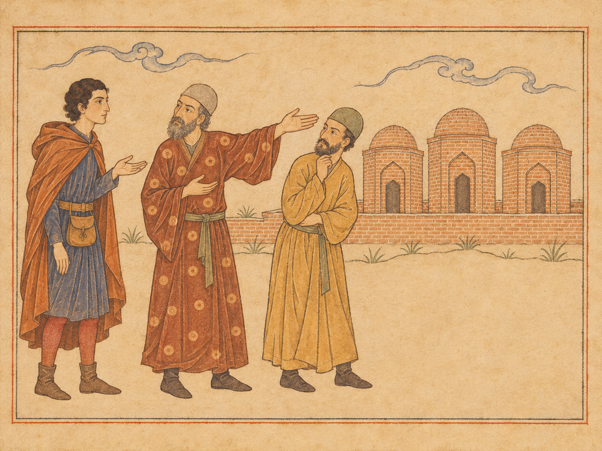

# Chapter I-6
## Tauris, Persia of the Three Kings, and the Eight Kingdoms

> *“In Persia is the city of Saba, from which the Three Magi set out when they went to worship Jesus Christ.”*
> — Marco Polo, Book 1, ch. 13 (Yule–Cordier)

---

The silk and gold cloth turns up again in Tauris (Tabriz), and it has company. Imagine taking one of the stones a dealer brings out and holding it where the light from the street strikes it. Polo puts merchants from Genoa and other Latin ports in this market, buying pearls and rubies and trading in goods brought from India, Baudas (Baghdad), and Cremesor (the Persian Gulf coastlands) [1]. Bernardini traces Genoese merchants in the city from 1280. You can see what brought them so far inland: Tauris sits where the Indian Ocean sea-lanes meet the Anatolian caravan roads. How early they had established themselves, and just when Marco himself was in the city, are different questions [2]. Polo cares first about what a merchant can buy and sell. He sets a silk-weaver within reach of a factor with a bale off the Gulf and a Latin trader with silver in his purse. A gemstone has the great advantage that you can carry a fortune in your belt without hiring another packhorse — provided you know what you are looking at when the dealer lays it in your palm.

See [the map of the outbound road, I-3](ch-03-second-setting-forth.md#map-of-the-outbound-road).

Tauris sits in Azerbaijan, yet Polo places it in Yrac (Iraq). A clue to how that happened comes from other writers who called the Mongol sovereign of Persia the lord of Iraq. A regional name could travel with the court whose capital this city had become [3].

Walk out among the gardens and Polo would have you admire the size and variety of the fruits, watered by clear channels [4]. His welcome for the city's people is frostier. He distinguishes Armenians from Georgians, Nestorians from Jacobites, yet lumps the Muslim townsmen together as Taurizi and damns them all in a breath — faithless, quarrelsome, and hard to deal with [5]. A buyer inspecting a ruby in a shaded booth will need a sharper eye for the individual dealer than Polo spares him here.

Step back into the covered bazaar for a moment and listen to the din around that booth. Persian brokers call out rates in silver; Nestorian clerks tally bales from the Gulf; Genoese factors finger raw silk and weigh pearls against Venetian ducats. Whatever Polo thinks of the townsmen's manners, Tauris is where the trade of half a continent changes hands under one roof.

In the Venetian V witness and Ramusio, the road from Tauris into Persia takes twelve days [6]. Before setting out, look down at a humbler piece of work than the market's gold brocade. The monks of St Barsamo (Barsauma) spend their days knitting woollen belts, lay them on the altar during Mass, and distribute them on their rounds as a remedy for aches, so that people from all around beg for one [7]. Polo likens their habit to the Carmelites'.

He places that monastery on the borders of Tauris, whereas the famous house of St Barsauma stands near Malatia — leaving open which foundation he means [8]. A reader who knows Carmelite robes can picture the monks at their knitting easily enough. A traveller on horseback would still need to ask directions at the crossroads to find the right gate.

Even so, the woollen girdles tell us something about how pilgrims and merchants alike travelled these roads. Anyone riding days through mountain cold with a stiff back or aching knees was ready to tuck a blessed belt from St Barsamo's altar inside his tunic.

---

Polo opens his account of Persia with a glance at what the Mongols have laid waste across its once-splendid cities [9]. The towns ahead show who is left to answer a stranger's questions. At Saba (Saveh), stand beside Marco as he asks about three tombs standing side by side beneath a square pavilion, their dead supposedly still keeping hair and beard. The Book names them Jaspar, Melchior, and Balthasar; the townsfolk he questions will tell him only that three kings were buried there long ago [10]. It is a maddeningly thin answer when you have walked in with the whole Christmas story in your head.

Down the road he has better luck. Three days away stands Cala Ataperistan — the Castle of the Fire-worshippers. The name translates cleanly enough; where the castle itself stood remains unestablished [11].

{#fig-i-6-saba-magi-tombs}

Here the people have a tale. Long ago three kings set out to see a newborn child, carrying gold for a king, incense for God, and myrrh for a physician, each gift meant to test who the child might be. Before the offerings are laid down, each king enters the room alone: the youngest sees a youth of his own age, the middle-aged king sees a man in his prime, and the eldest sees an old man. Puzzled, they compare notes outside and go in together — and find a babe of thirteen days [12].

The child accepts all three gifts and hands them a closed box in return. They ride on for several days until curiosity wins out and they pry it open. Inside lies a stone, meant to sign them to keep their new faith as firm as rock. Missing the point, they toss it into a well — and straightway fire drops from heaven into the water after it [13]. Picture the three kings peering over the well-lip: no retrieving the stone, yet they have been given a flame they can carry home, provided they never let it die.

It is a wonderful piece of storytelling — half Christian Epiphany, half Persian fire-temple legend — and you can hear why a traveller might jot it down in full. Where the townsfolk of Saba gave Marco nothing but three old graves and a shrug, the people down the road handed him a complete explanation of why their altars never went cold.

They bear that fire back and enshrine it in a rich church for their sacrifices; if it ever goes out, people ride up to ten days to fetch a fresh spark from co-religionists [14]. The castle claims one king's grave, Saba a second, and Avah (Āvah) the third [15] — though Polo had just put all three bodies under one roof at Saba.

— Listen to the tale from the priest tending the fire, and it explains where his altar-flame came from. Listen from the Feast of the Epiphany, and you recognise the gifts. Stories of the Magi and stories of sacred fire have both travelled far enough for listeners to piece them together [16].

---

A merchant setting out again needs to know who holds the road. Polo counts eight kingdoms in Persia — a label stretching across cities, peoples, and local principalities. There really were two Lurs in his day, each ruled by its own atabegs whom the Ilkhans could confirm or depose [17]. A caravan master needed to know whether last season's lord was still in his citadel, even if the district kept the same name on his itinerary.

| Book name | Identification | Reading |
|---|---|---|
| Casvin | Qazvin and its district | ✓ A city and district classed with kingdoms |
| Curdistan | Persian Kurdistan | ✓ A regional name |
| Lor | Great and Little Lur | ✓ Two principalities under local atabegs |
| Suolstan | Shūlistān | ✓ Ramusio’s form, beside Cielstan in the old French texts |
| Istanit | Probably Isfahan | ~ Ramusio’s *Spaan* supports the identification |
| Serazy | Shiraz and Fars | ✓ A city standing for its province |
| Soncara | Shabānkāra | ✓ A district in the south-east of Fars |
| Tunocain | Tun and Qāʾen | ✓ In the east, towards the country of the Dry Tree |

One of the entries could send you to quite the wrong place if you wrote down the letters as you heard them. Yule proposes that a copyist read *sf* as *st* in the name that became Istanit. That would take us part of the way from the name of the city to the one in the Book. The ending remains to be explained [18].

What you earn on the road depends as much on the cargo as the route. Try pricing a fine Persian horse still on its hooves in the yard: Polo quotes a sum a French listener would recognise, about two hundred livres tournois, more or less according to the mount [19]. Yule puts that at roughly £193 in his own gold reckoning — the price of a prime charger in Europe, though the real buyers here wait across the sea.

A large, fast ass with an easy amble fetches thirty marks of silver [20]. A beast that glides without jarring your spine is worth a small fortune to a rider facing tomorrow's stages, and merchants will pay handsomely for comfort over rough gravel.

The horses march south in strings to Kisi (Kish) and Hormos (Old Hormuz, called Curmosa here), where dealers meet the sea-captains bound for India [21]. Getting a horse safely to the coast is one trade; stowing it aboard ship with fresh water, fodder, and a groom is another. No wonder the price climbs with every hand the animal passes through.

Think of what it takes to move a string of valuable horses across barren ridges to the sea. Every halt means bargaining for barley and clean water; every ravine risks a sprained fetlock that turns a two-hundred-livre charger into dead weight. By the time a horse steps onto a ship at Hormos, its price already carries the cost of the road.

Polo's merchants ride armed. Despite Mongol rule, he warns, homicides happen daily along these roads and unprepared caravans are cut to pieces [22]. Yet step inside the towns along that same route and you find weavers turning out silk and cloth of gold, alongside cotton, grain, fruit, and wine in abundance [23]. Those whose livelihoods depend on a caravan see a kinder country than the man sleeping with one hand on his sword beside the bales.

The Zelada Latin and Ramusio pause over the wine, answering how Muslims drink it when their law forbids it: boil the grape juice, they say, until it thickens, changes taste, and earns a new name [24]. A host may well pour you a cup of boiled must, though a traveller taking that custom for all Persia has stepped ahead of the evidence.

Still, you can hear the curiosity behind the question. A Venetian used to wine at every meal sits down at a Persian table, sees a dark, sweet cup set beside his bread, and asks how his host squared it with the law. The answer — boil it down until it is no longer wine — is just the sort of practical workaround Marco liked to record.

---

At Yasdi (Yazd), ask for a silk that carries the name of the town itself — *Yasdi* — which merchants pack onto camels and carry far afield for sale [25]. Beyond the city, seven days across a level plain offer only three places to find shelter for the night. There is sport along the way: picture a rider slipping the hood off his hawk for a quick flight while the caravan plods toward the next caravanserai. Polo stocks the open woods and scrub with partridges, quail, and fine wild asses [26], and Yule's bracketed passage adds dates hanging from the palms [27].

Before you leave the plain of Yasdi, though, look back once at the scrub and the three lonely halts. Between Tauris and Kerman, Polo has given us a Persia of gem-booths, fire-temples, eight shifting kingdoms, two-hundred-livre horses, and wild asses racing across the plain — a country where every stage mixes high commerce with old wonders.

At the end of the seventh day, carry that Yasdi silk into Kerman (Kermān), where women and their daughters are waiting with needles to stitch birds and beasts across it.

---

## Notes

[1] ✓ Silk and gold cloth, precious stones and overseas trade are central to Polo’s market. Yule compares Odoric, who also describes the city’s trade, and explains Cremesor as Garmsīr [@yc, 1.11 nn. 2–3].

[2] ~ The date 1280 comes from a historian’s account of Genoese trade. It gives evidence of the commercial setting, while the precise date and occasion of Marco’s visit remain open [@bernardini2000genoa; @yc, 1.11 n. 3].

[3] ✗ The city is in Azerbaijan. Yule uses the title for the Ilkhan in Ibn Baṭṭūṭa to suggest how the geography might have been confused [@yc, 1.11 n. 1].

[4] ✓ The gardens and fruit appear in Polo’s description. Yule compares other visitors’ accounts of the cultivated surroundings [@yc, 1.11 n. 5].

[5] ~ Polo records different communities in the city. The condemnation of its native townsmen and the parallel Yule draws from Mustawfi belong to the writers who make those judgements [@yc, 1.11 n. 4].

[6] ~ Shared by the V witness and Ramusio. Ramusio supplies the stage Yule places in brackets, and the Venetian witness also has twelve days [@yc, 1.11; @simion2019devisement, 16.9].

[7] ~ The Book describes the knitting, the blessing and the use of the girdles for pain. The comparison with the Carmelite habit is for the benefit of its Latin audience [@yc, 1.12].

[8] ? Yule favours the celebrated Jacobite house near Malatia. The distance from Tauris and the number of dedications to Barsauma leave the question of the actual house open [@yc, 1.12 n. 1].

[9] ~ The damage of the Mongol campaigns belongs to the historical setting. Polo opens his account with a verdict on the whole country and goes on to describe substantial communities and trade [@yc, 1.13].

[10] ~ The Book gives the traditional Latin names and reports the state of the bodies. It distinguishes that account from the much more limited answer Polo says he got in Saba [@yc, 1.13; @yc, 1.14 n. 3].

[11] ? The Persian name is glossed as the Castle of the Fire-worshippers. The distance belongs to Polo’s reckoning, and even the place’s location on the outward or homeward route is uncertain [@yc, 1.13 n. 1; @yc, 1.14 n. 3].

[12] ~ Gold, incense and myrrh signify king, God and physician in the story. Yule notes a different traditional explanation of the myrrh and a separate tradition that assigned distinct ages to the Magi [@yc, 1.13 n. 2; @yc, 1.14 n. 1].

[13] ~ The stone and the fire are episodes of the story Polo reports. The stone’s meaning is given to the Book’s reader while the kings fail to understand it [@yc, 1.14].

[14] ~ The Book describes how people keep and renew the fire. Its description of worship in the story is distinct from what the comparisons establish about Zoroastrian practice [@yc, 1.14 n. 2].

[15] ~ The local version assigns each king to a place. Abbott’s later report places Avah about sixteen miles south-south-east of Saba, though he took a bearing without visiting it [@yc, 1.14 n. 3].

[16] ? Yule compares the treatment of the gifts in the Latin tradition and traditions of a sacred fire, including the account in Ammianus. Their recurrence gives scope for comparison and leaves the sources of the tale Polo tells open [@yc, 1.13 n. 2; @yc, 1.14 nn. 1–3].

[17] ✓ Yule identifies the eight names and gives their extent where possible. Spuler’s account of Great and Little Lur gives examples of Ilkhanid confirmation and deposition of local atabegs [@yc, 1.15 n. 1; @spuler1987atabakan].

[18] ~ Ramusio has *Spaan*. Yule suggests a handwriting confusion between *sf* and *st* and expressly leaves the ending of *Istanit* unexplained [@yc, 1.15 n. 1].

[19] ~ Polo allows the horse price to vary with quality. Yule calculates the two hundred livres as about £193 on the gold basis he uses, a comparison in his own historical terms [@yc, 1.15 n. 2].

[20] ~ The thirty silver marks are Polo’s estimate for an exceptionally fine ass. His notice singles out the amble and speed [@yc, 1.15].

[21] ✓ The Gulf trade in horses bound for India recurs in the Book. Polo names the two entrepôts and describes the change of hands there [@yc, 1.15 n. 2; @yc, 3.17].

[22] ~ The Book distinguishes government protection from the insecurity a merchant could still encounter. The claim of a homicide every day is its generalisation [@yc, 1.15 n. 3].

[23] ~ The list of crafts and produce is Polo’s account of the towns. It puts a trading and manufacturing population alongside his account of danger on the road [@yc, 1.15].

[24] ~ Shared by Zelada and Ramusio. The objection about the prohibition and the response about boiling occur in both. Yule compares later accounts of wine and boiled drinks [@moule1938description, ch. 33, pp. 117–118; @yc, 1.15 n. 4].

[25] ✓ Polo gives the fabric the name of the city. Yule finds the name used in Persian for a cloth from Yasdi [@yc, 1.16 n. 1].

[26] ~ The stages, shelter and game are given as Polo records them. Yule considers more than one line for the road [@yc, 1.16 n. 2].

[27] ~ Yule prints the production of dates in brackets. It is a detail of his reading of the woods, while their planting and the road’s precise line remain uncertain [@yc, 1.16 n. 2].
