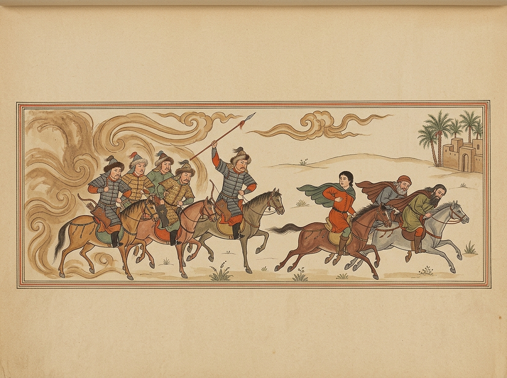
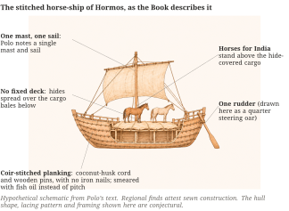

# Chapter I-7
## Kerman, Camadi, Hormos: Heat, Stitched Ships, and the Road Back to Kerman

> *“Their ships are wretched affairs… They have one mast, one sail, and one rudder.”*
> — Marco Polo, Book 1, ch. 19 (Yule–Cordier)

---

The silk from Yasdi (Yazd) has seven days of plain behind it by the time it reaches Kerman (Kermān). In a workshop here you can see what else a good piece of silk can fetch. Women and their daughters stitch birds, beasts and flowers into cloth for cushions and quilts and the hangings a lord will want on his walls [1]. Beyond the cloth shops there are saddles, spurs, bows and blades. A man can spend a good deal of money getting ready to leave this town. The worker making a saddle has to think of the man who will use it hour after hour. The stitcher has to think of someone who will have years to look at her work. What the two send out of the town has a chance of being seen well beyond Kerman, one on the road and the other indoors at the end of it.

Polo gives Kerman a prince of its own in the old days and has the Mongols send in governors after the conquest [2]. The people above the workshops have less freedom to choose a ruler now. An artisan on the ground has things a Mongol lord will want whatever his name is. In the mountains the Book finds turquoise in the rock [3]. It also gives a name to the steel, *ondanique*, the sort of metal a European buyer might treasure in a blade or a mirror [4]. The man up in the hills after falcons can look for a bird smaller than a peregrine and take note of the red under its neck and across its breast. There isn’t a quarry in the sky that can get away from one, by Polo’s reckoning [5].

Seven more days bring the road through towns and good hunting country up to a pass. Keep your layers on. Up here in winter, Polo maintains, a traveller can pile on clothes and still be cold. It takes two days to get down the other side. On the descent he sees fruit trees, a few people pasturing cattle and places where more people once lived [6]. By the time the plain opens out below, the cold is something to remember rather than something to keep out of your bones.

---

There were merchants at Camadi (Qamādin, near Jiroft) when it was a place worth coming to. Polo presents it after repeated raids, much diminished, at the start of the hot country of Reobarles (Rudbar) [7]. Dates and pistachios grow on the plain beside a fruit he calls the apple of Paradise [8]. In the Zelada Latin and Ramusio there are turtledoves after the fruit, left alone by people said to consider them unfit for the table [9]. The francolin Polo notices among the trees has red on its beak and feet. It’s a country where a man can feed birds or herds fairly well if he can keep hold of them.

There’s a white ox ready to take a load. The Book has it kneel, the way a camel does, so the man with the pack can get it over the hump. Then up it comes on its feet [10]. It’s worth standing still to see that. A beast that makes a heavy load easy to put on can get you away, with everything you brought, a little quicker. Polo reckons the sheep as big as asses and their fat tails at thirty pounds [11]. A butcher and a man who keeps a lamp could do plenty with one at a more ordinary size.

From a village wall, have a look across the plain. That wall is earth, but high enough to be worth riding for. The bands Polo calls Caraonas (Qaraunas) can cover the open country in a line of riders. In his telling, they come with a darkness so thick a man can lose sight of his companion alongside. He gives them magic to bring it on and, at times, ten thousand horses to stretch a line across the plain. People caught outside the villages can be killed or taken to sell [12]. A dust haze would be quite enough to make a fast horse hard to see. The tale tells you why a merchant might be glad to hear the thud of his own horse against the ground right up to the wall.

The Book names Nogodar (Negüder) as their leader and makes him a nephew of Sigatay (Chagatai). It also makes Sigatay the Kaan’s brother, when he was the uncle of Cublay (Kublai) and had died in 1242 [13]. Polo sends Nogodar through the narrow roads of Badashan (Badakhshan), Pashai-Dir and Keshimur (Kashmir). The leader loses men and horses, then takes Dalivar from Asedin Soldan in the story [14]. There are real raiding bands behind the names. Several pieces of the story have a better claim to a place in the Book than to a particular road on the map.

At Canosalmi it’s Marco himself we have to follow. He says the darkness nearly served the raiders against him too. He made it into a village, with seven of his companions in Yule’s text. The men he lost were captured and sold or killed [15]. We can’t point to the village gate now. The story puts a particular weight on getting there.

{#fig-i-7-carauna-escape width=86%}

| Detail | Account in Yule–Cordier | Later-witness addition | Evidence and limit |
|---|---|---|---|
| Birds of Reobarles | Fruit and francolins | The turtledoves and the reported taboo are shared by Zelada and Ramusio | ~ Reported custom |
| Escape to Canosalmi | Marco escapes and loses most of his company | The exact survivor count varies across witnesses | ? Polo’s claim; the site remains unfixed |
| Ships of Hormos | Coir sewing, wooden pins and horses carried above the cargo | The construction is present in the base account | ✓ Sewn planks have material parallels |
| Summer heat | A hot wind sends people into water up to their necks | Ramusio makes the wind destroy a force from Kerman | ✗ The army story is uncorroborated and has the scale of a marvel |

---

Past five days of plain and another steep stretch, the Book puts the traveller among streams, date palms and bright birds. Two more days across what the Book calls the Plain of Formosa and the sea is in sight [16]. After so much of the journey reckoned by the time it takes a man to ride it, there is a new measure available. Goods that have come over the horizon are about to go onto a set of scales. At Hormos (Old Hormuz, in the Minab area), a cargo of spice, silk or ivory from India can change hands for carriage much farther afield [17]. There is something else you want to know before you bring a large investment here, and Polo takes the trouble to tell you. If you die in the port, the ruler can take everything you brought [18]. His name in the Book is Ruomedam Ahomet. He owes allegiance to the ruler of Kerman, a relation that takes on a different complexion as soon as the tribute fails to arrive.

A visitor can sit down to salt tuna and onions with his dates. Polo has people leave meat and wheaten bread for days when they’re ill. He likes the wine of dates and spices, with a warning that the visitor’s first glass may do rather more to him than he bargained for [19]. The reason for a choice at the table, as Polo hears it, is whether it helps you live in that heat.

Down at the ships there’s a man at work on a length of rope. The fibre has come out of a coconut husk, beaten fine and spun. Polo takes it almost for horsehair by the look of it. The planks go together with that cord and wooden pins, and the builders rub the hull with fish oil [20]. The salt water leaves the cord sound, he allows. The problem he sees with the stitches is that they give the planks something more than water to resist when the wind gets up. A storm makes him less confident in the whole arrangement. In a port that lives by Indian trade you may hear a different opinion, but this is the one the Book brings back to the Mediterranean.

Have a look inside a ship before the cargo’s covered. Above the planks there’s one mast and one sail. Polo singles out the one rudder and says the ship carries its freight without a deck. Over the bales go hides, and above the hides go the horses bound for India [21]. Here are the valuable animals from the Persian roads again, standing on something a man can lift off to get at the goods. If I were going to buy a passage, I’d ask as many questions about the horses as about the stitching.

{#fig-c13-sewn-plank-hormos}

Those who can leave the city for the summer go out to gardens with running water. Polo has them sleep there. When the hot wind comes off the sand, the people in his telling get into the water and keep just their heads out until it’s gone [22]. You can judge a wind by watching what it does to a palm. The Book judges this one by how much of a man it will leave above water.

Ramusio takes the wind out to meet an entire army. The ruler of Kerman sends sixteen hundred horse and five thousand foot to enforce the tribute owed by Hormos. The guide fails to get them to their intended lodging, and there’s nobody left to carry news back once the wind comes through. The people sent to bury them try to move the bodies. In the story it’s no use, and they have to dig where the men fell [23]. The ruler has sent out a force to make good a debt, and it ends in people from the port spending their own labour to bury it. Polo’s weather has become a battle without an enemy on the field.

The months tell part of what people can bear. Polo gives them November for sowing grain, March for reaping it, and May for gathering dates. The heat has the rest of the year to strip the green away [24]. He gives the women four years to mourn their husbands, with people coming to lament every day [25]. In the Zelada Latin and Ramusio, the mourners can include women paid to take part [26]. What a merchant can carry out of the harbour is the most portable part of this country. Once the heat and the mourning come over the place, the view from the ship would tell you very little of it.

---

India will have its turn. Here the Book picks up a different road to Kerman and leaves the ships in the harbour [27]. Yule sees an abandoned plan to sail in that change of direction. We know the order in which Polo wants us to hear about the roads and the sea. The merchant from whom the story came had reasons of his own for knowing both.

On the road back are fine stretches of country, cheap provisions, dates and partridges. There are hot baths in the ground, for which the Book claims cures. You can buy bread too, but the water it’s made with gives it so bitter a taste that a stranger may be unable to finish it [28]. A man who’s made the whole journey can find water worth sitting in and water he can’t put in his mouth. He’ll want to know which sort he’s going to get before he goes much farther.

At Kerman buy bread if you like, but fill your water skins before you take the road out again. On the first three days towards Cobinan (Kuhbanan), even the water you do find will be bitter.

---

## Notes

[1] ~ The Book makes silk embroidery a household skill and gives it a market among the nobility. Its list runs from hangings to cushions and quilts [@yc, 1.17 n. 4].

[2] ~ Polo treats the conquest as a switch from hereditary rule to appointments. The local Kutlugh-Khanid dynasty continued under Mongol suzerainty, making the transition more complicated than his account suggests [@yc, 1.17 n. 1].

[3] ~ Polo places turquoise in the mountains without naming a mine. Yule proposes a locality on the strength of a much later notice quoted by Ouseley [@yc, 1.17 n. 2].

[4] ~ Yule connects *ondanique* with *hundwānī*, the word for Indian steel. He cites Edrisi on good iron in the district and compares Mediterranean references to the blade metal [@yc, 1.17 n. 3].

[5] ~ Yule cites later reports of falcons from the region. The bird’s colouring and unsurpassable speed belong to Polo’s description [@yc, 1.17 n. 5].

[6] ~ The stages are given in days, and the change from cold upland to warm country is consistent with the approach to Jiroft. See [Map A4, the outbound road](ch-03-second-setting-forth.md#map-of-the-outbound-road) [@yc, 1.17 n. 6; @yc, 1.18 n. 1].

[7] ~ Pelliot places Qamādin by Jiroft without fixing the ruins. Polo contrasts its former prosperity with its condition after raiding and gives Reobarles as the name of the hot plain [@yc, 1.18 n. 1; @pelliot1959notes, vol. 1, p. 139].

[8] ? The “apple of Paradise” is a name the traveller carried with him. The plant behind it is disputed, with proposals including a citrus and the *konār* [@yc, 1.18 n. 1].

[9] ~ Zelada and Ramusio. The turtledoves and the reason given for leaving them alone are shared by the two witnesses. The base account has the fruit and the francolins [@yc, 1.18; @moule1938description, ch. 36, p. 120].

[10] ~ Polo says the humped cattle kneel for loading. Yule cites later observations of humped cattle in the region, and the action under the pack is the Book’s report [@yc, 1.18 n. 2].

[11] ~ Fat-tailed sheep are well attested, while the thirty pounds belongs to Polo’s description of an extreme specimen. Yule compares several travellers’ accounts of such tails [@yc, 1.18 n. 2].

[12] ~ The raiding bands have historical parallels, and Polo’s darkness fits the experience of poor visibility on the plain. The explanation by enchantment and the ancestry assigned to the raiders belong to the account. Yule cites Wassāf’s particularly hostile description of the bands [@yc, 1.18 n. 4; @pelliot1959notes, vol. 1, “Caraunas”].

[13] ✗ Sigatay was Cublay’s uncle and died in 1242. Pelliot found no nephew of Sigatay named Negüder and places the events of the account after Alaü reached Persia. See [Chapter I-10, “Pamier, Cascar, Samarcand, Yarcan, Cotan”](ch-10-pamier-cotan.md) [@yc, 1.18 n. 4; @pelliot1959notes, vol. 1, “Caraunas”].

[14] ? Pelliot notes the name of the raiding bands in records from 1270 and links Asedin to Ghiyāth al-Dīn. Dalivar is Lahore for Marsden and Yule and possibly Delhi for Pelliot [@yc, 1.18 n. 4; @pelliot1959notes, vol. 2, “Dilivar”].

[15] ? Yule’s account follows Pauthier for the seven survivors. Polo places himself in the danger, but the site of Canosalmi and the timing of the incident remain open [@yc, 1.18 n. 5].

[16] ~ The Book names the last stretch the Plain of Formosa and fills it with streams and palms. Yule compares routes into the littoral, whose stages remain approximate [@yc, 1.19 n. 1].

[17] ✓ The mainland predecessor of the island port lay in the Minab region, and the removal to Jarun followed around 1300. The exact archaeological identification within the region remains a hypothesis [@yc, 1.19 n. 1; @floor2004hormuz; @potts2022minab].

[18] ~ Polo makes the ruler, Ruomedam Ahomet, heir to a foreign merchant’s goods if the merchant dies there. The ruler’s dependence on Kerman and the terms in which Polo reports it are discussed by Yule [@yc, 1.19 nn. 1, 6].

[19] ~ Polo describes the coastal foods and the use of date wine in the same breath as people’s explanations for staying well. Yule’s comparisons give some support for the pattern, while the rules and their effects belong to the account [@yc, 1.19 n. 2].

[20] ✓ Sewn joints occur on reused marine timbers studied in the Red Sea. That evidence also includes nailing and leaves the date of the planks’ original use uncertain, so the construction can be placed in a wider tradition with variation [@yc, 1.19 n. 3; @blue2011ships].

[21] ~ The single rig and the horses over the hides are Polo’s observations or reports about ships in the harbour. Yule compares other accounts of sewn ships and the traffic in horses, with the precise form of the steering gear open [@yc, 1.19 n. 3].

[22] ~ The seasonal hot wind is the *samūm*. The practices of sleeping outside the town and taking to the water are described by Polo and compared with other Gulf reports by Yule [@yc, 1.19 n. 4].

[23] ✗ Ramusio-only in Yule’s edition. The force and its destruction occur in the bracketed account, including the claim that Marco was present at the time. The army story is a much stronger claim than the account of the hot wind [@yc, 1.19 n. 5].

[24] ~ Polo gives a winter sowing, a spring harvest and a separate month for dates. The exact timing and the blanket statement about vegetation belong to his description [@yc, 1.19].

[25] ~ The Book’s account gives the mourning a duration of four years and has relatives and neighbours join the daily lament. The paid participants are a separate addition [@yc, 1.19].

[26] ~ Zelada and Ramusio. Hired mourners appear in both witnesses. Yule brackets the clause about them in his edition [@yc, 1.19; @moule1938description, ch. 37, p. 125].

[27] ? The Book moves from Hormos back to Kerman and defers India. Yule and Haw read the sequence as a decision to abandon a sea route. The Book gives the order of its narrative and leaves the relation between the outward journey, the return and the description of the port disputed [@yc, 1.19; @yc, Intro. § 19; @haw2006marco, ch. 3].

[28] ~ Polo gives the bitter bread as a consequence of the local water. The use of natural hot baths belongs to the road account, with the cures presented as claims [@yc, 1.19 n. 7].
