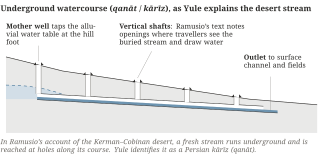
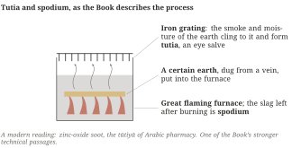
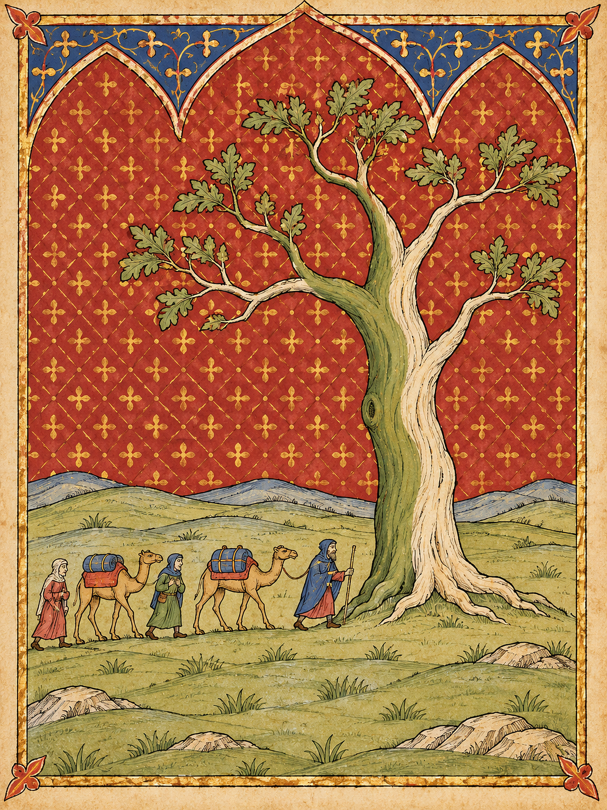

# Chapter I-8
## Cobinan, the Arbre Sec, and the Old Man of the Mountain

> *“It is a tall and thick tree… and there are no other trees near it nor within a hundred miles of it.”*
> — Marco Polo, Book 1, ch. 22 (Yule–Cordier)

---

The water that made the bread bitter on the road from the coast was at least there to be baked with. Out of Kerman (Kermān), you’ll need to bring your own. Polo gives the road seven days and scarcely any water in the first three [1]. What puddles you do find run green and bitter, and pack-horses—thirsty enough to drink *"will they nill they"*—sicken and die [2]. No village greets a rider here, and there is nothing for wild beasts to graze. Even the salt crusting the margins of those pools works against the caravan, turning every watering-stop into a gamble. Think of how much of the ordinary business of the road hangs on a leather water-skin. You can count your miles on a map and still spend them standing idle the moment a mule goes down. A traveller learns what it costs to carry water long before he learns what it costs to do without it.

Come as far as the end of that third day in Ramusio’s account, and suddenly there is water under your feet. You can peer down into openings along an underground channel beneath the desert sand, and pause to drink and water your beasts [3]. The Book is unsure what cut those shafts. A Persian irrigator, familiar with covered watercourses, would have plenty to say about how the stream got there. Up on the surface, though, there is a world of difference between knowing water runs somewhere in the dark and being able to lower a bucket into it. Yule suggests the channel may be the remnant of fields once tended here. For the farmers who dug it, every drop was meant to do a day’s work above ground; for a parched caravan, it is enough to know where the tunnel comes within reach.

{#fig-c15-qanat}

Four days more across the waste, with only wild asses for company, bring the road to Cobinan (Kuhbanan)—and suddenly the hills are full of iron and steel. The Book lingers over great steel mirrors forged here, polished bright enough to catch a buyer’s eye across a crowded courtyard [4]. Set a fine one on a merchant’s trestle and any customer can judge the temper of the metal at a glance, turning it to catch the light from the street. Two other wares from the same town sit beside it in the stalls, though you would have to step into the smithy to see where each comes from.

Watch the iron grating above the fire. A particular sort of earth goes into the furnace; the vapour rising from it settles as a crust on the bars, and that deposit is the *tutia* Polo hears praised as a salve for the eyes [5]. What remains in the belly of the furnace after the firing is *spodium* [6]. One worker scrapes the grating while another rakes the ash, and both carry their baskets out to the same bazaar. You could walk the stalls all morning without guessing how differently those two powders were born—one condensed out of rising smoke, the other left behind in the cinders. Yule cites a later traveller who watched tutia from the Kerman hills packed in small boxes for the sea-road to the harbour [7]. Think back to the ships waiting at the coast: a muleteer can carry a handful of mountain soot down to a port that trades it across an ocean for spices, pearls, or porcelain.

— A merchant’s ledger rarely asks how a powder was made once it reaches the quay, yet at Cobinan the furnace grate and the ash-pit sit side by side, feeding the same trade by opposite paths.

{#fig-c6-tutia-furnace}

---

Load water again. Polo makes the desert beyond Cobinan an eight-day crossing, bare of trees or fruit and cursed with the same bitter pools for the cattle. At Tonocain (the Tun and Qaen region), the Book reaches the northern rim of Persia [8]. Towns and villages reappear, and the air settles into a mildness neither frozen like the mountain passes nor blistering like the coast. Households here have surplus to sell, and a caravan can finally buy bread, fruit, and fodder without counting every ounce.

Out on a flat plain in that country stands the Arbre Sec (the Dry Tree), which the Book also calls the Arbre Sol [9]. One side of its bark shows green, the other white. Polo slows down here, as if a single tree on an empty horizon deserves as much patience as a walled city. Pick up one of its fallen husks: rough as a chestnut bur, it promises a kernel inside, yet cracks open empty. The timber is yellow and dense as boxwood [10]. To meet another tree, Polo says, you must ride a hundred miles in almost any direction—or ten if you take the one quarter the Book leaves open. I would dismount by the one we have. You may never settle its name simply by turning that empty husk over in your palm. If *Arbre Sol* means the Lone Tree, as Pelliot argued, one slow turn on your heel explains it. If you arrive with the Alexander romances in your saddlebag, you may catch yourself scanning the branches for some sign of the Sun. Either way, a tired rider looking for shade has found what he came for.

{#fig-i-8-dry-tree width=78%}

Here, the local people tell the Book, Alexander fought Darius [11]. A famous battle makes a handy milestone long after the banners have rotted; a two-coloured tree standing alone on a plain keeps the battle’s memory alive. Put the tree and the legend together, and a traveller can carry the place home in a single sentence—even if the next rider has a hard time finding the exact trunk from that sentence alone.

— After days of scanning dry sand for a well-shaft or a patch of scrub, a solitary tree is worth a story before anyone asks who fought beneath its boughs.

---

The next valley is as lush as this plain is bare, though you enter it by way of hearsay rather than the highway. People in the region, the Book says, told Marco of the Old Man of the Mountain (associated with Alamut, in the country the Book calls Mulehet) [12]. Polo names him Aloadin (ʿAlāʾ al-Dīn Muḥammad). Behind a fortress blocking the valley’s mouth, the tale spreads out fruit orchards, gilded and painted pavilions, and four conduits running through the grass: water—welcome enough after Kerman—alongside wine, milk, and honey [13]. Young women sing, play instruments, and dance in the shade. To the youths brought inside, the valley is meant to look like paradise itself, a place where every appetite is answered before it is spoken.

First impressions do the work. The Old Man guards the entrance tightly, and in Polo’s telling the recruits wake inside the garden without ever seeing the gate or the mountain road. Storytellers give them a sleeping draught [14], so when their eyes open, everything in sight matches the heaven they have been promised after death. For a few days, their own senses are the only witnesses they have—and the drugged cup and the sentries at the pass have already settled what those senses will report.

Soon enough, the young men wake again inside the grim walls of the castle, summoned before the one ruler who holds the key back to the garden. Someone who has only heard of paradise can now listen to a comrade who has walked its paths and drunk from its conduits. From there, the Book turns the traffic between garden and fortress into the engine of the Old Man’s power, even when he dispatches assassins abroad [15]. A follower who believes death sends him straight back to those four streams will obey without flinching. Other rulers, Polo adds, paid tribute simply to sleep safely in their beds [16], while the Old Man stationed deputies around Damascus and in Curdistan (Kurdistan) [17].

Where you stand decides which story you think you are watching. Down by the pavilions, a boy may swear the music drifts from heaven. Up at the gatehouse, a captain has to log every arrival and every dose. The legend Marco heard gives the Old Man a tyranny built on keeping those two vantage points apart—a tidy explanation for outsiders trying to make sense of enemies they feared from afar. Histories of the Nizārīs reveal a different world behind those walls, with fortified strongholds and a community whose own records tell a very different tale [18]. Once you have heard the garden legend, it is tempting to treat the Mongol siege that follows as the next chapter in the same fable, and the Book obliges. Yet the garrisons weighing surrender had real walls and real politics to reckon with.

---

An army has a plainer way of opening a valley. Alaü (Hülegü) sends a force against the Old Man, and in the Book’s telling his troops sit outside the castle for three years until hunger breaks the defenders. When the gates give way, the Book dispatches the Old Man and his men in one stroke [19]; Ramusio levels the paradise garden right alongside the fortress [20]. Once the pavilions and channels are wiped out in a single sentence, there is nowhere left in the story for any recruit to return to.

The real campaign kept a sharper calendar. Kitbuqa was already pressing the Nizārī castles in the early 1250s. Aloadin died before the decisive surrender; his son Rukn al-Dīn Khurshāh yielded in 1256, and the castle was taken that December [21]. The Book’s three-year blockade measures what a storyteller thought so steep a fortress ought to require. Chronicles separate the strongholds, the commanders, and the stages of the war: a father can die while his castle still holds, leaving a son to negotiate terms, and Girdkūh held out for years after the main surrender [22]. Follow the people rather than the legend, and the neat ending opens out again: the Mongols broke the Nizārī state, yet Nizārī communities endured [23].

A storyteller can travel a long way on a tale about a valley he never entered. Polo is careful to name his local informants at the start and to step back onto his own road at the end [24], and I am glad he left that seam visible. The story makes it easy to picture four streams running through an orchard, even if Marco never set foot there. Beyond these mountains, though, the road opens onto pastures and markets where a soldier or a merchant can put real food on a plate, and where a caravan no longer has to ration every drop of water from a leather skin.

Inside a besieged castle, every crust is counted, and every day without relief shrinks the garrison’s hopes. Out beyond the hills on the road to Sapurgan (Shibarghan), an army can halt simply because the grass is thick and the orchards are full—and that is where we pick up the trail.

---

## Notes

[1] ~ The Book counts seven days from Kerman to Cobinan. Houtum-Schindler, quoted by Cordier, proposes a longer route east of the mountains to account for the stages and waterless stretches [@yc, 1.20 n. 1]. See [Map A4, the outbound road](ch-03-second-setting-forth.md#map-of-the-outbound-road).

[2] ~ Yule compares accounts of saline watercourses in the region. Polo makes the shortage and the consequences for livestock part of the description of this particular crossing [@yc, 1.20 n. 2].

[3] ~ Ramusio-only in Yule’s edition. The openings and the underground stream are bracketed. Yule compares the passage with Persian watercourses called *qanāts* or *kārēzes* and suggests that this example may once have supplied cultivated land [@yc, 1.20 n. 3].

[4] ✓ The place is identified with Kuhbanan, which Yule finds named by medieval geographers. Later reports also mention metalworking resources in the district, including the material associated with the iron and the steel that Yule discusses, while the size of Polo’s town is open to question [@yc, 1.21 n. 1].

[5] ~ Yule compares other accounts of the material marketed as tutia and its use in preparations for the eyes. The collection above the furnace is the practical detail Polo supplies [@yc, 1.21 n. 2]. See [Diagram C6, the Cobinan furnace](../media/diagrams/C6-tutia-furnace.svg).

[6] ~ The Book distinguishes the material left from the firing from what collects on the iron. Yule discusses different uses of the name *spodium*, which make an exact modern identification uncertain [@yc, 1.21 n. 2].

[7] ~ Teixeira, cited by Yule, describes tutia from the region travelling in boxes to Hormos. His later account concerns the trade and gives a different preparation from the one in the Book [@yc, 1.21 n. 2].

[8] ~ Tonocain is usually read as Tun and Qaen, with a wider region intended in Polo’s account. Yule and the writers quoted by Cordier discuss different approaches to the district [@yc, 1.22 n. 1].

[9] ? The Book gives the two names. Pelliot argues that *Arbre Sol* means “Lone Tree”, while Yule discusses the Tree of the Sun and the Dry Tree alongside the Alexander tradition [@yc, 1.22 n. 2; @pelliot1959notes, vol. 2, p. 628].

[10] ~ Marsden and Yule compared the features with the oriental plane. The identification of an individual tree and the extent of its isolation remain open [@yc, 1.22 n. 2].

[11] ? The association with a battle belongs to the legend of Alexander in the region. Yule traces the parallels in stories of extraordinary trees associated with Alexander [@yc, 1.22 n. 2].

[12] ~ Polo presents the account as something told to him in the region. Yule links Mulehet to *Mulāḥidah*, an epithet applied to the Nizārī Ismāʿīlīs by their opponents [@yc, 1.23 n. 1].

[13] ? The garden of honey, milk, wine and water belongs to a story about the Old Man’s rule. Virani examines the tradition as a later paradise-garden legend [@yc, 1.23; @virani2021garden].

[14] ? Polo gives the drink an effect and leaves the substance unspecified. Lincoln discusses an earlier story by Arnold of Lübeck with an intoxicant and deceptive visions, which establishes a parallel in the legend [@yc, 1.23 n. 1; @lincoln2006terrorism, pp. 250–252].

[15] ? The promise of return to the garden gives Polo’s tale its explanation of obedience. Yule compares other versions of the story, while Daftary discusses the tradition in the context of the history of the Ismāʿīlīs [@yc, 1.24 n. 1; @daftary1990ismailis].

[16] ~ The Book presents the ruler’s reputation as a motive for the payment of tribute. Its explanation is part of the portrait of his power [@yc, 1.24].

[17] ~ There were Nizārī communities and strongholds in Syria, while the relationship between those communities and the Old Man’s deputies in this story is uncertain. Polo gives Damascus and Curdistan as their territories [@yc, 1.24 n. 2].

[18] ~ The strongholds are historical, as is the Mongol campaign against them. The combination of a fortress, a hidden garden and young men deceived into obedience belongs to the legend as Polo tells it [@yc, 1.24 n. 1; @daftary1990ismailis; @virani2021garden].

[19] ✗ Yule follows a text giving 1252, with other readings of 1242 and 1262. The three-year siege and the Old Man’s death at its end combine events that the historical accounts keep distinct [@yc, 1.25 n. 1].

[20] ~ Ramusio-only in part. The V text already has the castle levelled. The garden destroyed with it is the additional detail in Ramusio’s version [@yc, 1.25; @simion2019devisement, 21.10].

[21] ✓ Kitbuqa’s operations preceded Alaü’s arrival. Khurshāh surrendered in 1256 and Alamūt was handed over that December [@yc, 1.25 n. 1; @daftary2000khorshah].

[22] ✓ Some strongholds did not yield when Khurshāh did. Yule distinguishes Girdkūh’s much longer resistance from what happened at Alamūt [@yc, 1.25 n. 1].

[23] ✓ The Nizārī state lost its strongholds and political power. The history of the communities continued beyond the conquest [@yc, 1.25 n. 1; @daftary1990ismailis].

[24] ~ The Book locates Marco’s hearing of the story in the region and describes no visit to the valley. Alamūt is well away from the itinerary usually reconstructed between Cobinan and Tonocain [@yc, 1.22 nn. 1–2; @yc, 1.23; @yc, 1.25].
