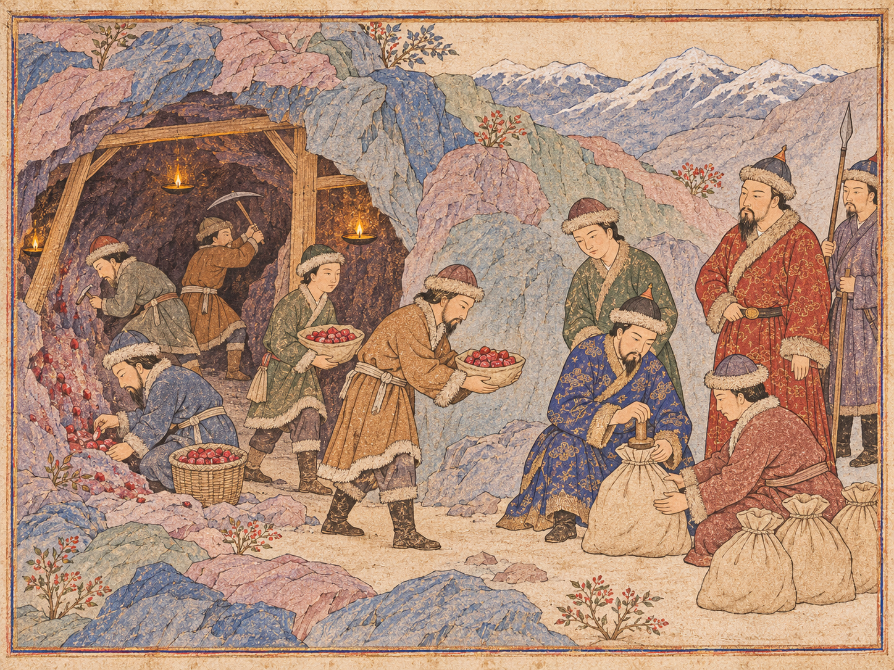

# Chapter I-9
## Balc, Badashan, Pashai, Keshimur: Rubies, Azure, and High Valleys

> *“It is in this province that those fine and valuable gems the Balas Rubies are found… There is also in the same country another mountain, in which azure is found; ’tis the finest in the world.”*
> — Marco Polo, Book 1, ch. 29 (Yule–Cordier)

---

Troops that have spent months starving a castle find a very different country on the road to Sapurgan (Shibarghan). Grass spreads thick for the horses, and orchards and fields keep the soldiers fed. Polo counts six days through towns and villages, yet breaks the stretch with fifty- or sixty-mile dry runs where every rider must carry his own water and the horses wait to drink [1]. Look at the road first through a quartermaster’s eyes: it pays to halt where the grazing is lush rather than drive gaunt beasts forward on empty bellies. Then look through a merchant’s: every water-skin lashed to a pack-saddle steals room from silk or spice, and a dry stretch forces you to trade payload for survival. Both pasture and thirst belong in the same march, though fitting all of it neatly into six days takes some squeezing.

In Sapurgan, watch what they do with a melon. A knife goes round and round the rind, peeling off a spiral strip to lay in the sun until the moisture dries out. A ripe melon spoils in a day; cured into ribbons, it travels to distant markets and arrives *"sweeter than honey"* if you take Polo’s word for it [2]. A pack-mule that cannot drink until the next well can at least carry a taste of last summer into the next town, and a trader can sell it long after the harvest is over.

Balc (Balkh) still shows shattered marble among its ruins, enough to hint at the splendour the Mongols broke when their armies swept through [3]. Ibn Baṭṭūṭa, riding past generations later, also walked among fallen mosques and colleges where bright paint still clung to the plaster [4]. Local storytellers had another monument to point out: here, they told Polo, Alexander married the daughter of Darius [5]. A royal wedding in a tale can keep a city’s name ringing long after its roofs have caved in and its bazaars have emptied.

Here Polo draws the boundary of Persia and the realm of the Mongols he calls the Tartars of the Levant. East and north-east he drops a single name, Dogana, with scarcely a word to hang a description on—likely a copyist’s tangle from the name of the next town [6]. The road itself is clearer. Water and game are plentiful, yet raiders have driven the villagers up into the hills, and Polo warns you to pack twelve days of rations before setting out [7]. He stations lions along the approach as well, a detail that has kept mapmakers and naturalists arguing ever since [8].

— Between Sapurgan’s dried melons and Balc’s broken marble, the road already teaches you how quickly a landscape shifts: one stage feeds an army, the next leaves a ruined capital behind, and the next asks you to carry twelve days of bread on your own mules.

### Map of the highlands and Tarim

At Taican (Taloqan), a hungry traveller heads straight for the grain market, though the town’s real curiosity lies south in the hills. There the rock salt is so dense it takes an iron pick to break it free. Caravans ride in from thirty days away to load it, and Polo boasts the hill could *"supply the whole world to the end of time"* [9]. Knowing salt sits in a cliff is one thing; turning a profit on it is another. After a thirty-day ride, a trader still has to quarry the blocks, lash them onto mules, and haul them home before he sees a coin. Yule noted salt workings in several directions around the town, so a south-facing traveller sees only part of the traffic. In Ramusio’s text, the other hills yield almonds and pistachios cheap enough for anyone [10]. What a merchant spends on pack-animals here decides how much of the mountain he can carry away, and whether a load of salt or a sack of nuts pays better at the next bazaar.

Three days farther bring vineyards, orchards, and settled villages. People drink boiled wine, wind a cord round their heads in place of a hat, and stitch coats and shoes from the pelts of the game they trap [11]. A river cuts through Casem (Kishm), seat of a local lord, while cattle-herders hollow their dwellings straight out of the earthen hillsides [12]. If you need a cobbler to mend a torn boot here, his front door may be a hole cut in a riverbank, with cattle grazing above his roof.

One hunt along this stretch gives the hounds second thoughts. Cornered porcupines huddle together and, in the Book’s telling, shoot their quills at the pack [13]. A hound certainly trots back with a muzzle full of spines, though the porcupine never has to fire a shot. Three waterless, foodless days beyond Casem—days when every rider must carry both bread and water—bring the road at last to Badashan (Badakhshan), where the valleys narrow and the air turns sharp.

---

The kings of Badashan also claim Alexander in their bloodline. Tracing their house to his marriage with Darius’s daughter, they style themselves Zulcarnain—the Two-Horned [14]. In Balc, that wedding is civic pride; up here, it is a crown’s title deed, dusted off whenever a new prince mounts the throne.

Look into the mountain Polo calls Syghinan. Miners tunnel for red stones the way other men dig for silver: balas rubies, which are in fact spinels [15]. In the Book, the king guards the entire output for himself, sending stones out only as tribute, royal gifts, or controlled sales. Any subject who digs on his own risks life and goods. Polo’s explanation sounds like a Venetian broker talking: flood the market, and the price collapses [16]. Picture a king weighing what gift to send a dangerous neighbour. Bales of silk eat up pack-animals and can be bought in any bazaar; a single red stone travels in one courier’s palm and comes from nowhere else on earth.

{#fig-i-9-balas-mines}

A different mountain holds veins of blue like ore—lapis lazuli [17]. A painter grinding ultramarine in a European workshop rarely pauses to picture the pickaxe work in these cliffs, where miners chip the stone out by lamplight and haul it down narrow trails. Polo adds silver mines to the range, and a winter cold bitter enough to outlast any memory of jewels if night catches you on the pass.

Unshod horses gallop over these rocky tracks without splitting a hoof. Ramusio adds that they tear downhill at a pace no lowland mount can match [18], and tucks in a tale of a breed marked on the forehead and descended from Bucephalus. When the king covets the stud and their owner refuses to part with them, the king has the man killed—whereupon the widow destroys every horse in the stable [19]. The finest bloodline in the kingdom becomes priceless the moment there is nobody left to sell it, and the story leaves only the memory of what those colts might have fetched.

Climb for a full day in Ramusio’s version, and the gorge opens onto a high plateau of grass, trees, and cold springs. Trout dart in the brooks, and wild sheep graze in flocks of hundreds [20]. Sick folk climb up from the stifling lowlands, Polo says, and recover in two or three days, as if the thin mountain air washes the fever straight out of their bones. Here Ramusio lets Marco speak of his own fever, which lingered nearly a year until the mountain air cured him [21]. Which exact meadow healed him is anyone’s guess, yet the detour changes the whole mood of the ascent. Earlier, riders climbed for blue stone or red spinels; now a sick traveller climbs simply to breathe, drink cold spring water, and gather strength to go on.

Picture the contrast between those two climbs. Down in the Syghinan galleries, guards watch every miner’s pockets for a hidden spinel; up on the grass plateau, a feverish merchant sits beside a trout stream with nothing to buy and nothing to guard, waiting for his strength to return.

| Detail | Base account in Yule–Cordier | Ramusio’s addition | Evidence and limit |
|---|---|---|---|
| Red stones | Balas stones and a royal monopoly, with a penalty for digging independently | The monopoly is already in the base account | ✓ The region produces red spinels; medieval control remains the Book’s account |
| Horses | Unshod horses on rough mountain roads | Speed downhill and the Bucephalus pedigree | ~ The pedigree belongs to the story |
| High pastures | The base account describes a mountainous country | Great sheep flocks, streams and an account of Marco’s recovery | ? The personal episode has no independent confirmation |

Sakers and lanners fly above these ridges too, giving the gentry sport, while the price of ordinary cloth tells a sharper story. Most folk wear animal skins; a wealthy woman, Polo marvels, may wrap sixty, eighty, or a hundred ells of cotton into a single pair of pleated trousers [22]. Every bolt of that cotton has to be hauled through the same narrow defiles the Book trusts to hold back an invading army [23]. Where the ground flattens, farmers raise wheat and huskless barley, pressing sesame and walnuts for oil [24]. Once a traveller reaches the settlements, the country feeds him well—provided he survives the approaches and carries enough silver to buy what the passes let through.

---

Ten days south of Badashan, by the Book’s reckoning, lies the warm country of Pashai (the Pashai country, with its extent disputed). Men there wear gold and silver studded with pearls and gems, speak a tongue of their own, dine on meat and rice, and enjoy a fearsome name for sorcery [25]. The jewellery is easier to credit than the spells; neither fixes the province’s lines on a modern map, yet both tell you how lowland travellers pictured the southern valleys.

Keshimur (Kashmir) lies seven days farther toward India in this report—a temperate, forested kingdom guarded by tight passes under an independent ruler [26]. Its masters, the tale runs, can make temple images speak and call down storms at will; Polo takes the country for the fountainhead of all idolatry [27]. Such was the reputation that travelled ahead of the valley into the Book, long before any European had walked its streets or heard a local monk’s own account of his faith.

Monasteries and hermits dot the hills, keeping to a spare diet and strict vows of abstinence [28]. In the Zelada Latin and Ramusio, devout locals who refuse to slaughter an animal still eat meat if a Muslim butcher wields the knife [29]. That small legalistic workaround is the sort of detail a curious visitor picks up when he watches who actually buys at the market stall. And for a merchant riding out from the Mediterranean, there is one practical detail worth pocketing above all the rest: Keshimur pays handsomely for coral [30]. Give a trader that single fact, and he remembers the name long after the talking idols fade—especially since the merchants of Tebet (Tibet) buy the very same red beads. Two distant highlands suddenly belong in the same ledger, linked by a single lightweight ware that fits inside a saddlebag and crosses half a continent without spoiling.

Notice how the Book’s eye keeps shifting scale across these valleys: from a royal monopoly over a single ruby cliff in Badashan to a handful of red beads traded across two mountain kingdoms.

Keep the coral packed for the road toward India. The Book turns back to Badashan, where a mountain river offers the only road higher into the range—and from here, we follow the water upstream.

---

## Notes

[1] ~ Polo describes fertile stages interrupted by waterless stretches. Yule finds the six days difficult as a continuous itinerary from the preceding episode and discusses the possibility of a gap in the route [@yc, 1.26; @yc, 1.27].

[2] ✓ Yule assembles parallels for the fame of the melons and for drying strips of fruit in the region. The sweetness belongs to Polo’s own estimate. The procedure is given without a cultivar [@yc, 1.26 n. 1].

[3] ✓ Polo gives ruined marble buildings as signs of Balc’s former wealth. The Mongol destruction is documented and later travellers found a city still bearing its effects [@yc, 1.27 n. 1].

[4] ✓ Yule cites Ibn Baṭṭūṭa on ruined buildings of Balc, including traces of former decoration. He found the city still largely laid waste in the fourteenth century [@yc, 1.27 n. 1].

[5] ✗ The legend puts Alexander’s marriage here and calls his wife Darius’s daughter. Roxana was the daughter of Oxyartes of Bactria, and the story joins different episodes of Alexander’s life [@yc, 1.27 n. 1].

[6] ✗ Some texts give a form such as *Dogaua*, with no description of the place. Pelliot follows Benedetto in treating it as a spurious name, probably produced from the phrase naming Taican [@yc, 1.27 n. 2; @benedetto1928milione; @pelliot1959notes, vol. 2, “Dogava”].

[7] ~ The Book puts the flight from the low country down to raids and armies. Twelve days without supplies is its estimate of the exposed stage [@yc, 1.27 n. 3].

[8] ? Yule compares several accounts of lions in the country towards the Oxus, including reports relayed by Moorcroft and Lieutenant John Wood. The word and the route have both drawn scrutiny in attempts to identify what travellers encountered [@yc, 1.27 n. 3].

[9] ✓ Taican is usually identified with Taloqan, and rock salt is worked in the region. The picture of traders coming from very far away is Polo’s measure of an important market, while the claim to supply the world is his flourish. Yule records works east and south-east of the town [@yc, 1.28 nn. 1–2].

[10] ~ Ramusio-only. The bracketed addition describes plentiful almonds and pistachios in neighbouring hills. The grain market and the salt are already in the earlier account [@yc, 1.28 n. 2].

[11] ~ Polo disparages the people in this stretch of the narrative. The cord head-dress, skins for clothing and boiled wine are the portable particulars, for which Yule cites later regional parallels [@yc, 1.28 n. 3].

[12] ~ Yule identifies Casem with Kishm and compares cave dwellings observed in other districts. The comparison gives an idea of the dwellings Polo is describing, with the province’s size and exact government open [@yc, 1.28 nn. 4, 6].

[13] ✗ The claim that the porcupines discharge their quills is an old legend. A dog close enough to be pricked has all the evidence of the danger that the Book’s dogs have [@yc, 1.28 n. 5].

[14] ✗ Alexander descent is a royal claim of prestige in this report. The title of the Two-Horned is connected with Alexander, while the descent and its marriage belong to local tradition [@yc, 1.29 n. 1].

[15] ✓ The balas ruby is red spinel, and Kuh-i-Lal is a major source in the historic region. The modern survey identifies the gem and its source without establishing how the medieval workings were organised [@yc, 1.29 n. 2; @vertriest2019field].

[16] ~ The monopoly in Polo’s account keeps the rights to mine and export with the ruler. The penalty and the deliberate restriction of supply are the Book’s account of how he keeps the price up [@yc, 1.29 n. 2].

[17] ✓ Lapis lazuli comes from the Sar-e-Sang deposits. Wood visited the workings in 1838, and the modern geological study describes the mineral deposit [@yc, 1.29 n. 3; @wood1841personal; @wyart1981lapis].

[18] ~ Ramusio-only in part. The F text already gives fast, unshod mountain horses. The special speed down steep slopes belongs to the added detail [@yc, 1.29 n. 4; @eusebi2018devisement, ch. 46 § 13].

[19] ? Ramusio-only. Yule compares other tales of unusual breeds associated with the region. The marked horses and their descent from Bucephalus belong to a legend told about the royal stud [@yc, 1.29 n. 4].

[20] ~ Ramusio-only. Great flocks, streams and high plains appear in the bracketed account. Yule compares the sheep with species known in the mountains [@yc, 1.29 n. 6].

[21] ? Ramusio-only. The recovery after about a year of illness is attributed to Marco in the added account. Yule suggests a site for the ascent, with the identification still open [@yc, 1.29 n. 7].

[22] ~ The cost of cloth and the division between its buyers and wearers of skins belong to the Book. The figures for the cloth in the trousers express the effect of the ample cut [@yc, 1.29 n. 9].

[23] ~ Polo describes fortified settlements and narrow approaches. Yule compares the history of invasions, which qualifies the confidence Polo ascribes to the people who hold those passes [@yc, 1.29 n. 8].

[24] ~ Wheat, huskless barley, and oils pressed from sesame and walnuts belong to the Book’s account of local food. The oils are one of the things the traveller notices in the absence of olives [@yc, 1.29 n. 5].

[25] ? Yule reads Pashai as reported geography and compares the account with stories of Udyāna and with the distribution of the Pashai name. The tale’s magic and its material details cannot establish a single route or population [@yc, 1.30 n. 1].

[26] ~ Keshimur is Kashmir in the Book. The passes and productive valleys fit the broad geography, while political conditions in the period were more complicated than the Book’s account of independence [@yc, 1.31 n. 4].

[27] ~ Kashmir had a significant place in the transmission of Buddhism, especially towards Tibet. The Book goes further in making it the religion’s origin and gives it the travellers’ repertoire of wonders [@yc, 1.31 nn. 2–3].

[28] ~ The ascetics, abbeys and monasteries are the Book’s account of local religion. Yule compares evidence for the region’s religious life at different periods [@yc, 1.31 n. 5].

[29] ~ Zelada and Ramusio. The account of avoiding slaughter and relying on Muslim butchers is shared by the two witnesses. Its explanation belongs to their account of religious practice [@yc, 1.31 n. 6; @moule1938description, ch. 49, p. 140].

[30] ~ Polo gives a merchant’s estimate of demand for coral brought from the west. It is evidence of what a trader might be told about the market, with the extent of firsthand travel in this stretch still open [@yc, 1.31 n. 7].
