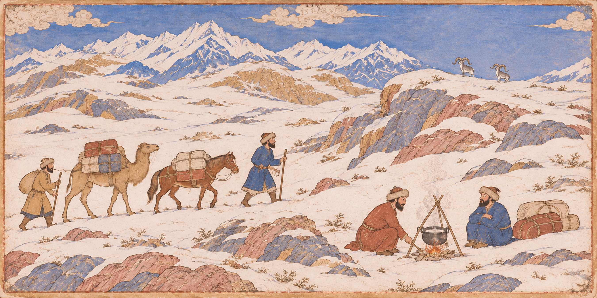

# Chapter I-10
## Pamier, Cascar, Samarcand, Yarcan, Cotan: Roof of the World to Jade Country

> *“The plain is called Pamier, and you ride across it for twelve days together… The region is so lofty and cold that you do not even see any birds flying.”*
> — Marco Polo, Book 1, ch. 32 (Yule–Cordier)

---

Follow the river up out of Badashan (Badakhshan). For twelve days the trail climbs between east and north-east, bending with the valley through lands ruled by a brother of the Badashan prince [1]. Villages and scattered farms still line the banks, so a caravan can buy bread and fodder along the way without unloading its spare packs. Farther up, provisions become something you weigh and pack before you dare set out. Every day’s climb narrows the valley floor and reminds the muleteers how soon the last inhabited hamlet will drop behind them.

See [the map of the highlands and Tarim, I-9](ch-09-balc-badashan.md#map-of-the-highlands-and-tarim).

At the top of that climb lies Vocan (Wakhan), a pocket kingdom only three days wide in any direction by Polo’s reckoning. Its chief bears the title *None*—count, in the Book’s gloss—and holds the valley under Badashan [2]. The people are Muslims with a tongue of their own and a reputation as stout fighters. A traveller can ask whose banner flies over the valley and get a clear answer, even if he cannot follow the local speech in the bazaar. For a caravan leading laden mules, though, a valley’s borders matter less for its politics than for its hay: how many days can you still ask a villager where to buy forage before the grass runs out? Game still roams these slopes, and three days higher into the peaks brings you to what Polo takes for the highest ground on earth. Every stage upward strips away another comfort of the lowland valleys, until even the bushes vanish.

Look out between the ridges and see what the Book offers a drover with a worn-out horse. The river winds across a plain whose grass, Polo swears, will fatten a lean beast in ten days [3]. In Ramusio and the Tuscan TA witness, that stream pours out of a mountain lake [4]. Behind the wonder of the altitude sits a practical caravan question: can your pack-animals put on enough weight here to survive the barren crossing ahead? Every ounce of flesh on a mule’s ribs is insurance once the grass disappears, and every day spent grazing here buys another stage across the waste.

Wild sheep roam these heights with horns *"good six palms"* long. Shepherds hollow them into bowls and stack spare horns into night pens to shelter their flocks from the wind [5]. In the Zelada Latin and Ramusio, wolves account for the scattered bones and horns—and Ramusio adds stone cairns piled beside the track to guide riders when snow buries the road [6]. A traveller spotting one of those cairns above the drift needs far less help from local guides than he would on an unmarked pass, and can keep his column moving even when the sky closes in. On a high plateau with no trees for landmarks, a heap of stones and a scatter of horn-pens are the only architecture in sight.

Then comes the Pamier (Pamir Plateau) itself: twelve days with every ounce of food packed on your saddles, where Polo sees no houses, no green blade, and not even a bird in the sky [7]. Even a camp-fire misbehaves, burning dull and taking forever to cook a pot of supper. A cooking fire has a humbler job than a beacon: a tired rider simply wants something hot in his belly before sleep and enough fuel left for morning. Centuries later, Lieutenant John Wood would boil water here to measure the altitude; the Book simply blames the freezing air [8]. Either way, if your kettle refuses to boil, it changes how far you think you are from the next kitchen, and makes every cold camp feel twice as far from home.

{#fig-i-10-pamier-crossing}

— If the height sounds familiar, the phrase “Roof of the World” may be doing some of the work. In February 1838, Lieutenant John Wood stepped off a frozen river onto these heights, came in sight of a lake, and recorded *Bám-i-Duniah*—which Yule quotes as a local expression [9]. Put Wood beside Polo on the snow, and we have two travellers five centuries apart trying to find words for the thin air.

Beyond lies Bolor (the Gilgit–Chitral mountains), forty days of peaks, gorges, and wilderness in the Book’s account, where skin-clad hunters scrape a living and earn little praise from Polo [10]. Any reader trying to trace a continuous road across those forty days soon sees the snag: the narrative pauses its march to sketch a wild mountain folk who live off the main caravan track, leaving more than one gap between the last market and the next oasis. That pause is a useful reminder that the Book’s map is built from travellers’ reports as well as a single straight line of march.

---

Down off the heights at last, Cascar (Kashgar) greets the caravan with vineyards, cotton fields, walled gardens, and merchants who range far abroad. Several towns dot the oasis, sharing the name of the chief city [11]. Nestorian Christians keep their churches here beside Muslim neighbours, and the townsfolk speak a language of their own [12]. After twelve days of gnawing cold rations on the plateau, a traveller has finally ridden into a market town whose traders pack goods out rather than hoarding them, and where fresh fruit hangs over the garden walls.

Polo assigns Cascar to the Great Kaan, though rival Mongol princes make that allegiance hard to square on the ground [13]. In these oases, you can stand in a bazaar the Book credits to one khan and still have to ask whose tax-collectors actually hold the gate. To illustrate that rivalry, the Book swings north-west for a story set in Samarcan (Samarkand).

Samarcan holds both Christians and Muslims, and here Polo places Caidu (Kaidu), kinsman and bitter enemy of Cublay (Kublai)—though other chronicles give Caidu and the house of Sigatay (Chagatai) a shared grip on the city, and whether Marco ever rode there himself is doubtful [14].

The story turns on a single stone. In the Book, Sigatay converts to Christianity, and his fellow Christians raise a church to St. John the Baptist. Beneath the central pillar supporting the roof, they wedge a stone taken from the Muslims. (Sigatay was in fact Cublay’s uncle, and his conversion remains unverified [15].) Once the prince dies, the stone’s owners demand it back. The Christians offer money instead; the case goes before the new ruler, who gives them three days to strike a bargain or surrender the block [16]. Picture standing under that timber roof, watching the sand run out on a three-day deadline while every builder in town knows what happens when you pull the keystone out from under a load-bearing post.

Money fails, and the deadline closes in. Looking up at the weight resting on that single stone, the congregation sees that human bargaining has run out, and turns to prayer for the church they built for the saint. No mason can shore up those heavy roof-beams in time; only a miracle can keep the timber from crashing down when the stone is dragged clear.

On the appointed morning, a gap three palms wide opens cleanly beneath the pillar’s foot—yet the column hangs fast in mid-air, holding up the roof as if nothing had moved. The Muslims take their stone away, and Polo says the pillar still stands there to be seen [17]. Centuries later, an inscription at Chên-chiang for a church founded by Mar Sarghis (Mar Sargis)—whose family hailed from Samarcan—tells the same miracle of a hanging column. Pelliot suspected Mar Sarghis himself carried the tale east [18]. Ask who brought the story from one city to the other, and you no longer have to stake everything on the physics of the roof.

---

Back on the southern oasis road at Yarcan (Yarkand), Polo again places the town under Caidu, counting Nestorian and Jacobite Christians alongside Muslims [19]. In the Venetian V witness and Ramusio, swollen throats catch the traveller’s eye—L notes a lump too—and Ramusio blames the local drinking water [20]. A goitre on a passer-by is a conspicuous detail for any visitor to carry home, even if diagnosing its cause had to wait for later centuries and different medical debates. It is the kind of bodily mark a traveller remembers long after he forgets the name of the local governor.

Cotton gives a merchant a sharper reason to remember this stretch. Ramusio singles it out at Yarcan [21], and farther east at Cotan (Hotan) the French text pairs cotton with orchards, vineyards, and busy workshops [22]—while Yule’s composite list adds flax, hemp, wheat, and wine from Latin and Venetian witnesses [23]. Enough grows here to feed a caravan and fill its return packs at once. A trader who only knew Cotan from its cotton bales still needed to know whether his men could buy bread, wine, and fodder while waiting for a buyer, and Cotan answers both questions at the same gate. These are towns where a caravan can rest its beasts, mend its harness, and trade cloth for fresh provisions without losing a week on the road.

Next comes Pein (probably Uzun-tatïr, near Keriya), another cotton oasis with a treasure hidden in its riverbeds. Waders pull smooth stones from the stream—jasper and chalcedony in Polo’s words, the prized jade of the Tarim rivers—though the exact site of Pein remains disputed [24]. A dealer on the bank knows how to grade the pebbles in a basket by colour and weight, sorting white stones from green before a single mule is loaded; a mapmaker centuries later still struggles to pin that bank to a single coordinate.

Here Polo notes a brisk local rule on absence: if a husband stays away more than twenty days, his wife may take another spouse, and he may marry again wherever his road has carried him [25]. Two people read that twenty-day clock very differently. A merchant delayed by snow or broken axles knows how fast three weeks vanish without a courier to carry word home; a wife watching the gate knows the exact morning her waiting ends, and settles her household accordingly.

If you have ever waited at a crossroads for a late caravan, twenty days sounds like an eternity—or no time at all, depending on whether you hold the reins or the hearth. Every trading town along this rim of the desert lives by calendars like that, where departure and return are measured in weeks of sand.

To this whole chain of oases the Book gives the name Great Turkey, and Ramusio stretches that label explicitly as far as Lop (Charklik) [26]. For a caravan preparing to leave Pein, the main comfort is that saddlebags can still be filled with cloth and river-jade. Beyond those pebbles, on the road to Charchan (Cherchen), every rider will once again have to count his water-skins before the sand swallows the trail, and every guide will watch the dunes for sweet wells.

---

## Notes

[1] ~ The river, stages and government of the land are given in the Book. Yule and Cordier discuss the approach to the upper Oxus and compare lines of travel in the mountains [@yc, 1.32 n. 1].

[2] ✓ The place is the Wakhan country. The size and dependency are Polo’s, and Yule discusses the title and possible readings of the word the Book gives [@yc, 1.32 n. 1].

[3] ~ The French has the plain, river and good grass. The ten days are the Book’s estimate of the effect on a lean animal [@eusebi2018devisement, ch. 49 § 9; @yc, 1.32].

[4] ~ Shared by TA and Ramusio. Yule brackets the lake, which Moule–Pelliot also mark in the Tuscan witness. The Venetian V describes two rivers [@moule1938description, ch. 50, pp. 141–142; @simion2019devisement, 26.16–17; @yc, 1.32].

[5] ~ V also describes the horns made into bowls. Blyth uses *Ovis Polii* in 1841 and refers to Polo. The species name gives no separate evidence that Polo measured an individual animal [@simion2019devisement, 26.16–17; @yc, 1.32 n. 2; @blyth1841ovis, p. 195].

[6] ~ The wolves occur in Zelada and Ramusio. The cairns that serve as markers in the snow are in Ramusio’s text [@moule1938description, ch. 50, pp. 141–142; @yc, 1.32].

[7] ~ The duration, lack of settlements and absence of birds belong to Polo’s account. Yule and Cordier consider different lines for the passage [@yc, 1.32 nn. 1–2].

[8] ? The Book puts the weak fire and difficulty cooking down to cold. Yule weighs several explanations, and the cause of the particular difficulty described stays open [@yc, 1.32 n. 2].

[9] ✓ Yule quotes Wood’s account of 19 February 1838, which gives *Bám-i-Duniah* as a local expression. The phrase comes into Yule’s commentary through that quotation [@yc, 1.32 n. 2].

[10] ~ Pelliot prefers a form equivalent to Balūr and discusses proposed limits for the mountain country. The duration, subsistence claim and judgement of the inhabitants belong to the Book [@pelliot1959notes, vol. 1, pp. 91–92; @yc, 1.32 n. 3].

[11] ✓ The Book gives its chief city a share in textile production and trade. Yule discusses the road by which a party might have reached this oasis before Yarcan [@yc, 1.33 n. 1].

[12] ~ The religious communities, churches and local speech are particulars in the Book. Its comments on the habits of the people are its own [@yc, 1.33].

[13] ? Yule describes competing political powers and a geography on which a simple assignment of allegiance sits uneasily. The Book has Cascar and Cotan subject to the Great Kaan and assigns Yarcan to Caidu [@yc, 1.33 n. 1; @yc, 1.35–36].

[14] ~ Polo presents Caidu as a rival of the emperor. Yule discusses the sharing of power in Samarcan and treats the passage as an account of a place Marco did not visit [@yc, 1.34 n. 1].

[15] ✗ Sigatay was the uncle of Cublay. The conversion and its connection to the church are part of the story in the Book; a historical conversion has yet to be established [@yc, 1.34 n. 2; @pelliot1959notes, vol. 2, “Marsarchis”].

[16] ~ In the Book the Christians offer to pay and must take the time set by the ruler to resolve the dispute. The property of the stone and the damage its removal might do give the story its stakes [@yc, 1.34].

[17] ~ The three palms and the standing column are the Book’s report. Its claim of a visible survival belongs to the miracle account [@yc, 1.34 n. 3].

[18] ~ An inscription by Liang Hsiang for the Mar Sargis church at Chên-chiang also has a hanging pillar. Pelliot proposes Mar Sargis as Polo’s informant. This leaves a possible shared source behind the two accounts [@pelliot1959notes, vol. 2, “Marsarchis”].

[19] ~ The territory’s allegiance and Christian communities are given by Polo. The chapter treats Caidu as the ruler it has already named [@yc, 1.35].

[20] ~ The swollen throat has support in V and L. The Book’s water explanation is in the bracketed Ramusio material, while reports of goitre in later visitors do not establish that cause [@simion2019devisement, 28.3; @moule1938description, ch. 53, p. 146; @yc, 1.35 n. 1].

[21] ~ From Ramusio in Yule’s edition. He adds cotton and the skill of the craftsmen to the remarks about the resources of Yarcan [@yc, 1.35].

[22] ✓ The French describes cotton, vineyards, gardens and trades at the oasis. Yule compares later reports about the agriculture [@eusebi2018devisement, ch. 53 §§ 4–8; @yc, 1.36 n. 3].

[23] ~ Moule–Pelliot mark flax, hemp, oil and wheat in L and VL. Wine is present in V as well as Ramusio [@moule1938description, ch. 54, p. 146; @simion2019devisement, 28.8; @yc, 1.36].

[24] ? Yule links the description of the stones to jade gathered in the wider region. Pelliot preferred Uzun-tatïr, which Bernardini considers possible, and Cordier discusses an alternative near Keriya [@yc, 1.37 nn. 1–2; @ycadd, on 1.37; @pelliot1959notes, vol. 2, pp. 800–802; @bernardini2008polo].

[25] ~ The twenty-day allowance is Polo’s account. Yule compares arrangements for temporary marriage elsewhere without establishing the precise rule in Pein [@yc, 1.37 n. 3].

[26] ~ From Ramusio in Yule’s edition. The name Great Turkey is in the base account; the bracket expressly extends it to the city of Lop [@yc, 1.37].
