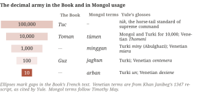

# Chapter I-12
## Caracoron, Chinghis, Prester John, Tenduc: How the Tartars Became Lords

> *“When Chinghis Kaan heard the brutal message that Prester John had sent him, such rage seized him that his heart came nigh to bursting within him…”*
> — Marco Polo, Book 1, ch. 48 (Yule–Cordier)

---

At Etzina (Khara-Khoto) the question is how many days' food you can carry out of town. The Book puts it twelve days north of Campichu (Zhangye). You can find camels and cattle there and good hawks of two sorts, sakers and lanners [1]. If you're carrying something to sell, look for your buyer before you leave. The inhabitants in this account live by their herds and what they grow. For what lies beyond, Polo says to take forty days' provisions. In summer there might be people about. In winter, with the cold down and the wild asses at home among scattered woods, the man who promised you could buy a meal on the road would have some explaining to do [2].

See [the map of the desert and Tangut road, I-11](ch-11-lop-tangut.md#map-of-the-desert-and-tangut-road).

At the far end Polo has Caracoron (Karakorum), the first city the Tartars held after they came out of their own country, in his account [3]. Ramusio puts a rampart of earth round it for want of stone, with a citadel and a palace for the governor [4].

— Rubruck had a great deal to say about the city, from its merchants' quarters to the silver tree that dispensed drinks at court. Digging has identified the great hall in the south-west as a Buddhist temple. There is a proposal for the site of the palace, and a question still open about whether Polo saw the place at all [5].

To see how the city comes into the story, go out again among the herds. Once a lord called Unc Can (Toghrul) took a tenth of their beasts and goods. That's how the Book remembers the arrangement. To its European readers he is Prester John, the Christian sovereign they've heard is to be found somewhere in the East [6]. At first the payments come in. Then the lord decides his people are too numerous and would be easier to manage if they were scattered. They move out across the desert and his tribute stops [7].

Chinghis (Chinggis Khan) comes to power among them and draws men from far and wide. In the Book his forces swell every time he wins a province, because the people he conquers are taken under his protection and go with him willingly [8]. Now he asks for Prester John's daughter in marriage. Picture having to tell your lord what the answer was. Prester John says he would put his daughter in the fire first. He expects to be able to speak that way to a man he still regards as his servant. The envoys repeat everything [9].

They come to the plain of Tenduc (the Hohhot region, provisionally), where the armies lie apart for two days. Chinghis wants to know the outcome before he goes into battle. The astrologers he calls on are Muslim and Christian. Only the Christians can give him an answer in the story. They take a cane, split it down the middle and assign one part to each of the two lords. Nobody may put a hand to either. A psalm is read. The Book makes the half named for Chinghis climb on top of the other while everyone is watching [10].

{#fig-i-12-cane-divination}

At the appointed time the armies fight. Polo has Prester John die on the field and Chinghis take his country [11]. A few more years of conquest and the Book kills Chinghis too, with an arrow in the knee at a place called Caaju [12].

— The insult has a history behind it in failed marriage negotiations. The final defeat of Unc Can came in 1203 at the Jeje'er Heights between the Tula and the Kerulen, after an earlier clash near Buir Nor. He got away and was killed by the Naiman. Chinghis lived another two dozen years. The speed of the Book's reckoning belongs with the cane and the two armies waiting on the plain [13].

Polo gets from the founder to the emperor of his own time in a single sweep. He goes from Chinghis to Cuy (Güyük), Batuy (Batu), Alaü (Hulagu, called Alacou here), Mongou (Möngke) and Cublay (Kublai), whom he reckons more powerful than all the rest put together [14].

— Put Ögedei back between Chinghis and Cuy. Batuy and Alaü ruled elsewhere in the empire that grew from the conquests. They never held the supreme title. Between one court's claim to pre-eminence and the reach of its actual authority, there is room for much of the history of the family [15].

| Book's order | Historical place in the succession |
|---|---|
| Chinghis | Great Kaan, 1206–1227 |
| Omitted | Ögedei, Great Kaan, 1229–1241 |
| Cuy | Great Kaan, 1246–1248 |
| Batuy | Ruler of the Jochid lands |
| Alaü (Alacou) | Ilkhan in Persia |
| Mongou | Great Kaan, 1251–1259 |
| Cublay | Ruled 1260–1294. His brother Ariq Böke contested the title until 1264. |

A dead ruler has a long way to travel in this story. All the Kaans are taken to a mountain Polo calls Altay (Altai), however far away they die. Then he makes it dangerous to meet the procession. The escort puts those who cross its path to death, on the understanding they will go on serving the emperor in the other world. His best horses are killed to go with him [16]. At Mongou's burial the Book counts more than twenty thousand people lost. Yule knew a similar story about the escort of Chinghis. The account of Mongou's burial that Pelliot prints supplies no support for the figure [17].

Come away from the royal procession and watch a household travelling. The Book follows it from winter pasture to the places where there is water and grazing in summer. Its house is built to go with it, a round frame of rods with felt over it. When it comes down, there is no wall left standing. When it goes back up, you find the door on the south side [18]. A traveller coming up to a place like this has to learn the difference between finding the people he came to see and finding the place he last saw them. He will do better to ask where the grazing is now than to ask how far it is to their old camp. Even if he finds the right household, he still has to ask how long they will be there.

There are carts covered so well in black felt that the women and children can travel dry in them, drawn by oxen or camels [19]. When there is something to buy or sell, it's the women who do it in Polo's account. The men are free for the chase and for practising what they will want to do in war [20]. Think of what there is to consider on a moving day quite apart from finding the next pasture. Somebody must know what there will be to buy when they get there and how much can be got for what the family brings along.

Food travels on its feet. There is milk and meat from the herds, and the Book lists whatever the hunt adds, down to animals that live in burrows. It likes the drink made from mare's milk, *kemiz* (kumis), and compares it to white wine [21]. If the household is rich you can see it in the furs a man wears under his gold cloth and silk [22].

A marriage costs the man a payment to the wife's mother. He can have as many wives as he can afford, in this account, with the first wife holding a particular place. There are rules for marriage to a dead man's widow that depend on just how close he was to her [23].

Follow the meal to the head of a different little family. There is a figure made of felt and cloth for Natigay, who looks after such things as the children and the cattle. His wife sits to his left and the children in front. A bit of fat goes to each mouth and a little broth outside the door [24]. The identification of Natigay with the earth goddess Etügen is one reading. Another would have the name belong to a goddess attested in a fragment a little later than the Book [25].

Ramusio describes a higher god as well. People put incense before the god of Heaven and pray for health of mind and body [26].

What could a man take if he had to travel away from his household and live on the move? Polo is interested in the horseman's kit, down to the leather bottles, a pot and the little tent. The horse needs grazing, and the man may have his dried milk. In Ramusio the movement of the horse shakes the milk together with water in a bottle, and there is the man's dinner [27]. It is what the army can do without that catches the merchant's attention. There is less to carry if the horses can make their own supper [28].

There is also the question of what an order has to go through to reach the man who is to carry it out. Polo can make the number of horsemen as great as he likes, and still a commander in his account need only give his instructions to ten men. Each of the ten has ten more to tell. The Book has gaps in the names of the grades, but the principle is clear [29]. It sees a mounted army that can make a pursuer sure of victory when he is in the worst position to claim one [30].

{#fig-c4-decimal-army}

Back among the herds, look for a brand. A man can turn his cattle out over the plain and find which are his, even if all his neighbours have turned theirs out too. Flocks have shepherds [31]. If a man is found to have taken a horse, the Book sets his ransom at nine times its value. For smaller thefts it counts punishments up from seven blows [32].

The most curious reckoning is between two families with children who died unmarried. They make a marriage contract for the pair and burn it. They send the dowry after it in pictures on paper. The parents take on the obligations of kinship as if the marriage had taken place among the living [33].

North of Caracoron, the Book reaches the plain of Bargu (the country towards Lake Baikal). There are people there who ride deer in its account [34]. Ramusio has them catching waterbirds that cannot fly while they moult [35]. At the edge of a reported northern sea are cliffs for peregrines and islands for gerfalcons. Polo knows which court a Christian trader's northern hawks will go to. It is the prince of the Levant's [36].

Back at Campichu, take the road east to Erguiul (the Liangzhou region) and the branch south-east to Sinju (Xining). People on that branch have animals that can put the local cattle to shame at the plough. Polo has seen or heard about their great shaggy relatives in the wild [37]. Ramusio adds that Marco took the white hair home to Venice and that the herders crossed yaks with cattle [38].

Another thing to take away from the district is musk. In Polo's account there is a small, hornless beast with formidable teeth, and the perfume comes from a sac on its belly. He mistakes the substance inside it for blood [39]. Ramusio sends a dried head and feet to Venice with Marco. Give an interested Venetian the head and he can make his own count of the teeth [40].

From Erguiul the east road leads to Egrigaia (the Ningxia region). From the capes and coats people wear you can imagine what one of the richer fabrics will cost. At its capital the best camlets in the Book are white, because there are white camels to make them from. Merchants buy the finished cloth and take it elsewhere [41].

A man going farther east into Tenduc can buy camlets of different colours as well as the stone that makes azure [42]. This is where the Book introduces King George (Körgüz of the Önggüd), a Christian ruler who holds the country under the Great Kaan. It gives him Prester John for an ancestor and says rulers of the house marry women from the emperor's family [43].

— A letter of John of Monte Corvino gives George a place outside the Book. The friar remembers a prince who took up the Latin rite and built a church. That evidence takes you some way towards finding the man. Locating the town Polo meant by Tenduc is harder [44].

The Book has a category of inhabitants it calls *Argons*, admiring their ability in trade, and another name for the territory, Gog and Magog. A European listener could recognise those names and still know very little about the people who lived there [45]. Take the road through the weaving towns and you can find different sorts of cloth of gold, as familiar to its merchants as the distinctions among woollens are to a Venetian [46]. At Sindachu (Xuandezhou) the trades supply the Kaan's troops. The Book remembers a mountain mine at Ydifu and the amount of game in the country [47]. Think what the name of the mine would mean to a merchant's companion. He could tell the man in the next town where there was silver to be had. That man would be able to tell him in return whether there was a market for what he had brought. By the time two such men have finished talking, the one going east has a picture of what he might find without having to go up the mountain for himself.

The next palace stands at Chagannor (Chaghan Nor), with swans in the lakes and pheasants on the plains. Cublay comes here to fly his hawks [48]. Polo has five sorts of crane to show you, from a black one to the great white bird with something like gold peacock eyes on its wings. There is a grey giant, a smaller bird in a fine pair of pendent feathers, and the one that lets a listener from home know the general sort of bird the others are [49]. In a valley nearby, someone has the work of keeping partridges in quantity for the emperor when he comes [50].

Leave the cranes on the plain and be ready for three more days in the saddle, with the emperor's summer park at the end of the ride.

---

## Notes

[1] ✓ Etzina is the Khara-Khoto area. Polo names the two kinds of falcon [@yc, 1.45 nn. 1–2].

[2] ~ The forty days are the Book's figure. Yule identifies the wild asses as *Asinus hemionus* [@yc, 1.45 nn. 2–3].

[3] ~ Caracoron is the historical Mongol capital in the Orkhon valley, though the Book does not establish that Marco visited it in person [@yc, 1.46 n. 1]. His description introduces a broad historical and ethnographic excursion on the steppe Mongols.

[4] ~ Ramusio-only in Yule. The rampart, citadel and palace are in his bracketed passage [@yc, 1.46].

[5] ✓ Rubruck describes the city and the silver tree; its maker was from Paris [@rockhill1900journey, account of Mongou’s palace at Caracarum]. Archaeology identifies the excavated Great Hall as a Buddhist temple. The palace under Erdene Zuu remains a proposal [@bemmann2021karakorum; @dai2015hall].

[6] ~ Unc Can recalls the Kerait lord Toghrul. Prester John brings the European legend to his story [@yc, 1.46 n. 4].

[7] ~ Paying cattle tribute to Unc Can and migrating northward into the steppe to escape his authority belong to the Book's simplified account of early Mongol vassalage [@yc, 1.46]. The story compresses decades of steppe confederation politics into a single break.

[8] ✗ The Book dates Chinghis's rise to 1187, early for the title conferred in 1206. Its peaceful conquest of the eight provinces is idealised [@yc, 1.47 n. 1].

[9] ~ The embassy and its insult are in the Book. Yule compares the failed double marriage with Unc Can's house [@yc, 1.47 n. 2].

[10] ~ The camps and cane are the Book's staging of the war. Yule compares Christian divination among the Mongols [@yc, 1.48–49].

[11] ✗ Unc Can survived the battle in which Chinghis broke his power [@yc, 1.49 n. 1; @yc, 1.50]. In the historical accounts he fled the field and was killed soon afterward among the Naiman.

[12] ✗ Chinghis died in 1227 during the Tangut campaign. Yule considers possible sources of the confusion over his wound and Caaju [@yc, 1.50 n. 1].

[13] ✓ The earlier engagement and the final one are distinct in the chronology Yule takes from Gaubil. The Naiman killed Unc Can after his flight, in the account cited by Yule [@yc, 1.49 n. 1].

[14] ✗ This is the order in the Book. Its argument for Cublay's superiority is praise [@yc, 1.51 nn. 1–2].

[15] ✓ Yule's commentary distinguishes the supreme Great Kaans—adding the omitted Ögedei after Chinghis—from Batuy and Alaü, who ruled regional uluses on the Volga and in Persia [@yc, 1.51 nn. 1–2]. See the succession table in this chapter.

[16] ? Altay is the Book's name, with the site disputed. The reported killing of people and horses is part of its funeral account [@yc, 1.51 nn. 3–4].

[17] ? Yule relays an escort story about Chinghis from Rashid. Pelliot translates an excerpt of Rashid on Mongou's mourning and burial. Its ellipsis leaves the omitted text unavailable as evidence for Polo's figure [@yc, 1.51 n. 4; @pelliot1959notes, vol. 1, “Cinghis”].

[18] ✓ Circular felt-covered framework tents (*yurts* or *gers*) pitched with their doors facing south match the eyewitness accounts of Rubruck and Carpini [@yc, 1.52 n. 1; @rockhill1900journey]. Seasonal movement between winter valleys and summer highland pastures structured nomadic life across the steppe.

[19] ✓ Two-wheeled and four-wheeled carts covered in black felt and drawn by oxen or camels appear in the thirteenth-century accounts of Rubruck and Carpini compared by Yule [@yc, 1.52 n. 2; @rockhill1900journey]. The rain-tight coverings allowed entire camps to carry household goods and families dry across open country.

[20] ~ Assigning buying, selling, and household management to women while men devoted themselves to hunting and warfare matches the observations of early Franciscan envoys to the Mongol courts [@yc, 1.52 n. 4]. Elite and ordinary Mongol women exercised wide economic responsibility whenever the men rode out on campaign.

[21] ✓ Yule compares Rubruck's detailed account of churning and fermenting mare's milk (*kumis*) and identifies the burrowing *Pharaoh's rats* of the text with steppe marmots [@yc, 1.52 n. 3; @yc, 1.53 n. 2; @rockhill1900journey]. Fermented mare's milk and game sustained the camps without reliance on grain.

[22] ~ Summer and winter robes of gold cloth and silk lined with costly sable, ermine, and fox pelts belong to the Book's portrait of wealthy steppe nobles [@yc, 1.53]. Fur linings marked rank and wealth inside the mobile camps just as silk brocades did at court.

[23] ~ The Book describes the marriage payment, senior wife and rules for marrying widows. Yule compares other reports of the customs [@yc, 1.52 n. 5].

[24] ~ The figures and their portion of a meal are in the main account. Yule compares the household images described by Carpini and Rubruck [@yc, 1.53 n. 1].

[25] ? Pelliot follows Banzarov in linking Natigay, Carpini's Itoga and Etügen. Mostaert's reading, discussed by Ragagnin, is *Načigai*, attested in a fragment dated 1312 [@pelliot1959notes, vol. 2, “Natigai”; @ragagnin2017natigay].

[26] ~ Ramusio-only in Yule. The opening of the chapter in his version gives the god of Heaven, the incense and the prayer [@yc, 1.53].

[27] ~ The kit and the use of dried milk belong to the Book. Ramusio-only in Yule. The preparation and the bottle churned by the ride are in the bracketed passage [@yc, 1.54 nn. 3–5].

[28] ~ The Book treats grazing and the capacity to travel without supplies as advantages. Its account includes prolonged endurance and drinking horse blood in extremity [@yc, 1.54 nn. 3–4].

[29] ✓ Organizing steppe armies in decimal units of ten, a hundred, a thousand, and ten thousand (*tümen*) is a foundational Mongol military institution [@yc, 1.54 n. 2]. Yule supplies the Turkic and Mongol terms for the two command grades left blank in the French manuscripts; see [Diagram C4, the decimal army](#fig-c4-decimal-army).

[30] ~ Polo gives the pursuing army's view of the mounted archers. The elaboration about avoiding a mêlée and pretending to flee is from Ramusio in Yule [@yc, 1.54 n. 6].

[31] ~ Marking horses, cattle, and camels with each owner's brand allowed large herds to graze unpenned across shared pasturelands [@yc, 1.55 n. 2]. Flocks of sheep and goats, by contrast, required constant watching by mounted or foot shepherds.

[32] ~ The numbers are Polo's. Yule compares a similar scale of punishment in other accounts [@yc, 1.55 n. 1].

[33] ~ The account of the dead couple is Polo's. Yule gives close comparisons in Chinese sources [@yc, 1.55 n. 3].

[34] ? Yule links Bargu with the Baikal region. The identification of the Mescript, whose animals are ridden in the story, is disputed [@yc, 1.56 n. 1].

[35] ~ Ramusio-only in Yule. The moulting birds and fish are in the bracketed passage [@yc, 1.56 n. 2].

[36] ~ The nests, far northern ocean and different destinations for hawks are the Book's account. The North Star behind the traveller towards the south is an exaggeration [@yc, 1.56 nn. 3–4].

[37] ✓ Yule identifies the shaggy wild and domesticated cattle of the Tangut highlands as yaks (*Bos grunniens*) [@yc, 1.57 nn. 1–3]. Their strength at the plough and burden-carrying across high mountain passes were prized throughout the Tibetan marches.

[38] ~ Ramusio-only in Yule. The hair taken to Venice and the crosses are in bracketed passages [@yc, 1.57 n. 3].

[39] ~ The animal is the Siberian or Alpine musk deer (*Moschus*), whose abdominal pod yields the prized perfume [@yc, 1.57 n. 4]. Polo mistakes the glandular secretion for congealed blood and gives the buck four tusks instead of its two elongated upper canines.

[40] ~ Ramusio-only in Yule. The dried head and feet are a claim of the later witness [@yc, 1.57 n. 4].

[41] ~ The distinction between the white camlets and the rest belongs to the Book. Yule discusses several proposed identifications for the capital [@yc, 1.58 nn. 1–3].

[42] ~ The azure stone is usually read as lapis. The Book gives the cloth and stone together as wares of the district [@yc, 1.59 n. 3].

[43] ✓ King George is historical: Chinese records and John of Monte Corvino attest Körgüz, the Christian ruler of the Önggüd who married into the Yuan imperial house [@yc, 1.59 nn. 1–2]. Making him the sixth-generation descendant of Prester John blends his real Nestorian-turned-Catholic dynasty with European legend.

[44] ✓ John of Monte Corvino's letter of 1305 describes King George's adherence to the Latin rite, his royal church, and his death [@yc, 1.59 n. 2]. Pelliot's proposed identification of Tenduc with Dongsheng (*Tung-shêng*) remains one candidate alongside proposals for modern Hohhot and Sichintingiu [@pelliot1959notes, “Tenduc”; @atwood2016toponyms].

[45] ? Polo gives *Guasmul* as a translation of *Argon*. Yule and Cordier discuss the name and the European association with Gog and Magog separately [@yc, 1.59 nn. 4–5].

[46] ✓ The gold-brocade names *Nasich* and *Naques* correspond to *nasīj* and *nakh*, the celebrated gold-and-silk textiles woven across the Mongol realms [@yc, 1.59 n. 6; @allsen1997commodity]. Colony workshops of Muslim and Chinese weavers produced these cloths for court distributions and trade.

[47] ~ Iron harness workshops at Sindachu (Xuandezhou), a mountain silver mine at Ydifu, and abundant game are reported by Polo along the approach to the summer court [@yc, 1.59 n. 7]. Yule notes that Xuandezhou was a major frontier prefecture northwest of Beijing, while the exact valley of Ydifu remains unfixed.

[48] ~ The palace and the emperor's hawking are in the Book. Yule discusses the identification of the White Pool [@yc, 1.60 nn. 1–3].

[49] ~ Some cranes can be compared with known species. The gold eyes on the white bird's wings remain unidentified [@yc, 1.60 n. 4].

[50] ~ The valley and its *cators* are the Book's account. Yule discusses the proposed kinds of partridge [@yc, 1.60 n. 5].
