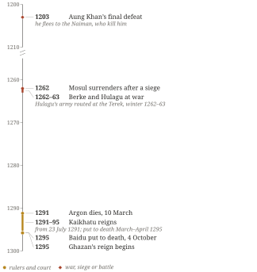
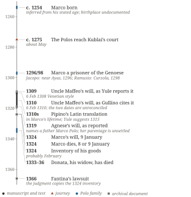

# Front Matter I-1
## The World Before the Road

> *“It came to pass in the year of Christ 1260, when Baldwin was reigning at Constantinople…”*
> — Marco Polo, Prologue, ch. 1 (Yule–Cordier)

---

::: howto
**How to read this book.** Each chapter retells one stretch of *Il Milione*. Small numbers beside claims in the text point to the chapter Notes, which compare those claims against other witnesses and cite works in the volume bibliography. Every Note opens with a verdict mark: ✓ corroborated by independent sources · ~ plausible, but a detail is under strain · ✗ probably wrong or exaggerated · ? scholars disagree (◇ marks a marvel or hearsay where kept as a separate verdict). From Volume II, chapters also carry a tag: **[V]** mostly what Polo says he saw or did · **[R]** mostly what he heard · **[M]** a mixture; Volume III's last chapters use **[reception]** for the Book's afterlife. Passages from Ramusio's sixteenth-century print, Pipino's Latin, Jacopo d'Acqui, or the Zelada Latin are anchored beside the detail they add and named in the matching Note (for example, “Ramusio-only.” or “Ramusio-only in part.”). Read these as later layers in the transmission, not as Polo's earliest words.

**Pronunciation.** Each volume’s glossary offers hints for unfamiliar names. See [Wikipedia’s pronunciation respelling key](https://en.wikipedia.org/wiki/Help:Pronunciation_respelling_key).
:::

This retelling follows *Il Milione* in modern English so readers can linger over the work of merchants, envoys, and sailors as well as the wonders they bring home. The closing essay explains the [principles of the retelling](../vol-3/ch-12-reliability-essay.md#principles-of-this-retelling).

The Prologue takes the Polo brothers east from a Venetian trading base. Their venture began in a world already joined by Mediterranean shipping and Mongol roads, with wars over who could use the best ports and passages [1].

### The Mediterranean as a counting-house

Venetian and Genoese merchants traded in spices, silk, alum, grain, and enslaved people. Their galleys called at Acre (Akko), a Crusader foothold and trading port until its fall in 1291 [2].

A harbour could be open to both cities and still favour one of them. At Constantinople (Istanbul), a Venetian merchant could sell a cargo free of duties that a Genoese merchant had to pay. That advantage came from Venice’s part in the conquest of 1204. When Michael Palaeologus retook the city in 1261, it was Genoa’s turn to be rewarded for helping to bring an emperor to power [3]. The bargaining that mattered to a merchant began well before the ship put in.

Across the Black Sea, Venetian merchants kept a trading post at Soldaia (Sudak), a port on the Crimean coast. Marco the Elder owned a house there and left it to the Franciscans in his will, reserving the right of his children to live there for life [4]. His brothers Niccolò and Maffeo belonged to a merchant family with an address on either side of the crossing.

### Map of the world in 1260

![Map A2. Approximate spheres around the time of the elder voyage. The eastern Mongol realm predates the Yuan dynastic name. Constantinople was still Latin in 1260, with Nicaea the principal Byzantine successor in the region. Soldaia and Constantinople had Venetian links, Acre was contested, and Ayas (Yumurtalık) was a port in Lesser Hermenia (Cilician Armenia). Genoa secured new privileges at Constantinople in 1261. *(Map: this edition, after Peacock, map 1, and the trade sources in the media credits.)*](../media/maps/A2-world-in-1260.svg)

### Pax Mongolica

Within two generations, Mongol conquests had brought down Khwarezm, the Abbasid caliphate at Baudas (Baghdad), and the Jin in northern China. The rulers who followed could protect long-distance traffic across much of the land their armies had taken. Historians use *Pax Mongolica* for the periods when that protection made travel easier for envoys and merchants [5].

Consider what a fresh horse could mean to a traveller on the steppe. At a relay, someone travelling under a khan’s authority could trade a spent mount for one ready to ride. A *paiza*, a tablet bearing that authority, could secure supplies and assistance along the way [6].

William of Rubruck saw what that system could do on his way across the steppe in the 1250s. On some days his party changed horses two or three times. Elsewhere they rode days without finding anyone. The escort chose its mounts first, and when the horses tired, the friars shifted their clothes to other pack animals and sometimes had to double up on one horse. There was sometimes millet gruel in the morning, and at the end of a long day Rubruck was grateful for mutton broth [7].

Four realms recur in the story. Cublay (Kublai) ruled the eastern realm in China and Mongolia, later known as the Yuan. The Ilkhanate took shape in Persia and Iraq, the Golden Horde held the Volga steppe, and the heirs of Sigatay (Chagatai) ruled across Central Asia [8]. A road protected by one ruler could still close at the next frontier. The fighting between Barca (Berke) and Alaü (Hulagu), and later between Caidu (Kaidu) and Cublay, put that protection under strain [9].

{#fig-b2-mongol-politics}

### Venice and Genoa

In Acre, the church of St Sabba stood on the boundary between the Venetian and Genoese quarters. A dispute over it broke out in 1255 and grew into a war that lasted for years. Venice drove Genoa out of Acre, but neither city could keep its merchants safe at sea without escorts [10]. With a convoy, a merchant’s crossing now depended on the company his ship kept. The quarrel had followed the cargo out of the harbour.

The rivalry returns in [Chapter I-1](ch-01-genoa-prison.md), which weighs how Marco came to be a prisoner in Genoa in 1298 [11].

{#fig-b1-polo-family}

### Why Latins went east around 1260

Mongol courts offered opportunities to merchants with jewels or other rare goods. Rulers also brought skilled people across their territories, sometimes by force. When Rubruck needed an interpreter, he turned to a Parisian goldsmith in Caracoron (Karakorum) who knew a good one. The goldsmith had work to finish for the khan and could only help once his commission was done [12]. There was a place at court for someone who could make a difficult piece of work or carry a conversation between languages.

Curiosity travelled with commerce. John of Plano Carpini and Rubruck reported the name Cathay (northern China) in Europe before the Polos’ venture. Both had met people from there at a Mongol court, and Rubruck tried to fit what he learned to the classical books he knew [13]. A merchant returning to Venice could talk about where to find buyers, what the ruler wanted to know about Europe, and what a stranger could expect at his gates.

[Chapter I-2](ch-02-house-of-polo.md) follows the brothers from a road closed by war to a commission for the Pope.

### Names, dates, and the outbound volume

The book’s forms come first, with a modern equivalent in parentheses on first mention. Approximate dates show where the chronology depends on a reconstruction. The year 1260 in the epigraph is one example. It is Yule’s working date for the brothers’ crossing from Constantinople to Soldaia [14]. A date for one stage of the voyage can be firmer than a date for the whole venture.

[Maps for the Outbound Road](front-02-maps-outbound.md) traces Volume I from Venice to Chandu (Shangdu) and the threshold of Cambaluc (Beijing).

Follow the galleys across the Black Sea and the land routes begin.

---

## Notes

[1] ✓ Historical context is drawn from the Yule–Cordier introductions, Larner’s [-@larner1999marco, chs. 9–10] reception history, Mongol-empire surveys by Morgan [-@morgan1986mongols] and Rossabi [-@rossabi1988khubilai, chs. 1–2], and Allsen [-@allsen2001culture] on Eurasian cultural exchange. This opening companion frames the political and commercial stage rather than retelling a chapter of *Il Milione*.

[2] ✓ The Venetian and Genoese quarters at Acre were bases for trade through Syria. Yule describes the fall of the port in 1291 as a blow to a southern route for goods from Asia [@yc, Intro. § 31].

[3] ✓ Under the Latin Empire, Venice enjoyed exemptions and trading rights the Genoese lacked. Yule describes Genoa’s alliance with Michael Palaeologus, who displaced Baldwin II in 1261 and rewarded his allies [@yc, Intro. § 31; @yc, Prol. 1 n. 1].

[4] ✓ Yule dates the Venetian trading post at Soldaia to about the middle of the century. The elder Marco’s 1280 will names his house there and spells out the provision for his son and daughter [@yc, Prol. 1 nn. 1–2].

[5] ~ *Pax Mongolica* is a modern term for the relative security Mongol rule could provide. Routes and conditions varied with local politics [@morgan1986mongols; @larner1999marco, ch. 1].

[6] ✓ The Prologue gives the Polos a gold tablet authorising supplies and assistance for their embassy [@yc, Prol. 8]. Yule compares that practice with other uses of Mongol tablets of authority [@yc, 2.7 n. 2].

[7] ✓ Rubruck’s description of travel across the country he calls Cangle gives both the frequency of the horse changes and the difficulties his party faced between stops [@rockhill1900journey, pp. 131–132].

[8] ✓ The four realms took shape over decades, and the claim to supreme Mongol authority outlasted effective control over all four. Morgan [-@morgan1986mongols] surveys the successor realms, and Rossabi [-@rossabi1988khubilai, chs. 1–2] gives the background to Cublay’s rise.

[9] ✓ The war between Barca and Alaü broke out in 1262. Caidu’s resistance to Cublay was a later conflict, centred on Central Asia [@yc, Prol. 2 n. 3; @morgan1986mongols].

[10] ✓ Yule dates the dispute at Acre to 1255 and describes the war that followed as lasting years. His account traces the fighting from the trading quarters to attacks on shipping [@yc, Intro. § 31].

[11] ? The French Prologue dates the writing of the Book in Genoa to 1298 [@yc, Prol. preamble]. Yule favoured Ramusio’s tradition of capture at Curzola (Korčula). Jacopo d’Acqui put the capture at Ayas [@yc, Intro. § 37]. See [Chapter I-1](ch-01-genoa-prison.md), Notes 7–8.

[12] ✓ Allsen [-@allsen2001culture, ch. 1] documents the movement of specialists across Mongol Eurasia. Rubruck names the goldsmith as William Buchier and records writing to ask for the services of a young man in Buchier’s household [@rockhill1900journey, pp. 177–178].

[13] ✓ Yule credits Carpini and Rubruck with bringing back accounts of Cathay. Rubruck identified its people with the Seres of classical geography [@yc, Intro. § 16].

[14] ~ The principal manuscripts give 1250. Yule used the chronology of the brothers’ venture and their return to Venice in 1269 to propose 1260 as the likelier year of the crossing [@yc, Prol. 1 n. 1].
