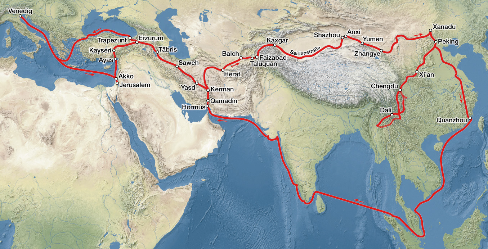
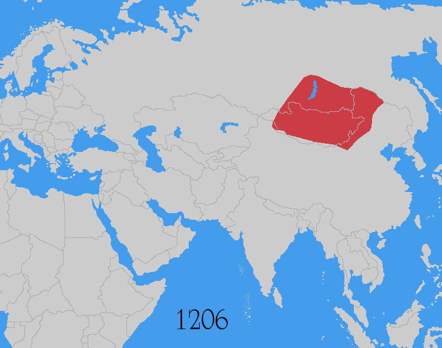

# Front Matter I-2
## Maps for the Outbound Road

> *“And here, where its breadth is least, it takes a month to cross it.”*
> — Marco Polo, Book 1, ch. 39 (Yule–Cordier)

---

Maps cannot replace Polo’s words, but they keep the ear honest. Volume I runs from the Adriatic to the Mongol summer court: roughly Venice to Chandu (Shangdu), with a long Persian–Central Asian bend and a desert that still frightens readers who have never seen sand. What follows is a map guide — how to look at the outbound route — plus place tables drawn from the project gazetteer (volume = 1). Image files live under `../media/`; captions below use placeholders until those files are filled. [1]

### How to read the outbound arc

Think of Volume I as three nested journeys, not one straight line.

**First, the elder brothers’ prologue road** (before young Marco leaves Venice): Constantinople (Istanbul) → Soldaia (Sudak) → Sarai / Bolghar country → Bocara (Bukhara) → long ride to the Great Khan → return via Ayas (Lajazzo) and Acre (Akko) to Venice. That arc is the family’s apprenticeship in Mongol logistics. [2]

**Second, the family setting-forth with Marco** (early 1270s): Acre and the papal business with Tedaldo / Gregory X → Ayas → the Anatolian–Armenian highlands → Tauris (Tabriz) and the Persian cities → Kerman → Hormuz (Hormos), where the sea plan fails → inland again past the Arbre Sec country toward Balkh and Badakhshan. [3]

**Third, the high road into Cathay:** Wakhan and Pamir → Kashgar, Yarkand, Khotan and the southern Tarim string → City of Lop and the Desert of Lop → Tangut oases (Succiu, Campichu) → the approach past Caracoron’s memory and Tenduc’s legends → Chandu, then the threshold of Cambaluc (Khanbaliq / Beijing). [4]

On a modern wall map this looks like a crooked ribbon from Italy to Beijing via Iran and Xinjiang. In the book it feels like a sequence of courts, markets, marvels, and waits — because that is how a merchant-storyteller remembers distance.

### Overview map — Venice to the Khan

*Caption:* Schematic overview of the Polo outbound corridor from the Mediterranean to Yuan China, marking principal hinges (Acre, Tauris, Hormuz, Pamir, Lop, Shangdu/Cambaluc). *(Wikimedia Commons — credit in media/ATTRIBUTIONS.md)*

Use this map to keep the whole arc in one glance. Do not treat every coastal label as a personal landing; Volume I is mostly land travel after Ayas.

### Asia under the Mongol umbrella

*Caption:* The Mongol world of Polo’s generation — Yuan, Ilkhanate, Golden Horde, Chagatai — as the political weather system of Volume I. *(Wikimedia Commons — credit in media/ATTRIBUTIONS.md)*

This second map is political weather more than itinerary. When the book says a road was shut by war, look here for which ulus borders were burning.

### Place table — prologue and Black Sea / Volga hinge

| Book name | Modern | Role in Vol. I |
|-----------|--------|----------------|
| Venice | Venice, Italy | Home parish; start and final return (c. 1295) |
| Constantinople | Istanbul, Turkey | Elder brothers’ Latin-era base; later Black Sea return node |
| Soldaia | Sudak, Crimea | Crimean trading foothold of the house |
| Sarai | Sarai region (Lower Volga), Russia | Berke (Barca) court country |
| Bolghar | Bolgar, Tatarstan, Russia | Volga Bulgaria sojourn on the first voyage |
| Bokhara | Bukhara, Uzbekistan | Three-year trap; meeting with Great Khan’s envoys |

### Place table — outbound from Acre into Persia

| Book name | Modern | Role in Vol. I |
|-----------|--------|----------------|
| Acre | Acre (Akko), Israel | Second departure; papal / legate business |
| Ayas (Lajazzo) | Yumurtalık, Turkey | Cilician port; land gate into Anatolia–Persia |
| Sivas | Sivas, Turkey | Anatolian stage toward the east |
| Erzincan | Erzincan, Turkey | Armenian highland road |
| Erzurum | Erzurum, Turkey | Corridor toward Tabriz |
| Mosul | Mosul, Iraq | Mausul — chiefly reported (Nestorian/Jacobite, muslin) |
| Baudas (Baghdad) | Baghdad, Iraq | Caliph’s fall and marvel tales; itinerary weight debated |
| Tauris (Tabriz) | Tabriz, Iran | Ilkhanid hub; outbound and return |
| Saba (Saveh) | Saveh, Iran | Magi tombs tradition |
| Yazd | Yazd, Iran | Silk / desert-edge city toward Kerman |
| Kerman | Kerman, Iran | Hub; turquoise, steel, desert routes |
| Hormuz (Hormos) | Old Hormuz near Minab, Iran | Abortive sea plan; later return landfall |

### Place table — deserts, high valleys, Tarim, Tangut, court

| Book name | Modern | Role in Vol. I |
|-----------|--------|----------------|
| Tonocain / Arbre Sec | Dasht-e Kavir region, Iran | Dry Tree landmark; folkloric geography |
| Balkh | Balkh, Afghanistan | Ruined ancient capital (Balc) |
| Badakhshan | Badakhshan (Fayzabad area), Afghanistan | Rubies, horses; Marco’s recovery in the hills |
| Wakhan | Wakhan Corridor, Afghanistan | Upper Oxus approach to Pamir |
| Pamir | Pamir Plateau | High crossing; name enters Europe widely via Polo |
| Kashgar | Kashgar, Xinjiang, China | Major Tarim oasis (Cascar) |
| Yarkand | Yarkand, Xinjiang, China | Oasis; goitre noted |
| Khotan | Hotan, Xinjiang, China | Jade and cotton (Cotan) |
| Lop (City of Lop) | Charklik / Ruoqiang, Xinjiang, China | Staging for the great desert |
| Desert of Lop | Taklamakan / Lop Desert | Spirit-voices crossing |
| Succiu (Suzhou/Jiuquan) | Jiuquan, Gansu, China | Tangut frontier oasis |
| Campichu (Ganzhou) | Zhangye, Gansu, China | Tangut country |
| Karakorum | Kharkhorin, Mongolia | Old capital — largely historical digression |
| Tenduc | Tumed / Hohhot region, China | Prester John / King George colour; site debated |
| Shangdu (Xanadu) | Shangdu, Duolun County, China | Summer court; Volume I’s arrival climax |
| Cambaluc (Khanbaliq) | Beijing, China | Winter capital threshold into Volume II |

### A few map cautions

Hormuz in Polo’s outbound chapters is **Old Hormuz** on the mainland near Minab, not the later island city tourists photograph. Baudas and the mountain-miracle story may sit nearer to report and pious tale than to a GPS pin on the family’s path. Tenduc and the Arbre Sec are soft geography — useful as book landmarks, dangerous as survey points. The Desert of Lop is a region, not a single campsite. [5]

When a chapter says “forty days” or “seven days,” treat the number as narrative measure first and itinerary stopwatch second. Medieval days’-journeys compress and expand with memory, danger, and literary habit.

Anyway, the maps are here so you can look up when the storyteller says *next he mentions Tauris* or *then they came to the City of Lop*. The road itself remains in the chapters.

---

## Notes

[1] Place data filtered from `/workspace/marco-polo/gazetteer.csv` where `volume=1`. Image files are expected under `/workspace/marco-polo/media/`; see `media/ATTRIBUTIONS.md` for license lines when files arrive.

[2] ✓ Elder voyage geography in outline — Constantinople, Soldaia, Sarai/Bolghar, Bocara — Prologue tradition with Yule date correction.

[3] ✓ / ~ Second setting-forth via Acre–Ayas–Persia–Hormuz abort — core Book I itinerary; exact day-stages vary by manuscript and commentary.

[4] ✓ Pamir–Tarim–Lop–Tangut–Chandu sequence as Volume I’s eastern climax; Cambaluc fully opens in Volume II court chapters.

[5] ? Soft IDs: Arbre Sec, Tenduc, Pem, parts of Baudas marvel overlay. Prefer gazetteer `reliability` column (visited / likely_visited / reported_only / uncertain).
