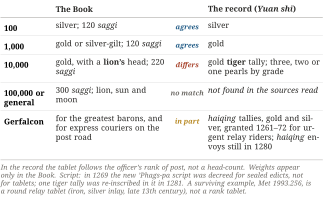

# Chapter II-1
## Cublay Kaan: Puissance, Nayan, and the Ordo of Victory

> *“Now am I come to that part of our Book in which I shall tell you of the great and wonderful magnificence of the Great Kaan now reigning, by name CUBLAY KAAN.”*
> — Marco Polo, Book 2, ch. 1 (Yule–Cordier)

**[M]**

---

Leave the summer park at Chandu (Shangdu) and follow the man who can have its ropes pulled up whenever he wishes. Cublay Kaan (Kublai) has a capital at Cambaluc (Beijing), and a title that makes the scale of his claim clear before he says a word. A Kaan is a lord of lords. The Book sets out to make the case that no other ruler has had so much land, treasure and power at his disposal [1]. Start with the part a man can claim by being born into the right family. Then see what happens when another man from the same family comes to claim it.

See [the map of imperial realm and its Nayan inset, II-F2](front-02-maps-cathay-manzi.md#map-of-kublais-realm).

By Polo's reckoning the empire came to Cublay in 1256, when he was forty-three. The Book still has him reigning in the year of the prison, 1298. He was proclaimed in 1260, while a rival claim was being made by his brother Ariq Böke, and died in February 1294 [2]. Keep that difference in mind when the Book tells us how often he went to war. In its telling, only one campaign after his accession was serious enough to take him into the field himself [3].

The man who does it is Nayan. The Book makes him an uncle of Cublay's. Their family tree instead takes Nayan back to another branch, that of Temüge Otchigin, the youngest brother of Chinghis (Chinggis Khan) [4]. What the Book wants you to see first is a young prince with an enormous number of horsemen. To a man who comes for a day to sell animals, Nayan may seem a very great lord indeed. The question that matters to Cublay is where the prince thinks his right to rule begins and ends. That makes a quarrel over a relationship into a quarrel the people who live between two princes are going to have to endure. He is one of the lords who owes obedience to Cublay and would prefer to exercise it over other men [5].

Caidu (Kaidu), Cublay's Ögedeid rival, was another reigning prince of the family. Polo has Nayan send envoys with a plan to attack Cublay from east and west at once. Caidu is said to answer warmly and bring another hundred thousand horsemen. The spoken dialogue is not a court transcript, but the anti-Cublay alliance is credible at its core [6].

When Cublay learns of the plot he tells very few people. Yet the Book gets him three hundred and sixty thousand horsemen and a hundred thousand on foot within ten or twelve days. It calls the horsemen the court's own falconers and whippers-in. Think how different the same count would sound to a man charged with feeding them [7]. He has the animals to consider first. And he has to find a man who knows the pastures ahead, or the figure he hears at court is of little use. The claim about whippers-in uses a name from the hunt to give an outsider some idea of the numbers the emperor has at hand. The men in charge of the animals would hear it a little differently.

Ramusio's version gives a reason the summons does not go out farther. There are men who have to be left in the provinces because of the offices they hold there [8]. An astrologer gives the emperor what he wants to hear at home, an assurance of victory [9].

Twenty days on the road and, says the Book, the emperor is where someone else would have needed thirty marches to get. Cublay's people have made sure no warning slips through. The story gets to Nayan asleep beside the wife he favours, then cuts straight to the sight that awaits him when he gets up [10].

Picture the height of the emperor's standard. The Book has him on rising ground, in a boarded tower carried by four elephants. Its word for a wooden defence familiar from a castle makes a tower appear above the heads of the men on the plain [11]. From below, much of the emperor himself might be hidden by the boarding. A soldier would know where to look from the height of the cloth flying over it. Think of a man coming out of a tent on the other side of the plain and making that discovery. The man wants to know what else has come up in the time he has been sleeping. Some of the riders have a foot soldier sitting behind them. Yule compares a report from Gaubil for the shared saddles. It is still a question whether that report can stand as a witness independent of Polo [12].

The men are ready, and all you hear for a moment is singing and the sound of a two-stringed instrument. Neither side can begin until the great drum gives the signal. First Cublay's sounds, and then Nayan's [13]. Larner hears in the formal arrangement of the scene the prose of Arthurian battle [14].

The story gives the fight the rest of the morning. Polo fills the air with arrows and has men brought down until the emperor's side prevails. He gives the two armies seven hundred and sixty thousand riders between them. The numbers tell you something about the force with which the scene is being told. At noon a prince and his barons are in the emperor's hands [15]. The noise that filled the plain is gone by the time the victorious soldiers can reckon who is missing. We have watched the rising ranks and heard the instruments that made the armies seem to act as one. Now the story narrows to what is to happen to one man.

The Yuan records place the main action in the summer of 1287 and describe the emperor's command and Nayan's defeat. Their notices of different engagements and commanders leave room for doubt about how they correspond to the Book's single mighty battle [16].

| Feature / Claim | Book account (Polo) | *Yuan shi* annals & biographies | Analysis & limits | Verdict |
|---|---|---|---|---|
| Kinship & status | Uncle of Cublay, aged 30, ruler of vast eastern territories | Junior-generation cousin (descendant of Chinghis’s brother Temüge Otchigin) | Princely line in Manchuria confirmed; kinship generation altered in the Book | ~ / ✗ genealogy |
| Forces engaged | Nayan 400,000 horse on the plain; Cublay raises 360,000 horse and 100,000 foot | Annals (j. 14, 154): Tabudai attacks with reported 60,000; vanguard repulses | Both sources employ epic convention; chronicle figures are annalistic claims | ~ / ◇ |
| Elephant bartizan | Cublay commands from a wooden castle mounted on four elephants | Passages checked mention no elephants; Li Ting commands crossbows and fire-pao | Elephant tower is Book claim; unsupported in searched Chinese annals | ? Independent confirmation open |
| Cross on standard | Nayan carries Christian cross on his battle banner | Nestorian Christianity attested among Onggirat and eastern Mongol nobility | Faith attested among eastern nobility; cross banner unmentioned in Chinese sources | ~ / ? |
| Execution method | Rolled in a carpet and shaken to death to avoid shedding imperial blood | Nayan bound and executed after capture (j. 14, 162) | Yule adduces parallels for avoiding royal bloodshed | ~ exact method |

Look back at the rebel's standard now that it is down. There is a cross on it in the Book, which has Nayan baptised a Christian [17]. He is still the emperor's kin. Polo has attendants wrap him in a carpet and kill him away from public view. The explanation is that his blood must not touch the ground or be shed in the sight of the sun [18].

The Book names Nayan's four provinces as Chorcha (Jurchen country), Cauly (Korea or its frontier), Barscol and Sikintinju. It gives their allegiance back to the emperor. The identification of some places is open, and the capture of Nayan did not bring the fighting in the north-east to an end [19].

Now hear what people say about the cross. Muslims, Jews and others deride the Christians for carrying something that has failed to help one of their own. Cublay tells the Christians their cross was right to do nothing for a rebel. Give the court a moment to realise the turn he has given the insult [20].

— The inscriptions of Nanghin (Kaifeng) put the synagogue in 1163 [21]. The question raised by this particular story is whether there were Jews present at the time and place where Polo's jeer is heard. Evidence for that remains thin [22].

Cublay goes back to Cambaluc and his court's festivities. Caidu, hearing what happened, keeps himself ready for war [23].

Ramusio brings Easter into the palace. The emperor has the Gospels brought forward, incensed and kissed by the men attending him [24]. Ask what a visitor belonging to any of the court's other religions would see at one of his own festivals. Ramusio gives each the honour of imperial attendance and has Cublay say that he pays respect to four prophets and would like to know which has the greatest power in heaven [25]. The scene depends upon people seeing what the emperor chooses to honour. At Easter the book makes its passage through the hands of the men of the court. A baron kisses it where the Christians who brought it can see him. The person outside the court can hear what he did without ever seeing the book.

Ramusio also takes the question of baptism back to the elder Polos, when the emperor sends them to the Pope. How could he answer his own men if their holy men can bring him a cup untouched at table and the Christians can do nothing of the sort? Let the Pope send his hundred learned men to demonstrate their powers, and then, in the story, he and his barons will be baptised [26].

At the distribution after the victory you can do an inventory the way Marco might. Some of the men have silver plate to take home. Some have jewels. A man might go to the audience in command of a hundred and come away in command of a thousand [27]. What he can show another man when he goes abroad will also change.

Lay the tablets beside one another. A silver one for a commander of a hundred, gold or gilded silver for the man with a thousand, and gold with a lion's head for the man with ten thousand. The first two weigh a hundred and twenty *saggi* each. The lion weighs two hundred and twenty [28]. There is a demand for obedience on the tablet, and a written warrant says what the man can do. Beyond the court he has something he can put in front of a stranger and say what he needs [29]. If you are that stranger it matters more than his claim to have been brave. Before you agree to have a man take an animal from your stable, you want to know whose authority he has to do it. The difference between what he has got to show and what the next man can show is the difference the Book wants us to see in the grades of metal.

The general at the top of the Book's order may take a silver chair and have a golden canopy held over his head. His tablet weighs three hundred *saggi* and carries a lion with the sun and moon [30]. A tablet bearing gerfalcons goes to very few. Polo gives its bearer the emperor's authority to take horses for his messengers wherever he needs them [31]. That is a different way to make a bird known at court. The falconer's bird goes out with him and comes back to his hand if all goes well. This bird goes out on a piece of metal. It can take its bearer across the empire, and there will be men along the road who have never seen the face of the emperor but know perfectly well what the emperor's bird requires of them when it appears.

You've seen the marks by which a stranger can recognise the emperor's authority on the road. Now come inside and look at the man his officers have to face when they go to court.

---

## Notes

[1] ~ The Book explains the title and makes the claim of unprecedented imperial power [@yc, 2.1].

[2] ✗ The Book puts the accession in 1256 and the reign still going in 1298. Cublay was proclaimed in 1260 and won the succession struggle against Ariq Böke. He died in 1294 [@yc, 2.2 nn. 1–2].

[3] ✗ The absolute claim about one campaign has exceptions, including the contest with Ariq Böke. The Book puts Nayan in 1286 [@yc, 2.2 n. 3].

[4] ✓ Pelliot identifies the line of Temüge Otchigin, called Uchegin by Yule. It makes Nayan a cousin in a junior generation [@pelliot1959notes, vol. 2, “Naian”; @yc, 2.2 n. 4].

[5] ~ The prince’s youth and claimed muster of three hundred thousand belong to the Book [@yc, 2.2].

[6] ~ The regional threat from Caidu is real. The reported exchange and his hundred thousand are the Book’s [@yc, 2.2; @rossabi1988khubilai, ch. 8].

[7] ✗ The Book numbers the rapid levy at 360,000 horse and 100,000 foot. Rossabi contrasts the book’s figure with a historical estimate [@yc, 2.3; @rossabi1988khubilai, ch. 8].

[8] ~ Ramusio-only in Yule. Yule and Cordier discuss the provincial garrison explanation and Palladius’s comparison with the *aolu* system [@yc, 2.3 n. 1].

[9] ~ The consultation is part of the Book’s account before the army goes out [@yc, 2.3].

[10] ~ The shortened march, the absence of warning and the sleeping prince belong to the Book’s account of surprise [@yc, 2.3–2.4].

[11] ? The French term is *bretesche*. The Yuan passages checked do not settle the tower’s historicity. The suggested parallel in Rashid remains unverified [@yc, 2.4 n. 1; @yuanshi1370, j. 14, 154, 162].

[12] ? Yule adduces Gaubil. The possibility that the comparison depends on the Book leaves its use as independent evidence open [@yc, 2.4 n. 2].

[13] ~ The Book has music and singing before the signal. Yule compares examples of the *naqqāra* [@yc, 2.4 n. 3].

[14] ~ Larner discusses the formal staging of the Nayan battle in witness F, chapter 79, and its affinities with Arthurian prose [@larner1999marco, ch. 6, p. 109 in the 2001 edition].

[15] ✗ This total comes from Polo’s combined horsemen. The duration and the capture are narrated in the same battle scene [@yc, 2.4].

[16] ✓ The annals and biographies report Cublay’s command, the sixth-month engagement and Li Ting’s actions. A single location and matching numbers cannot be inferred from the entries [@yuanshi1370, j. 14, 154, 162; @rossabi1988khubilai, ch. 8].

[17] ? Nayan’s baptism and cross are the Book’s specific claims. Christianity among Mongol princes offers context [@yc, 2.4 n. 6].

[18] ~ Yule compares avoidance of royal bloodshed in other accounts. The carpet and secrecy belong to Polo’s report [@yc, 2.5 n. 1].

[19] ? The Book gives four provinces and discusses the renewed allegiance. Yule’s commentary treats disputed names and the later fighting involving Hatan [@yc, 2.5 n. 2].

[20] ~ The religious taunt and Cublay’s answer belong to the main narrative. Ramusio also mentions Jews in a separate court passage [@yc, 2.5 n. 3; @yc, 2.6 n. 2].

[21] ✓ The inscriptional account reported by Cordier gives the Kaifeng synagogue a foundation in 1163 [@yc, 2.5 n. 3].

[22] ? Loewe finds notices in the *Yuan shi* for 1329, 1340 and 1354 in a fiscal context. They leave the presence of Jews at the 1287 episode open [@loewe1987jewish; @yc, 2.5 n. 3].

[23] ~ The return, festivities and Caidu’s continuing readiness are described by Polo [@yc, 2.6 n. 1].

[24] ~ Ramusio-only in Yule. The blessing of the Gospels at Easter is in the extended passage quoted by Yule [@yc, 2.6 n. 2].

[25] ? Ramusio-only in Yule. The four prophets and the emperor’s remarks about honour and the cross are reported there. Rubruck’s account of Mongou’s patronage describes a separate court [@yc, 2.6 n. 2].

[26] ? Ramusio-only in Yule. The speech to Niccolò and Maffeo is framed as part of their mission to the Pope. The offer of baptism echoes the embassy’s request for learned men [@yc, 2.6 n. 2].

[27] ~ The material gifts and promotions follow the victory in the Book’s account [@yc, 2.7 n. 1].

[28] ~ The listed ranks, metals, weights and lion are Polo’s. The comparison with Yuan ranks has a tiger where the Book gives the myriarch a lion [@yc, 2.7 n. 2; @hsiao1978military].

[29] ✓ Yule compares tablets and written orders in other sources. The precise inscription is given by the Book [@yc, 2.7 n. 2].

[30] ~ The chair, canopy and heaviest tablet are the Book’s marks of high authority. Yule compares the honour of the umbrella in other accounts [@yc, 2.7 nn. 2–3].

[31] ~ The Book gives the gerfalcon tablet powers to requisition horses and goods. Yule compares the tablet with related warrants [@yc, 2.7 n. 4].
