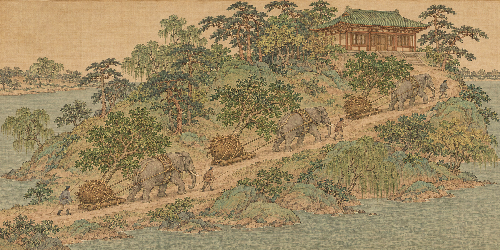

# Chapter II-2
## Person, Wives, Sons, and the Palace Inside the Walls

> *“The personal appearance of the Great Kaan, Lord of Lords, whose name is Cublay, is such as I shall now tell you.”*
> — Marco Polo, Book 2, ch. 8 (Yule–Cordier)

**[M]**

---

What sort of man dispenses the golden tablets we have just handled? Step forward to an imperial audience and examine Cublay Kaan (Qubilai, Kublai) from the spot where palace marshals bid visitors stand. Polo sketches a sovereign of middle stature, solid frame carried with natural ease, and well-proportioned limbs. His nose stands straight and his complexion shows clear white and ruddy red [1]. Manuscript scribes divide over the colour of his eyes. Yule leans toward copies calling them deep black, though rival manuscripts borrow the romance epithet used for a falcon’s bright grey gaze [2]. Someone watching him enter the throne room might notice ordinary human height just as keenly as the court ceremonial designed to lift him high above every subject.

Four noble ladies keep distinct courts of their own. Each bears the style of empress and holds an individual title across the capital. Cublay summons whichever consort he wishes to his chambers, or crosses into hers [3]. Polo counts at least three hundred gentlewomen serving each empress. Adding young pages, eunuchs, and household domestics swells a single imperial palace establishment to ten thousand people [4]. Even a listener who credits three hundred waiting-women pauses over ten thousand mouths inside one wing. A chamberlain attached directly to an empress knows precisely which inner threshold a messenger may cross. An envoy arriving for formal morning audience may spend half a day among courtyards without learning where his petitioner sits.

Younger attendants serving Cublay’s personal quarters travel another road into court. Polo calls their homeland tribe the Ungrat (Kungurat), an ancestral clan long married into the house of Chinghis (Chinggis Khan) [5]. Every year commissioners choose a hundred maidens. Senior palace matrons take the novices into their own beds to test their sweet breath, clean skin, and quiet slumber before sending six at a time to attend the emperor for three days and nights until the next six relieve them [6]. Ramusio’s edition slips one sharp extra test past the senior matrons: the young women must never snore [7].

— Ramusio turns that choice into a strict goldsmith’s assay. Examiners grade hair, skin, brows, mouth, and proportions in “carats” out of twenty-four—sending only candidates meeting Cublay’s mark up to court, where thirty or forty stay. Merchant memory or later storytelling? Either way, later Ming and Manchu palace drafts offer clear parallels [8].

When counting the Great Kaan’s heirs, the Book boasts twenty-two sons born to the four empresses alongside twenty-five by his concubines. Yule records far fewer sons born to the chief consorts across eastern annals and suspects a copyist’s slip [9]. Seven of those princes govern broad provinces in the Book, ruling with all the royal spirit expected from their father’s blood [10].

— Chinkin (Chingkim) stood first as appointed crown prince. An elder brother, Dorjé, had apparently died in youth [11]. Chinkin himself died prematurely in the mid-1280s, years ahead of his father [12]. His son Temur was the young heir Marco identifies as waiting behind him, and Temur duly ascended the throne in 1294 [13].

Cold northern winter calls the Great Kaan home to Cambaluc (Beijing) for three full months beginning in December by Polo’s calendar [14]. Ramusio pins the capital squarely on the north-eastern border of Cathay [15]. Step inside those vast whitewashed walls alongside an usher who knows which postern awaits your badge. Tall vermilion timber lintels loom above cold cobbles. A traveller might pace miles around outside ramparts without once glimpsing the inner throne roofs.

The Book’s outermost palace wall forms a square measuring one mile along each flank, whitewashed bright, pierced with neat defensive loopholes, and rising ten paces above the courtyard dust [16]. Spacious storage pavilions crown every corner and midpoint along the parapet. One houses oiled bows and quivered arrows, another stiff leather saddles, and another chased silver bridles. Marco names each depot’s stock like an inspector who spent wet afternoons asking clerks where winter harness lay packed [17].

Five ceremonial gates pierce the southern face of that long whitewashed wall. Whenever the broad central portal swings back on heavy brass-bolted hinges, everyone across the gravel court knows the Great Kaan himself rides out; lesser princes, marshals, and foreign envoys file through flanking arches [18]. Within that square sits a second enclosed court, slightly deeper north-to-south, packed with inner storehouses and guarded gates [19]. Deep at the centre rises the Great Palace itself. While an armoury keeps bridle leather ready on simple wooden shelves, nothing near the heart of court moves lightly: petitioners cross cold flagstones only when palace ushers signal each measured pause.

To Polo’s amazed eye, it stands unmatched as *“the greatest Palace that ever was.”* It rises on a single broad storey hoisted aloft above tall white marble foundations to command the open courtyards [20]. Ramusio’s text leads visitors out onto an open terrace circling the entire building right up to a carved marble balustrade, entered inside by four noble stairways [21].

Step beneath those carved cedar eaves and painted dragons, circling birds, mailed horsemen, and hunting beasts crowd walls veiled in hammered gold and bright silver plate. Raise your chin toward the rafters, and vivid red, azure, and gilded woodwork glows evenly in soft torchlight [22]. Polo seats six thousand guests comfortably at low banquet tables down that single room [23]. Out across crisp winter courtyards, sunbeams blaze off glazed roof tiles fired red, yellow, green, and sapphire blue like polished crystal [24]. In Ramusio’s version, visitors glimpse distant pavilions tucked behind the rear gable holding crown treasure chests and the ladies’ apartments—yet no outsider steps inside [25].

Between inner and outer palace walls roll green lawns and blossoming fruit orchards dotted with white deer, timid gazelles, sleek squirrels, and the small antlerless buck prized across markets for aromatic musk [26]. Ramusio even traces the drainage of summer rain across that park: raised flagstone walks keep messengers dry above sunken lawns where rainwater sheets gently into soft grass [27]. Put yourself in the dusty riding boots of a curious merchant visiting Cambaluc rather than an imperial clerk carrying an urgent tally. Flagged garden walks carry your gaze only so far across peach groves; everything rarer lies strictly within gates barred at the Kaan’s pleasure.

Off the north-west corner of the palace enclosure spreads a broad artificial lake teeming with prized fish kept ready for royal kitchens. Clear canal water feeds the basin in and out past willow banks, while stout bronze and iron gratings block channels so no silver carp slips out to open river [28].

A single bowshot north rises a steep tree-clad mound. Ramusio explains that workmen piled this hill out of soil dug from the fish-lake basin [29]. Dark evergreens mantle its slopes through winter frost. Polo knows just how the finest specimens climbed that height: whenever Cublay hears of an extraordinary pine or cypress anywhere in his realm, foresters lift it whole with rich soil packed round thick roots and lash it behind elephants to haul straight to the mount [30]. Stand back in clear morning sun and admire the deliberate colour scheme. Green azurite stone dresses the rocky slope, green glazed tiles crown the summit pavilion, and soft pale green hangs overhead indoors—giving Green Mount a nickname no courtier ever forgot [31].

{#fig-ii-2-green-mount}

Concerned that his chosen successor keep royal dignity unbroken, Cublay grants his heir a matching palace establishment and imperial seal, though effective rule stays Cublay’s while he lives [32]. Scribes stumble slightly over Polo’s word *son* here: Chinkin had already passed away, so Yule reads Marco’s young heir as the grandson Temur [33]. Ramusio’s text places the two palaces opposite each other beside the broad lake, joined across open water by a long timber bridge [34].

Walk past outer palace gates into the bustling metropolis beyond, where old names cling alongside fresh mortar. An older southern town stood there before Cublay built his vast new seat across a narrow stream—Cambaluc (Taidu or Dadu), meaning the Great Court [35]. Polo frames that ambitious move round an astrologer’s warning that the older city would rise in rebellion [36]. Ramusio adds a practical rider: the new squared wall still could not pack every household inside, leaving trusted older families settled across the ancient southern wards [37].

Pace out the great outer earthen rampart yourself beside dusty cart tracks. Polo reckons six square miles along every flank of a battered mud-brick wall ten paces thick at its turf footing and tapering upward [38]. He stations three tall timbered gatehouses along each side—twelve gates in all—above long garrison magazines crammed with spare bows and iron gear [39]. Modern archaeology on the capital’s excavated foundations counts only eleven main city gates, with two piercing the shorter north curtain instead of three. Still, for a merchant hunting wholesale pine timber or dry Sichuan ginger, knowing which gatehouse heavy wagons rolled through at sunrise beats pacing six miles of parapet around an outer moat.

{#fig-a9-dadu-city-plan}

Inside those broad archways, paved boulevards run so arrow-straight and open that a watchman standing under one gate can sight the far gatehouse clear across the town [40]. Fine tiled courtyards, busy timber inns, and noble residences line every square block. Ramusio crowns this civic design with the simile that entered world memory: squared house-plots ruled by surveyor’s cord, allotted evenly to household heads along cross-streets so the entire capital lies drawn *“just like a chess-board”* [41].

Night settles when the giant bronze watch-bell tolls from its central drum tower. After three deep strokes ring out across tile roofs, only someone hurrying for a physician or a midwife in childbed may step outdoors—and even that runner must swing a lit paper lantern [42]. A thousand armed guardsmen keep station by every city gate, both for imperial dignity and tight street order [43]. Ramusio hints at suspicion beneath that discipline, muttering that the Kaan’s watchmen still distrust native townsfolk after dark [44]. Stand beside the gate patrol an hour past curfew and peer down two miles of empty straight gravel avenue, with the shutters barred and the braziers banked. Only a single flickering paper lantern bobs out of night shadow: that frail yellow flame both proves the bearer carries urgent honest business and gives guards time to draw sword before he hails the wooden barrier.

Yet a reader pausing at the watch-gate notices sharp silences beside everything Marco sets down so carefully. Tea steamed in copper kettles across northern and southern rooms every afternoon, yet Polo never drops a word on brewed tea [45]. Foot-binding crippled countless wealthy daughters in urban households just a generation before Friar Odoric remarked on it, yet Polo keeps silent [46]. Nor does the Book name any Great Wall stretching across northern crags, though Ming builders raised towering stone fortresses at Jiayuguan a century later over uncertain Yuan earthworks [47]. Chapter III-12 will return to these famous silences across the whole manuscript tradition.

Leave that solitary watch-bell swinging in winter dark above silent avenues, and step forward into torches blazing round the palace dining doors—where the Great Kaan’s seasonal feasts, personal guard, and gold-cup trick await inside.

---

## Notes

[1] ~ The Book opens its portrait of Cublay with his medium height, shapely limbs, straight nose, and fresh white-and-red complexion [@yc, 2.8]. Courtly panegyric balances believable physique with imperial dignity.

[2] ? Scribes diverge sharply between black eyes (*noirs*) and the bright grey falcon-eye epithet (*vairs* or *voirs*) favoured in French romance [@yc, 2.8 n. 1]. Yule leans toward the witnesses reading black eyes without forcing finality on a copyist’s variant.

[3] ✓ Four recognized senior empresses heading separate *ordos* (camp courts) accord well with Yuan palace structure reported by Palladius [@yc, 2.8 n. 2]. Yule compares differing totals for Cublay’s wider wives reported across von Hammer and Gaubil.

[4] ~ Assigning three hundred gentlewomen and ten thousand staff per empress’s household inflates palace retinues to imperial epic scale [@yc, 2.8 n. 2]. Each senior consort genuinely maintained an autonomous administrative appanage.

[5] ✓ Ungrat renders the aristocratic Khongirad (Kungurat) tribe, long linked by preferential imperial marriages to the house of Chinghis [@yc, 2.8 n. 3]. Cublay’s senior empress Chabi belonged to this celebrated lineage.

[6] ~ Selecting a hundred maidens annually, placing them under senior matrons to test health, and rotating six attendants on three-day watches forms the Book’s domestic scheme [@yc, 2.8]. No court administrative register confirms those precise rotation totals.

[7] ~ Ramusio-only in Yule. Checking novices overnight to verify none snored in her sleep appears solely in Ramusio’s 1559 Venice print [@yc, 2.8]. It turns an intimate palace detail into memorable humanist colour.

[8] ? Ramusio-only in Yule. Grading brides across twenty-four “carats” like assayed gold bullion sounds either like a Venetian merchant’s metaphor or later embellishment [@yc, 2.8 n. 3]. Yule adduces comparable Ming and Manchu palace drafts of banner daughters as distant historical parallels.

[9] ✗ Twenty-two sons by chief wives and twenty-five by concubines far exceed verified family totals [@yc, 2.9 n. 2]. Yule notes ten or twelve lawful sons across standard eastern lists and suspects textual corruption of medieval Roman numerals.

[10] ✓ Assigning seven princes to regional appanages and provinces accords broadly with Yuan frontier viceroyalties held by Cublay’s sons [@yc, 2.9 n. 2]. Mangalai’s Shaanxi command in Chapter II-6 illustrates one such real princely charge.

[11] ~ The *Yuan shi* lists Dorjé as Cublay’s eldest son and gives neither his mother nor his birth year [@yuanshi1370, juan 107]. Its biography of Chabi names Chinkin as her son without naming Dorjé [@yuanshi1370, juan 114]. Yule suggests Dorjé died young [@yc, 2.9 n. 1].

[12] ? Chinkin’s premature death falls safely in the mid-1280s, though sources waver slightly over month and year [@yc, 2.9 n. 1]. Yule prints the twelfth lunar month of 1284–1285, while *Yuan shi* calendars pointing toward January 1286 remain an active chronological check.

[13] ✓ Temur, Chinkin’s son, stands properly beside his grandfather as designated successor and mounted the throne in 1294 [@yc, 2.9 n. 1]. Yule tracks Bayan’s steady backing during the smooth transition after Cublay’s death.

[14] ~ Spending three winter months from December onward inside Cambaluc matches the court’s seasonal swing between summer pastures at Chandu and winter headquarters [@yc, 2.10]. Official court decrees confirm regular winter residence at Dadu.

[15] ~ Ramusio-only in Yule. Locating the capital squarely near the north-eastern boundary of Cathay belongs exclusively to Ramusio’s wording [@yc, 2.10]. Geographically, Beijing guards the frontier passes toward Liaodong and Manchuria.

[16] ~ Claiming an outermost mile-square, whitewashed, loop-holed wall ten paces high adapts architectural dimensions cleanly to European ear [@yc, 2.10 n. 1]. Cordier cites Chinese accounts logging construction of an imperial brick wall beginning around 1271.

[17] ~ Assigning four corner pavilions and four midpoint halls separately to bows, saddles, and bridles imposes neat Italian inventory order on Mongol arsenals [@yc, 2.10 nn. 3–4]. Bretschneider compares excavated towers while leaving exact warehouse labels open.

[18] ~ Five south gates with the middle archway kept sacred for the Great Kaan himself reflects classic Chinese imperial gate protocol [@yc, 2.10 n. 5]. Yule notes identical ceremonial reservation at the Meridian Gate of later dynasties.

[19] ~ Double palace enclosures housing storehouses and inner throne halls preserve Dadu’s concentric court layout accurately in broad outline [@yc, 2.10 n. 6; @xu2020dadu, pp. 44–55]. Modern architectural reconstructions caution that detailed hall interiors surpass fragmentary foundations.

[20] ✓ Raising a vast single-storey timber hall on an elevated stone plinth accords closely with traditional Chinese imperial palace design [@yc, 2.10 n. 8]. Yule links Polo’s raised single storey cleanly with classic Beijing ceremonial platforms.

[21] ~ Ramusio-only in Yule. Adding the open terrace, marble balustrades, and four monumental stone stairways rests on Ramusio’s expanded prose [@yc, 2.10 nn. 7–8]. Such architectural elaboration mirrors later palace accounts without independent thirteenth-century verification.

[22] ~ Carved dragons, horsemen, gilded walls, and brightly painted ceilings convey Yuan timber decoration vividly [@yc, 2.10]. Ramusio further expands those relief dragons with thick gold and silver leaf plating.

[23] ~ Seating six thousand banqueters under one timber roof pushes genuine grand-banquet scale into heroic traveller arithmetic [@yc, 2.10]. Ceremonial assemblies certainly crowded main halls and flanking courtyards together.

[24] ✓ Red, yellow, green, and blue glazed roof tiles shining from afar match authentic Song–Yuan imperial ceramic glazes [@yc, 2.10 n. 9]. Archaeological roof-tile shards recovered across Dadu confirm vivid polychrome glazing.

[25] ~ Ramusio-only in Yule. Mentioning barred rear pavilions storing crown treasure chests and imperial women derives solely from Ramusio’s edition [@yc, 2.10]. Strict spatial separation between public audience halls and rear residential quarters matches Chinese court layout.

[26] ~ Fruit orchards stocked with deer, gazelles, squirrels, and musk deer inside palace walls describe an enclosed imperial hunting park [@yc, 2.10]. Noble Chinese gardens regularly blended orchards with captive game.

[27] ~ Ramusio-only in Yule. Paving walkways high above lawn level so rainwater drained evenly into garden grass comes purely from Ramusio’s layer [@yc, 2.10]. Well-engineered brick drainage channels did crisscross Yuan Dadu’s gardens.

[28] ~ Stocking an artificial lake off the palace’s north-west flank with river fish fenced behind iron and brass channel gratings captures Taiye Pond accurately [@yc, 2.10 n. 11]. Yule aligns Polo’s north-west water sheet directly with imperial lake plans.

[29] ~ Ramusio-only in Yule. Explaining that workers threw up the steep earthen mound directly from soil excavated out of the fish lake appears solely in Ramusio [@yc, 2.10]. Historical Chinese accounts trace Qionghua Island’s hill in part to earlier Jin–Yuan dredging spoil.

[30] ~ Lifting mature evergreens in earth-balls behind elephants expresses imperial power over landscape [@yc, 2.10]. While Yuan gardens transplanted specimen trees carefully, heavy elephant haulage reads like traveller colouring.

[31] ✓ Dressing an artificial summit in green stone and a green-roofed pavilion agrees closely with Friar Odoric’s later notice of *Mount Wan-shou* [@yc, 2.10 nn. 12–13]. Yule weighs competing minerals behind Polo’s vivid green *azur*.

[32] ~ Granting the heir a mirror-palace and imperial seal while reserving sovereign command to Cublay outlines dual crown administration [@yc, 2.10]. Crown-prince palaces stood traditionally near the eastern or western flanks of Dadu.

[33] ? Calling the designated successor Cublay’s *son* clashes with Chinkin’s mid-1280s death [@yc, 2.10 n. 14]. Yule smoothly resolves that wording tension by reading Marco’s young prince as Chinkin’s son Temur.

[34] ~ Ramusio-only in Yule. Setting the heir’s palace opposite Cublay’s across a bridge over the lake belongs strictly to Ramusio [@yc, 2.10 n. 15]. Yule confirms a Yuan wooden bridge spanned Taiye Lake long before its marble replacement.

[35] ✓ Separating old southern Cambaluc (former Zhongdu) from Cublay’s new northern foundation *Taidu* (*Dadu*, founded 1271) beside a stream hits urban history accurately [@yc, 2.11 n. 1]. The twin cities really stood divided across open water meadows.

[36] ~ Citing astrologers’ rebellion prophecies to explain transferring the seat from old Zhongdu to new Dadu echoes Mongol court politics [@yc, 2.11 nn. 1–2]. Practical flood control and ruined Jin walls equally drove Cublay’s vast rebuilding.

[37] ~ Ramusio-only in Yule. Leaving trusted families inside old southern wards because new walls could not hold everyone belongs purely to Ramusio [@yc, 2.11]. Historically, southern Jin suburbs remained thickly populated long after 1271.

[38] ✗ Estimating twenty-four miles round battered earthen walls (six miles per side) exceeds archaeologically surveyed perimeters [@yc, 2.11 n. 3; @steinhardt1990chinese]. See [Map A9, Yuan Dadu](ch-02-person-palace.md#fig-a9-dadu-city-plan) for the excavated rammed-earth city trace.

[39] ✗ Counting twelve outer city gates—matching Friar Odoric—misses the historical eleven gates uncovered by Chinese excavators [@yc, 2.11 n. 4; @steinhardt1990chinese]. Modern ground surveys documented on Map A9 verify three gates each on south, east, and west curtains but only two on the north wall.

[40] ✓ Straight orthogonal boulevards running unobstructed from gate to gate reflect Dadu’s deliberate classical Chinese street grid [@yc, 2.11; @steinhardt1990chinese]. Urban archaeology confirms broad rectilinear avenues intersecting across balanced residential wards.

[41] ~ Ramusio-only in Yule. Comparing squared family house-plots set out by line to a neat chess-board belongs uniquely to Ramusio’s compilation [@yc, 2.11 n. 5]. The metaphor accurately conveys Dadu’s modular *fang* ward geometry.

[42] ~ Night curfew tolled by a central drum-and-bell tower requiring lanterns on medical or childbirth errands blends authentic Yuan watch practice with traveller vividness [@yc, 2.11 n. 6]. Beijing’s surviving Bell Tower site dates back to Dadu’s urban axis.

[43] ~ Stationing a thousand soldiers at every city gate inflates routine municipal guard detachments to grand parade numbers [@yc, 2.11 n. 7]. Tight nocturnal control nonetheless guarded gates across Mongol-ruled northern cities.

[44] ~ Ramusio-only in Yule. Qualifying those heavy gate patrols as suspicion toward conquered subjects stems solely from Ramusio [@yc, 2.11 n. 7]. That gloss rings true against Mongol garrison anxieties after northern conquest.

[45] ? Cordier establishes brewed tea as an everyday Chinese staple long before Polo’s stay—cited centuries earlier by the ninth-century Arab traveller Soleyman—so Marco’s silence remains genuinely puzzling [@yc, Introduction, § 71; @rossabi1988khubilai, chs. 5–6; @wood1995did, ch. 8]. Competing modern explanations appear in Back Matter II-1, II-2, and Chapter III-12.

[46] ? Friar Odoric explicitly remarked on tiny bound feet among noblewomen just one generation after Polo left China [@yc, Introduction, § 71; @rossabi1988khubilai, chs. 5–6; @wood1995did, ch. 8]. Whether Marco overlooked private women’s quarters or omitted the custom by taste remains debated across the closing essay.

[47] ? Modern stone passes at Jiayuguan were built only under the Ming dynasty beginning in 1372, leaving sparse earthen Yuan fortifications far less monumental than travellers later assumed [@chinawh2004jiayuguan; @yc, Introduction, § 71]. The fierce scholarly quarrel over Polo’s silences—tea, bound feet, and the Great Wall—is weighed in full in [Chapter III-12](../vol-3/ch-12-reliability-essay.md) [@wood1995did, ch. 11; @derachewiltz1997marco; @haw2006marco, ch. 4; @larner1999marco, ch. 3; @vogel2013marco, ch. 1].
