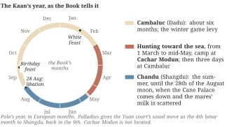

# Chapter II-4
## Hunt, Hounds, Litter, and the Traffic of a Million

> *“You must know that the city of Cambaluc hath such a multitude of houses, and such a vast population inside the walls and outside, that it seems quite past all possibility.”*
> — Marco Polo, Book 2, ch. 22 (Yule–Cordier)

**[V]**

---

The last guests have bowed their way out of the White Feast, past the guards and the perilous wooden threshold. Come outside with me, dear reader. There’s a covered cart beyond the gates of Cambaluc (Beijing) worth a look. It has a tiger inside. Beyond it the red and blue ranks of the Kaan’s huntsmen stretch into the distance. In the spring marshes, watch for the four elephants carrying a gold-lined room. A crane rises. Off comes the roof, and out goes a gerfalcon. Cublay (Kublai) Kaan can watch it strike without getting out of bed.

Someone has to feed a court that can take a small army out for the afternoon. In December, January and February the country around the capital goes hunting, as far out as forty days' travel in Polo's reckoning. Boar, stag and wildfowl are dressed where they fall and sent by cart to the palace. A district twenty or thirty days away can still contribute to the winter table [1]. Beyond that, the palace asks for tanned hides, which will keep long enough to be made into army gear [2]. Marco has an eye for the point at which a delivery stops paying its way. A hide can finish a journey that a haunch can't. The same animal could therefore end up on a baron's table or on a soldier's back, depending on how far it fell from the capital.

The Kaan brings his own hunters. A cheetah can travel on the back of a horse, ready to be let loose when there is quarry worth the sprint, and even the lynxes are trained.

{#fig-liu-guandao-hunt width=68%}

If a cat riding pillion seems like something only the Kaan could arrange, think of Frederick II. He hunted with cheetahs in Italy [3] and used to joke that his cats knew how to ride.

The animals Polo calls lions have black, red and white stripes. A tiger is what you would see if you could look through the cover of the cart, where it travels with a little dog for company. For boar, bear or wild cattle, the cart takes the downwind approach [4], which gives the tiger a chance to surprise an animal quite capable of fighting back. On open ground there are eagles trained for wolves [5]. Polo grants the wolf about as much chance as he gives a deer once it hears the Kaan's dogs.

Those dogs belong to the two masters of hounds, Baian and Mingan, whom the Book calls *Chinuchi* [6]. One brother’s men wear red livery, the other’s blue. In each corps, two thousand handlers have one or more mastiffs in their charge. Polo puts ten thousand men under each brother and sends one flank out with about five thousand dogs. Listen for one of those dogs barking across open country and you get some idea of what the Kaan is buying with all that manpower. The brothers ride out on opposite flanks and feed men and dogs into the line until, in the Book's telling, it takes a full day to ride from one end to the other [7].

Picture this. The Kaan sits in the middle of that plain with a hawk on his fist. Over here the hounds are running a bear. Over there another pack has a stag in sight. Rustichello could send a knight galloping into either chase. The Kaan has only to turn in his saddle.

Even a day off from the hunt leaves the brothers with deliveries to make. From October to the end of March they owe the court a thousand head of game a day [8]. Quail do not count. Fish do, at the rate of one head of game for every three people you can feed. The thousand has the ring of a number you shout across a hall. The fish allowance sounds like an argument somebody had to settle at the kitchen door.

---

Come March, the Kaan heads out toward the Ocean Sea, which the Book puts two days from the capital [9]. The water is more like a hundred miles away in a straight line. Distance behaves a little better when Polo describes how the party spreads across the ground. He gives the expedition ten thousand falconers and five hundred gerfalcons, with peregrines, sakers and goshawks besides [10]. The birds go in groups of a hundred or two. While one party hunts a stretch of country and sends its catch to the Kaan, the next is already working another. A goshawk can be flown at waterfowl along the way. A prince who kept all his birds under his own eye would have to wait his turn at the same patch of water as everybody else.

Out ahead, pairs of *Toscaol* [11] watch the sky. Each man has a whistle to call back a bird and a hood to settle it once caught. If the Kaan flies a falcon, the watchers can follow it from post to post and go to its aid while he stays where he is. A little label tied to the hawk's leg gives the name of its owner and the name of its keeper. If neither can be found, the bird goes to the *Bularguchi* [12], who also takes charge of stray horses and swords. His banner flies from the highest spot in camp. I’d keep one of those little labels. There’s enough writing on it to spare a stranger the trouble of asking every man in camp if he’s lost a hawk.

The Kaan travels in a timber room on four elephants, with hammered gold on the inside and tiger skins on the outside. He has a dozen of his best gerfalcons to hand and barons riding close enough to talk to him. Imagine trying to keep up your end of that conversation when a rider breaks in: *“Sire! Look out for Cranes!”* Good heavens, off comes the roof. The Kaan marks the birds, chooses his falcon and throws it into the air. He can see the whole flight from his seat, or from his bed if that's where the news catches him. The barons get to watch from horseback.

{#fig-elephant-litter width=87%}

I’m glad to have Ramusio’s detail about the Kaan’s gout [13]. From the bed, an opening in the roof means an afternoon under the sky when your feet won’t take you as far as the door.

At Cachar Modun [14] the tents are up before the hunting party arrives. Polo credits the encampment with ten thousand, enough to swallow the imperial household and all the households that come with it. The great audience tent opens south and has room, by his account, for a thousand people. Knights and barons wait there while the Kaan receives the people he has sent for in a tent to the west. His sleeping quarters are just behind. The layout of the palace has come out into the grass. A visitor still has to wait on the public side of a door.

Spice-wood poles hold up the audience tents. Striped skins keep out the weather and silk ropes take the strain. Now, have a proper look at the lining. Those panels are sable and ermine, fitted together as neatly as you please. Enough sable to line a single mantle [15] will set you back a thousand gold bezants, two thousand if you take Polo at his word. And there’s a fair bit of wall in a tent that seats a thousand. The doctors, astrologers and falconers bring their families. There are tents even for the hawks and their minders [16]. Walk among all those people going about their business and you could take the place for a town. From its last tents, though, you can ride straight out to reed beds, rivers and lakes with cranes and swans on them.

The sport stays good in part because the Kaan decides who gets to have it. Polo puts a twenty-day reserve around the camp where other people may keep neither hounds nor hawks. His closed season for hares and several kinds of deer runs from March through October [17]. At other times anyone may take them. A hare can fall asleep beside the road in spring, the Book boasts, and nobody will lay a hand on it. The Kaan will be back for sport next year and expects there to be something left to catch.

By mid-May the tents come down and the Kaan is back in Cambaluc for three days of feasting. Then he is off to Chandu (Shangdu (Duolun County)) [18], where the Cane Palace and its park offer relief from the summer heat. Polo has him leave on 28 August, at the time of the white mares' milk offering. September brings the birthday back around. Put those movements on a calendar and the Book gives us six months in the capital, three in the field and three at the summer palace. Even the imperial pleasures have an itinerary.

{#fig-seasonal-orbit}

---

Let the Kaan go on to Chandu. If you’ll come this way, we can stay at the gates of Cambaluc and see who comes in when the court goes out.

An envoy with a gift for the Kaan, a man hoping to sell to a lord, and a trader who has a buyer out in the suburbs can all arrive at the same gate. The Book counts twelve gates, with a suburb spreading from each until it meets the next, three or four miles out [19]. Polo thinks more people live outside the walls than inside. What a merchant needs to know is which door to knock on. Foreigners can find lodging with people from their own part of the world [20]. As Polo explains it to his audience, there might be one house for Lombards, another for Germans and a third for the French. Polo reaches for the familiar word *fondaco*. Imagine an inn where someone already knows your language and may be able to tell you who will pay the best price for what you brought.

The suburbs take in more than travellers. The dead go beyond both the walls and the outlying houses for burial or cremation, depending on their religion. Women who sell sex live outside the gates too. Polo gives them more than twenty thousand in all [21], his way of making a reader imagine how many strangers there must be to support so much business. After the great bell has rung three times, parties of thirty or forty patrol the streets [22]. Anyone caught outside spends the night in custody and answers for it in the morning. The penalty for an offence is a beating that can prove fatal. The Book attributes the choice of the stick to the religious objection to drawing blood.

If you’re used to a city where you can walk home at any hour, imagine hearing that third stroke when you’re still three streets from your bed. You’d soon learn the city in minutes as well as streets.

In daylight the carts keep coming. India sends costly wares and Cathay sends the goods of its own provinces, some for the Kaan, some for the courtiers, some for the people who live here when the court is away. Polo singles out one cargo: a thousand cartloads of silk a day [23]. You can hear the merchant trying to explain how a fabric a European would think of as a luxury could bear so much ordinary wear. Silk is plentiful and cheap here, he says, and flax is scarce. He allows that there is cotton and hemp in some districts, but nowhere near enough for the demand he sees around him. About two hundred towns send buyers and sellers into the capital in his reckoning [24]. The figures have the scale of a romance, and the thing that keeps drawing Marco's eye is what people have to haul and sell to make a city that big possible.

Silk still comes through the gates when Cublay rides north for the summer. The city is in the hands of his finance minister, Achmath (Ahmad Fanakati). One night a messenger tells Achmath the crown prince has come back and wants to see him. Achmath hurries to the palace. The prince is still away.

---

## Notes

[1] ~ The court's demand for game belongs to a landscape with a long memory for winter hunting. Magaillans describes frozen animals standing in rows awaiting shipment to the capital centuries later, a vivid parallel for Polo's carts [@yc, 2.17 n. 1].

[2] ✓ Requiring outlying districts beyond thirty days' journey to send dressed and tanned hides rather than perishable meat reflects the practical logistics of supplying imperial armouries [@yc, 2.17]. Leather from provincial game hunts went directly into army gear and court saddlery.

[3] ✓ Hunting with cheetahs had a long life at courts across Eurasia. Yule describes the practice of carrying a cat behind a rider and credits Frederick II with the joke about his cats' horsemanship [@yc, 2.18 n. 1; @yc, 1.61].

[4] ~ Ramusio-only. The advice about approaching against the wind comes from Ramusio's text. The older account already puts the striped animal and its little canine companion together in the covered cart [@yc, 2.18].

[5] ✓ The great wolf-catching eagle has a counterpart in the Central Asian *búrġút*, or golden eagle. Atkinson [-@atkinson1858oriental], as cited by Yule, describes an eagle brought to bear on a wolf in the region's hunting tradition [@yc, 2.18 n. 4].

[6] ? Baian and Mingan are credible Mongol names, though the brothers are hard to trace. Yule canvasses several ways to get from *Chinuchi* to a keeper of large dogs, including a possible connection with Mongol *noghai*, “dog” [@yc, 2.19 n. 1].

[7] ~ The advancing wings make sense for a drive that sweeps game toward the hunters. Polo's ten thousand men under each brother and a line a day's ride wide give the drive its epic dimensions [@yc, 2.19].

[8] ~ Ramusio-only. The winter quota comes from Ramusio, right down to the exemption for quail and the rule about fish. The allowance sounds like an accounting convention, even if the daily thousand is a figure to take lightly [@yc, 2.19].

[9] ✗ Yule puts the nearest shore about a hundred miles from the capital, several days' travel for a court on the move. He also notes that Ramusio's compass bearing differs from the French account, which leaves room for debate about the route [@yc, 2.20 n. 1].

[10] ~ The flock is easy to imagine in working parties, harder to count across miles of country. Rossabi [-@rossabi1988khubilai, ch. 6] recounts the hunts using Polo, while Yule cites descriptions of a later imperial hawking establishment in which each bird had a keeper [@yc, 2.20 n. 2]. See [Liu Guandao’s *Khubilai Khan Hunting*](#fig-liu-guandao-hunt) for a court painter’s view of the hunt.

[11] ✓ The French manuscripts give *Toscaor*, and Yule takes *Toscaol* from Ramusio. He connects it with the Turki *tosḳáúl*, a watcher or road guard [@yc, 2.20 n. 3]. See [Back Matter II-2, Glossary under “Toscaol”](back-02-glossary.md#term-toscaol).

[12] ✓ A description of the Perso-Mongol court gives its lost-property officer a flag, just as Polo does. In that account, anyone reclaiming a stray animal has to prove ownership [@yc, 2.20 n. 4]. See [Back Matter II-2, Glossary under “Bularguchi”](back-02-glossary.md#term-bularguchi).

[13] ~ Ramusio-only. The claim that gout made the litter necessary is bracketed from Ramusio. The Korean annals, as reported by Palladius, have a particularly practical detail about the Kaan's swollen feet: he asks for skins to make boots. Odoric describes a later emperor travelling with falcons in a chamber [@yc, 2.20 n. 5; @odoric1913travels, ch. 40].

[14] ? The name may mean something as ordinary as “wooded country,” which gives a mapmaker little to work with [@yc, 2.20 n. 6]. The site still has no fixed identification. See [Back Matter II-2, Glossary under “Cachar Modun”](back-02-glossary.md#place-cachar-modun) and the map cautions in [Front Matter II-2](front-02-maps-cathay-manzi.md#map-cautions-for-volume-ii).

[15] ~ Sable was a luxury fit for a ruler's tent, and its dark fur made an especially prized lining. Yule's notes distinguish the fur used to weatherproof the outside of the pavilion from the luxurious lining inside, whose cost comes from Polo [@yc, 2.20 nn. 7–8].

[16] ✓ Bringing physicians, astrologers, falconers, and their households into a laid-out tent city reflects the mobile Mongol *ordo*, which reproduced the court's spatial hierarchy in the field [@yc, 2.20; @allsen2006royal]. Every specialist corps and its birds had a fixed quarter around the sovereign's enclosure.

[17] ~ The *Yuan shi* records official hunting grounds and closed seasons, including breeding-season bans in 1286 and 1287 and a ban from the first through the seventh lunar month in 1297, while the 1291 *Tongzhi tiaoge* edicts (juan 28) and the *Yuan dianzhang* 捕獵 summary table (juan 38) end the closed season on the twentieth day of the seventh lunar month (七月廿日) as Polo's March-to-October span roughly does; the full *Yuan dianzhang* article beyond the summary table remains uninspected [@yuanshi1370, juan 14; @yuanshi1370, juan 19; @yuanshi1370, juan 101]. Pétis de la Croix's 1722 *Yasa* extract gives the same March-to-October months as Polo, leading Yule (despite his “just the reverse” remark) to suspect Pétis copied Polo [@yc, 2.20 n. 9].

[18] ✓ A Chinese account cited by Bushell [-@bushell1874notes] describes the seasonal move to the summer capital. Polo's tidy division of the year is a convenient outline of a real migration [@yc, 2.21]. See [Back Matter II-1, “Two capitals, one gravity”](back-01-trivia-and-disputes.md#trivia-worth-keeping).

[19] ~ Ramusio-only in part. Chinese sources count eleven gates, and Yule notes that later descriptions still reckoned twelve suburbs [@yc, 2.11; @yc, 2.22 n. 1]. The description of where the suburbs meet and how far they extend is Ramusio-only [@yc, 2.22]. See [Map A9, Dadu city plan](ch-02-person-palace.md#fig-a9-dadu-city-plan).

[20] ✓ Ramusio-only. The account of lodgings assigned by origin comes from Ramusio. Polo uses the Mediterranean word *fondaco* for these houses, from Arabic *fandūḳ*, the word Ibn Baṭṭūṭa uses for lodgings for Muslim merchants in China [@yc, 2.22 n. 2].

[21] ~ Polo uses two features of city life to mark the limits of the walls: funerals go out beyond the suburbs, while the suburbs themselves absorb trades such as selling sex. The tally of more than twenty thousand women is part of his argument about the volume of visitors [@yc, 2.22].

[22] ~ Ramusio-only. The night patrol's arrests and punishments are described in a Ramusio-only passage. The earlier description of the capital already has a bell and a curfew, while the explanation about avoiding bloodshed belongs to this account [@yc, 2.11; @yc, 2.22].

[23] ✗ The abundance of silk is more persuasive than a daily tally of a thousand carts in every season [@yc, 2.22]. The later jibe about “a million lies” is part of the book's reception. See [Chapter III-10, Note 6](../vol-3/ch-10-ca-polo-milione.md#notes) and [Back Matter II-2, “Milione”](back-02-glossary.md#term-milione) for the surviving evidence on the name.

[24] ✓ Drawing trade from some two hundred surrounding towns reflects Dadu's position as the newly built political and transport hub of North China [@yc, 2.22; @rossabi1988khubilai, ch. 6]. Imperial demand and the convergence of post roads and canals pulled provincial silk, grain, and luxury goods toward the capital's markets.
