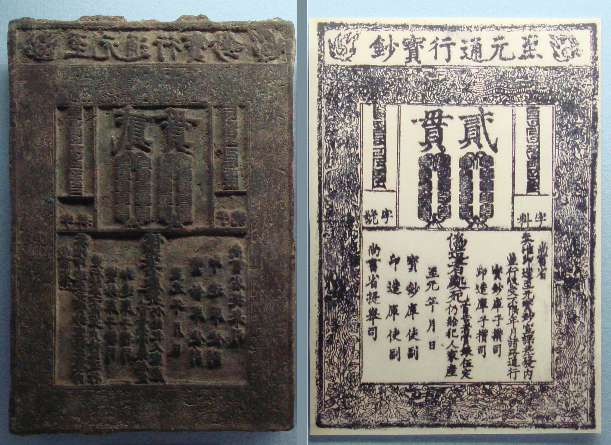
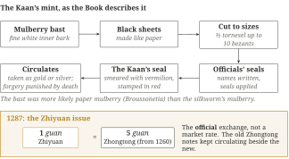
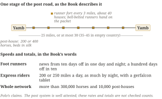

# Chapter II-5
## Ahmad the Bailo, Paper Money, Posts, Coal, and Charity

> *“Now when all this happened Messer Marco was upon the spot.”*
> — Marco Polo, Book 2, ch. 23 (Ramusio; Yule–Cordier)

**[M]**

---

The messenger has reached Achmath (Ahmad Fanakati) in the Old City. The crown prince is supposed to be back, and he wants the minister at the palace now. Achmath goes out into the night. At the gate Cogatai, who commands the garrison, wants to know where he’s going. He hasn’t heard a thing about the prince’s return. In the account Yule took from Ramusio, he follows the minister with some of his men [1].

We have a little time before they reach the hall. Achmath has made his way from the household of Chabi, the empress, to high office in the service of Cublay (Kublai) Kaan [2]. The Book calls him *bailo*, which would give a Venetian an idea of a man with the right to act for a ruler [3]. He has been in a position to hand out offices as well as collect revenues. In Ramusio’s account, a man who wants a governorship can pay for it. Achmath offers posts to men whose daughters he wants, and the women have little choice in the bargain [4]. The Kaan seldom sees a reason to refuse him. The people who might have given him one have to live with his minister.

Chenchu and Vanchu are the names Ramusio gives two men who plan to get rid of Achmath. One commands a thousand, the other ten thousand [5]. They have their chance while the Kaan is at Chandu (Shangdu, in Duolun County) and his son Chinkin (Chingkim) is away. In Ramusio’s telling they hope to start a wider rising against the Kaan’s foreign officials, with beacons carrying the signal out to other cities [6]. First they have to get the minister into the room.

There are enough lights round the man on the seat to make the hall look ready for a prince. Achmath sees them, sees Vanchu, and bows. Chenchu takes off his head with a sword. In Ramusio, Cogatai shoots Vanchu from the entrance and has Chenchu seized [7]. The other cities get no signal. Chinese accounts also have the false summons, but give the fatal blow to Wang Zhu, with a copper mace [8]. There is more agreement on what brought Achmath to the hall than on what happened once he was inside.

Afterwards, the Kaan has Achmath’s money brought from the Old City to his own treasury and has the body dug up and thrown out [9]. Ramusio also gives him punishments for some of the minister’s sons. The tale goes on to restrictions on Muslim marriages and the slaughter of animals for food [10]. A court can turn quickly from judging a man to judging an entire community.

— Look again at who is in the room when the story is told. Polo puts himself in Cambaluc (Beijing) at the time [11]. One of the Chinese accounts has a man whose name was once read as his. That man, Bolad, held imperial honours years before Marco arrived [12]. The name belongs to the man who had to answer to the Kaan.

| Detail | Polo in Yule’s Ramusio chapter | Chinese record and later source criticism | Verdict |
|---|---|---|---|
| Minister | Achmath, powerful finance minister | Ahmad Fanakati, with a biography in the *Yuan shi* | ✓ Identity |
| Men involved | Vanchu and Chenchu, commanders of ten thousand and one thousand | Wang Zhu led the plot; Cai Meibiao reads the Book’s titles as referring to Wang Zhu and Zhang Yi | ~ Titles illuminate the account |
| Summons | The crown prince’s supposed return brings Achmath out by night | The Chinese account also uses the prince’s supposed arrival | ✓ Shared ruse |
| Fatal blow | Chenchu uses a sword | Wang Zhu strikes with a copper mace in the Chinese account Yule relays | ? Divergent accounts |
| Polo and Bolad | Polo claims to have been in the city | Bolad is the official identified in the Chinese record | ✗ The name is no evidence of Polo’s whereabouts |
| Aftermath | Exhumation and confiscation | Chinese accounts also have the corpse taken up and the property seized | ✓ Broad agreement |

---

In the same city, the Kaan can pay out a fortune without opening a chest of gold. At his mint, pale fibre from between the wood and the heavy bark goes to make a dark sheet. Polo calls the tree a mulberry and thinks of the leaves that feed silkworms [13]. The sheets are cut to different sizes. The marks on the paper will make one piece worth half a silver groat in his reckoning and another worth ten gold bezants.

Put yourself at the head clerk’s table. In Ramusio, the other officers have already signed or sealed the sheet. The chief officer puts vermilion on the Kaan’s seal and presses it down. That red impression is what the next man has to trust. A forged sheet, the Book warns, can cost a man his life [14].

{#fig-ii-5-paper-money}

{#fig-zhiyuan-note}

{#fig-c1-paper-money}

In the market, the Kaan can insist people take the sheets in payment. Much as Polo makes of the threat behind them, he is delighted by what they let you do. You can carry the value of ten gold coins without the weight of one [15]. A trader with pearls or silver can sell to the Kaan at a valuation made by twelve specialists, get paid promptly in paper and buy his next cargo with it [16]. A baron who wants bullion for a belt or a piece of plate can go to the mint to buy it back. If the paper wears out, the mint will replace it for three in every hundred of its value [17]. That’s a charge for you to note if you’re carrying it a long way in the rain.

An old piece of paper could pass beside a new issue. In 1287 the official rate made one *guan* of the Zhiyuan issue equivalent to five *guan* in the older Zhongtong issue [18]. Polo’s alchemy is at its most persuasive when you watch the man with the pearls take his payment and go to spend it. The Book has much less to tell you about how much that payment will be worth later.

---

Twelve men have their own set of rooms in a palace at Cambaluc. The Book calls their body the *Shieng* and counts thirty-four provinces under them [19]. It gives the provinces judges and clerks, and the Kaan confirms governors the barons propose. If a decision needs to have any effect outside the palace, somebody has to carry it.

On the roads from Cambaluc a courier can look for the buildings of the *Yamb*, the horse post, every twenty-five or thirty miles in Polo’s reckoning. The longer crossings can take thirty-five or forty-five miles between stations. A bed with silk on it is there for a man who can stop. For a man who can’t, there are fresh horses [20]. Polo has more than three hundred thousand horses in the network and ten thousand station houses [21]. Leave the great inventory in the capital for a moment. A man riding out from one of the stations needs to know the next one will have his horse.

Between the horse posts, listen for the bells. A foot-runner wears them on his belt and a man coming out to relieve him can hear him before they meet. A clerk is there to note the time, and the next runner goes off with a slip of paper. Polo gives him about three miles to go [22]. Fruit gathered in Cambaluc one morning can be on the Kaan’s table at Chandu the following evening, if you give the relay the speed Polo does [23]. It is a wonderful way of explaining an expensive post. The Kaan can have ripe fruit with his dispatches.

{#fig-post-roads}

On urgent business, the Book puts the rider on a fresh horse before he’s had time to cool down. The dispatch changes hands at the next station, and Polo puts two hundred miles or more in a day. Torches slow them at night. A tablet with a gerfalcon on it can claim a fresh horse even from somebody using the road on his own account [24]. At a station supplied by the neighbouring villages, half the horses can rest at grass while the others are on duty. A river crossing needs boats to be ready too [25]. Whether it’s a horse, a clerk or a boatman, there has to be somebody at the far end waiting to do their bit.

Some of the business carried on those roads is about the harvest. In a bad year the Kaan sends men out to learn which districts need seed and food, and where a remission of taxes and a supply of cattle would help [26]. Ramusio has another way for the government to lose a duty. If a chance arrow from the Kaan’s bow strikes a flock or a boatload of goods, he wants no tax on what it hit [27]. Even the Kaan’s mistakes can have a place in the accounts.

Rows of trees give the rider a line to follow in good country. Where trees won’t grow, Ramusio has stones or pillars put up instead. The same account gives Cublay an interest in how long planting a tree might make him live [28]. When the rider stops, the wine Polo offers him is brewed from rice and spices. It looks clear enough to be harmless and goes to the head more quickly than you might expect [29].

---

At home on a cold night, a person can put a black stone on the fire. It will be burning in the morning, Polo marvels, and he says it is cheaper than wood [30]. Ramusio takes us to the bathhouse and sets an entire population to washing at least three times a week [31]. Imagine how high the pile of wood would have to be. That is the case the Book’s later account makes for the stones.

In good years grain goes into store. In a shortage the government sells it back, at a quarter of the going price in Polo’s example [32]. There is also food for poor families and a loaf at the palace for anyone who comes to the daily dole. Polo sends thirty thousand people a day to that door [33]. Ramusio has cloth made from a share of the wool, silk and hemp owed to the government, with the weavers giving time from each week [34]. In these accounts it takes several sorts of delivery to keep a city going. A bill for a loaf and a levy on a piece of cloth belong to the same story.

For a groat a man can buy a year’s weather in a little book. In Ramusio there are five thousand astrologers on the Kaan’s books. They draw up *Tacuin*, almanacs of weather, cattle disease and other things a man might rather know in advance [35]. A trader can bring them the time of his birth before setting off on a journey. Ramusio makes a father record it at the outset, along with the sign of the year in a cycle that comes round every twelve years [36].

Look above the door, then down to the floor. In Ramusio’s account of household worship, people make offerings of incense before a tablet set high on the wall. On the ground is a figure called Natigai, with a wife and children, to whom the household turns for the weather and the fruits of the earth [37]. The Book sends the soul after death into another life, higher or lower according to the one a person has lived [38]. The account fits several kinds of belief into a single room. Yule wonders whether the tablet and the figure even belong together in the way the Book presents them.

At the palace door the barons change their boots. They put on white leather so they don’t spoil the carpet and bring a little covered vessel if they need to spit. The way to approach, in Ramusio’s account, is quietly [39]. Outside, a regulation can reach much further than a carpet. The Book gives the Kaan a ban on gambling, a punishment for neglecting parents, and the release of prisoners with a mark on the cheek [40]. With the laws so far in his favour, a courtier would still be wise to remember both his pairs of boots.

Leave the good boots at the door. Marco has business from the Kaan that takes him out of Cambaluc. A few miles down the road a stone lion waits above the water, and there’s a long way to ride beyond it.

---

## Notes

[1] ~ Ramusio-only in Yule’s edition. The assassination narrative comes through Ramusio and is absent from the Geographic French. Yule gives the name as Achmath, where Ramusio prints Achmach [@yc, 2.23 n. 1; @ramusio2015viaggi].

[2] ✓ Yule cites Chinese and Persian accounts of Achmath’s advancement from the empress’s household and his financial office by 1264. Cordier refers to his biography in the *Yuan shi*, under the rubric for bad ministers [@yc, 2.23 n. 2; @yuanshi1370, juan 205].

[3] ~ Ramusio-only. The Venetian *bailo* was a representative with authority abroad. Yule doubts that the term itself was used for the minister at Cambaluc [@yc, 2.23 n. 3].

[4] ~ Ramusio-only. The charges of abuse and corruption have parallels in the accounts Yule compares. The arrangements described for individual offices and the tally of twenty-five sons in positions come from the Book’s telling [@yc, 2.23 n. 2; @rossabi1988khubilai, ch. 7].

[5] ~ Ramusio-only. Cai Meibiao, as reported by Luo, reads the words as the titles *qianhu* and *wanhu*, commanders of a thousand and ten thousand, and identifies the men as Zhang Yi and Wang Zhu. Yule’s Chinese material also names Kao Hoshang as a conspirator [@luo2024designations; @yc, 2.23 n. 4].

[6] ? Ramusio-only. The plan for a wider rising aims at people identified as foreigners in the account, which distinguishes them by beards. The beacon and the extent of the alleged plot remain claims of this version [@yc, 2.23].

[7] ~ Ramusio-only. The Book puts the sword in Chenchu’s hand and has Cogatai kill Vanchu. Its account of the aftermath includes arrests and executions in the city and elsewhere [@yc, 2.23 n. 4].

[8] ✓ The Chinese histories as relayed by Yule share the night summons in the prince’s name, in the spring of 1282. The description of Wang Zhu striking Achmath with a copper mace differs from the Book’s scene [@yc, 2.23 n. 4; @haw2006marco, ch. 11; @vogel2013marco, ch. 1].

[9] ✓ Yule’s Chinese sources report the exhumation and confiscation. The punishments meted out to particular sons vary in the telling [@yc, 2.23 n. 4; @rossabi1988khubilai, ch. 7].

[10] ~ Ramusio-only. The restrictions on marriage and slaughter follow the Book’s account of the murder. Yule reports comparisons for the slaughter restrictions in other settings, while the causal link here belongs to the story [@yc, 2.23; @yc, 2.6 n. 3].

[11] ? Ramusio-only. The assertion puts Polo in the city at the time of the murder. The degree to which the episode corroborates his presence has to be judged apart from the identity of the official who spoke to the Kaan [@yc, 2.23 n. 5; @vogel2013marco, ch. 1].

[12] ✗ The official once identified with Polo is Bolad. Parker’s correction, printed by Cordier, places the official in imperial service before Marco’s arrival, and Ma reports the later rejection of the identification [@ycadd, on 2.23; @ma2025chinese].

[13] ✓ The Book describes the use of inner bark to make the notes. The likely paper mulberry is distinct from the mulberry fed to silkworms, which supplies Polo with a familiar point of reference [@yc, 2.24; @vogel2013marco, ch. 1].

[14] ✓ Ramusio-only in part. The sequence of signatures, seals and the final red impression is bracketed in Yule. The issue of paper notes is already in the base account [@yc, 2.24]. See [Diagram C1, paper money](#fig-c1-paper-money).

[15] ~ The Book makes acceptance universal and puts the force of the Kaan behind it. Its argument for the ease of taking payments in paper depends on being able to spend the notes at the next stop [@yc, 2.24; @vogel2013marco, ch. 1].

[16] ~ Polo describes the state as the purchaser of imported bullion and gems and assigns the valuation to twelve experts. Yule compares other accounts of exchange between the government and merchants [@yc, 2.24 n. 1].

[17] ✓ The Book puts the fee for replacing a damaged note at three per cent. The charge belongs to an official exchange system, just as wear belongs to the experience of the person carrying the note [@yc, 2.24 n. 1; @vogel2013marco, ch. 1].

[18] ✓ The Zhongtong notes date from 1260 and continued to circulate with the new Zhiyuan issue. The rate of five old units to one new was the official conversion of 1287 [@yc, 2.24 n. 1; @guan2024yuan].

[19] ~ Polo’s *Shieng* reflects the central administrative body. Yule’s comparison with Chinese and Persian material helps distinguish the council and provinces, whose number and subdivisions do not fit the Book’s figures neatly [@yc, 2.25 n. 1].

[20] ✓ The *yam* was the Mongol relay post system. Yule compares several accounts of horse stations, while the intervals and rich furnishings in this account remain the Book’s description [@yc, 2.26 nn. 2–3].

[21] ✗ Polo’s tallies of horses and buildings are estimates on an imperial scale. Ramusio’s version offers its own way of justifying the figures [@yc, 2.26 n. 4].

[22] ~ The three-mile stages, bells and clerks belong to Polo’s account of the foot relay. Yule compares later descriptions of the time records kept at posts [@yc, 2.26 n. 6]. See [Diagram C2, the post roads](#fig-post-roads).

[23] ~ The fruit is Polo’s example of the speed of a relay between the two capitals. Yule compares another royal household’s transport of perishable fruit [@yc, 2.26 n. 5].

[24] ~ The urgent tablet fits the system of travelling credentials. The figures are Polo’s, and his text itself makes the pace fall after dark when torches have to keep up [@yc, 2.26 n. 7].

[25] ~ The Book identifies a local obligation to provide horses and, where needed, boats. It assigns horses to imperial expense in uninhabited stretches [@yc, 2.26].

[26] ✓ The Book gives examples of remission and replacement after harvest failure and losses of cattle. Yule compares Chinese provisions for relief [@yc, 2.27 n. 1; @yc, 2.31 n. 1].

[27] ? Ramusio-only. The arrow that touches a herd or a boatload makes it inauspicious to collect on that property, in the passage Yule brackets. The general account of relief from taxes in bad years is already in the base text [@yc, 2.27].

[28] ~ Ramusio-only in part. The tree-lined roads are in the base account. Ramusio adds the belief about longevity and alternative markers where trees fail [@yc, 2.28 n. 1].

[29] ✓ Yule compares accounts of brewing and serving rice wine. The speed with which it affects the drinker is part of Polo’s praise of its strength [@yc, 2.29 n. 1].

[30] ✓ Coal is the black stone of Polo’s description. Even Wood credits the accuracy of this account, and Yule cites other evidence for the fuel’s use [@yc, 2.30 n. 1; @wood1995did, ch. 8].

[31] ~ Ramusio-only. The coal itself is in the base account. The link with the number of hot baths and the claim about their frequency occur in the added passage [@yc, 2.30].

[32] ✓ Yule describes the practice of storing grain and releasing it to stabilise prices. Polo’s price of one bezant for four measures is an example in the account [@yc, 2.31 n. 1].

[33] ~ The yearly family allowances and a daily issue of bread are distinct in the Book’s account. The thirty thousand at the palace each day is its figure [@yc, 2.32].

[34] ~ Ramusio-only. The cloth levy, the work assigned to weavers and the influence of the Buddhist teachers on almsgiving are in Ramusio’s addition [@yc, 2.32 n. 1].

[35] ~ Ramusio-only. *Tacuin* reflects Persianate *taqwīm*, for a calendar or table. Yuan astronomical instruments and government almanacs give context for the scene, while the number of astrologers and the price of each booklet are the Book’s. The 1328 print figures in Yule’s note describe an official calendar run [@yc, 2.33 n. 1].

[36] ~ Ramusio-only. Yule distinguishes the actual twelve-animal cycle from the sequence the Book gives. In the account, a recorded birth date is something a traveller can take to an astrologer [@yc, 2.33 n. 2].

[37] ? Ramusio-only in Yule’s edition. Yule considers the passage partly interpolated and suggests that the upper tablet may be ancestral. Pelliot links Natigai to Etügen, while Mostaert’s reading, discussed by Ragagnin, links the name to *Načigai* [@yc, 2.34 n. 3; @pelliot1959notes, vol. 2, “Natigai”; @ragagnin2017natigay].

[38] ~ Ramusio-only in Yule’s edition. The Book describes rebirth by means of a ladder of social positions and animal lives. Yule reads the surrounding account of religion with reservations about how it brings different traditions together [@yc, 2.34 n. 3].

[39] ~ Ramusio-only in Yule’s edition. The white boots and covered spitting vessels belong to the Book’s account of going before the ruler. Cordier reproduces a later observation of covered pocket spittoons [@yc, 2.34 n. 6].

[40] ~ Ramusio-only in Yule’s edition. The Book groups filial reverence, gambling restrictions and the release of branded prisoners with other social customs. Its exact penalties and intervals belong to the account [@yc, 2.34 nn. 4–5].
