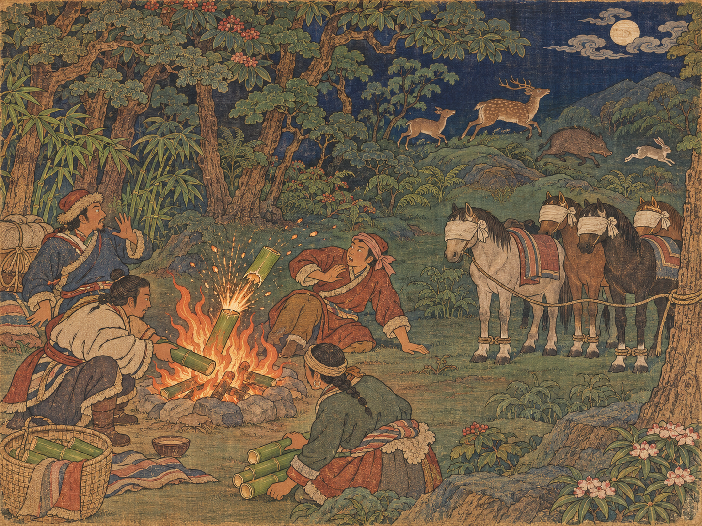

# Chapter II-7
## Tebet, Caindu, Carajan, Zardandan

> *“After those five days’ march that I spoke of, you enter a province which has been sorely ravaged; and this was done in the wars of Mongu Kaan.”*
> — Marco Polo, Book 2, ch. 45 (Yule–Cordier)

**[M]**

---

The bridge at Sindafu (Chengdu) has shops and a man to take the Kaan’s tolls. Five days out, a merchant has rather more use for a good length of bamboo than for anything he could have bought from the shops. At the edge of Tebet (eastern Tibet), Polo puts the travellers among villages ruined in the wars of Mongou (Möngke) Kaan [1]. The hills rise round the road and people grow scarce. In the Book, the bears and the beasts it calls lions have had time to multiply.

### Map of the southwest circuit

![Map A11. The route through the borderlands toward Carajan and Vochan is reconstructed. Dots lead to reported Mien and toward unfixed Bangala. For Caugigu, Yule proposed Kiang Hung; Pelliot read the description as the Upper Red River area, with the name pointing to Tonkin. Muang Yong, Kengtung and Chiang Mai have also been suggested. For Anin, compare Yule’s Lin-ngan and Homi, the Honghe region, and Pelliot’s Annam; for Coloman, Yule’s western Guizhou with Pelliot’s northeastern Yunnan. Cuiju’s Guiyang-area reference represents a Guizhou hypothesis; Kuizhou and the Xuzhou–Yibin area are other candidates. Fungul uses Yibin, with Luzhou and Phungan-lu proposed. *(Map: this edition, from the Book and S-17.)*](../media/maps/A11-southwest-circuit.svg)

At sundown the men cut green canes and heap them on the fire. After a little while the heat sets the bamboo cracking loud enough to send animals running. Ten miles away you could still hear it, Polo reckons [2]. Take that as an idea of how ambitious he is for his fire. Just here on the road, there’s a more pressing question. How do you stop the horses running away too?

Cotton in the ears for the people. Cloth over the horses’ heads, and ropes at all four feet. The Book knows of travellers who have lost horses that broke their halters at the first bang. A few nights of it and the animals grow used to the sound [3]. In the meantime, the men are betting their transport on the pegs they’ve driven into the ground. They’ve got twenty days of food to carry before the Book brings them to a village where they can buy more [4].

{#fig-ii-7-exploding-bamboo}

— Stay with the horses a moment, dear reader. Out there a bear hears something that frightens it away. Here in camp you’ve made exactly the same noise for an animal you need to stay beside you.

At the first inhabited stretch, a ring has a use a traveller could hardly have guessed at Sindafu. Polo tells of older women offering unmarried girls to men on the road. The gift a traveller leaves a girl goes towards a collection she can show when it’s time to marry. The Book wants twenty such tokens at least, and attaches a stricter expectation of fidelity to marriage itself [5]. It’s a story told for the benefit of young men on the road. Its relish is easier to place than the custom.

For something a merchant can put a price on, look at the musk. Dogs help hunters catch the animals the Book calls *Gudderi*, and at market salt serves where the Kaan’s paper does elsewhere [6]. Polo credits Tebet with eight kingdoms, rivers and lakes that yield gold dust, fine woollens and cinnamon. Coral fetches a good price from people who hang it round the necks of women and sacred images [7]. On a journey west, the man carrying coral may have something to sell long before he gets anywhere near the next mint.

Mastiffs the size of donkeys range through the tale. Ramusio sets them on a particular wild ox, the *Beyamini*, and adds sakers to the falcons taken from the mountains [8]. Polo also names astrologers and enchanters whose feats he refuses to tell on the grounds that no good would come of it. After telling us they have magic he makes us take the rest on trust. He makes a great claim for the Kaan as well, extending his authority over Tebet and the countries to follow [9]. A governor who means to make good on a claim like that will want something here worth guarding.

---

At Caindu (Xichang and its valley), start at the lake. Ramusio calls the pearls white and uneven. Polo makes fishing for its pearls a matter of imperial permission. Fetch some out of the water on your own account, and in his telling it can cost you your life [10]. The Kaan also keeps a hold on the turquoise in the hills [11]. Both stories give the traveller an idea of what one ruler can do with a valuable commodity. The pearl goes on being expensive because he can stop a good many people selling it.

A hat on a door tells a Caindu household who can come in. In Polo’s account a host offers a visitor the company of women in his family, then takes himself off to the fields. He stays out while the hat or some other token hangs there. The Book puts divine favour and prosperity among the rewards the host expects [12]. The same sort of story turned up at Camul (Hami), well back along the road. This time it’s the hat that stays in the memory.

A cash payment here can be something you could put in the soup. At Caindu you get to watch salt go into the mould. The Book reckons half a pound to the cake, and eighty cakes to a *saggio* of fine gold [13]. Ramusio makes the cake round on top and flat beneath, with an official mark pressed into it by the ruler’s own officers [14].

Out in the hills, in Ramusio’s version, the same weight of gold will cost a trader sixty cakes, or fifty, or forty if he goes far enough. People who can use the salt have gold and musk and few chances to sell either. In town, the whole cakes stay in circulation. Broken bits go in the pot [15]. I’d like to see the look on the face of a man who’s just chipped a bit off a perfectly good coin. That he can still use the chip as salt tells you why there are people glad to take the stuff deep in the hills.

At table Polo has fish from the lake and a drink brewed from wheat, rice and spices. He describes a tree with narrow laurel-like leaves and a pale flower, then calls what grows on it a clove. Cassia is a likelier reading [16]. A man who could price a spice in his own market still had to find a word for it when he saw the stuff growing on a tree.

Ten days’ riding with villages along the way brings the road to the Brius (Jinsha River crossing). Gold dust in the water and spice on the banks give Polo two reasons to remember the boundary [17]. Across it he counts seven kingdoms in Carajan (Yunnan) and sets Sentemur (Esen-Temür) there as a son of Cublay (Kublai). Sentemur was his grandson, as Polo has it when he gets to the fighting at Vochan (Baoshan) [18]. The dates of the two princes who appear on the road can help to place a visit. They leave room for knowledge picked up from someone who served there.

---

Five days from the river, the horses and farms give way to the merchants and workshops of Yachi (Kunming). The Book finds Muslims, a few Christians of the Church of the East and people whose religion it calls idolatry [19]. There’s wheat in the market, but Polo sends you to the rice for your supper and a cup of clear, strong drink. If you’re short of dinner, the butcher can sell you some raw liver with garlic and spices [20].

At the salt wells they draw brine, and the ruler has income from what they make of it [21]. In the market count eighty white cowries to a weight of silver, which Polo values at two Venetian groats. From there it takes another kind of reckoning, eight silver weights to a gold one [22]. A man who hasn’t seen a cowrie might have seen the same kind of shell on a dog’s collar. Marco can get him from the collar to the exchange rate in a breath.

Ten days farther west, Talifu (Dali) is a second capital, named Carajan in the Book like the larger province. Here the ruler Polo calls Cogachin (Hügechi) really is a son of the Kaan [23]. Gold comes in grains from the water and in larger pieces from the hills. At Talifu one weight buys six of silver, and the cowries, Polo says, come from India [24]. A merchant carrying silver is beginning to see a pattern in the prices. He’ll see it even more clearly at the next stop.

First, though, have a look at the track from the water. The Book puts a serpent here with two feet, eyes bigger than bread loaves and a tail that marks the ground as if someone had dragged a full cask. It comes out at night. A crocodilian is the usual reading, and the creature grows considerably in the telling [25]. Hunters set blades in its path and wait until it comes back. In Ramusio, crows calling over the carcass bring the men out to collect it [26]. The flesh can be sold. Polo reserves the high price for the gall, as a medicine credited in his account with everything from relieving hard labour to curing a bite from a mad dog [27].

Spare a glance for the horses headed to India. Polo has their tails shortened and their riders sitting long in the stirrups, like the French. A man in boiled leather can carry a spear and shield and a crossbow whose bolts the Book says are poisoned [28]. Ramusio makes the poison part of a tale about prisoners who would rather die than undergo torture [29]. The Book has an even darker story about the days before the conquest. A host, it says, might kill an eminent guest in the belief that his good fortune would stay with the house [30]. Polo credits the government with putting an end to it. The tale’s welcome depends entirely on who is telling it.

---

Five days farther on comes Zardandan (western Yunnan), the Gold-Teeth country. At Vochan Polo fits the men with gold covers for both rows of teeth [31]. Ramusio puts dark tattooed bands on their arms and legs, the work of five needles used together [32]. The men go to war or out hunting, in the Book’s division of labour. The women do the business, helped by people enslaved in war [33].

At a birth Polo puts the washed and wrapped baby beside its father. The mother gets up to manage the household, and the man stays in bed for forty days, receiving the visits of the family [34]. The Book’s explanation gives each parent a share of the hardship. If you’ve brought something for the new baby, it’s the father you’ll find in bed to receive it.

A deal has its own little object. Split a stick and cut corresponding notches on the two halves. One half goes with each party. When the money comes back, the debtor gets the creditor’s piece [35]. Put both together and you can see exactly what is being settled. A church or temple is absent from the picture the Book gives here. It says people honour their ancestors and reckons a stick sufficient where correspondence would be of little use.

In a house with someone ill, the Book has the family send for people who can deal with spirits. They play music and dance until one falls down and answers for the spirit believed to be responsible. The family may have to fetch sheep of just the right colour, jars of spiced drink, lights and fragrant wood. The singing and the offerings go on until the spirit relents, or the performance has to begin again [36]. After the answer everybody has been waiting for, even the man who lay on the floor gets up to join the feast.

At the exchange in Zardandan, Polo reckons five weights of silver to one of gold [37]. Bring enough silver and the difference from the price at Yachi will pay for a good deal of road. The Kaan’s troops have found a reason of their own to go to Vochan. From the plain there, the next men to arrive appear to have brought their towers with them.

---

## Notes

[1] ~ Yule locates the approach on the routes west and south-west from Sindafu. Polo’s Tebet here is the eastern frontier, around Kham, and the damage he attributes to Mongou’s wars belongs to the wider Mongol campaigns in the region [@yc, 2.45 n. 1].

[2] ~ Yule quotes Hooker on the noise of heated bamboo bursting and on its use to keep animals away from a camp. The sizes of the canes and the distance at which Polo says they can be heard are more doubtful [@hooker1854himalayan; @yc, 2.45 n. 2].

[3] ~ The precautions with horses and cotton in the ears come from the Book. They make the difference between a camp alarm and a device the travellers can use on successive nights [@yc, 2.45].

[4] ~ Twenty days without provisions for sale is Polo’s reckoning. The comparable journey reported by Gabriel Durand in Yule’s notes took a different number of days [@yc, 2.45 n. 3].

[5] ? Yule compares reports about marriage and gifts in several places, while Polo’s twenty tokens remain a local allegation. Bolognari compares Jacopo d’Acqui’s account with the F, Z and VA versions of Polo and treats the parallels as evidence of related texts [@yc, 2.45 n. 4; @bolognari2024chronica, pp. 55–57].

[6] ~ The Book calls the musk animals by a Mongol name and places them alongside salt currency in its account of Tebet. Vogel surveys the circulation of salt money as part of his assessment of Polo’s account [@yc, 2.45 n. 5; @vogel2013marco, ch. 4].

[7] ✓ Yule describes the value attached to coral in Tebet and cites other travellers on its use as an ornament. The Book’s eight kingdoms and its list of commodities describe a wider region than the opening road [@yc, 2.46 nn. 1–3].

[8] ~ Ramusio-only in part. Yule brackets the particular wild ox and the addition of sakers, while the mastiffs and lanner falcons are already in the base account [@yc, 2.46 n. 5].

[9] ~ The claim of power over all the realms to come belongs to Polo’s presentation of the Kaan. The same chapter declares a refusal to elaborate on the enchanters’ feats, which it attributes to diabolic arts [@yc, 2.46 n. 4].

[10] ? Ramusio-only in part. The lake and restriction form the base account; Yule brackets the colour and shape of the pearls as an addition from Ramusio. Polo presents the restriction as a way to protect the value of pearls [@yc, 2.47].

[11] ~ Yule cites Chinese reports of a deposit of turquoise near the chief town of the district. The Book’s restriction requires imperial permission to extract it [@yc, 2.47 n. 2].

[12] ? Yule compares the Caindu story to the episode at Camul and cites Garnier and others for local analogues. Polo’s account gives the men’s reasons and makes a general claim about a province [@yc, 1.41; @yc, 2.47 n. 3].

[13] ~ Polo distinguishes gold reckoned by weight from the moulded salt used for small payments. The half-pound cakes and the rate of eighty to a *saggio* are in the base account [@yc, 2.47 nn. 4–5].

[14] ~ Ramusio-only. The shape and the ruler’s stamp are features of Ramusio’s version, along with the restriction of manufacture to royal officers [@yc, 2.47 n. 4].

[15] ~ Ramusio-only. The sliding exchange rate in the hills and the use of chipped salt for food are in Ramusio’s account. Vogel judges the close detail of the weights, rates and stamping highly likely to rest on observation. The practice itself leaves the traveller’s route open [@yc, 2.47 nn. 4–5; @vogel2013marco, ch. 4].

[16] ~ Yule’s notes discuss the local spiced wine and compare the tree in the Book with cassia. “Clove” is Polo’s identification [@yc, 2.47 nn. 6–7; @yc, 2.46 n. 3].

[17] ✓ The Brius is generally identified with the Jinsha. The account of washing gold and finding cinnamon along the river gives the boundary a commercial character [@yc, 2.47; @yc, 2.48 n. 1]. See [Map A11, the southwest circuit](#map-of-the-southwest-circuit).

[18] ✓ Sentemur was Cublay’s grandson through Hügechi, as the Book’s account of the frontier campaign has it. The rulers’ assignments help place the account broadly around the period of Sentemur’s appointment, while the exact date and extent of a personal journey remain uncertain [@yc, 2.48 n. 1; @yc, 2.51].

[19] ~ The Book’s list gives Yachi more than one religious community. Yule discusses later evidence for Christians in the region, while Polo’s description leaves the size of the earlier community unclear [@yc, 2.48 nn. 1–2].

[20] ~ Yule compares the use of wheat and rice across the region. The Book describes rice drink and the sale of seasoned raw meat, including liver for customers of modest means [@yc, 2.48 nn. 3, 5–6].

[21] ✓ The salt wells and the ruler’s revenue belong to a wider system of salt production and taxation. The lake in the account is generally identified as Dianchi [@yc, 2.48; @vogel2013marco, ch. 4].

[22] ~ The cowries are the “porcelain” shells of the Book. The conversion to Venetian groats and the ratio of eight weights of silver to one of gold are the rates it gives for Yachi [@yc, 2.48 n. 4]. See [Diagram C9, gold and silver exchange rates](ch-08-mien-bangala.md#fig-silver-exchange).

[23] ✓ Yule identifies the second capital as Talifu, the old seat of kings in Carajan, and its Mongol prince as Hügechi. The conquest of the kingdom dates to the 1250s [@yc, 2.48 n. 1; @yc, 2.49 n. 1].

[24] ~ The six-to-one exchange and the Indian origin of the cowries are what the Book reports at Talifu. Gill, cited by Yule, reports the later use of cowries in the region [@yc, 2.49 n. 2].

[25] ~ The beast is usually identified as a crocodilian, with the species open. No record from Carajan appears in the twenty dated records tabulated by Iijima and colleagues from Wen and colleagues’ 1980 study, whose primary Chinese distribution table was not inspected directly [@yc, 2.49 n. 3; @iijima2022hanyusuchus, supplementary table S1; @wen1980malai]. The great eyes, two feet and daytime burrow are features of Polo’s telling.

[26] ~ Ramusio-only in part. Yule brackets the crows alerting the hunters; the account of the blades already appears in the base text [@yc, 2.49].

[27] ~ The price Polo assigns the gall depends on the cures credited to it in the account. Yule records comparisons for the medicinal use of gall and for eating the animal’s flesh [@yc, 2.49 n. 3].

[28] ~ Yule discusses local ponies, tail treatment and crossbows in comparison with the equipment in the Book. The French comparison describes a longer seat in the saddle [@yc, 2.49 n. 4].

[29] ? Ramusio-only. The story about prisoners swallowing poison and their captors trying to make them vomit is bracketed in Yule. The base account already has poisoned bolts [@yc, 2.49].

[30] ? Yule finds tales with similar elements but no precise parallel for lodging and killing a guest to acquire his qualities. Polo’s thirty-five years since the conquest are approximate [@yc, 2.49 n. 5].

[31] ~ The Persian name *Zardandan* means “Gold-Teeth” and corresponds to Chinese *Jinchi*. Explanations of the name range from fitted gold to the colour produced by chewing betel, and the ethnonym covers a wider region than the town of Vochan [@yc, 2.50 nn. 1–2].

[32] ~ Ramusio-only. Yule brackets the tattooed bands and the five needles used to apply them. He compares descriptions of related practices in the region [@yc, 2.50 n. 2].

[33] ~ The Book divides the work this way, and Yule quotes Garnier’s report of a similarly sharp division. The parallel gives a point for comparison and leaves the scope of Polo’s description open [@yc, 2.50 n. 3].

[34] ~ The arrangement is called couvade. Yule gives examples from several regions, while the forty days in bed and the family celebration belong to Polo’s telling [@yc, 2.50 n. 4].

[35] ~ Dividing a notched tally gives each person a record to match against the other’s. The Book’s broad claim about the absence of writing goes further than the existence of a stick for recording a debt [@yc, 2.50 nn. 6–7].

[36] ~ Yule cites descriptions of spirit-medium healing for comparison with the music, possession and offerings Polo describes. The account puts the family’s expenses and preparations on the page as clearly as the performance itself [@yc, 2.50 nn. 8–12].

[37] ~ The Book gives the same five-to-one rate here and at the market on the descent. The claim about a distant supply of silver is Polo’s explanation for the opportunity he sees in the exchange [@yc, 2.50 n. 5; @yc, 2.53]. See [Diagram C9, gold and silver exchange rates](ch-08-mien-bangala.md#fig-silver-exchange).
