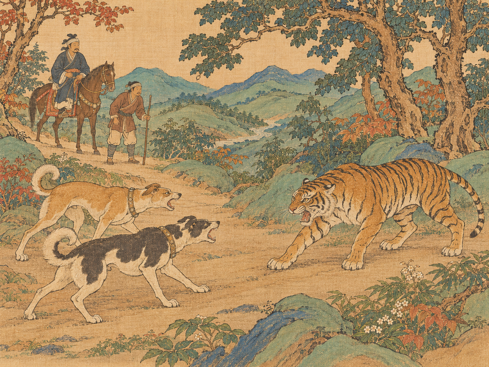

# Chapter II-9
## Caugigu, Anin, Coloman, Cuiju — and Back

> *“From Sindafu you set out again and travel some 70 days through the provinces and cities and towns which we have already visited, and all which have been already particularly spoken of in our Book. At the end of those 70 days you come to Juju where we were before.”*
> — Marco Polo, Book 2, ch. 59 (Yule–Cordier)

**[R]**

---

East of Bangala, the road crosses into Caugigu (perhaps around Jinghong, or farther south along the Upper Red River), thirty days’ march by Polo’s reckoning [1]. The people are idolaters with a language of their own, and the Book strings this province and the three after it along an eastward line that will eventually bend north-east back to Sichuan—eighty-seven marches in all from Bangala to Sindafu (Chengdu), if you add up the days as the manuscripts give them. Gold and spices are plentiful here, and cheap—for a reason any merchant who pays for his own pack animals understands at once. Far from the sea, overland carriage eats the margin out of bulky goods before a ship’s mast is ever in sight [2]. A bale of spice that would fetch a fortune on a saltwater quay sits heavy and cheap in a landlocked valley, where every stage outward demands fresh silver for drivers, beasts, and fodder. What travels light, or pays its own way on four legs, is another matter.

The king of Caugigu sends yearly tribute to Cublay (Kublai) at Cambaluc (Beijing) [3]. Before we count his treasure, look at a townsman’s bare forearm. Lions, dragons, and birds run across his skin in permanent needlework, and they do not stop at the wrist.

See [the map of the southwest circuit, II-7](ch-07-tebet-carajan.md#map-of-the-southwest-circuit).

The country around him is well stocked: tame elephants in great numbers, cattle of several kinds, and plenty of game, with people living on meat, milk, rice, and a wine brewed from rice and spices [4]. The king’s household is drawn on the same generous scale. The Book credits him with at least three hundred wives and the habit of marrying any noted beauty in his valleys [5]. It is Rustichello’s familiar shorthand for a distant court: a ruler rich enough in land and tribute to keep an entire palace full of brides.

Now look properly at that needlework. Polo says nearly the whole population has it pricked into face, neck, chest, arms, hands, and belly—lions, dragons, birds, and whatever else the needle can trace, laid in so deep it can never be washed out. To local eyes it is a mark of elegance, so the man or woman with the most embroidery draws the greatest admiration [6]. A traveller in silk court sleeves might keep his arms covered; here, a person’s standing is written on the skin in plain daylight. The Book catches what makes a Venetian stare, even if it leaves out how the ink was mixed, who held the needle, or what the patterns meant at home.

— Editors have spent two hundred years sliding Caugigu back and forth across hazy mountain borders. Yule set his compass near Jinghong across the southern borderlands. Pelliot read the name instead from northern Vietnam and treated the manners as an Upper Red River sketch. Frontier names drifted easily along caravan trails [7].

Push east out of Caugigu and you come to Anin (perhaps Jianshui, or an upland belt bordering Annam), a country of idolaters with their own tongue, subject to the Kaan, living by tillage and wide pastures. Here a horse dealer’s eyes sharpen. The people raise herds of oxen and buffalo, and they sell horses in great numbers to buyers from India, making a handsome profit on the road [8]. Polo never forgets a horse market; he has watched them from Hormos (Hormuz) to Carajan (Yunnan), and he knows that wherever Indian buyers ride up into the hills, silver is moving in the other direction to pay for stock that hot coastal plains cannot breed for themselves. Anyone who lives by horse fairs knows what to ask at the gate: not how the meadows look, but what the buyers are paying and whether the best strings have already gone south.

There is money on the people’s wrists and ankles as well. Both women and men wear heavy bracelets of gold and silver, and Marco notices that the men’s are the costlier [9]. A horse trader riding west from Anin remembers the price of a stout gelding; another traveller remembers the gleam of gold on a man’s forearm. Two reports from the same market can sound like two different countries, and neither one tells you much about the people who tilled the fields outside the gate.

Even the road between Caugigu and Anin depends on which manuscript lies open on the table. Ramusio counts twenty-five days’ journey; the French texts count fifteen [10]. Both numbers come from report rather than a paced survey, leaving Anin almost as mobile as its spelling—where Yule looked to south-eastern Carajan around Ami, Pelliot scanned Annamite chronicles [11]. Eight days’ march farther east—or north-east as the map bends—brings the road up into the hills of Coloman (provisionally the Guizhou or north-eastern Yunnan uplands) [12].

Coloman is hill country, set among high mountains and strong natural passes. The Book describes its people as tall, handsome, and brown in complexion—fighters well able to hold their towns and villages against an intruder [13]. After the open pastures of Anin, the road narrows into crags where every settlement looks built for defence, and where a traveller’s eye shifts from horse herds to the steep approaches above the valley.

Higher up, those cliffs hold the dead. When someone dies in Coloman, the Book says, the body is burned, the bones are gathered into little chests, and the chests are carried up the mountains and hung inside great caverns where neither man nor beast can reach them [14]. Burning the body first makes the climb possible: a small chest of bones can be carried up a rock face where a full coffin could never go, and the cavern keeps the remains safe from scavengers below. Stand at the bottom of a gorge and tilt your head back toward those dark mouths in the rock. Whoever brought that story down to the road knew how to make a listener look up, without needing to have climbed the cliff himself.

Down in the valleys, the living trade in two currencies at once. Coloman has gold, yet for everyday buying and selling its people count out porcelain shells—the white cowries we met back in Carajan—just as Bangala, Caugigu, and Anin do [15]. Wealthy merchants handle large consignments and eat well on meat, milk, rice, and spiced rice wine. Gold settles the wholesale bargains; cowries rattle in the hand for everything else. Two monies side by side tell you how far a frontier market reaches before imperial silver or paper takes over.

Twelve days’ travel along a river out of Coloman bring the road into Cuiju (perhaps the Guiyang belt), past towns and villages that the Book passes over in a breath, until you reach the large city of Fungul (possibly Yibin or Luzhou, though riverside towns vie closely) [16].

— Any tidy anchorage looks clean enough inside an atlas square until you stretch medieval spellings across living water. Long disputes between rival upper-river towns and highland stations show editors threading elastic day-counts along twisting gorges that resist one stamp [17].

At Fungul, two things catch a merchant’s eye at once. First, the people weave cloth from the bark of trees, making fine, cool summer garments [18]. A Venetian raised on wool and silk knows how to judge a weave between thumb and forefinger, and a light summer stuff beaten from tree fibre earns its own line in his notebook. Second, the cowry shells disappear from the counter: here the Great Kaan’s paper money is current again, and the Book marks the border explicitly [19]. That single change of currency tells you more than any frontier stone. Cowries belong to the tributary borderlands; once mulberry paper reappears in the till, you are back inside the fiscal world of Cambaluc, where imperial tax collectors and governors hold the roads. Silk and other wares move up and down the river to distant markets [20], and the people are good soldiers as well as traders.

Yet the riverbanks carry a warning that belongs squarely to Rustichello’s notebook. So many fierce beasts—the Book calls them lions, meaning the striped tigers of the south—prowl the country that no one dares sleep outside at night. Even travellers on the river must moor well clear of the bank, or a beast will leap aboard and drag one of the crew into the dark [21]. Nobody could cross the province at all, Polo insists, without a local pair of allies: huge, fierce dogs bred so bold that two together will take on a tiger [22].

Every traveller takes a couple of these dogs along. When a tiger appears, the pair dart in and out, baying and snapping at its flanks while dodging every sweep of its paws, until the beast turns to escape their din and backs into the woods to put a tree behind it. Then the travellers draw their bows and loose arrows until it falls [23]. It is a neat piece of theatre for a listener in Venice, with the dogs holding the stage and the archers finishing the act. Rustichello’s frontier roads rarely lack a companionable marvel to get a traveller safely past the trees. A boatman poling through river fog has simpler questions: where the current sets, where the shoals lie, and how far off the bank he needs to drop his anchor before dark.

{#fig-ii-9-dogs-and-tiger}

Twelve more days along the river, past towns that trade in paper money and keep good fighting men, bring the traveller back to Sindafu (Chengdu) [24]. We have already walked its great covered bridge, with its painted pillars and its shops open from morning till night, and Polo does not repeat himself. Instead he sends us seventy days north and east through cities and provinces the Book has already described, compressing two months of familiar roads into a single sentence until we stand again at the fork of Juju (Zhuozhou) where the western road began [25]. A traveller who has already counted the inns and ferries once has no need to count them a second time.

Step back outside Juju’s gate and look at the loop the last four chapters have drawn. Tattooed valleys, horse pastures, cliff-hung bones, cowry markets, bark-cloth weavers, and tiger-hunting dogs have all been threaded onto one return road to Sichuan, and then seventy days of familiar riding are folded up behind us like a map. Some of those stories came from the road itself; others may have been gathered at court or over a camp fire and stitched onto the itinerary by days’ marches. Twelve convenient river stages close a gap that editors have been measuring ever since.

Now turn your horse’s head south-east out of Juju, away from the mountain passes and down onto the flat plain of Cathay (northern China). Four days through busy trading towns—all using the Kaan’s paper money—bring you to the walls of Cacanfu (Hejian), and the long eastern road toward Manzi (southern China) [26].

---

## Notes

[1] ? Thirty days east from Bangala to Caugigu comes solely from Polo’s itinerary [@yc, 2.56–2.57]. No independent medieval survey clocks a matching thirty-day road stage between Bengal and Yunnan or northern Vietnam.

[2] ~ Expensive overland carriage explains why gold and forest spices bought cheaply in remote interior valleys before touching maritime lanes [@yc, 2.56]. Polo treats caravan transport friction with a merchant’s eye for margin against travel time.

[3] ~ Yearly tribute delivered to Cublay expresses Suzerain submission in the Book’s diplomatic formula [@yc, 2.56]. Local Tai or northern frontier polities balanced formal Yuan homage with substantial upland autonomy.

[4] ~ Elephants, cattle herds, forest game, and spiced rice wine compose Polo’s standard Southeast Asian resource register [@yc, 2.56]. Each item fits subtropical Tai–Lanna or Upper Red River valleys without fixing one town.

[5] ~ Attributing at least three hundred wives and blanket royal selection of beauties reflects courtly stereotype rather than counted census [@yc, 2.56]. Rustichello regularly underscores distant kingship through extravagant domestic numbers.

[6] ~ Needle tattooing of dragons, lions, and birds across men and women fits Tai and upland Southeast Asian practice well [@yc, 2.56]. Yule notes comparable floral and mythical skin-pricking among Shan and Tai communities, though Marco omits the technique’s ritual role.

[7] ? Yule favoured Kiang-Hung (Jinghong) in southern Xishuangbanna, whereas Pelliot derived *Caugigu* from *Jiaozhiguo* (modern northern Vietnam) and pointed to Upper Red River manners [@yc, 2.56 n. 1; @pelliot1959notes, vol. 1, entry 128]. The split highlights how far border ethnography could drift along mountain trails.

[8] ~ Pasture-raised horses sold toward Indian markets along with oxen and buffalo belong to Polo’s regional trade report [@yc, 2.57]. Upland horse routes linking Yunnan and northern Indochina with Bengal and the coast are historically plausible.

[9] ~ Heavy gold and silver armlets and leg-rings worn predominantly by men preserve genuine upland ornament observation [@yc, 2.57]. Still, Polo turns selective frontier wealth into a blanket badge for the entire province.

[10] ? Textual manuscripts diverge sharply between twenty-five days (Ramusio) and fifteen days (Geographic French F text) between Caugigu and Anin [@yc, 2.57 n. 2]. Such wide numeric swings show route copyists working from shaky intermediate reports.

[11] ? Yule looked to Ami (Kaiyuan) in southern Yunnan while Pelliot traced the syllable toward Annam [@yc, 2.57 n. 1; @pelliot1959notes, vol. 1, entry 22]. Neither candidate cleanly satisfies all compass cues and itinerary counts simultaneously.

[12] ~ Eight days northward from Anin sets Polo’s climbing interval toward Coloman’s limestone hills [@yc, 2.57–2.58]. The figure anchors his return trajectory toward Sichuan even where the intervening stations blur.

[13] ? Yule placed Coloman in western Guizhou among Miao–Lo-lo borderlands, while Pelliot read a variant as *Tu-lao-man* along eastern Yunnan [@yc, 2.58 nn. 1–2; @pelliot1959notes, vol. 2, entry 363]. Admiration for the hill fighters’ stout fortresses reflects Polo’s own appraisal.

[14] ~ Cremation followed by packing bones into chests and hanging coffins inside high cliffs matches genuine southern upland customs [@yc, 2.58]. Suspended cliff burials along Guizhou–Sichuan karst gorges still survive archaeologically, though Polo compresses diverse practices into one picture.

[15] ~ Combining cowry shells for petty buying with gold bars for wholesale trade extends the monetary zone shared across Bangala, Caugigu, and Anin [@yc, 2.58]. Cowries circulated for small change across Yunnan into the early Qing period.

[16] ? Twelve river days bringing travellers to Fungul open the Cuiju stretch whose waters and port name remain disputed [@yc, 2.59 n. 1]. Whether the stage descended an upper Yangzi tributary or climbed from Guizhou affects every surrounding dot on the map.

[17] ? Fungul has been matched provisionally with Yibin (Suifu), Luzhou, or Phungan-lu across differing manuscript spellings [@yc, 2.59 n. 1]. Broader placements for Cuiju span central Guizhou (Guiyang) eastward into Guangxi or north toward Sichuan approaches.

[18] ~ Summer bark-cloth pounded and woven from fibrous trees reflects Polo’s keen commercial eye for regional textiles [@yc, 2.59 n. 2]. Yule adduces Chinese paper-mulberry and bast fabrics woven in the warm southwest valleys.

[19] ~ Re-entering the zone of the Great Kaan’s paper currency marks the Book’s administrative threshold back into core Yuan territory [@yc, 2.59]. Wherever cowries gave way to mulberry paper notes, direct imperial tax administration held sway.

[20] ~ Active river freight carrying raw silk and bulky merchandise along the Fungul–Cuiju channel belongs to Polo’s market inventory [@yc, 2.59 n. 5]. The detail prepares his swing back into Sichuan’s main trade trunk.

[21] ~ What Polo calls fierce river-bank lions dragging sailors off moored boats are tigers along forested gorges [@yc, 2.59 n. 3]. Yule notes that Marco regularly applies *leoni* to Asian tigers across wooded south China.

[22] ~ Travel safety resting on pairs of large hunting dogs ready to face big cats blends local guard-dog reputation with tall storytelling [@yc, 2.59 n. 4]. Yule adduces early travellers’ notices of formidable Sichuan and Yunnan mastiffs.

[23] ~ Cornering the cornered beast against a tree trunk while hunters finish it with arrows forms a classic Rustichello set piece [@yc, 2.59]. The staging owes more to European hunting romance than audited river-pilot logs.

[24] ? Another twelve-day river march from Fungul back to Sindafu closes the speculative southern loop [@yc, 2.59 n. 6]. Because neither starting point nor river channel is firmly fixed, that return span stays provisional.

[25] ? Sending the reader back seventy stages through northern lands already described echoes the opening route of Book II [@yc, 2.59 n. 7]. Yule suggests this massive loop preserves dim traces of a genuine imperial mission without proving every south-eastern bend.

[26] ✓ Juju is Zhuozhou south of Beijing, and Cacanfu four stages south-east along the flat corridor is Hejian [@yc, 2.59–2.60]. Rejoining the fork at Juju hands the narrative cleanly onto the eastern Manzi trunk road in Chapter II-10.
