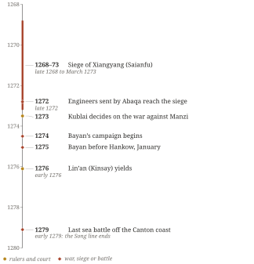

# Chapter II-10
## Eastward to Manzi: Canal Cities and the Fall of the Sung

> *“And when you pass this river you enter the great province of Manzi. So now I must tell you how this province of Manzi was conquered by the Great Kaan.”*
> — Marco Polo, Book 2, ch. 64 (Yule–Cordier)

**[M]**

---

From Juju (Zhuozhou), four days south bring the traveller to Cacanfu (Hejian), at the head of a district of towns and villages. This is the opening of Polo’s southbound journey through eastern Cathay, toward Manzi, the Sung lands. Silk and salt, canals and paper money mark its stages. At the end, the route reaches a river crossing and turns from travel to conquest. [1]

Polo measures this road in days and the repeated arrival at another city. He gives the same few signs of settled life at each stop: trading people, crafts, paper currency, and the burning of the dead. Then the landscape changes around the traveller. First there is salt earth, then rivers crowded with cargo boats, then the canal split that sends water toward both provinces.

Cacanfu is a prosperous trading city. Its people make their living by trade and crafts, weaving silk and gold cloth and producing sendal in quantity. Ramusio’s version adds Christians with a church.

The city heads an important territory, full of smaller towns and villages. The goods made there have a route north to Cambaluc (Khanbaliq, Beijing). Ramusio’s version adds the river-and-canal link that carries merchandise to the Kaan’s capital. [2]

Three days farther south lies Changlu (Cangzhou), another large city in Cathay. Paper money circulates there, and its inhabitants trade and work at crafts. The district’s salt comes from the ground itself: workers heap up salty earth, wash it with water, then boil the brine in iron vessels until fine white grains settle out. They sell the salt across neighbouring regions for a substantial profit. [3]

— Polo repeatedly links Chinese people with cremation, but the practice was neither universal nor confined to China. It was common in some regions and among Buddhists, while burial remained widespread. His recurring formula turns a varied custom into a national rule. [4]

Five days beyond Changlu, the road reaches Chinangli (Jinan). A broad river carries silk, spices and other costly goods through the city, with traffic moving in both directions. Southward, the traveller passes a chain of towns and villages before reaching Tadinfu (Yanzhou), a large and wealthy place with eleven subordinate cities. Merchants deal on a great scale, and silk is plentiful; gardens produce unusually large fruit. In earlier times, Polo says, Tadinfu was the seat of a kingdom conquered by the Great Kaan. Polo’s account gives it the title of the region’s noblest city, but that distinction and the revolt that follows fit Chinangli better. The names and episodes seem to have shifted in the telling. [5]

At this point the travel account becomes a story of rebellion. Polo places the revolt at Tadinfu, but the historical setting is Chinangli. Litan (Li Tan), a commander with about eighty thousand horsemen, turned against the Great Kaan in 1262. The Book gives him the title Sangon, a rendering of the Chinese *Tsiang-kiun*. The Great Kaan sent Aguil and Mongotay with a hundred thousand horsemen and a large infantry force. Litan gathered more than a hundred thousand horsemen and many foot soldiers, but his army was defeated and he was captured. The Yuan annals record his execution later that year. They also distinguish people coerced into joining the revolt, some of whom received pardons, from Polo’s broader account of clemency. The annals name several commanders, but the identities of Polo’s Aguil and Mongotay are not equally certain; Aguil is identified as Aju, while Pelliot disputes Yule’s reading of Mongotay. [6]

Beyond Tadinfu, three days through crowded towns lead to Sinjumatu (Jining), a wealthy city beside a river. The route’s water system becomes a wonder in Polo’s telling. The people have divided the current: one branch flows east toward Manzi, the other west toward Cathay. Boats crowd the city, carrying goods south and north, then returning with cargo from the other direction. Polo stresses their number: it is hard to believe how many vessels gather there. The canal’s summit turns the two great regions into partners in trade. Friar Odoric later describes Sunzumatu as a place where silk was cheap. [7]

### Map of the canal spine

![The sequence from Juju to Kinsay, with the two Vujus at Huzhou and Jinhua. The dashed lines to Nanghin and Saianfu orient two digressions. Nanghin is plotted at Pelliot’s Kaifeng; Yule followed the Anqing reading. Tinju uses Nantong, with I-chin (Yizheng) and the Taizhou salt yards as alternatives. Linju uses Linqing provisionally; compare Xuzhou and Odoric’s Lenzin. Vughin’s Wujiang point follows Yule; Pelliot tentatively reassigned the name to Jiaxing, and Wuxi has also been suggested. The inset sketches the watershed near Sinjumatu. The surviving Nanwang engineering complex dates substantially to the Ming. *(Map: this edition, from the Book, gazetteer and Grand Canal nomination.)*](../media/maps/A12-canal-spine.svg)

Eight days south of Sinjumatu, a succession of thriving towns leads to Linju (provisionally identified with Linqing). Its men are called good soldiers, though trade and manufactures occupy them. The surrounding country supplies game and the necessities of life, while vessels crowd the river beside the city with costly goods. For the first time in several stages, the people are described as soldiers; the city still belongs to the same commercial world as the settlements behind it. The identification is uncertain, but the Book places Linju on the same waterway that has carried the traveller south.

Three days farther on stands Piju (Pizhou), a wealthy city at the entrance to Manzi. Merchants there send carts loaded with goods into the southern province, and their trade brings the Great Kaan revenue. Two more days bring the traveller to Siju (Suqian), another rich city, now amid broad, fertile plains where wheat and other grains grow well. [8]

From Siju the road crosses fertile country for three days before reaching the Caramoran (Yellow River). Polo traces the great river to the country of Prester John, then describes it as more than a mile wide, deep enough for large ships, and full of large fish. He gives the river a fleet of fifteen thousand vessels, all belonging to the Great Kaan. Each, on average, carries twenty sailors and fifteen horses with their riders, provisions, weapons and equipment. They stand ready to take the Kaan’s troops toward the Indian islands. The sea, Polo says, lies only a day away. The scale of this river scene is much larger than the market towns that have marked the route so far.

Two towns face one another across the river: the larger Coiganju (Huai’an) and a smaller place called Caiju. The larger town is a centre of trade and the smaller its neighbour at the crossing. Once across, the traveller has entered Manzi. The river’s course and mouth have shifted over time, so Polo’s crossing belongs to a different landscape from the modern one. Yule distinguishes this little Caiju from the town of the same name elsewhere on the Yangzi. [9]

— The river’s great fleet and single-day distance to the sea may preserve a memory of the Yellow River’s former southern outlet, but the figures are not a reliable census. Its navigable estuary has moved, and the river’s course has changed repeatedly.

Manzi is ruled by a king Polo calls Facfur, the Sung emperor Duzong. The Book presents him as rich and powerful, second only to the Great Kaan in wealth, territory and subjects, but absorbed by women and charity rather than war. Polo makes this contrast central: the ruler’s attention is elsewhere, and the people have no horses or training in arms. Yet the cities are protected by deep water and wide moats, strong natural defences that could have held if their people had been soldiers.

— This portrait turns a complicated defeat into a familiar story of a soft court and a weak people. Sung defenders fought hard from fortified cities; the empire did not lack for courage. [10]

In 1274 the Great Kaan sent Bayan Chincsan, a commander whose name Polo links to the phrase “Hundred Eyes.” Cublay (Kublai) had decided on the campaign in 1273; Bayan set out the following year and reached Hankow in January 1275. The hundred-eyes prophecy is a story about Bayan’s name, not a literal translation of his title. [11]

The Manzi king had been told by astrologers that only a man with a hundred eyes could take his kingdom, so the name seemed to promise safety. Bayan entered the country with horsemen, foot soldiers and a great number of boats. At Coiganju he demanded surrender and was refused. The next four cities also resisted. Rather than besiege them, he moved on; at the sixth city he began taking strongholds by assault, one after another, until twelve had fallen.

Polo makes Coiganju the start of this advance and sends Bayan directly toward Kinsay (Hangzhou), the royal capital. The campaign was less simple. Bayan’s main force followed the Han and Yangzi route; another column moved toward Yanju (Yangzhou) and Coiganju. Kinsay surrendered in early 1276, after the Sung court had begun to break apart.

The king fled by sea with a thousand ships, while the Queen stayed to defend the capital. When she learned that the approaching commander was called Hundred-Eyes, she remembered the prophecy and surrendered the city and kingdom. The Book turns the fall into a fated, nearly bloodless submission. In fact, the Sung emperor Duzong had died in 1274. His young son Gong succeeded him, with his grandmother, Empress Dowager Xie, as regent. The court’s surrender and the loyalists’ later resistance stretched across several years.

— The episode compresses separate events into a single scene: the child emperor and regent at Lin’an, the surrender in 1276, and the last Sung resistance at sea, which ended in 1279. Polo’s version gives the Queen the decisive role and the prophecy the final word.

The Queen, Polo continues, was brought to the Great Kaan and received with honour. Her husband never returned from the islands where he had fled. The route now turns back to Coiganju, but before resuming it the Book lingers over the king’s generosity. [12]

Polo describes the care of abandoned infants as one of the king’s great works. Poor families, he says, sometimes exposed newborn children they could not raise. The king ordered officials to take them in, record the hour of birth, and place them with wet nurses across the country. Wealthy couples without children could adopt them; when the children grew up, the king arranged marriages and paid the expenses. The account gives the annual number as twenty thousand boys and girls.

The king also helped poor householders whose small homes stood among larger ones. When told that a family could not afford to expand, he supplied the means. Polo presents Kinsay as a city where every house was fine as a result. More than a thousand young men and women, dressed in rich clothes, attended the king. His rule was so just, the Book says, that wrongdoers could not be found and no one needed to lock a door at night.

The details build a portrait through acts of care: children are placed with families, poor homes are improved, and an abundant court surrounds its ruler. Polo’s claim that the capital has no crime belongs to the same ideal. The city is made to look secure not by walls or guards, but by a king who has removed the needs that might lead people to steal.

Polo’s picture of the Sung king is generous and idealized: a ruler who rescues children, helps the poor and keeps the peace. The history around him is more tangled than the Book allows. From Coiganju, the road resumes south through Manzi. [13]

---

## Notes

[1] ✓ / ~ Southward itinerary from Juju to Cacanfu opens the journey toward Manzi. ✓ Polo’s route follows the eastern corridor of Cathay. ~ Cacanfu is identified with Hejian, not with earlier proposed Henan sites.

[2] ✓ / ~ Ramusio-only. Christians with a church; the river-and-canal connection carrying merchandise to Cambaluc. ✓ Cacanfu is strongly identified with Ho-kien fu (Hejian). ~ Other identifications have been proposed. As cited in Yule: Pauthier [@yc, 2.60].

[3] ✓ Changlu’s salt was produced by leaching salty earth and boiling the brine in iron cauldrons. The Cangzhou–Yen-shan district produced salt; similar processing is reported near the Yangzi mouth. As cited in Yule: Duhalde [@yc, 2.60].

[4] ✗ / ~ The cremation formula overgeneralizes regional and Buddhist practice as a national custom. Cremation was common in some areas; burial was also widespread. As cited in Yule: Ku Yen-wu, de Groot [-@degroot1892religious], Mayers, Conti [@yc, 2.60].

[5] ✓ / ~ [@yc, 2.61] / ? Chinangli is T’si-nan fu (Jinan); Tadinfu is Yen-chau (Yanzhou). ✓ The names and positions fit these identifications. ~ The “noblest” city and the revolt better fit Chinangli, suggesting a conflation. Sangon represents the Chinese title *Tsiang-kiun*.

[6] ✓ / ~ The *Yuan shi* places Litan’s revolt in early 1262, records the investment of Jinan in the fourth month and his execution in the seventh, and names Prince Hebichi and Shi Tianze among the commanders [@yuanshi1370, juan 5; @yc, 2.61]. Separate edicts pardoned some people described as coerced; this differs from Polo’s broad pardon. The annals also name Aju among the commanders against Litan; Polo’s Aguil is identified as Aju, son of Uriyangqadai [@pelliot1959notes, vol. 1, “Agiul”; @yuanshi1370, juan 128]. Pelliot reads Mongotay as a common name, Manghutai, and disputes Yule’s identifications [@pelliot1959notes, vol. 2, “Mongatai”]. Yule’s narrative gives 1273; the reported 1272 variant has not been independently checked.

[7] ✓ / ~ Sinjumatu is T’si-ning (Jining); Polo describes a river divided toward Cathay and Manzi and heavy vessel traffic. ✓ The canal summit fits the water system; Odoric describes Sunzumatu as a silk market. ~ The route and river branch have been disputed. As cited in Yule: Odoric [@yc, 2.61]; Gandar [@yc, 2.62].

[8] ✓ / ~ / ? Linju’s identification remains tentative among Lingiu, Lin-ch’ing and Odoric’s Lenzin. ✓ Piju is Pei-chau at the entrance to Manzi. ✓ / ~ Siju is Su-t’sien, a wheat-growing district. As cited in Yule: Odoric [@yc, 2.61].

[9] ~ / ✗ / ✓ Caramoran is described as more than a mile wide, navigable for large ships, with the sea a day away and about fifteen thousand Kaan vessels carrying horses. ~ The passage may preserve a snapshot of the southern Yellow River outlet. ✗ The fleet figure is not a reliable census. ✓ Coiganju is Hwai-ngan; ? Caiju’s location is uncertain. The river changed course and outlets over time.

[10] ✓ / ✗ / ~ Facfur is the Sung emperor Duzong; the title derives from Persian *Baghbūr* and Chinese *Tianzi*, “Son of Heaven” [@yc, 2.65]. ✓ The title is correctly applied. ✗ The claim that Manzi had no soldiers is contradicted by the defence of its cities. ~ Court decadence is a familiar narrative topos.

[11] ✓ / ✗ / ◇ Bayan of the Barin was the commander sent against Manzi. ✓ Cublay decided on the campaign in 1273; Bayan started in 1274 and reached Hankow in January 1275 (Parker, in Cordier [@yc, 2.65]). ✗ “Hundred Eyes” is a pun on Pe-yen (Bayan), not a translation of Chincsan. ◇ The astrologers’ prophecy is folklore. As cited in Yule: Mayers [@yc, 2.65].

[12] ✗ / ~ [@yc, 2.65] Bayan’s campaign is compressed and heroicized. ✗ His main route was along the Han and Yangzi, not a direct advance from Coiganju; ~ another column moved toward Huai. ~ / ✗ The king’s flight and the Queen’s surrender compress Duzong’s death, the child emperor Gong and regent Xie, Lin’an’s surrender in 1276, and resistance at sea until 1279. ✓ The Queen received honourably at the Kaan’s court.

[13] ◇ / ~ [@yc, 2.65] Polo attributes foundling care, help for poor households, a large household retinue and unlocked doors to the king. ◇ The account idealizes his charity and justice. ~ Foundling institutions and exposure are attested, but twenty thousand children a year is likely a round number.
