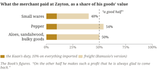
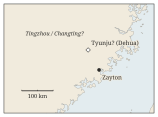

# Chapter II-14
## Fuju, Zayton, and the Haven of the World

> *“And I assure you that for one shipload of pepper that goes to Alexandria or elsewhere, destined for Christendom, there come a hundred such, aye and more too, to this haven of Zayton; for it is one of the two greatest havens in the world for commerce.”*
> — Marco Polo, Book 2, ch. 82 (Yule–Cordier)

**[M]**

---

South from Kinsay (Hangzhou), the road first crosses a settled, cultivated country. After a day, Polo's route reaches Tanpiju (perhaps Shaoxing), a rich city still under Kinsay's authority. Its people use paper money, trade and make goods, and burn their dead. The description is brief; the itinerary soon moves on [1].

The first day's travel passes a continuous line of homes and gardens rather than an empty road between isolated towns. Tanpiju is one of the larger places along it, with the usual combination of trade and small manufacture. Paper money links these southern cities to the Kaan's rule, while the custom of burning the dead marks a difference in local practice. The route gives little space to Tanpiju itself: its people and their work are noted, then the account turns south again.

Three days later comes Vuju (Jinhua), also governed from Kinsay. Another two days southeast, through towns that seem to run together, brings the traveller to Ghiuju (Quzhou). The repeated sequence of towns and villages makes the road feel almost continuous; the stages measure distance more clearly than they mark a change in settlement. Silk is plentiful in Ghiuju, where people earn their living in trade and craft. The city has enormous bamboos, said to reach four palms around and fifteen paces long. The claim is striking, though the region was known for bamboo and Polo's measurements may be enlarged.

The next four days lead through a country thick with settlements, birds and game. Polo calls its large predators lions; in this region he most likely means tigers. At Changshan, a hill divides the waters: one course runs back toward Kinsay, the other toward the south. The place marks a change in the journey, not simply another stop. The route crosses a ridge between waterways, and onward travel continues through the countryside. Polo also says sheep are absent from Manzi, though cattle, goats and pigs are common. That broad claim is best read as a report about what he encountered, not a count of every district.

Yule reads the river description as a ridge between valleys: water runs away on opposite sides, and travelers must cross the high ground between them. The stream ceases to be navigable at Changshan, making the portage part of the route rather than a detour from it. That interpretation makes the hill a practical landmark in the journey.

Three days more bring the road to Cuju, the last city under Kinsay in this direction. The country remains settled and rich in game, with traders and craftsmen along the way. Beyond Cuju lies the kingdom of Fuju (Fuzhou), one of the great divisions of Manzi. Cuju's exact modern location is uncertain, as are several of the stage identifications along this road; the watershed at Changshan is the route's clearest geographic clue. Polo's sequence carries the traveller from a kingdom governed from Kinsay into a new province, but the border is described through the cities and distances rather than a boundary post. This gives the account a practical rhythm: a day or several days of travel, then a city whose products or position make it worth naming. The route is not a survey of every settlement. It singles out places that mark jurisdiction, supply an unusual commodity or interrupt the journey.

From Cuju, six days southeast carry the traveller into Fuju's mountain valleys. Towns and villages supply food, while game is abundant. The text again calls the predators lions. Ginger and galingale grow in such quantity that Polo's account prices a groat's worth of ginger at eighty pounds, a vivid measure of abundance rather than a market survey. A fruit resembling saffron serves as a substitute for the spice. These are the road's notable goods: roots for cooking and trade, a local fruit used for colour, and game in the surrounding country.

The account then turns to the hill people: it reports blue-painted foreheads, spears, swords and foot soldiers, and accuses them of killing and eating people. Polo's charge is a hostile report, not a verified custom; Yule treats such accusations against mountain communities as a recurring stereotype [2].

After three days of the six, the road reaches Kelinfu (Jianning), a substantial city belonging to the Great Kaan. Three stone bridges cross there. Polo gives each a remarkable scale—about a mile long and nine paces wide—and describes their marble decoration. They are the detail that stops the itinerary: rather than another list of products or officials, the account pauses over costly public works. The surviving record does not confirm his dimensions, but the bridges are the feature he singles out.

Ramusio's account adds a textile trade: silk woven into different fabrics.

Ramusio's version also mentions dyed cotton cloth sent across Manzi. The older account describes black fowl with hair instead of feathers, like a cat's coat. Three days farther on, in the last stretch of the six-day journey, the route reaches Unken (perhaps Minhou), whose location remains disputed. Sugar is made there in abundance, and the Great Kaan's court is said to receive its supply from the town.

Ramusio's sugar story adds a refining lesson. It says that before the Mongol conquest, people boiled and skimmed cane juice until it cooled into a dark paste; later, men from Babylonia showed them how to refine it with tree ash. Yule explains that Babylonia here means Cairo. Separately, he reports that Fujian local histories credited men “from the West,” in Mongol times, with teaching fine-sugar making; those histories were not directly examined. The account then places Fuju fifteen miles beyond Unken [3].

Fuju is the key city of Chonka, a name for the kingdom whose origin remains uncertain. Polo describes the city as a major manufacturing and trading centre, guarded by a large garrison because its people are prone to revolt. The account makes the garrison part of the city's identity: its strategic importance brings both government attention and military presence. A broad river runs through the city in his account, and ships are built there. Sugar, pearls and precious stones arrive in a commercial flow that connects Fuju to the Indian Ocean.

The route explains how. Indian ships bring costly wares to Zayton (Quanzhou), and vessels carry goods up the river to Fuju. Polo presents the two cities as linked parts of a trading system: the seaport gathers foreign cargo, and river traffic carries some of it inland. He also describes Fuju as orderly and well supplied, with necessities available in plenty. The river is the Min, though its course does not run through the centre of today's city as his wording suggests; the discussion may refer to a suburb or a broader urban area. Chonka's name remains unexplained [4].

Five days southeast from Fuju, after crossing the river, the road reaches Zayton. The country between them is full of thriving settlements, farms and forest, including camphor trees. The people Polo encounters are traders and craftspeople under Fuju's government. His itinerary offers a short description of the journey, then gives its full attention to the city and its harbour. Zayton belongs to the kingdom of Fuju, yet its harbour serves merchants from across Manzi and ships arriving from India with spices and other expensive goods.

The port's trade is described in sweeping terms. Cargoes of jewels and pearls flow inland for distribution across Manzi, and the Kaan collects substantial duties. The harbour draws both foreign merchants and traders from within the realm; the goods do not stay on the waterfront but move onward through the country. Spices and costly wares travel with the ships arriving from India, while the port also receives the merchants of Manzi. Polo compares the pepper carried to Zayton with the much smaller amount sent toward Alexandria and Christendom: a hundred shiploads, or more, for every one sent west. It is a measure of the port's stature in his telling, not a customs ledger. He calls Zayton one of the world's two greatest commercial harbours. The statement joins the city's two roles: a point of arrival for long-distance shipping and a centre from which merchandise moves through the southern provinces [5].

On imported goods, including gems and pearls, the Kaan's duty is ten percent. Polo also gives freight rates: thirty percent for small wares, forty-four for pepper, and forty for bulky goods such as sandalwood. Taken together, the toll and freight charges amount, in his calculation, to about half the merchant's investment. The rates make the costs sound immense, while the account also presents Zayton as a place where merchants continue to trade.

Ramusio's portrait adds that the countryside is quiet and easy-going, and that visitors from Upper India come to Zayton to have tattoos made by local specialists. The main account says the region supplies life's necessities in abundance. It gives no inventory of everyday foods or household goods here; instead, the brief claim of abundance sits beside the port's long account of imported cargo.

Tyunju (perhaps Dehua) is described as a town in the province that makes fine porcelain, exported widely and sold cheaply. Polo puts the price in familiar terms: one Venetian groat buys three dishes, each presented as remarkably fine. The place-name's identification is not settled: this Fujian locality is plausible, while Tingzhou/Changting and other kiln localities have also been proposed. What fails is the claim that porcelain was made nowhere else. Fujian did produce ceramics, but the passage cannot establish a sole source. The price and praise belong to Polo's description; the text does not give a comparison of wares from different kilns.

Ramusio alone adds a separate account of porcelain production: clay is dug out, left exposed to weather for thirty or forty years, then shaped and fired. Its version places this town along a river route, but Yule cautions that this geography may reflect a medieval idea about connected waterways, not a reliable location for the kiln. The clay story belongs to Ramusio's version, not to the shared account of Tyunju [6].

The older text says that Zayton has a language of its own. Ramusio expands the observation into a wider claim: one speech and one writing system across Manzi, with local dialects that speakers can still understand, as in the difference between Genoa, Milan, Florence and Naples. The example makes a distant linguistic pattern easier for European readers to picture. Polo's comparison is a striking attempt to describe linguistic unity without denying local variation. He also says Chonka brings the Kaan as much customs revenue as Kinsay, or more.

Polo names three of Manzi’s nine divisions, Yanju (Yangzhou), Kinsay and Fuju, and leaves the other six undescribed [7]. He means to take us out to sea next. Stay with the customs men for a moment. The money they take at Zayton belongs to the Kaan, and a prince on the other side of his empire thinks he’s entitled to a share. What would the Kaan have to give up to get him to court?

---

## Notes

[1] ~ [@yc, 2.79] The route from Kinsay south through Tanpiju, Vuju and Ghiuju to Changshan and Cuju is clear in outline, but several place identifications are disputed. Tanpiju has been identified with Shaoxing or Fu-yang; Vuju with Jinhua; Ghiuju with Quzhou; Changshan's watershed is the strongest route clue. The report of giant bamboos and the absence of sheep is broad and may be exaggerated.

[2] ◇ The account describes painted hill fighters and accuses them of cannibalism. Yule compares this to hostile reports about mountain peoples; the accusation is not corroboration of the practice. The saffron-like fruit remains uncertain: Yule discusses *Gardenia* and *Carthamus* (Bretschneider; Hanbury) [@yc, 2.80].

[3] ✓ Kelinfu is identified with Kien-ning fu; Polo's bridge dimensions are not independently established. Ramusio-only. Its additions include textiles at Kelinfu and the sugar-refining story at Unken. Yule reports Fujian local histories crediting men “from the West,” in Mongol times, with teaching fine-sugar making; those histories were not seen. Ramusio's “Babylonia” refers to Cairo, whose sugar was famous. The exact Unken location remains disputed (Min-ts'ing, Yung-chun and other possibilities) [@yc, 2.80].

[4] ✓ / ? [@yc, 2.81] Fuju is Fuzhou, and the Min is its river. The river's position “through the middle” is imprecise; it may refer to suburbs. Chonka's origin is unresolved. The account's trade route brings Indian goods by way of Zayton and then up the Min.

[5] ✓ Zayton is Quanzhou (T'swan-chau), a major medieval port. Its identification is supported by Yule, Bretschneider, Yuan maritime-trade records and archaeology [@schottenhammer2001emporium; @chen1984quanzhou]. ◇ Polo's hundred-to-one pepper comparison and “one of the two greatest” claim are expressions of scale, not exact measures. See also Yule's discussion of Ibn Baṭṭūṭa [@yc, 2.79; @yc, 2.80; @yc, 2.82].

[6] ✓ / ~ [@yc, 2.82] The ten-percent import duty and listed freight rates are Polo's figures. Ramusio-only. Its quiet-country and tattoo details, the porcelain process, and the expanded language claim do not belong to the shared account. Tyunju may be Dehua, but Tingzhou/Changting and other kiln localities have been proposed; Dehua's production does not support Polo's claim that porcelain was made nowhere else (Lin and Zhang) [@lin2017chinese]. Ramusio's pottery-making account and river geography should not be used to settle the town's location; Yule discusses the possible connection to Jingdezhen and the medieval river theory [@yc, 2.82].

[7] ~ / ? [@yc, 2.82] Polo says Chonka's customs revenue equals or exceeds Kinsay's and closes after naming three of Manzi's nine kingdoms. His promise to describe India belongs to the book's transition, not independent evidence about Polo's travels.
