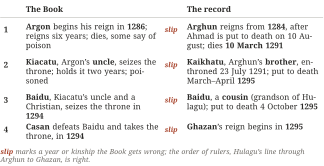

# Chapter II-15
## Great Turkey, Caidu’s Daughter, and the Wars of the Ponent

> *“In GREAT TURKEY there is a king called CAIDU, who is the Great Kaan’s nephew… Now this King Caidu is never at peace with his uncle the Great Kaan, but ever at deadly war with him.”*
> — Marco Polo, Book 4, ch. 1 (Yule–Cordier)

**[R]**

---

When the Book has finished Cathay and Manzi, it does not return to a straight homeward road. It widens its horizon. Beyond the Kaan’s capital lie the kingdoms of Central Asia, the Chinghisid houses of Persia and the Golden Horde, and the cold north. Marco Polo presents these lands mainly as report: court politics, military stories, furs and sledges, with the Mongol empire as an immense quarrelling family. [1]

In Great Turkey, Polo places Caidu (Kaidu), a prince of the Ögedeid line and Cublay (Kublai)’s lifelong rival. The Book calls Caidu Cublay’s nephew and grandson of Sigatay (Chagatai), but the genealogy is loose. Caidu was the son of Kashin, son of Ögedei; he stood for Ögedeid independence rather than Chaghatai’s line. The difference matters, because Caidu’s quarrel was about the rule of the entire Chinghisid state. [2]

The Book says Caidu demanded a share of Cathay and Manzi, yet refused to accept Cublay’s supremacy at a court summons. Cublay offered him a provincial allotment such as his own sons received, but Caidu would come only if he could remain independent in his own country. Year after year Cublay guarded the frontier and Caidu led raids. Polo gives Caidu a hundred thousand horsemen and several barons from the imperial line. The military scale is rhetorical, but the enduring war is real: for decades Caidu resisted Cublay from Central Asia.

Great Turkey itself lies toward the northwest beyond the Jon (Oxus). Polo gives Caidu battles with Cublay’s generals, fixed numbers and the old Mongol ritual of the kettledrum. Hosts charge after the naccara sounds, arrows fall, and the plain fills with wounded and dead. One fight is placed near 1266; another brings Caidu against Nomogan (Nomukhan), Cublay’s son, and George, grandson of Prester John, near Caracoron (Karakorum). The account makes the battle last until evening and leaves no victor. [3]

— Nomogan’s later seizure is not the same story as Polo’s drawn battle. Rashid al-Din records that rival princes seized Nomogan and his brother in 1277, while Pelliot doubts that Caidu or George belonged to the episode in the form the Book gives them. The drawn fight remains a report with uncertain historical correspondence. [3]

At Caidu’s court appears Aijaruc (Khutulun), his daughter. Polo calls her the Bright Moon and gives her a wrestler’s wager. No man could marry her until he defeated her in a trial of strength. Each challenger forfeited a hundred horses if she won; if he won, he would take her as his wife. She collected more than ten thousand horses. [4]

The story makes Caidu and his wife urge their daughter to let a prince win, but Aijaruc refuses. She wrestles him before the court, throws him, and leaves him with her horses. She then joins campaigns, captures enemy soldiers and carries them to her father.

Rashid al-Din knows Kutulun as a warlike daughter of Caidu. Ibn Battuta later tells a related wager story about another princess. The combination of a historical wrestler and a well-known marriage tale makes Aijaruc plausible as remembered royalty while the exact palace contest remains folklore. [4]

The horizon now turns south and west to the Ilkhanate. Abaga (Abaqa), lord of the Mongols of Persia, sent his son Argon (Arghun) to guard the frontier against Caidu. Caidu sent Barac (Baraq), a Chaghataid prince and ally rather than Caidu’s brother. Argon defeated him, but soon learned of Abaga’s death. [5]

Argon was forty days from the court. Before he arrived, his uncle Acomat Soldan (Ahmad Tegüder) seized the throne and its treasury. He had converted to Islam and was known to his enemies as the Saracen sultan. When Argon advanced, Acomat met him with an army. Argon was defeated and captured.

The aged baron Buqa then helped Argon’s conspirators free him. They included Elchidai, Togan, Tegana, Tagachar, Ulatai (Oulatay) and Samagar. Argon was hailed as Kaan, Buqa’s party killed the army commander, and Acomat fled toward Egypt. He was arrested and executed. Argon then sent his son Casan (Ghazan) to the Arbre Sec (the Dry Tree) with thirty thousand horse. The Book says Argon began his reign in 1286 and reigned six years. The real reign began in 1284 and ended with Argon’s death in 1291. [5]

Immediately after Argon’s death, Kiacatu (Geikhatu), his brother, took the throne while Casan remained far away. Geikhatu married Argon’s widow and ruled for about a year. Baidu, his cousin and a Tarakai descendant, seized power in 1295 after Geikhatu was killed. Casan swore vengeance, defeated Baidu in battle, had him put to death and began his own reign in 1295.

The Book calls Baidu an uncle and calls his Christianity decisive, but both claims are loose. Baidu was a cousin of the reigning house, and Ghazan’s victory, not his formal name, is the historical turning point. The reigning line ran Hulagu (Alaü) – Abaqa – Arghun – Ghazan, while Geikhatu and Baidu intervened between Arghun and Ghazan. [6]

Polo leaves Persia for the northern steppes. Conchi (Kunchi), a Jochid prince, rules a kingdom of plains and valleys. His people keep cattle and no settled cities or fields. They live on milk and meat, obey no outside ruler and worship felt figures of Natigai and a wife, which they feed crumbs and rub with meat. The identity of the king and the exact cult remain uncertain, but northern Jochid princes and ruler cults are plausible historical surroundings. [7]

The country has immense white bears, black foxes, wild asses, sable, ermine and a small marmot-like or jerboa-like animal Polo calls the Pharaoh’s rat. The Book says summer food came from these burrowing animals, but the identity is not certain. [7]

One northern tract is impassable to horses for thirteen days. It is crossed only on sledges drawn by large dogs. Each post has a relay of six dogs, a bear skin for the courier and a driver on a second sledge. The next station sends out a fresh team while the old dogs turn back. The hunters beyond it collect sable and ermine beneath underground houses. The detail belongs to northern fur geography; the dog strength and exact methods are rounded. [7]

Beyond the kingdom Polo places the Land of Darkness. It has neither sun, moon nor stars, and the people live without their own king. Merchants from the illuminated border visit for furs. The darkness, Polo says, is a place of sables and ermine, carried to the light for sale. The description belongs to legendary geography, but trade in northern pelts was real. [8]

The northern route reaches Lac (Wallachia), conterminous with Rosia (Russia). Lac is mixed in religion and exports fine furs. Rosia has a language of its own, Greek-Christian towns and cities, strong passes and silver mines. It pays tribute to a Tartar king of the Ponent. [9]

Polo names Toctai (Toqta) of the Golden Horde. He also gives a list of Ponent rulers beginning with Sain and Patu, then Barca (Berke), Mungletemur, Totamangu and Toctai. The sequence reflects confusion: Batu is the likely Sain and Patu; his title and later names have been split and rearranged. The conquest of Rosia, Comania, Alania, Lac and Gazaria is a broad echo of the Golden Horde, not a precise king-by-king chronicle. [9]

The final scene returns to war between Alaü (Hülegü) of the Levant and Barca (Berke) of the Ponent. Around 1262 they fought over territory near the Caspian and the Iron Gates. Abaqa was sent across the Terek into Berke’s country; Berke rallied and the Ilkhan army was driven back. Polo gives a much larger battle, with addresses, kettledrums and equal hosts. The outcome becomes Berke’s victory, and the dispute is said to have closed the elder Polos’ western route.

That family route is later than the Book’s battle itself. The Polos travelled east in 1260–69 and reached the court by 1266, according to their own chronological setting. The Berke–Hülegü war remains verified as a major border conflict; the exact episode and the elders’ response belong to separate reports. [10]

The Ponent horizon closes with Caidu in Central Asia, the Ilkhanate in succession struggle and the Golden Horde along the northern edge. It is less a sequence of eyewitness scenes than a Mongol political map heard by travellers and court informants. Names, dates and kinship were bent in retelling, but the pattern of Chinghisid rivals is real.

---

## Notes

[1] ✓ / ◇ [@yc, 4.1] Book 4 is court and embassy report rather than a continuous itinerary. The manuscript order places these matters after the India chapters. The western and northern subjects are heard and compiled, not established as Marco’s personal route.

[2] ✓ [@yc, 4.1] Caidu fought Cublay and held a frontier across Central Asia. ✗ Caidu grandson of Sigatay / Cublay nephew — Caidu was Ögedei’s grandson. ✓ Caidu demanded a share of imperial territory and refused Cublay’s supremacy. The dialogue is literary.

[3] ◇ / ? [@yc, 4.2] Polo gives battles in 1266 and a later drawn battle at Karakorum. Rashid al-Din reports Nomogan’s seizure in 1277, but Pelliot doubts Yule’s link to Caidu and George. Pelliot [-@pelliot1959notes, vol. 1, “Caidu”; vol. 2, “Giorge”] does not support the Book’s drawn battle as a proven match.

[4] ~ / ◇ [@pelliot1959notes, 4.4] Aijaruc (Khutulun) is a plausible Rashid al-Din figure: warlike, unmarried and famous for wrestling. ✓ The palace wager and horse count belong to the wrestler tale and later folklore. [@yc, 4.4]

[5] ✓ / ~ [@yc, 4.6–4.10] Abaga, Arghun, Ahmad Tegüder and the 1284–91 succession are real. ✓ Arghun was defeated, freed by Buqa and his allies, and returned to power. ? Exact dialogue, names and rescue sequence carry Rustichello’s or court-rhetoric form. Baidu and Ghazan follow in the next passage.

[6] ✗ / ~ [@yc, 4.17] Kiacatu was Arghun’s brother, not his uncle, and ruled briefly before 1295. ~ / ✓ Baidu was a cousin, seized power in 1295 and was defeated by Ghazan. ✓ The Hulagu–Abaqa–Arghun–Ghazan line. As cited in Yule: Hayton [@yc, 4.17].

[7] ✓ / ◇ [@yc, 4.4] Northern Jochid princes and felt-ancestor cults belong to the steppe world. ~ White bears, dog sledges and underground houses belong to a northern fur report; exact animal names and scales vary. “Pharaoh’s rat” is not identified with certainty.

[8] ◇ [@yc, 4.8] The Land of Darkness is legendary geography. ✓ Fur commerce into the illuminated northern border is historically plausible. The mare-guided raids and the return route are reported devices, not a verified itinerary.

[9] ~ / ? Lac = Wallachia is Yule’s identification. ? Lac’s religion and northern border are uncertain. ✓ Rosia is Russia in the Book’s usage; Greek Christianity and tribute to the Golden Horde fit the broad setting. [@yc, 4.16]

[10] ✓ / ✗ [@yc, 4.20] The Berke–Abaqa war is historical. ✓ Abaqa sent forces across the Terek, and Berke rallied. ✗ Polo’s Rustichello-style equal-host battle and the Polos’ western diversion are not independently established by the account itself.
