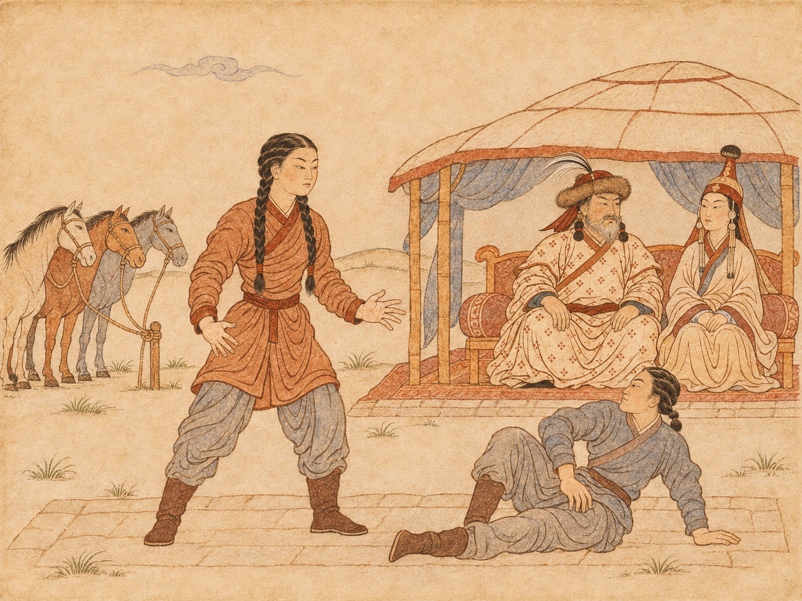

# Chapter II-15
## Great Turkey, Caidu’s Daughter, and the Wars of the Ponent

> *“In GREAT TURKEY there is a king called CAIDU, who is the Great Kaan’s nephew… Now this King Caidu is never at peace with his uncle the Great Kaan, but ever at deadly war with him.”*
> — Marco Polo, Book 4, ch. 1 (Yule–Cordier)

**[R]**

---

The customs at Zayton (Quanzhou) bring in a fortune. When Caidu (Kaidu) asks for his share of Cathay (northern China) and Manzi (southern China), consider what there is to share. Cublay (Kublai) Kaan can offer him a province, as he does his own sons. There’s a condition attached. Caidu must come to court and do homage. In Polo’s telling, he sends back his willingness to obey from exactly where he is [1].

Where he is, in the Book’s Great Turkey (the Central Asian khanates), lies beyond the Jon (Oxus) if you travel up from Hormos (Hormuz). Caidu can call on princes descended from Chinghis (Genghis) Kaan and, if you take Polo’s tally, a hundred thousand riders. The Kaan has to keep soldiers on the marches all year round [2]. A province handed down by Caidu’s own forebears and one granted him in Cublay’s gift are different things to a man who intends to keep his saddle.

{#fig-mongol-horizon}

Look at the family tree before the horses go out. The Book calls Caidu Cublay’s nephew and a grandson of Sigatay (Chagatai). His father, Kashin, was a son of Ögedei, which makes Cublay his father’s cousin [3]. Caidu has his own line of descent from a Great Kaan. And the neighbours whom Polo has mistaken for his immediate family can be formidable allies.

At the first battle, which Polo dates to 1266, Caidu and his cousin Yesudar defeat two barons allied to Cublay. The defeated men escape on good horses. The Book sends Caidu out again after two years, this time against Cublay’s son Nomogan (Nomukhan) and a prince called George near Caracoron (Karakorum) [4].

Each side draws up six columns of ten thousand, in this telling. Before the kettledrum sounds, look into a bowman’s quiver. Polo counts thirty light arrows for distance and thirty broad-headed ones for close work [5]. The two drums sound and the field closes up. Men loose arrows until there are none left to draw, and then come the swords and maces. Neither side wins. They go back to their tents at nightfall, and Caidu is away at dawn after hearing that reinforcements are coming [6]. We have a later record of Nomogan falling into the hands of other princes. The field where the drums go quiet still eludes us.

---

The next horses at Caidu’s court are a young woman’s takings. Her name in the Book is Aijaruc (Khutulun), the Bright Moon [7]. A suitor gets her hand if he can throw her. If she throws him, he gives her a hundred horses. Ten thousand and more have changed owners by the time Polo brings a prince into the hall who will stake a thousand at once [8]. Her father and mother would like her to let this one win. The Book allows her to decide what they can ask of her, and she agrees to the match on the same terms as ever.

Picture the two of them on the palace floor. He’s in a fitted jacket of sendal, she’s in one of sammet, a rich silk. They get hold of each other by the arms. For a while there’s nothing to choose between them. Then she puts him down on the paving [9]. The prince leaves with his people, and Caidu’s daughter has a thousand more horses to find room for.

{#fig-ii-15-aijaruc-wrestling}

I like to imagine the grooms watching this match. One person landing on the floor means a thousand animals to feed in the morning.

Out on campaign, Polo’s Aijaruc darts away from her father’s company and seizes a man from the other side as neatly as a hawk taking a bird. Rashid al-Din also knows of a daughter of Caidu who goes to war with him [10]. It’s a firmer footing for her than the tally of horses. As for the palace contest, other storytellers have found a challenge like hers worth telling about another princess.

---

At the marches of Persia, Abaga (Abaqa) sets his son Argon (Arghun) to watch the ground around the Arbre Sec (the Dry Tree). The Book sends Barac (Baraq) across the river against him and calls him Caidu’s brother. Barac was a prince of Sigatay’s line, an ally of Caidu, and he died in 1271. Abaga lives until 1282 [11]. Between the fight and the news of the father’s death there are years the storyteller can cross in a breath.

Forty days separate Argon from court when the news reaches him in Polo’s account. Within reach of the treasury is his uncle Acomat Soldan (Ahmad Tegüder), who has embraced Islam. Acomat takes the throne and hands out treasure among the barons and troops [12]. Everybody on both sides seems to have a speech in the Book. Watch the money for a moment. It’s going into the hands of the people his nephew will need if he is to get anywhere near the throne.

Argon meets Acomat’s troops and the Book has him captured and put in irons [13]. Acomat goes on to court, leaving his army and his prisoner in the charge of a commander the Book calls the Melic, or lord. By the time another party of barons enters Argon’s tent, there is every reason for him to wonder which command they have come to carry out.

Boga (Buqa) has brought Elchidai, Togan, Tegana, Tagachar, Oulatay (Ulatai) and Samagar. Their offer to put Argon on the throne sounds to him like a poor joke until they swear allegiance. Off come the fetters. The men shoot into the commander’s tent and Argon takes charge of the same army that brought him there a prisoner [14]. Acomat tries to get away towards Egypt. He is taken and executed, in August 1284. The Book starts Argon’s reign two years late [15].

From the throne, Argon sends his son Casan (Ghazan) to the frontier with what the Book reckons at thirty thousand horse [16]. It means that when Argon dies in March 1291, his son is well out of the way. Kiacatu (Geikhatu) takes power that July. He is Argon’s brother, although the Book calls him an uncle, and he takes wives from Argon’s household. By the time he is killed in 1295 he has had nearly four years on the throne [17].

Baidu, a cousin of both men through his father Tarakai, succeeds him in the spring of 1295. The Book makes much of Baidu’s Christianity and gives Casan a battle in which his rival’s men come over to him. Baidu is killed that October and Casan takes the throne in 1295 [18]. Follow the succession on the diagram and you can see just how long it takes for the government to pass from father to son.

{#fig-c8-ilkhan-succession}

---

A sable coat puts us back in the Kaan’s world even if the people who supplied the skins are months away. In the northern country of Conchi (Kunchi), Polo pictures riders and herds moving through plains and valleys, with no city or castle to live in. Their ruler answers to no one. At dinner some of the meat goes to felt images of Natigai and his wife, who watch over the herds [19].

There are white bears, black foxes, wild asses and sables in the Book’s northern woods and plains. The people are said to eat the abundant little animal Polo calls a Pharaoh’s rat all summer [20]. For anybody who has to cross his thirteen days of ice and mire, a bear has another use. A skin goes down on a runner sledge to give the courier a seat. Six dogs pull it. The keeper of the post goes ahead in his own sledge to find the best going [21]. At the next post the courier changes dogs and the others go back. That’s one way to get a dispatch across country that can swallow a wheel.

Hunters in the valleys beside the route set traps for sable, ermine and black fox. Polo puts their houses underground to escape the cold [22]. Farther on comes a country where it is permanently twilight. The raiders who go there, in the Book, ride mares and leave the foals behind. When the men want to find their way out, they trust the mares to find their way home [23]. Merchants who simply want the pelts can wait at the edge of the darkness. The hunters bring them for sale.

At the border of Rosia (Russia), Polo finds another fur trade in Lac (possibly Wallachia). Its people, he reports, include Christians and Muslims [24]. Rosia itself has silver mines and Christians of the Greek rite. They pay tribute to Toctai (Toqta), one of the Mongol rulers Polo calls the Tartars of the Ponent, or west [25]. The Book assigns their conquests from Rosia to Gazaria (Crimea) to Sain and then gives him a successor called Patu. The first of those names was probably a title of the second, Batu [26]. Follow the names down through Barca (Berke), Mungletemur and Totamangul and the Book brings you to Toctai. By then the confusion runs deeper than counting a ruler twice. The Book sends two princes to their sovereign to demand justice of Nogai for the killing of their father. It gets the family so tangled that the young men appear to change fathers between kneeling and getting up to speak. There was a war between Toctai and Nogai. Yule can follow it through accounts of more than one battle, with the two men’s fortunes reversed between them [27].

Polo almost stops at the strait to the Black Sea. There’s a hill he could show us at the entrance, but the Book backs away from the view. Venetians, Genoese and Pisans already sail there, he tells us at the end of these accounts [28]. A merchant likely to travel that way can ask round the quay. Which of his neighbours could tell him about a sledge through thirteen days of lake country?

Before we get to a ship, there is one more army on a shore. Alaü (Hülegü) and Barca meet in the Book between the Iron Gates (Derbend, now Derbent) and the Sea of Sarain (Caspian Sea). Alaü’s tents are rich enough to make a show of his wealth. Barca comes up and pitches his camp about ten miles away. There are two grand addresses before the armies go into battle. In this version it’s Barca who is driven from the field [29].

Follow the troops to the Terek and the outcome changes. Abaga led an army into Barca’s territory. Barca’s men drove it back over the frozen river in the winter of 1262–63, and soldiers drowned when the ice gave way [30]. For the elder Polos, still on the road in their own account, war sealed off the way back west. They found a way forward. The men on the river had much less room to choose.

Leave the horses at the water’s edge. Out at Zayton there are merchants preparing to go to sea. A man can have a cabin to himself on one of their ships. What I’d like to show you first is the space below it, where the safety of the cargo depends on a line of timber.

---

## Notes

[1] ~ Polo gives the rival claims the form of a demand and a conditional offer. The struggle between Caidu and Cublay is historical, while the exchanges are preserved here as the Book tells them [@yc, 4.1 nn. 1–2].

[2] ~ Yule cites Rashid al-Din on the expanse of country held between the rival powers. Polo’s hundred thousand is his estimate of Caidu’s whole strength [@yc, 4.1 n. 2].

[3] ✗ Caidu was Ögedei’s grandson through Kashin. Yule suggests that Caidu’s influence among the princes of Sigatay’s line may explain the Book’s mistake [@yc, 4.1 n. 1].

[4] ? Polo dates the first fight to 1266 and places the later fight against Nomogan and George near Caracoron. Pelliot doubts the identification of the latter and suggests that the Book may have put George in place of his father Ai-buqa [@yc, 4.2; @pelliot1959notes, vol. 2, “Nomogan” and “Giorge”].

[5] ~ The allocation of arrows belongs to the Book’s description of how mounted archers equip themselves. Each kind has a job, from long-range shooting to close work with a head that can cut a bowstring [@yc, 4.2].

[6] ? The Book’s second battle ends without a victor. The Yuan chronicle reports that other princes seized Nomogan at Almaliq in 1277 and says Caidu did not join them. The capture is a separate event in the record and leaves the narrated battle unidentified [@yc, 4.2 n. 3; @yuanshi1370, juan 12; @pelliot1959notes, vol. 2, “Nomogan”].

[7] ✓ Yule identifies the name in the Book as a Turkish expression for the shining moon. Through Hammer he identifies Caidu’s daughter as the Khutulun named by Rashid al-Din [@yc, 4.4 n. 1].

[8] ~ The escalating stakes and the running count belong to Polo. They give the audience a way to measure the size of the final wager [@yc, 4.4].

[9] ? The court match has the shape of a folktale, with the prince’s thousand horses at stake. Yule compares Ibn Baṭṭūṭa’s account of Princess Urduja, who wanted a husband able to defeat her in combat, and leaves open a possible connection between the stories [@yc, 4.4 n. 1].

[10] ✓ Rashid al-Din’s account, as relayed by Yule through Hammer, puts Khutulun in the field with her father. The comparison supports her presence on campaign; the hawk-like capture is Polo’s scene [@yc, 4.4 n. 1].

[11] ✗ The Book turns Barac, a ruler from Sigatay’s branch, into Caidu’s brother and telescopes the fighting with the change of rulers. Barac died in 1271, years before Abaga’s death in 1282 [@yc, 4.5 n. 2; @yc, 4.6 n. 1].

[12] ~ Acomat’s conversion and accession belong to the historical succession; the distribution of the treasury to win over the army is how the Book stages his claim. Polo treats the conversion as central to the quarrel and gives the rivals elaborate speeches [@yc, 4.6 nn. 1–3; @yc, 4.7–11; @yc, 4.17 n. 1].

[13] ✓ Yule’s comparisons support Argon’s defeat and capture. The Book leaves him in irons in the hands of a commander whose title it renders as Melic [@yc, 4.12 nn. 1–2].

[14] ~ Boga and his allies secured Argon’s release and his rise to power. Yule identifies several of the men and suggests that Polo may later have heard the story from Oulatay, who went east as Argon’s envoy [@yc, 4.13–14; @yc, 4.17 nn. 1–2].

[15] ✗ Acomat was executed on 10 August 1284, so Argon’s reign begins in 1284. The Book gives 1286 [@yc, 4.15–17; @yc, 4.16 n. 1; @yc, 4.17 n. 2].

[16] ~ The sources Yule compares put Casan in charge of the eastern provinces. The Dry Tree and the figure of thirty thousand cavalry belong to Polo’s telling [@yc, 4.17 n. 2].

[17] ✓ Kiacatu was enthroned on 23 July 1291 and put to death in spring 1295. Yule’s account names two women from Argon’s royal tents who became wives of his brother [@yc, 4.18 n. 1; @thackston1998rashiduddin, pp. 575, 580–581, 586].

[18] ✓ Baidu’s father Tarakai was a son of Alaü, making Baidu a cousin of Argon and Kiacatu. Baidu was executed on 4 October 1295 and Casan was enthroned that November, a year after the date the Book gives for both reigns [@yc, 4.19 nn. 1–2; @thackston1998rashiduddin, p. 627].

[19] ~ Yule identifies Conchi with a prince of the Jochid line. Polo presents the felt figures and the tending of their mouths as inherited customs reaching back to Chinghis Kaan [@yc, 4.20 n. 1; @yc, 1.54].

[20] ? Yule compares marmots and other burrowing animals in discussing the Pharaoh’s rat. The name and the subsistence detail in the Book leave its identity uncertain [@yc, 4.20 n. 2].

[21] ~ Yule compares dog transport in northern Asia with the relay described by Polo. The precise lengths, teams and sizes belong to the Book’s account [@yc, 4.20 n. 3].

[22] ~ The Book links underground dwellings to the severity of the cold. Its lists of pelts give the northern account a commercial point of contact with other regions [@yc, 4.20 nn. 4–5].

[23] ~ The mare and foal give the tale a way to navigate the legendary darkness. Trade in northern furs is plausible independently of the Book’s explanation of how raiders went after them [@yc, 4.21 nn. 2–3].

[24] ? The Book places Lac at the edge of Rosia and calls its population religiously mixed. Yule proposes Wallachia, with reservations about which region the name designated [@yc, 4.22 n. 2].

[25] ✓ Polo gives Rosia the Greek rite and names Toctai as its overlord. The general setting fits the tributary relations of the Rus’ principalities with the Golden Horde [@yc, 4.22 n. 1].

[26] ✗ Yule reads Sain, meaning “good”, as an epithet of Patu. The Book has turned a title and a name into two rulers, and its list compresses later successions as well [@yc, 4.24 nn. 1–2; @yc, 4.29 n. 1].

[27] ? The text alternates between Tolobuga and Totamangu as the brothers’ father. Yule compares accounts of Toctai’s defeat by Nogai and Nogai’s later defeat, with differences in the chronology [@yc, 4.29 n. 1; @yc, 4.30–33].

[28] ~ The Book first breaks off at the entrance to the Black Sea, then gives the familiarity of the route as its reason for passing over the coast. In Yule’s edition the northern and western reports come after the voyage through the Indian seas [@yc, 4.23; @yc, 4.34].

[29] ✗ The Book gives victory to Alaü’s side and magnifies both armies. The family’s eastward journey belongs to the Prologue, and its account also puts Alaü on the winning side [@yc, 4.25–28; @yc, Prol. 2].

[30] ✓ Yule distinguishes the better-attested Terek campaign from the Book’s victory for Alaü. Abaga, commanding for his father, was driven back in the winter of 1262–63. The war closed the way back for the brothers in the Prologue. See [Chapter I-2, “The House of Polo and the Elder Voyage”](../vol-1/ch-02-house-of-polo.md) [@yc, 4.25 n. 3; @yc, Prol. 2 n. 3].
