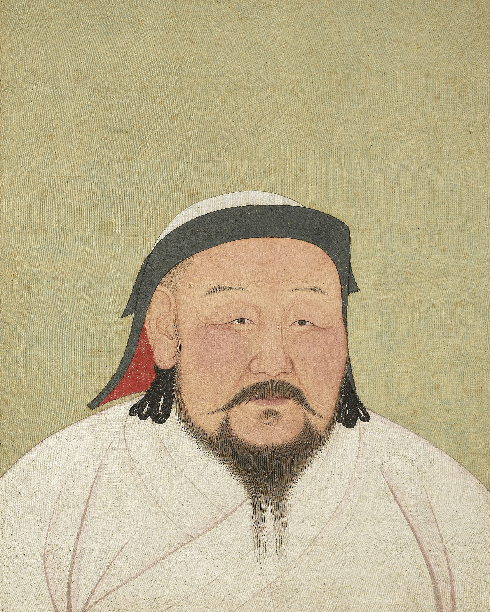

# Front Matter II-1
## Yuan China: The World You Are Entering

> *“To this city also are brought articles of greater cost and rarity, and in greater abundance of all kinds, than to any other city in the world.”*
> — Marco Polo, Book 2, ch. 22 (Yule–Cordier)

---

::: howto
**Reading the marks.** Notes open with ✓ corroborated · ~ plausible · ✗ probably wrong · ? contested (◇ marvel or hearsay). Tags: **[V]** mostly seen or done · **[R]** mostly heard · **[M]** both. A provenance label such as “Ramusio-only.” or “Ramusio-only in part.” in a Note identifies material from a later witness and defines its scope. Full key: Volume I, front matter.
:::

Volume II drops the reader into a different register. Volume I was the road; Volume II is the realm — Cublay Kaan (Kublai), his ordo and palaces, the paper-money and post-horse machine, the western and southwestern circuits, then the rich south the book calls Manzi. Before Polo starts narrating feasts and bridges, a companion pause helps: what kind of China is this, and what horizon is still closing as he watches?

### Kublai’s China — not “timeless Cathay”

The ruler at the centre of Volume II is Cublay (Kublai), grandson of Chinghis (Chinggis Khan), Great Khan of the Mongol world in claim and emperor of a Chinese-style state in practice. He proclaimed the Yuan dynasty in 1271 and built rule on a double foundation: Mongol conquest elite and Chinese administrative technique. Morris Rossabi’s biography remains a clear modern door into that balancing act; Yuan sources and Persian historians (Rashid al-Din’s world) supply the outer frame [1].

{#fig-khubilai-portrait width=76%}

For the book’s purposes, two capitals matter more than a modern national map. **Chandu** (Shangdu / Xanadu) is the summer court you already met at the end of Volume I — hunting parks, ceremonial horses, religious specialists. **Cambaluc** (Khanbaliq / Dadu — today’s Beijing) is the great winter seat: walls within walls, palace compounds, markets, and the bureaucratic hum of an empire that taxed grain, salt, and commercial traffic on a scale Latin cities could barely imagine [2].

Polo’s Cambaluc is not a Qing postcard and not a Song painting. It is a Mongol imperial city raised on the North China plain, staffed by Mongols, Central Asians (*semuren* in later classification talk), northern Chinese subjects, and assorted foreign specialists — including, if the book is believed, the occasional Venetian on errands. When Volume II praises the palace’s marble and the city’s markets, listen for a guest describing power’s theatre.

{#fig-b3-kublai-polo-calendar}

### Dadu and Shangdu — seasonal gravity

Think of Yuan sovereignty as seasonal gravity. Summer pulled the court toward Chandu’s cooler plateau country; autumn and winter pulled it back to Cambaluc’s walls. Polo’s hunt chapters, feast calendars, and palace descriptions make more sense if you let the court move. The *yam* post system — relay horses, hostels, tablets of authority — existed partly to make that mobility and that empire’s messages possible across distances that would have broken a purely personal retinue [3].

When Volume II speaks of twelve thousand Keshican (guard), robes of one colour issued for feast days, or birthday spectacles, you are hearing court anthropology as a merchant-guest remembered it: impressed, sometimes exaggerating, often sharp on logistics and colour. Believe the institution of spectacle; audit the headcount.

### The Sung conquest horizon

While Cublay’s northern machine ran, the conquest of the Southern Song — Polo’s **Manzi** — was still the great unfinished or newly finished business of the age. Saianfu (Xiangyang) fell after a long siege in the 1270s; Kinsay (Hangzhou) surrendered in 1276; residual Song resistance guttered out by 1279 with the naval endgame off Yaishan. Volume II’s Manzi chapters therefore sit on a moving floor: some descriptions feel like travel in a newly pacified rich south; the Saianfu mangonel story claims a Polo-family cameo in the conquest toolkit — a claim historians still chew [4].

When Polo praises Kinsay’s lakes, markets, and paper records of houses, he is describing the former Song capital under Yuan rule — a city that had been, until yesterday in historical time, the heart of a rival Chinese world. The wonder is conquest’s inheritance as much as eternal splendour.

### Paper money, coal, and the *yam* world

Volume II is where Latin readers met institutional marvels that still startle:

**Paper money.** Polo describes fiat notes issued on official paper, accepted under penalty, and used across the Khan’s dominions. Yuan paper currency is abundantly attested in Chinese sources; Polo’s wonder is less “did it exist?” than “how cleanly did a foreign guest understand the monetary politics and the later inflation crises?” Hans Ulrich Vogel and monetary historians are useful here; the book’s tone is marvel plus moral of obedience [5].

**Coal.** He narrates black stones that burn like charcoal — a detail once mocked in Europe and later recognised as ordinary North China fuel. The coal passage is one of the quieter corroborations that the narrator had breathed northern air. It is ethnographic, not alchemical [6].

**Posts and charity.** The *yam* relays, granary and poverty-relief notes, and Achmath (Ahmad Fanakati) the bailo’s fiscal tyranny (and bloody end) turn Volume II into an administrative travelogue as much as a wonder book. Achmath’s story can be checked, in outline, against Chinese historiography; Polo’s dramatisation is still dramatisation — a foreigner’s memory of a hated minister’s fall [7].

### Circuits the chapters will walk

After court and capital, Volume II sends the reader on circuits:

- **West / southwest:** Pulisanghin (the stone bridge later nicknamed the Marco Polo Bridge) toward Shanxi, Cachanfu (Puzhou), and Kenjanfu (Xi’an), then Sindafu (Chengdu), Tebet’s marches, Carajan (Yunnan), and the gold-teeth country of Zardandan.
- **Reported frontiers:** Mien (Burma) and elephant battles; Caugigu and highland ethnonyms that stay soft on the map.
- **East into Manzi:** canal cities, Yanju (Yangzhou), Saianfu’s siege tale, Suju (Suzhou), the long love-letter to Kinsay, then Fuju (Fuzhou) and Zayton (Quanzhou) — the haven where Volume III’s ships wait.
- **Horizon chapter:** Great Turkey and the wars of the Ponent — Book IV material compressed as imperial weather, mostly reported [8].

### How to listen in Volume II

Believe bridges, posts, paper notes, and urban density more readily than exact headcounts. Treat governorship claims and family mangonel heroics as disputed until Notes say otherwise. Keep book-names (Cambaluc, Kinsay, Zayton) in the ear; modern names are there so you can find them on a map without flattening the medieval tongue. The map companion next door will hang Cathay and Manzi on the wall; the trivia chapter at the end will pocket Yanju, Saianfu, and Kinsay’s arithmetic.

You are entering a world where a Venetian could watch a Mongol emperor feast in robes of one colour, pay with mulberry-bark notes, burn black stones against the cold, and ride south toward a canal metropolis larger than any Italian commune. That is the Volume II bargain. The chapters keep it — orally, clearly, and with the floorboards marked where the numbers bounce.

---

## Notes

[1] ✓ Cublay proclaimed the Yuan dynastic name in 1271 and ruled as both Mongol Great Khan and Chinese-style emperor [@yc, 2.1 n. 1; @rossabi1988khubilai, ch. 5]. Allsen [-@allsen1997commodity] examines how the court marshalled artisans, textiles, and administrators across the wider Mongol commonwealth.

[2] ✓ Chandu (Shangdu) and Cambaluc (Khanbaliq / Dadu) functioned as the dual seasonal capitals of the Yuan realm [@yc, 1.61; @yc, 2.10–11; @steinhardt1990chinese]. Both walled sites have been surveyed by modern Chinese archaeologists; see [Map A9, Dadu city plan](ch-02-person-palace.md#fig-a9-dadu-city-plan).

[3] ✓ The *yam* postal relay network linked the capitals to the provinces through horse stations, foot-runners, and metal tablets of authority (*paiza*) [@yc, 2.26]. Chinese administrative codes and Persian chronicles corroborate the system in detail; see [Chapter II-5, Notes 20–25](ch-05-ahmad-paper-coal.md#notes).

[4] ✓ The final conquest of the Southern Song ran from the siege of Xiangyang (1268–73) and Bayan’s capture of Hangzhou (1276) to the naval battle of Yashan in 1279 [@yc, 2.65, 2.70]. The Book’s claim that the Polos supplied the counterweight trebuchets at Saianfu clashes with the siege chronology; see [Chapter II-11, Notes 21–37](ch-11-yanju-saianfu.md#notes).

[5] ✓ Yuan paper money (*chao*) is extensively documented in Chinese fiscal sources and surviving notes [@yc, 2.24; @vogel2013marco, ch. 1]. While Polo accurately describes the bark paper, seals, and conversion fees, Chinese records give a much fuller account of the inflation and 1287 currency devaluation; see [Chapter II-5, Notes 13–18](ch-05-ahmad-paper-coal.md#notes).

[6] ✓ Polo’s account of burning black stones dug from the mountains is a well-attested description of North China coal use [@yc, 2.30; @golas1999mining]. Even sceptical critics credit the accuracy of the coal passage; see [Chapter II-5, Notes 30–31](ch-05-ahmad-paper-coal.md#notes).

[7] ~ Achmath (Ahmad Fanakati) appears in the *Yuan shi* under the biography of "villainous ministers," confirming his fiscal power and his assassination in a night plot in spring 1282 [@yc, 2.23 nn. 2, 4; @yuanshi1370, juan 205]. Polo’s account comes through Ramusio and dramatises the fall from a courtly partisan perspective; see [Chapter II-5, Notes 1–12](ch-05-ahmad-paper-coal.md#notes).

[8] ~ The wars of Caidu in Great Turkey and the succession conflicts of the Golden Horde and Ilkhanate (Yule's Book IV) reach the Book largely as court and military report [@yc, 4.1–29]. Chapter II-15 gathers them at the close of Volume II as the northern and western horizon of Cublay’s realm.
