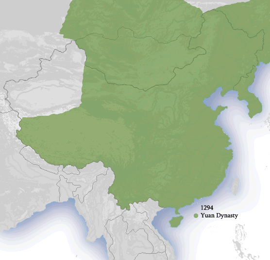
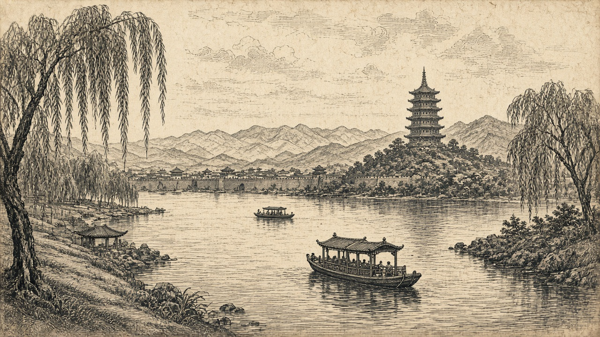

# Front Matter II-2
## Maps for Cathay and Manzi

> *“And so I will tell you of the great province of Manzi…”*
> — Book II (Yule–Cordier tradition)

---

Volume II needs a different map habit than Volume I. You are no longer dragging a caravan from Ayas to Lop; you are circling a court, then riding circuits west, southwest, and south through canal country to the Fujian havens. The images below are placeholders for files in `../media/`. Place tables come from the gazetteer filtered to volume = 2. [1]

### How the Volume II map hangs together

Start at **Cambaluc** (Beijing). One road of description runs **west and southwest** across the Pulisanghin bridge toward Shanxi, Xi’an country, Sichuan’s Sindafu, then Yunnan’s Carajan — with Tebet and Burma mostly as side-report. Another movement — the one modern readers often love most — runs **southeast into Manzi**: canal and river cities, Yangzhou, the Saianfu siege story, Suzhou, Hangzhou’s Kinsay, then down the coast to Fuzhou and Quanzhou (Zayton). [2]

Politically you are inside Yuan China after the Mongol conquest of the north and during/after the absorption of the Song south. Ethnographically Polo still splits the world into Cathay (north) and Manzi (south) in the older foreigner’s tongue.

### China under the Yuan

*Caption:* Yuan China schematic for Volume II — Dadu/Shangdu gravity, western/southwestern circuit, and the Manzi–Grand Canal corridor toward Zayton. *(Wikimedia Commons — credit in media/ATTRIBUTIONS.md)*

Use this map to keep court, west circuit, and south circuit from collapsing into one spaghetti line.

### Kinsay and the Jiangnan approach

*Caption:* Kinsay (Hangzhou) and neighbours — Suju (Suzhou), Ganpu, and the estuary approaches Polo loads with numbers and marvels. *(Wikimedia Commons — credit in media/ATTRIBUTIONS.md)*

Kinsay earns its own frame because Book II’s city description is the longest urban set-piece in the whole work. When numbers of bridges or houses feel incredible, look back at the lake-and-canal geography: the wonder is density, not magic.

### Place table — capital approaches and west / southwest circuit

| Book name | Modern | Role in Vol. II |
|-----------|--------|-----------------|
| Pulisanghin | Lugou Bridge (Marco Polo Bridge), Beijing | Famous stone bridge on the outbound west road |
| Juju | Zhuozhou, Hebei | South road stage from Cambaluc |
| Tainfu | Taiyuan, Shanxi | Wine and arms country |
| Pianfu | Linfen / Pingyang area, Shanxi | Pingyang identification usual |
| Cachanfu | Xi’an (Chang’an), Shaanxi | Kenjanfu; Nestorians noted |
| Sindafu | Chengdu, Sichuan | Great bridge and Sichuan commerce |
| Tibet | Eastern Tibet / Kham | Tebet customs and musk — marches more than Lhasa |
| Carajan (Yunnan) | Dali / Kunming region | Western Yunnan kingdom colour |
| Yachi | Kunming, Yunnan | Usually identified with Kunming |
| Zardandan | Baoshan / Tengchong area | “Gold-Teeth” ethnonym region |
| Mien (Burma) | Bagan / Pagan kingdom, Myanmar | Elephant battle — largely reported |
| Caugigu | Northern Vietnam / Tonkin region | Soft ID (Jiaozhi links debated) |
| Cuiju | Guizhou region | Soft highland geography |

### Place table — Manzi corridor to the haven

| Book name | Modern | Role in Vol. II |
|-----------|--------|-----------------|
| Acbalec Manzi | Hanzhong area, Shaanxi | Border-of-Manzi marker; ID varies |
| Ciangu | Cangzhou / Changlu area, Hebei | Salt towns on canal approaches |
| Yangiu (Yangzhou) | Yangzhou, Jiangsu | City firm; governorship claim contested |
| Nanghin | Nanjing, Jiangsu | On the southern urban string |
| Saianfu | Xiangyang, Hubei | Siege and mangonel story — visit vs report debated |
| Suju (Suzhou) | Suzhou, Jiangsu | Silk city; “Venice of China” tag in later talk |
| Vuju | Huzhou, Zhejiang | Often Huzhou |
| Quinsay (Kinsay) | Hangzhou, Zhejiang | Former Song capital; densest city portrait |
| Ganpu | Ganpu (Haiyan), Zhejiang | Port of the Quinsay estuary |
| Fuju (Fuzhou) | Fuzhou, Fujian | Fujian circuit |
| Zayton (Quanzhou) | Quanzhou, Fujian | Great haven; embarkation for Volume III |

### Map cautions for Volume II

**Yanju / Yangzhou** is a solid city identification; Polo’s claim to have governed it is the quarrel, not the pin on the map. **Saianfu** is solidly Xiangyang; whether the Polos’ engineers truly delivered the decisive mangonels is the quarrel. **Caugigu, Anin, Coloman, Cuiju** are ethnonym-heavy and soft — good for reading Yule’s footnotes, bad for pretending precision. **Tibet** in Polo is eastern marches and musk country more than a Lhasa travel diary. [3]

Cambaluc itself also appears in Volume I’s gazetteer row because the elder brothers and Marco’s arrival share the capital; Volume II is where the city becomes a full machine on the page.

Anyway, keep these maps nearby when the storyteller says *next he mentions Sindafu* or *then Polo describes Kinsay*. The circuits are long; the book’s memory is longer.

---

## Notes

[1] Gazetteer filter: `volume=2` in `/workspace/marco-polo/gazetteer.csv`. Media placeholders: `map-china-yuan.jpg`, `map-hangzhou-kinsay.jpg`.

[2] ✓ Dual-circuit reading of Book II — west/southwest vs Manzi/coast — matches outline-volumes structure for II-6 through II-14.

[3] ? Soft IDs and disputed service claims — see `back-01-trivia-and-disputes.md` in this volume.
