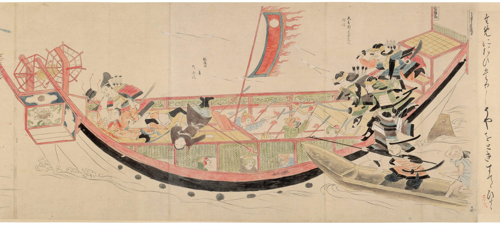

# Chapter III-1
## Ships of Manzi and the Island of Chipangu

> *“Chipangu is an Island towards the east in the high seas… And I can tell you the quantity of gold they have is endless… he hath a great Palace which is entirely roofed with fine gold, just as our churches are roofed with lead.”*
> — Marco Polo, Book 3, ch. 2 (Yule–Cordier)

**[M]**

---

On the roadstead off Zayton (Quanzhou), a merchantman built for the Indian Ocean rides at her cables [1]. The private cabin you paid good silver for sits directly over a fir hull [2]. Northern speakers and Mongol clerks call this conquered Song realm Manzi (South China) [3]. Around the broad waist of the vessel run fifty or sixty neat timber cabins under one deck, each fitted with a proper wooden door where a merchant locks his sample-bags and sleeps dry above the bilge [4]. Aloft from the planked waist rise four tall masts stepped through the deck, with two spare masts lashed beside the bulwarks, ready to raise when fair monsoon winds invite full canvas. Behind everything turns one heavy axial rudder at the stern [5].

Below the waist hatch lies the lower hold, and it is worth a look before the dockers batten the boards shut [6]. In Ramusio’s fuller text, the largest ocean hulls divide below into thirteen timber compartments framed tightly to halt a sudden rush of water [7]. Seasoned sailors insist on keeping the bilge clean so a watchman with a horn lantern spots a jetting seam at once. A vessel may stave her planks against a jagged reef; Ramusio also pictures a cruising whale mistaking white bow-foam at night for drifting fry and slamming straight into the hull [8]. Whichever blows the timber open, the watch wakes the deck in seconds. Porters scramble down to haul pepper sacks and ginger crates out of the flooded bay into the dry compartment next door. The crew stop the leak and then return the goods to the same compartment [9].

— A merchant ship dug out of coastal silt near Zayton in 1974 holds twelve transverse bulkheads forming thirteen compartments, built in the late thirteenth century [10]. Small limber holes pierced near the keel allowed bilge-water to trickle toward the pump, so hauling heavy sacks in a hurry was still damp, back-breaking work beneath the lantern [11].

{#fig-c12-seagoing-junk}

Out on the ways, a thumb run along the outer seam between two strakes meets something stiffer than European tar [12]. Shipwrights fasten a double skin of fir planking with long iron spikes, then knead a pale paste of quicklime, shredded hemp, and pungent tree-oil into a sticky putty that seals every joint tighter than pitch [13]. When the sea falls glassy calm and every mat sail droops against the shrouds, those tall hulls move by sheer muscle. Four sweating seamen lean together against each clumsy sweep to haul the ship across dead water [14].

Marco measures a vessel’s burden by the pepper basket rather than the tun. Five or six thousand woven baskets fill the hold beneath a crew of at least two hundred sailors [15]. Ramusio raises that complement to three hundred hands on the largest hulls and maintains that earlier shipyards launched bulkier ships still [16]. Ahead of each great merchantman pulls a stout tender carrying a thousand baskets of her own, towing her flagship in calm airs while the big hull’s sweeps rise and fall [17]. Yet Ramusio warns of a crisp seamanship hazard astern. A tender can tow under sail when the wind is on the beam. When the wind comes from astern, the big ship takes the wind out of the tender’s sails and is in danger of running her down [18]. Even in harbour, small pinnaces slung from side davits never rest. They ferry water casks and haul heavy stone anchors clear along the channel [19].

Old timber buys itself a second and third life at Zayton’s yards [20]. Whenever salt and teredo worm pit the outer strakes, carpenters simply spike fresh fir sheathing cleanly over the worn planking without stripping old wood away. They repeat that timber coat up to six layers thick [21]. Once a hull rides heavy and sluggish inside six wooden skins, she drops off the long India run for shorter coastal voyages until shipbreakers haul her onto the mudflats for firewood [22]. Even what lies inside the hold respects dry timber: merchants vow that grain stowed cleanly in such a vessel keeps sweet a full year without rotting [23]. Keep that quiet yard arithmetic—nails, lime putty, spare masts, and honest bilges—firmly in mind before we push east into rumours of palace roofs covered in bullion.

---

Fifteen hundred miles east across the high seas from the mainland, the Book raises Chipangu (Japan) [24]. No foreign prince rules its valleys. Marco swears the island’s domestic hoard of gold passes any clerk’s counting [25]. Few mainland skippers risk the open crossing, and Ramusio supplies a blunt royal reason: Chipangu’s king forbids any grain of gold to cross the surf [26]. Traders who never saw the quay needed no customs pass to carry the glitter home in tavern talk.

The royal palace, by that telling, is built like a reliquary. Where a cathedral builder at home lays dull grey sheets of lead across steep rafters, this palace roofs every ridge and gable with plates of beaten gold [27]. Gold encases every window frame. Heavy golden flagstones—*“a good two fingers thick”*—pave the broad audience halls underfoot [28]. Press two fingers edge-to-edge beside a marble threshold in your own parish church, and you weigh the sheer extravagance of that claim in half a heartbeat.

Rose-pink stones gleam beside the bullion. Along with smooth white pearls, the Book prizes large round rose-coloured pearls that fetch every silver penny a white pearl commands [29]. Ramusio follows one such gem all the way to the grave, where mourners tuck a red pearl inside a dead kinsman’s mouth before lighting the pyre or lowering the body into earth [30]. Two centuries on, a printed Latin copy of Marco’s travels preserved in Seville still bears ink marginal notes on Chipangu’s gold and red pearls, which Juan Gil assigns to Christopher Columbus’s quill [31]. Back in thirteenth-century Cambaluc (Beijing), however, the prize that caught Cublay (Kublai) Kaan’s eye was simple tribute.

To seize that untouched treasury, Cublay launches a great armada out of Zayton and Kinsay (Hangzhou) under two captains named Abacan and Vonsainchin [32]. Horse and foot storm ashore across Chipangu’s coastal plains and fire open villages, yet every walled fortress slams its gates tight against the invaders [33].

{#fig-a15-invasions-of-japan}

Then the sky blackens out of the north [34]. Fearing a rocky lee shore, Abacan and Vonsainchin slip cables and claw seaward. Half their hulls splinter against a small island reef while luckier ships clear the headland for home [35]. Thirty thousand soaking, hungry soldiers stand stranded upon the wet shingle [36]. When the northern gale blows itself out, the escaped captains hold clear sea enough to turn back and lift their comrades off. Marco blames bitter hatred between the two admirals for leaving every castaway to starve on the beach [37]. Imagine peering across empty grey rollers until the last friendly lugsail vanishes beneath the horizon.

Soon island fighters row out in triumphant flotillas to strip the stranded garrison [38]. As soon as local troops scramble ashore and form ranks to march inland, the ragged Tartar survivors slip neatly round behind them. Ramusio stages the manoeuvre with crisp terrain detail: the castaways steal along a hidden path round a steep central ridge and sprint down to the unguarded enemy ships [39]. From the ridge-top, the islanders glance back just in time to see their own pennants billowing out into deep water.

Under those captured island standards, the desperate castaways steer brazenly straight up to Chipangu’s royal capital [40]. Watchmen peering from the gatehouse spy familiar fleet banners crowding the bay and throw the portals wide, yielding the stronghold to a starving garrison without drawing a single bowstring [41]. For seven months the invaders hold those borrowed walls while siege lines tighten around them. With no relief convoy ever breaking the horizon, they finally surrender on a promise of their lives [42]. Marco dates that capitulation to 1279 and reports that an enraged Cublay later ordered both quarrelsome admirals executed [43].

History parts one sweeping shipwreck tale into two distinct expeditions, sailing in 1274 and 1281 [44]. A sudden late-summer tempest really did smash the combined invasion fleets in 1281 and pass into Japanese chronicle as the divine wind. Yet capturing a royal capital beneath stolen pennants belongs squarely to the Book’s romance [45].

{#fig-suenaga-boarding}

| Episode | The Book | Other evidence |
|---|---|---|
| Expeditions | One expedition, ending in 1279 | ✓ Distinct campaigns in 1274 and 1281 |
| Command | Abacan and Vonsainchin | ~ Yule compares names in his sources. The historical commands differ across the campaigns and forces. |
| Loss of the ships | The fleet caught by a north wind | ✓ A storm and catastrophe in accounts of 1281. Wrecks off Takashima give material evidence of the fleet. |
| Return under captured banners | Survivors take a capital and hold it seven months | ? Other accounts report the killing or capture of survivors. They give no support to the capture of the capital. |

Divers working the seabed off Takashima (Takashima Kōzaki site area) in 2011 and 2014 raised Chinese-framed hull timbers from the shattered 1281 fleet [46]. Yet cold timber on the sea-floor tells only the carpenter’s half of a disaster. A diver measures iron nail patterns and bulkhead spacing; only a chronicle remembers panic in the dark when anchor ropes parted. Several recovered Takashima ribs even carry deep char and scorch marks, clear scars of fire and fighting before the storm dragged those hulls down [47].

One stubborn watchtower adds a final camp-fire marvel before the armada closes [48]. Eight captured defenders turn every Mongol sword-edge until baffled conquerors club them slowly to death with wooden staves. Cutting open their arms, the soldiers dig out small enchanted pebbles tucked beneath the skin [49]. Whatever truth rests in Asian amulet lore, iron-proof stones make a grim pocket-prize for armies sent east to bring back slabs of palace gold.

---

Before weighing anchor, the Book takes us inside an island temple [50]. Gilded statues glare down with clustered heads and whole thickets of arms—four, ten, even a thousand hands radiating across one trunk—because, the Book shrugs when anyone asks, their fathers carved them that way before them [51]. Outside the courtyard runs a darker rumour of islanders who slaughter and roast unransomed prisoners at a feast [52]. Multi-armed bodhisattvas genuinely fill East Asian shrines. Stony silence, meanwhile, meets any reader asking which specific quay Marco’s informant stepped onto. For twelve manuscript chapters, truth be told, the Venetian has been steering across pilots’ charts rather than his own deck.

Across the wide Sea of Chin east of Manzi, seasoned skippers count 7,459 spice islands [53]. Holds bursting with fragrant wood, pale pepper, and black pepper entice bold venturers out from Zayton and Kinsay to gamble a year on the monsoon [54]. Two winds turn the calendar year into one clean shuttle: sail south-west down the winter breeze, pack the hold, and ride the steady summer wind back north [55]. Named waters change like harbour markers across one unbroken sea, Marco observes sharply, just as sailors at home speak of the English Sea or the Sea of Rochelle without crossing a fence [56].

Right at the close of this island roll falls an honest admission: *“Moreover, Messer Marco Polo never was there.”* [57] Every one of those seven thousand islands stays clean outside Cublay’s tax ledgers [58]. Between claiming islands on a grand court map and landing customs clerks at the pier lies a month of open monsoon swell.

Here Ramusio inserts a distinct coastal sweep into the Gulf of Cheinan (Hainan and the Gulf of Tonkin), washing mainland bays for two months’ sail [59]. Copper ingots and river-panned gold draw traders between busy villages and low offshore reefs in a lively gulf economy of its own [60].

Back on Zayton’s stone quay, the wet hawsers are cast off and the heavy rudder clears the mud. Our next slant of wind blows south-west toward Chamba (Champa) [61], where an ageing king buys off an invading Mongol army with a living tribute of war-elephants.

---

## Notes

[1] ✓ Zayton (modern Quanzhou) serves as the departure haven for the Indian Ocean voyage across Book 3. Manzi’s seagoing merchant fleet anchors the opening chapter before the text turns to islands Marco never visited [@yc, 3.1 n. 1].

[2] ✓ Fir planking, a single deck, and heavy seagoing framing form the structural core of Polo’s junk description [@yc, 3.1 nn. 1–2].

[3] ✓ Manzi was the northern Chinese and Mongol designation for the conquered Southern Song realm rather than a Song self-name [@yc, 2.48]. For the maritime shipwrights of Fujian and Zhejiang, the old southern shipyards now built for Yuan overseas commerce.

[4] ✓ Fifty to sixty private merchant cabins arranged under a single deck underline the passenger comfort of large ocean junks [@yc, 3.1 n. 1]. Ibn Baṭṭūṭa later noted similar lockable cabins with private keys for merchants travelling aboard Chinese ships [@yc, 3.1 n. 1].

[5] ✓ Four permanent masts, two stepped auxiliary masts, and a single stern axial rudder match southern Chinese seagoing rig practice cited by Yule and Cordier [@yc, 3.1 n. 2]. The hinged centerline rudder contrasted sharply with the twin quarter-rudders still common on thirteenth-century Mediterranean hulls.

[6] ✓ Keeping the bilge clean so watchmen could trace incoming water belonged to standard shipboard maintenance [@yc, 3.1 n. 3]. A dry well beneath the cargo hold gave the crew immediate warning whenever a hull seam worked loose at sea.

[7] ✓ Ramusio-only. Yule prints the thirteen watertight compartments inside brackets directly from Ramusio’s 1559 edition [@yc, 3.1 n. 3]. Heavy transverse bulkheads stiffened the hull laterally while dividing the hold into separate bays.

[8] ~ Ramusio-only. Ramusio supplies the dramatic night hazard of a cruising whale mistaking white bow-foam for food and striking the hull alongside reef damage [@yc, 3.1]. The detail illustrates how sailors explained sudden nighttime leaks in deep water far from rocky shoals.

[9] ✓ Ramusio-only. Isolating a holed bay by shifting goods into an adjacent dry compartment while carpenters seal the seam comes solely from Ramusio’s expanded account [@yc, 3.1 n. 3]. The passage gives early modern European readers one of their clearest descriptions of Chinese bulkhead engineering.

[10] ✓ Pearson, Li and Li report twelve transverse bulkheads dividing thirteen cargo compartments in the late-thirteenth-century hull excavated near Zayton in 1974 [@pearson2002quanzhou]. The correspondence between the excavated Quanzhou ship and Ramusio's thirteen compartments is striking.

[11] ✓ Green and colleagues examine small limber holes cut along the keel of that wreck, showing that bilge drainage complicated any absolute notion of hermetically sealed boxes [@green1998quanzhou]. Crews could plug those limber holes or pump a central well, qualifying rather than overturning the bulkhead principle.

[12] ✓ Double-planked fir hulls fastened with long iron spikes appear in Yule’s base ship description [@yc, 3.1 n. 4]. Iron nail-fastening set Chinese junks apart from the stitched-plank vessels of the Persian Gulf and western Indian Ocean.

[13] ✓ Yule and Cordier compare Chinese *chunam* caulking—quicklime, shredded hemp, and tung or nut oil kneaded into durable putty—across later maritime accounts [@yc, 3.1 n. 4]. Unlike European pitch, the lime-and-oil paste hardened into a waterproof crust that deterred wood-boring worms.

[14] ~ Four seamen per heavy sweep represent Polo’s figure for Manzi junks [@yc, 3.1 n. 5]. Yule cites later observers such as Ibn Baṭṭūṭa recording even larger rowing crews working the great auxiliary oars during calms [@yc, 3.1 n. 5].

[15] ~ Five or six thousand baskets of pepper measure freight capacity in mercantile terms, worked by at least two hundred sailors [@yc, 3.1 n. 6]. Reckoning a ship's burthen by pepper baskets was standard practice among China-trade merchants.

[16] ~ Ramusio-only in part. Yule brackets Ramusio’s higher crew figure of three hundred hands and his remark that earlier Chinese ships had been built larger still [@yc, 3.1 n. 6]. The addition attributes the gradual scaling-down of hull sizes to harbour depth and loss risk.

[17] ~ The thousand-basket tender towing a becalmed flagship under sweeps stands in Yule’s base French text [@yc, 3.1]. Large ocean junks regularly sailed with two or three substantial escort vessels that carried part of the cargo and assisted in coastal handling.

[18] ~ Ramusio-only in Yule. His version distinguishes towing under sail with a wind on the beam from the danger when the larger ship takes the wind out of the tender’s sails with the wind astern [@yc, 3.1]. The distinction reflects a practical seaman's eye for how high-sterned hulls blanket smaller craft downwind.

[19] ~ Smaller side-boats slung both on great ships and on tenders handled anchors, lines, and harbour supply [@yc, 3.1]. Hoisting up to ten dinghies along the bulwarks kept the ship self-sufficient in roadsteads without quays.

[20] ~ Repairing aged hulls by fastening fresh outer sheathing directly over worn planks matches traditional Chinese yard maintenance [@yc, 3.1 n. 6]. Adding a new skin coated in lime-and-oil putty spared shipwrights from stripping the original framing.

[21] ~ Up to six successive plank thicknesses before retirement represent Polo’s specific shipyard limit [@yc, 3.1 n. 6]. Each annual layer added weight and draught until the hull grew too heavy for open-ocean storm swell.

[22] ~ Downgrading heavily sheathed hulls from oceanic passages to sheltered coastal traffic and final breaking reflects commercial reality [@yc, 3.1 n. 6]. A vessel too sluggish for the monsoon run could still carry bulk timber or salt along inland estuaries.

[23] ~ Ramusio-only. The claim that grain stays sweet for a full year in a well-built ship appears inside Ramusio’s expanded timber notice [@yc, 3.1]. Dry, lime-sealed holds protected perishable bulk cargoes from bilge damp.

[24] ~ Chipangu derives from Chinese *Riben-guo* (“Sun-Origin Country”), placed 1,500 miles east across open water in Polo’s mariner reckoning [@yc, 3.2 n. 1]. The distance inflates the crossing from southern Chinese ports while capturing Japan's position beyond the continental shelf.

[25] ✓ Sovereign independence from the Yuan court is historical [@yc, 3.2 nn. 1–2]. The report of endless bullion exaggerates Japanese gold exports that circulated in rumours along the Fujian quays.

[26] ~ Ramusio-only. Yule brackets the sovereign ban on exporting gold from Chipangu solely from Ramusio’s text [@yc, 3.2]. The restriction offers a trader's rationale for why so much reported island gold stayed locked inside royal palaces.

[27] ✗ Roofing an entire royal palace with sheets of beaten gold like European church lead belongs to hearsay marvel [@yc, 3.2 n. 3]. Yule notes that gilded temple ornaments in Japan were magnified by mainland informants into solid gold architecture.

[28] ✗ Golden paving-slabs two fingers thick and gilded windows extend the legendary palace picture reported at second hand [@yc, 3.2 n. 3]. Later European readers took these lines as literal treasure targets on Atlantic charts.

[29] ~ Round rose pearls valued equal to white pearls reflect genuine East Asian demand for tinted pearls [@yc, 3.2 n. 4]. Kaempfer and other observers cited by Yule confirm the high value placed on large Japanese pearls.

[30] ~ Ramusio-only. Tucking a red pearl inside a dead person’s mouth before cremation or burial enters Yule inside Ramusio’s brackets [@yc, 3.2]. The detail adapts Chinese and East Asian funerary mouth-gem customs to the island report.

[31] ~ Gil attributes the Latin marginal notes on Chipangu’s gold and red pearls on fol. 57v of the Seville Colombina volume to Christopher Columbus’s hand [@gil2006marcocristobal, p. 30]. See [Chapter III-11](ch-11-afterlives.md) for the dating and reception of the Colombina postils.

[32] ~ Abacan and Vonsainchin compress the historical commanders Alahan and Fan Wenhu of the 1281 Mongol–Korean invasion sailing from Ningbo and Quanzhou [@yc, 3.2; @yc, 3.3 n. 1]. Alahan fell ill before sailing, leaving Fan Wenhu and his colleagues in command at sea.

[33] ~ Burning open countryside while fortified strongholds held out simplifies the northern Kyushu fighting around Hakata Bay [@yc, 3.2; @yc, 3.3 n. 1]. Japanese stone breastworks along the shore kept the landing forces pinned near the coast.

[34] ✓ A sudden northern storm shatters the armada in both the Book and Japanese records of the 1281 *kamikaze* typhoon [@yc, 3.3 n. 1; @rossabi1988khubilai, chs. 4, 8]. See [Map A15, invasions of Japan](#fig-a15-invasions-of-japan).

[35] ~ Fleet ships fleeing seawards and smashing on an islet blend storm chaos with the Takashima wreck zone in Imari Bay [@yc, 3.3 n. 1]. Crowded vessels collided in the narrow channels as captains tried to claw off the lee shore.

[36] ~ Abandoning thirty thousand stranded troops matches the vast casualties trapped on Takashima in 1281 [@yc, 3.3 n. 1; @rossabi1988khubilai, ch. 8]. Chinese annals record that the surviving commanders sailed away in the soundest hulls, leaving tens of thousands of soldiers behind on the island.

[37] ? Blaming bitter personal hostility between Abacan and Vonsainchin for abandoning the castaways is Polo’s dramatic explanation [@yc, 3.3 n. 1]. While Yuan records confirm divided command and poor coordination between the northern and southern fleets, Alahan had already died in China before the storm struck.

[38] ~ Islanders crossing after the gale to strip the shipwrecked army echoes Japanese counter-attacks on the Takashima survivors [@yc, 3.3 n. 1]. Samurai detachments rowed out from the mainland as soon as the seas subsided to destroy the stranded camp.

[39] ~ Ramusio-only in part. Feigning flight around the island to seize the attackers' unattended hulls belongs to the base text, while Ramusio supplies the high central ridge and twin paths [@yc, 3.3]. The terrain detail gives the fictional counter-stroke a concrete tactical stage.

[40] ✗ Sailing straight to Chipangu’s capital under captured pennants has no support in Japanese or Yuan annals [@yc, 3.3 n. 1]. The stranded troops on Takashima were killed or enslaved on the coast rather than marching inland to Kyoto or Kamakura.

[41] ✗ Watchmen flinging city gates open to captured standards extends the ruse into pure camp romance [@yc, 3.3 n. 1]. The episode recasts a catastrophic naval defeat as a clever soldiers' stratagem for court listeners.

[42] ✗ Holding the royal capital seven months before surrendering on terms that spared their lives contradicts Japanese and Chinese records [@yc, 3.3 n. 1]. In the historical accounts, the Japanese spared Southern Chinese (*Manzi*) recruits as labourers while executing Mongol, Korean, and Northern Chinese captives.

[43] ✗ Dating the campaign to 1279 conflates the 1274 and 1281 invasions [@yc, 3.3 nn. 1–2]. Historical commanders faced disgrace and dismissal at court rather than Polo's tidy story of one general beheaded and the other losing his ears.

[44] ✓ Rossabi distinguishes the 1274 probing raid at Hakata Bay from the massive two-fleet invasion of 1281 destroyed by the August typhoon [@rossabi1988khubilai, chs. 4, 8]. Keeping the two expeditions distinct clarifies how the Book compressed them into one campaign.

[45] ✓ Yule compares Chinese and Japanese historical records side by side to isolate the real typhoon and abandonment at Takashima from the stolen-capital stratagem [@yc, 3.3 n. 1]. See the comparison table in this chapter.

[46] ✓ Ikeda, Sasaki and Kimura report the 2011 and 2014 Takashima underwater excavations, confirming bulkhead and hull joinery from the 1281 Southern Fleet [@ikeda2019takashima, pp. 1635–38]. The timbers provide direct archaeological witness to the Fujian- and Jiangnan-built transports shattered in Imari Bay.

[47] ~ Sasaki’s dissertation documents charred and reused riverine timbers on the Takashima wrecks, showing fire damage and hasty requisitioning before sinking [@sasaki2008origin]. The findings support both Japanese fire-raft attacks and the rushed shipbuilding orders recorded in the *Yuan shi*.

[48] ~ Stone amulets inserted beneath the skin to stop iron blades belong to widespread Southeast and East Asian warrior invulnerability folklore noted by Yule [@yc, 3.3 n. 3]. Similar talismans were reported later among Burmese and Malay fighters.

[49] ~ Beating charmed defenders to death with wooden staves and cutting the stones from their arms adapts a stock marvel to the Kyushu landings [@yc, 3.3 n. 3]. The motif parallels the Mongol taboo against shedding royal blood with edged steel.

[50] ✓ Multi-headed and multi-armed temple images reflect real East Asian Buddhist iconography, such as thousand-armed Avalokiteśvara and fierce tantric guardians [@yc, 3.4 n. 1]. Grouping Chinese and island images together shows how striking Buddhist statuary appeared to Latin eyes.

[51] ~ Explaining multi-limbed idols simply as inherited ancestral custom preserves a coastal trader’s offhand reply [@yc, 3.4 n. 1]. Rather than expounding Buddhist doctrine, Polo's informants treated temple styles as fixed local tradition.

[52] ? Eating unransomed war captives extends an unverified cannibalism trope across Chipangu and the outlying islands [@yc, 3.4]. The accusation recurs whenever the Book moves beyond ports frequented by Marco's own circle.

[53] ~ Pilots’ tally of 7,459 islands offers an impressionistic mariner figure for the western Pacific and East Indies archipelagos [@yc, 3.4 n. 2]. Precise-sounding four-digit counts were a favourite rhetorical device among medieval sea pilots.

[54] ✓ White pepper, black pepper, and aromatic woods genuinely drew Fujian merchant fleets south-east each year [@yc, 3.4 n. 2]. The cargo list shifts the horizon from Japan southward toward the spice islands of the archipelago.

[55] ✓ Winter outward passages and summer homebound passages accurately capture the monsoon shuttle governing the South China Sea [@yc, 3.4 n. 3]. Ships cleared Zayton on the north-east winter wind and returned on the south-west summer monsoon. See the South China Sea panel in [Chart C11](ch-09-cocachin-return.md#fig-c11-monsoon-cocachin).

[56] ✓ Comparing regional Asian sea names to the English Sea and the Sea of Rochelle shows how cleanly Polo understood the eastern waters as arms of one unbroken Ocean Sea [@yc, 3.4 n. 3]. That observation stood directly against classical Ptolemaic ideas of an enclosed Indian Ocean basin.

[57] ✓ Disclaiming firsthand presence (*“Moreover, Messer Marco Polo never was there”*) closes the Sea of Chin chapter in the French text before Ramusio’s gulf insert [@yc, 3.4 n. 4]. The candour honors the Prologue's pledge to separate eyewitness travel from pilots' reports.

[58] ✓ None of those 7,459 outlying islands paid regular revenue or submitted to Cublay’s treasury [@yc, 3.4]. The note marks the seaward limit of Yuan imperial taxation.

[59] ~ Ramusio-only. The separate Gulf of Cheinan description is quoted by Yule solely from Ramusio [@yc, 3.4 n. 4]. Pelliot identifies Cheinan with Hainan and the Gulf of Tonkin, opening the coastal route toward Champa [@pelliot1959notes, vol. 1, pp. 242–243].

[60] ~ Copper ingots and river-panned gold traded between mainland bays and coastal islands belong to Ramusio’s gulf passage [@yc, 3.4 n. 4]. Chinese copper cash and bullion formed the staple medium of exchange along the Tonkin and Viet littoral.

[61] ✓ Sailing south-west from Zayton leads straight into Chamba (Champa) at the opening of Chapter III-2 [@yc, 3.5]. That mainland coast formed the principal western landfall for junks running down the South China Sea.
