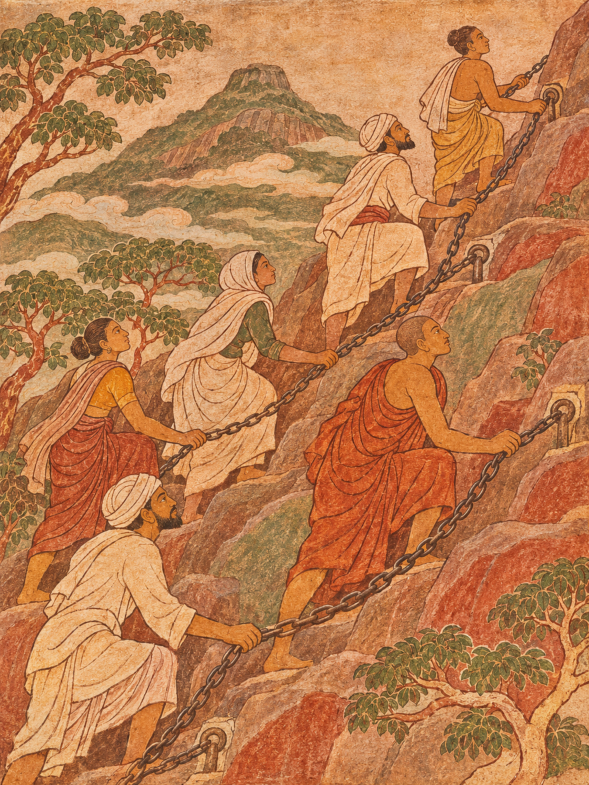

# Chapter III-4
## Necuveran, Angamanain, Seilan: Islands of Rumour and the Foot on the Peak

> *“Angamanain is a very large Island… all the men… have heads like dogs… When you leave… you come to the Island of SEILAN, which is in good sooth the best Island of its size in the world… Indeed, an he had but been so, he would have been a great saint of Our Lord Jesus Christ.”*
> — Marco Polo, Book 3, chs. 13–15 (Yule–Cordier)

**[M]**

---

Step away from Fansur (Barus)’s warm sago oven and trace the shore back north-west to Lambri (Lamuri, near the Aceh headland) to catch a fresh sea bearing [1]. Sailing north a hundred and fifty miles off Java the Less (Sumatra), lookouts raise a tiny marker islet named Gauenispola. The Book promises to describe that little island next, then slips onward and never mentions it again [2]. Far louder on sailors’ tongues wait two bigger archipelagos dead ahead: one steeped in precious timber, the other whispered about beside guttering cabin lamps.

At Necuveran (the Nicobar Islands), merchant woods catch Marco’s eye before a single boot touches sand. Red sandalwood trunks, thick clove groves, spreading coconut palms, and red brazilwood fill his island tally. Every item reads like portable cargo a ship’s clerk notes cleanly from the rail [3]. Bare coastal dwellers live without king or chief like wild beasts, he claims. Every man and woman walks naked apart from a narrow band of bright silk bound round the forehead [4]. Set his aloof report beside a ninth-century Arabic trading log of the same sea. Agile villagers shoot out from coral coves in light outrigger canoes piled high with ripe coconuts and sweet lumps of ambergris to barter briskly for bars of raw iron [5]. Without landing a clerk across the surf, goods swinging up over a gunwale reveal cleanly what both peoples wanted most.

Swing north to Angamanain (the Andaman Islands), and brisk canoe barter snaps straight into sailors’ nightmare. Every man on the beach, Marco swears roundly, wears the heavy muzzle, glaring eyes, and jagged teeth of a huge mastiff hound [6]. Yet right behind those terrifying jaws sits an oddly peaceful farmstead. Villagers sow neat rows of rice, draw fresh milk, keep herds for meat, and pick strange orchard fruit—all while seizing and roasting any foreign castaway unlucky enough to drift ashore [7]. Even local fruits stay unnamed while the dog-faced cannibal fills the lantern light. Flip back through antique Mediterranean bestiaries, and you meet an old classical fable moored in eastern seas only by a real island name Yule traces to an Arabic dual form [8].

— Picture two watchkeepers hunched over a swinging forecastle lamp. One brags how cheaply he swapped iron bars for ambergris off a canoe. The other swears mastiff-headed man-eaters lurk behind the surf. A lively ghost tale keeps nervous captains clear of uncharted shoals.

---

Watch the horizon flatten steadily after a thousand miles of west-south-west sailing. Because Seilan (Sri Lanka)’s northern plains lie so low and flat, lookouts never sight green palms until white surf curls directly beneath the bowsprit [9]. Even then, skippers drop their sounding lead twice to catch sandbanks before the keel scrapes mud. Marco paces the island’s rim at twenty-four hundred miles. Older mariners’ charts printed thirty-six hundred miles, he notes shrewdly, before fierce northern gales drove heavy winter seas across broad tracts of lowland sand and drowned whole coastal districts beneath shallow water [10]. Even twenty-four hundred doubles Seilan’s real shoreline several times over. Yet any skipper watching green rollers burst over sunken banks understands immediately why ancient sea-charts show far more earth than sailors skirt today.

King Sendemain rules Seilan free of any mainland tribute [11]. Lightly clothed subjects wear scarce more than a scrap of cotton round their loins while sowing rice, pressing warm sesame oil, tapping sweet tree-toddy, and felling matchless red brazilwood along fertile river valleys [12]. Whenever trouble gathers on his frontier, however, Sendemain hires foreign Muslim troops off arriving ships. That dry aside shows cleanly how dimly Marco rated local fighting blades [13].

Open your palm wide when the Book unlocks Seilan’s royal treasury. Beyond river-washed sapphires, bright yellow topazes, deep violet amethysts, and fiery garnets scooped out of muddy stream beds by digging crews, Sendemain wears a flawless ruby thick as a man’s forearm. It glows red as live coal and measures a full palm long [14]. No silver scale on earth can even guess its value, Marco vows. Cublay (Kublai) Kaan sent ambassadors across sea and land offering the full ransom of a rich city—or whatever treasure Sendemain wished to ask. Yet the island monarch turned every bid down flat because his fathers and forefathers had handed the heirloom down untouched before him [15]. No honest jeweller ever weighed a forearm-sized ruby on brass balance pans. Yet the courtly legend needs an unthinkable gem to make an emperor’s vast treasury look spare beside proud royal inheritance.

Leave Sendemain’s velvet cushion behind and squint upward through drifting cloud toward rusted iron bolted straight into cliff rock. Adam’s Peak rears so sheer above monsoon mist that pilgrims haul themselves step after trembling step up heavy iron chains riveted into bare granite [16]. Without those iron links, the Book notes flatly, scarcely a soul could reach the summit. Fifty years after Marco sailed past, Ibn Baṭṭūṭa climbed those very cliffs. He counted ten chains and named the highest, dizziest tether above empty air the “chain of the profession of faith,” where travellers clutched cold iron and prayed against sliding to the treetops below [17].

{#fig-iii-4-adams-peak-pilgrims width=78%}

At the rocky crest sits a revered grave and hollowed rock footprint [18]. Muslim worshippers climb those links to honour Adam, first father of mankind. Buddhist pilgrims kneel in equal devotion beside the tomb of Sagamoni Borcan (Śākyamuni Buddha) [19]. Before watching mountain keepsakes march halfway across Asia, climb down off that wind-scoured spire into a quiet walled royal park below.

---

Once upon a time, a rich monarch blessed with one gentle son feared losing his heir to the dusty world outside. So he built the boy a radiant pleasure palace set amid quiet gardens and marble pools. Inside those walls waited thirty thousand fair companions, sweet lutes, and graceful dancers. Bronze gates swung shut against every sight of sorrow. No grey beard, sick beggar, or weeping mourner might cross the sill, so the young prince grew up believing human youth never fades [20]. Never once did he set foot past his own orchard walls or hear a whisper of death.

One bright morning, the prince insisted on riding beyond the orchard gates to see how ordinary townsfolk live. His father granted an escort, and hooves clattered into dusty noon sunlight. Right beside the highway lay a stiff, motionless corpse. Reining in his mount in sudden shock, the young lord turned to his riders and asked what strange thing lay in the dust. It is a dead man, they answered quietly. The boy stared down in disbelief: must every living mortal come to that same cold pass? When his horsemen said yes, the prince fell silent and rode pensively round the bend [21]. Barely a league farther crept a bent, withered elder propping trembling knees on a wooden stave. Not a single tooth remained inside his gums through sheer weight of years. Once again the riders explained what age does to human flesh [22]. Turning straight back through his singing halls that night, the shaken prince declared he would stay no longer in a perishing world. He vowed instead to seek out the deathless Creator who made him [23]. Through Rustichello’s Franco-Italian pen, an Indian royal speaks the urgent longing of a medieval Christian pilgrim.

Slipping silently past drowsy sentries at midnight, the heir climbed into steep, roadless mountains far from court. There he lived on spare wild herbs and spring water in spotless purity, keeping strict abstinence like a desert hermit. That devotion wrings from Marco’s book one of its warmest sighs: had the young prince only received baptism, he would have shone as a great saint of Our Lord Jesus Christ [24]. Weigh how startling that quiet praise rings inside a book that normally gauges a king’s worth by tribute silver and gold brocade.

When word of the hermit’s death reached court, weeping followers bore his wasted body home to a father nearly crazed with grief. Beside the bier, the broken-hearted king summoned master goldsmiths to cast a towering statue in solid gold set with jewels. Next he ordered every subject across Seilan to fall down and worship his son as divine [25]. In Marco’s telling, that glittering likeness marks the start of every carved idol in eastern Asia. Priests tell how the young prince walked an immense wheel of eighty-four earthly rebirths. First he died as a man to rise again as an ox, then passed into a horse, stepping through creature after creature until his eighty-fourth death lifted Sagamoni Borcan cleanly into godhead [26]. Lock a prince behind bronze palace gates, and he slips past the guard; cast his image in gold, and kingdoms wear steps into bare cliff.

Pilgrims still trudge up those mountain chains from distant coasts as thickly as Europeans walking toward Santiago de Compostela in Spain [27]. Muslim and Buddhist shrines share the summit, each claiming its famous relics—two molars, sacred hair, and a stone bowl. Here the Book steps politely aside. God alone knows whose dust rests atop the crag, Marco declares, while standing firm from Christian scripture that Adam’s grave lies nowhere in eastern Asia [28].

---

Sendemain’s forearm ruby stayed locked tight inside Seilan’s treasury. Yet in 1284, Marco dates a great Yuan embassy travelling by land and sea with a subtler request from Cambaluc (Beijing) [29]. So urgently did Cublay’s envoys press the island king that they won two broad back molars—passing thick and heavy—alongside strands of sacred hair and a beautiful alms-bowl carved out of green porphyry [30]. One pack-mule could swing those small relics up northern mountain passes. Inside the imperial capital, however, they brought an entire metropolis to its feet.

When couriers gallop ahead crying that the envoys have neared the outer gate, Cublay orders Christian clerks, yellow-robed monks, and all the citizens of Cambaluc to march out with banners and music. Priests bear the prized chest high above the crowd. Together they escort what the Book insists the Kaan revered as Adam’s holy remains [31]. Hold both scenes side by side for one beat. First watch a lone pilgrim gripping cold iron chains high above Seilan’s forest mist. Next watch drums, silk canopies, and bowed barons swarming down Cambaluc’s highway around three small keepsakes carried from the southern sea.

Even hardened palace stewards stared round-eyed beside that green porphyry dish. Sacred writings preserved beside it swear that if cooks ladle rice enough for one hungry man into its hollow, the bowl swells magically until five grown soldiers eat cleanly to fullness [32]. Marco adds that Cublay tested that marvel himself. Such kitchen bounty steps straight out of Buddhist alms-bowl legend onto the Great Kaan’s banquet cloth.

Set the green dish gently back inside the palace vault and steer sixty miles west of Seilan across shallow emerald water. Ahead along Maabar (the Coromandel Coast), hundreds of sleek pearl boats already swing at anchor while oiled divers sink down weighted ropes to tear oysters off the sand—and a king’s bailiff stands on deck to count his royal tenth from every dripping basket.

---

## Notes

[1] ✓ Coaster ships backtrack along northern Java the Less to Lambri (Lamuri) before shaping a north-north-west run into the Bay of Bengal [@yc, 3.11]. Lambri served as the final Sumatran watering point before captains struck out across open water toward Ceylon.

[2] ~ Passing tiny Gauenispola 150 miles north of Lambri records a real sailing landmark left unidentified, along with Polo’s unkept promise to return to it later in the Book [@yc, 3.12 n. 1]. Yule compares candidates among the small islands off Aceh Head such as Pulo Rondo or Pulo Bras.

[3] ✓ Red sandalwood, coconut palms, and red dyewood appear among Necuveran’s chief forest yields along Indian Ocean shipping lanes [@yc, 3.12 n. 1]. Passing ships regularly paused at the Nicobar Islands for fresh water, nuts, and timber.

[4] ~ Pairing cloves with coconuts blends Nicobar products with eastern archipelago trade spices reaching sailors’ notebooks [@yc, 3.12 n. 1]. Going naked apart from a silk forehead band reflects exaggerated shipboard descriptions of island bark-cloth dress.

[5] ~ Yule cites the ninth-century Arabic *Relations* (*Akhbār al-Ṣīn wa-l-Hind*), describing Nicobar islanders paddling canoes out to swap ambergris and coconuts for iron [@yc, 3.12 n. 1]. Trading alongside passing hulls without coming ashore kept islanders and foreign crews at a cautious distance.

[6] ✗ Dog-headed men with mastiff jaws revive ancient *cynocephali* marvels rather than eyewitness observation [@yc, 3.13 n. 1]. Laufer in Cordier’s addenda traces the wider Eurasian folk motif across Greek, Chinese, and Arab geographic lore [@ycadd, on 3.13].

[7] ✗ Yule notes the sharp internal contradiction between branding Andamanese islanders indiscriminate cannibals and crediting them with settled crops of rice, milk, and meat [@yc, 3.13 n. 1]. Mariners feared the Andamans and filled the unvisited shores with stock monster stories.

[8] ~ Schlegel traces *Angamanain* to an Arabic dual form for the Great and Little Andamans [@yc, 3.13 n. 1]. That grammatical dual shows genuine Arab nautical geography operating beneath the sailors’ horror tales.

[9] ✓ Running roughly a thousand miles west-south-west across the Bay of Bengal brings ships steadily down to low-lying northern Seilan (Sri Lanka) [@yc, 3.14]. The bearing and distance match the open-sea monsoon passage from the Nicobar channel to the Ceylon coast.

[10] ✗ Twenty-four hundred miles and older charts’ thirty-six hundred both vastly exceed Sri Lanka’s true coastline of under 700 miles [@yc, 3.14 n. 2]. Attributing the shrinkage to fierce north winds eroding the low northern plains offers an imaginative mariner’s explanation for why older periplus figures looked too large.

[11] ? Identifying Sendemain remains unresolved: Yule places Pandita Parākramabāhu III at Dambadeniya (numbered II in Cordier’s addenda for 1267–1301), whereas Tennent favours the Malay invader Chandra Banu beside northern Tamil kings [@yc, 3.14 n. 3; @ycadd, on 3.14; @tennent1859ceylon]. No single Sinhalese or Tamil royal title fits the transcription cleanly.

[12] ~ Rice, sesame oil, tree-toddy, and red dyewood align neatly with Polo’s inventory and later Chinese notices such as Ma Huan quoted by Cordier [@yc, 3.14 n. 4]. Those staple products sustained both local island markets and calling merchant fleets.

[13] ~ Recruiting Muslim soldiers from abroad alongside harsh judgement on local valour combines historical mercenary hiring with merchant bias [@yc, 3.14]. South Indian and Arab troops frequently served in the island kings' competing armies during the thirteenth century.

[14] ✗ While Sri Lanka genuinely exports sapphires, topazes, amethysts, and rubies, claiming exclusive origin and a flawless palm-long royal stone follows gem romance [@yc, 3.14 n. 5]. Chinese and Arab writers told similar stories of a colossal fiery ruby in the king of Ceylon's treasury.

[15] ? Cublay’s city-price offer and Sendemain’s ancestral refusal belong peculiarly to Polo’s court anecdote, though Hayton parallels the giant ruby legend [@yc, 3.14 n. 5]. The story sets the Great Kaan's collector's appetite against an island king's dynastic duty.

[16] ✓ Iron stanchions and riveted chains bolted into the granite precipice up Adam’s Peak are corroborated independently as genuine medieval pilgrim engineering [@yc, 3.15 nn. 1, 5]. Rusting ancient chains still cling to the steep summit approach today, where local legend even linked them to Alexander the Great.

[17] ✓ Ibn Baṭṭūṭa climbed the peak half a century later (Lee’s translation, ch. XX), counting ten iron chains and naming the top tether the “chain of the profession of faith” because fearful climbers recited the creed as they gripped it [@yc, 3.15 n. 1]. Both travellers notice the exact hardware that made the perilous ascent possible.

[18] ✓ Competing Muslim and Buddhist reverence at the summit shrine accurately captures the mountain’s shared devotional life [@yc, 3.15 nn. 1, 5]. In the Book's telling only Muslims (claiming Adam) and Buddhists (claiming Sagamoni Borcan) dispute the peak, whereas Hindu and Portuguese Christian claims appear in outside sources [@tennent1859ceylon].

[19] ✓ Sagamoni Borcan cleanly reproduces the Mongol title (*Burkhan*) for Śākyamuni Buddha beside Muslim Adam traditions on the crag [@yc, 3.15 nn. 1, 5]. Using a Mongol religious title on a Sri Lankan mountain shows how Marco filtered Indian Ocean sights through the court vocabulary of Cambaluc.

[20] ~ Guarding a secluded prince inside an orchard palace filled with music and maidens reflects classical Buddhist legends of Siddhārtha Gautama's youth [@yc, 3.15 n. 2]. Polo's listeners receive one of Western literature's earliest recognisable biographies of the historical Buddha.

[21] ~ Meeting a roadside corpse adapts one of the classical Four Sights of the Great Departure into direct dialogue between the startled prince and his attendants [@yc, 3.15 n. 2]. The shock of death shatters the palace illusion his father built around him.

[22] ~ Passing the bent, toothless elder completes the sheltered prince’s encounter with human mortality as transmitted to Polo’s hearers [@yc, 3.15 n. 2]. Polo's version condenses the traditional four encounters—old age, sickness, death, and an ascetic—into death and old age.

[23] ~ Turning the prince’s departure into a quest for an undying Creator recasts Buddhist renunciation in Christian devotional speech [@yc, 3.15 n. 2]. A medieval Venetian naturally translated seeking liberation from rebirth into seeking the God who made the world.

[24] ~ Regretting only that so pure an ascetic lacked Christian baptism echoes parallels in the medieval Christian legend of Barlaam and Josaphat weighed by Yule [@yc, 3.15 n. 3]. Josaphat's own name ultimately derived from *Bodhisattva* through Arabic and Georgian translations.

[25] ? Crediting a grieving father’s gilded and jewelled statue with Asia’s first idol converts Buddhist image origins into a royal memorial story [@yc, 3.15 n. 4]. The explanation mirrors popular medieval Christian theories of how pagan image-worship first began.

[26] ✗ Compressing Jātaka rebirth traditions into eighty-four neat animal and human births ending in godhead imposes Polo’s tidy count on complex Buddhist lore [@yc, 3.15 nn. 2–4]. Even so, the passage grasps the core doctrine of successive karmic rebirths leading to buddhahood.

[27] ✓ Likening Buddhist peak pilgrimage to Christian journeys to classic shrines anchors unfamiliar worship for European readers [@yc, 3.15 n. 5]. The comparison treats the Asian pilgrims' devotion with notable respect.

[28] ~ Recording two rival relic claims while objecting to Adam’s Asian grave on scriptural grounds carefully divides Polo’s report from his own creed [@yc, 3.15 n. 5]. He sets down what both Muslim and Buddhist informants told him while reserving his orthodox Christian dissent.

[29] ? Dating a Yuan relic mission to 1284 gives an unconfirmed year around real Mongol diplomatic interest in Sri Lankan sacred treasures [@yc, 3.15 n. 6]. Chinese annals record envoys such as Yiheimishi sent to Ceylon for the Buddha's alms bowl and relics in the 1280s.

[30] ~ Naming two molar teeth, hair, and a green porphyry bowl fits prominent Buddhist tooth and alms-bowl (*pātra*) relic traditions assembled by Yule [@yc, 3.15 nn. 5–7]. In the Book, however, the court receives the objects under the Muslim identification as relics of Adam.

[31] ~ Staging a vast clerical and civic reception outside Cambaluc matches Yuan ceremonial spectacle [@yc, 3.15 n. 6]. Cublay patronized Buddhist relics lavishly while letting different communities attach their own sacred histories to them.

[32] ? Claiming the green porphyry bowl multiplies one portion of food to fill five borrows classic Buddhist alms-bowl miracle lore for Cublay’s table [@yc, 3.15 n. 7]. See [Back Matter III-1, “Adam's Peak”](back-01-trivia-and-afterlives.md#trivia-worth-keeping) for the mountain's competing traditions.
