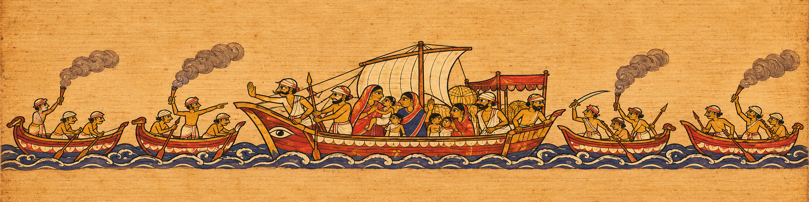

# Chapter III-6
## Mutfili to Kesmacoran: Diamonds, Brahmans, and the Westward Shore

> *“It is in this kingdom that diamonds are got… Now among these mountains there are certain great and deep valleys… the men who go in search of the diamonds take with them pieces of flesh… white eagles… And you must know that this kingdom of Kesmacoran is the last in India as you go towards the west and north-west… from Maabar on, this province is what is called the GREATER INDIA…”*
> — Marco Polo, Book 3, chs. 19–30 (Yule–Cordier)

**[R]**

---

North out of Maabar (Coromandel Coast), the coast runs into Mutfili (Motupalli and the Andhra coast). Base manuscripts measure a thousand miles from Mailapur (Mylapore); Ramusio cuts that span neatly in half to five hundred [1]. For forty quiet years a wise queen has governed this independent realm in peace, justice, and equity. Yule identified her with Rudrama Devi of the Kākatīya line—daughter and reigning heir of King Ganapatideva rather than Polo’s devoted widow [2].

Any captain beating through monsoon squalls off Mutfili has crisp practical cause to bless her father’s stone charter. Carved on a temple pillar in 1244–45, Ganapatideva’s edict sets harbour tolls plainly and vows to stranded captains that royal bailiffs will restore salvaged shipwreck cargo rather than strip helpless vessels bare [3]. Knowing harbour duties before anchoring helps every purser balance ledgers. Knowing your storm-tossed pepper sacks stay yours on wet sand decides whether you risk dropping anchor at all.

Inland from the harbour sheds rise sun-baked mountain gorges. When winter rains break overhead, roaring torrents sweep loose gravel down rocky gullies, leaving bright uncut diamonds in damp beds once water subsides [4]. Fierce summer heat dries every spring and fills narrow clefts with deadly serpents so no miner dares climb down into the shadow. Seekers therefore haul baskets of lean raw beef onto cliff-tops and hurl dripping slabs straight down over sheer ledges into the abyss. The soft meat strikes damp gravel at the canyon floor and picks up sharp white stones that stick fast in the fat. Great white eagles haunting those peaks—fed chiefly on mountain snakes—swoop after fresh meat and carry bloody chunks back to rocky crags. Waiting watchers yell loudly from ridge-tops, chase startled birds skyward, and pry uncut white diamonds off crimson meat. Hunters even comb high stick nests, inspect white droppings, and slit trapped eagles’ gizzards to glean stones swallowed down below [5]. A tall traveller’s tale climbs jagged ridges far faster than any miner dragging iron picks up stone tracks.

Marco boasts that Mutfili alone yields all the diamonds on earth, sending huge prize gems straight to eastern kings while leaving tiny refuse chips for Christian buyers [6]. Pause beside cool village looms before steering westward: Mutfili weavers spin fine white cottons—*buckram* in the Book—so gossamer-thin they drape like spider’s web fit for kings and queens. Pasturelands round those weaving towns raise the biggest sheep on earth alongside abundant daily food for every household [7]. Between serpent cliffs and woven muslin, delicate cotton carries a sharper mercantile touch.

---

Having pushed north to Mutfili, the Book now steps back down the coast to Mailapur and turns west—entering Lar, an elusive western province whence, Marco vows, every Abraiaman (Brahman) trader and ascetic springs [8]. Spot each Abraiaman instantly by a stout cotton thread worn cleanly over one shoulder and tied beneath the opposite arm across chest and back [9]. Never did truer merchants keep books, Marco admires warmly. They taste neither flesh nor wine, keep strictly to one faithful wife, touch nothing belonging to another, and—in Ramusio’s generous trade note—sell foreign strangers’ wares faithfully for whatever modest reward a visitor offers [10]. Imagine a Venetian factor landing in an unfamiliar port and trusting his entire cargo to a broker who refuses to pad a single weight or lie over a coin.

Even royal jewel buyers ride out of Lar. Envoys cross east into Soli (the Chola country) buying rare pearls and fine gems, paid double cost price by Lar’s wealthy sovereign so state chests overflow [11]. Yet watch one of these honest merchants step onto his sunlit threshold to close an ordinary bargain. First he measures morning sun-shadows carefully against prescribed lengths set down for each weekday. If his shadow falls short or runs long by a hair’s breadth, he locks his purse tight until the sun reaches the exact mark [12]. Ramusio adds one unlucky daily hour named *Choiach*, marking off Half-tierce on Monday, Tierce on Tuesday, or Nones on Wednesday [13]. Back indoors, a wall tarantula creeping out of an ill quarter, a sudden gate sneeze, or a darting swallow halts bargaining flat on the spot [14]. Sparse meals, refusal of surgeons’ lancets, and herbal chewing-twigs keep those cautious brokers lean and white-toothed into ripe old age [15].

Stranger still walk the Chughi—ascetic yogis whom Marco credits with 150 or 200 years of lean rice-and-milk longevity, stoked twice monthly from childhood on boiled mercury and sulphur [16]. Stark naked elders strap small brass, pewter, or gold oxen above their brows. They rub skins grey with burnt cow-dung ash—or bone ash in some witnesses—daubing a gentle smudge across hospitable hosts’ foreheads in Ramusio [17]. Asked why they walk unclothed, they answer calmly that mortals enter life naked with no shame of flesh, unlike clothed sinners who hide vice under silk. They eat solely off dry Apple-of-Paradise leaves—since green leaves hold living souls—and refuse to crush a fly or flea. Sleeping bare upon cold earth without cloth above or below, they burn their dead lest maggots starve upon a ghost’s conscience, and test monastic novices with temple girls’ blandishments before sealing lifelong vows [18]. One crowded chapter blends Brahmans, Jains, and Śaiva yogis onto a single portrait.

---

Back round India’s tip the Book sweeps—skipping coastwise sequence as Map A17 warns—into Cail (Old Kayal), busy port of Ashar, eldest among five brother kings [19]. Arab horse-ships crowd roadsteads from Hormos (Old Hormuz), Kisi (Kish), and Aden while Ashar, blazing with jewels and ringed by three hundred wives, governs with strict equity. He welcomes foreign skippers fairly, protects their goods at the quay, and keeps port tolls steady so ships return season after season [20]. Whenever hot-blooded brothers marshal spears for civil war, their aged mother strides between battle lines gripping a naked knife. She swears to hack off the breasts that suckled them and rip open her own womb before blood spills, holding royal peace together solely while her heart beats [21].

In Ramusio’s Cail street scene, lords and commoners alike chew spiced *tembul* (betel) leaves blended with camphor, sweet spices, and quicklime to sweeten breath and settle the stomach [22]. Spit red *tembul* juice deliberately into another man’s face, and lethal insult flashes straight to Ashar’s court. Neither apology nor silver fine settles that stain on honour. There the sovereign hands both contenders round bucklers and sharp swords—forbidding only fatal points—while townsfolk pack the square in silence until one fighter drops dead [23]. Picture a sunlit marketplace turning from spice-bargaining to ring-fenced steel over one red stain on a linen sleeve.

Rounding India’s toe brings the fleet to Coilum (Kollam)—placed five hundred miles south-west in Polo’s skewed compass—where junks from Manzi (southern China), Arabia, and the Levant pack wharves beside black-skinned idolaters, Christians, and Jews [24]. Dark green pepper gardens are planted, watered, and harvested cleanly from May through July alongside fragrant ginger and rich *brazil Coilumin* timber [25]. Indigo dyers gather green herbs, discard roots in Ramusio’s detail, steep stems in broad water vats until leaves rot, boil blue liquid under blistering sun, and slice thick dry dye-cakes weighing four ounces apiece for overland and sea packs [26]. Fierce heat cooks raw eggs dropped in rivers before a walker strides a stone’s throw, Marco marvels [27]. Out of thick green jungles prowl pitch-black lions, snow-white parrots with scarlet bills and feet, vivid red and blue birds, and tiny bantam cocks unlike European fowls [28]. Meanwhile, townsfolk sip sweet palm-sugar liquor, consult skilled physicians who bleed arms deftly, and marry first cousins or even their brothers’ widows [29].

At India’s true southern tip, Comari (Cape Comorin), the sight lifts the spirits of every northern helmsman. Thirty miles seaward, the Pole Star glimmers back cleanly one welcome cubit above dark foam [30]. Behind breaking surf prowl leopards, bears, lions, man-like forest apes, and motley *gatpauls* in startling variety, roaming dense coastal woods where no European hunter has ever set foot [31].

— Any Mediterranean sailor who watched that northern lamp vanish off Java the Less (Sumatra) knows what one cubit above the sea-rim means: the ship has turned the corner of the world and begun climbing home.

---

Three hundred miles west past misty headlands lies Eli (Ezhimala), where broad river mouths serve instead of stone breakwaters. During dry summer weeks, towering Manzi junks load pepper and ginger inside six or eight urgent days, holding sandbars against steep gusts with massive hardwood anchors [32]. Yet pity any hull blown into Eli by winter squalls. Town customs welcome ships bound directly for their quay while plundering storm-driven vessels as windfalls dropped by God [33].

Off Melibar (Malabar), the North Star climbs two full cubits above the whitecaps [34]. Every summer, more than a hundred pirate craft cruise out from Melibar and Gozurat (Gujarat), carrying wives and children aboard so whole families live at sea for the entire sailing season. Squadrons of twenty or thirty galleys space themselves five or six miles apart in a hundred-mile cordon across open water. One puff of smoke from a lookout boat pulls the whole pack round any passing trader. Yet these corsairs free captive crews unharmed, bidding stripped captains sail home, earn fresh profits, and cross Melibar’s waters again next year—though large, well-armed eastern junks now beat the squadrons off [35]. Honest shipping surges through anyway. Great junks from the east unload copper ballast, gold, silver, sendal silk, and cloves, then load pepper, ginger, cinnamon, turbith, coconuts, and fine cottons; fewer than one spice ship steers west for Aden for every ten beating east toward Manzi [36].

{#fig-iii-6-malabar-corsairs}

North again rises Gozurat, lifting the North Star six clear cubits above the dark swell—placed far too close to Melibar in Marco’s miles [37]. Here desperate corsairs drench captive merchants with sharp tamarind-and-sea-water purges to force out swallowed pearls and rubies before looting chests [38]. Quiet inland workshops spin subtler wealth. Towering cotton trees stand six paces high and live twenty years, yielding fine spinning yarn for their first twelve seasons before dropping coarser mattress-floss up to age twenty [39]. Curriers dress goat, ox, buffalo, and unicorn hides by the shipload. They stitch red-and-blue leather sleeping mats inlaid with gold-and-silver-wire birds and beasts that fetch ten silver marks apiece, alongside six-mark embroidered cushions fit for kings [40].

{#fig-c10-pole-star}

Three western havens finish Greater India’s seaboard rim. At Tana (Thane), dealers load fine leather, buckram, and coarse brown frankincense under a blunt royal compact: the king gives corsairs leave to plunder passing ships on condition that every captured Arab warhorse is reserved straight for his own stables [41]. Cambaet (Khambhat) trades honestly in indigo, hides, cotton, and—in Ramusio—imported medicinal *tutia*, watching the North Star mount higher still [42]. Semenat (Somnath) thrives cleanly by honest shipping despite fierce idol temples, its merchants sticking to open-sea trade rather than piracy [43]. Last stands Kesmacoran (the Makran coast), blending idolaters with—in Ramusio’s note—a Muslim majority harvesting rice, wheat-corn, flesh, and milk along busy land and sea tracks [44].

Here the Book calls halt at Greater India’s western edge, leaving interior kingdoms untold lest the catalogue outlast a listener’s patience, and steers five hundred miles south across open sea toward twin lonely islands divided between husbands and wives [45].

---

## Notes

[1] ~ Mutfili matches Motupalli, the chief seaport of the Kākatīya kingdom in Andhra [@yc, 3.19 n. 1]. Base texts reckon 1,000 miles north from Maabar, while Ramusio’s brackets trim the span to 500 miles.

[2] ✓ Yule identified Mutfili’s praised female ruler with Rudrama Devi of the Kākatīya line (r. 1263–1289) [@yc, 3.19 n. 1]. Talbot’s study of Andhra inscriptions shows she ruled as the daughter and designated male-titled heir (*Rudradeva Mahārāja*) of Ganapatideva rather than as Polo's grieving forty-year widow [@talbot2001precolonial, pp. ix, 131, 135].

[3] ✓ Ganapatideva’s 1244–45 bilingual pillar charter (*Abhayaśāsana*) erected at Motupalli explicitly fixes customs duties and abolishes the older royal confiscation of storm-driven ships [@hultzsch1913motupalli, no. 22, pp. 188–197]. That maritime charter explains why foreign merchants remembered the port as an exceptionally just and peaceful market.

[4] ✓ Seasonal stream-washing after heavy monsoon rains aligns with historical alluvial diamond workings along the Krishna and Godavari riverbeds [@yc, 3.19 n. 2]. Floodwaters scoured the mountain gorges and deposited diamond-bearing gravels in the lower gullies.

[5] ? Casting raw meat down serpent-infested crags for white eagles to carry up—and mining their nests, droppings, and bellies for stuck stones—adapts a famous Eurasian gem-folklore motif [@yc, 3.19 n. 2]. Yule traces the same meat-and-eagle diamond story from Epiphanius of Salamis through the *Arabian Nights* voyage of Sinbad.

[6] ✗ Claiming Mutfili supplies all the diamonds on earth exaggerates Golconda and Andhra dominance while capturing local royal pre-emption over large stones [@yc, 3.19 n. 2]. Borneo and other Indian districts also worked diamond gravels in the Middle Ages.

[7] ✓ Fine gossamer cottons likened to a spider’s web match historical Andhra muslins (*buckrams*) celebrated from the ancient *Periplus* through medieval Arab and Chinese trade manuals [@yc, 3.19 n. 3]. Polo boasts that no king or queen on earth could wish for finer summer linen.

[8] ? Locating Lar west of Mailapur proves awkward against real Indian geography [@yc, 3.20 n. 1]. Pelliot weighs ancient *Lāṭa* (Gujarat), the Konkan coast, and Tamil districts without pinning down how Marco routed all the Brahmans of India from a single western province [@pelliot1959notes, vol. 2, “Lar”].

[9] ~ The sacred cotton shoulder-thread (*yajñopavīta*), vegetarian abstinence, monogamy, and reputation for commercial honesty blend Brahman caste rules with western Indian Vania merchant guilds [@yc, 3.20 n. 1; @pelliot1959notes, vol. 2, “Lar”]. Foreign traders relied heavily on local brokers whose word bound a bargain.

[10] ~ Ramusio-only. Serving foreign traders loyally as brokers without demanding a fixed fee until rewarded voluntarily appears solely inside Ramusio’s brackets [@yc, 3.20]. Later European factors at Surat and Calicut described similar silent and trustworthy brokerage customs.

[11] ~ Royal jewel agents travelling to Soli (Chola country) to buy pearls at double price offer a western variation on Maabar’s royal monopoly anecdote [@yc, 3.20 n. 2]. The notice links Gujarat capital directly into Tamil pearl markets.

[12] ~ Measuring morning sun-shadows in feet against weekday charts before closing a bargain mirrors traditional Indian *chāyā-puruṣa* and *pañcāṅga* business augury [@yc, 3.20 nn. 3–4]. Every hour carried its calculated shadow length for buying or declining goods.

[13] ~ Ramusio-only. Assigning one unlucky weekday hour called *Choiach* during which no business could be struck enters Yule inside brackets from Ramusio [@yc, 3.20 n. 3]. Caldwell identified the term with Sanskrit *kāla* or Tamil *kālam* (the inauspicious daily period of *Rāhukālam*).

[14] ~ Wall spiders (tarantulas), gate sneezes, and crossing swallows record everyday street omens observed across Indian bazaars [@yc, 3.20 n. 4]. A merchant who heard the wrong sneeze at his threshold turned back and unlocked his shop another hour.

[15] ✓ Longevity, strict moderation at table, refusal of bloodletting, and chewing herbs (*chaw-sticks*) for strong white teeth reflect real Indic hygiene [@yc, 3.20]. Sound teeth and abstention from wine impressed European travellers used to medieval humoral bleeding.

[16] ~ Drinking a potion of quicksilver and sulphur twice monthly matches historical Indic alchemical *rasāyana* (mercury-and-sulphur) longevity practices studied by Wujastyk [@yc, 3.20 n. 5; @wujastyk2013perfect]. Claiming that the draught stretched ascetics' lives to 150 or 200 years echoes the yogis' own boasts.

[17] ~ Ramusio-only in part. Wearing small brass or gold ox badges on the forehead and smearing cow-dung (or bone) ash with great reverence fit Śaiva *Jaṅgama* or *Vīraśaiva* ascetics (*Chughi*, yogis) in the base texts, while Ramusio adds daubing hospitable strangers’ foreheads [@yc, 3.20 nn. 6, 11]. The bull badge represents Śiva's mount Nandi.

[18] ? Serving food on dry leaves rather than green ones (which they believed possessed a living soul), sparing all insects, burning corpses to prevent starving worms from dying, and testing novices with temple girls blend Jain *ahiṃsā* doctrines with ascetic folklore [@yc, 3.20 n. 7]. Polo folds Jain and Śaiva mendicants together under the single name of *Chughi*.

[19] ✓ Old Kayal (Cail) on the Tamraparni delta was the premier Pandyan horse-and-pearl port before silt choked its harbour [@yc, 3.21 n. 1; @wassaf1871tarikh, pp. 32–34]. See [Map A17, the Book's order and the Indian coast](ch-05-maabar-st-thomas.md#fig-a17-book-and-coast) for how Polo’s narrative loops back to Cail before rounding Cape Comorin [@yc, 3.30 n. 2].

[20] ~ King Ashar’s vast jewels, fair trade laws for foreign ships, and three hundred wives reflect real Pandyan port prosperity paired with courtly exaggeration [@yc, 3.21 n. 1]. Foreign skippers flocked to Kayal because royal officers protected their cargoes and settled disputes promptly.

[21] ~ An aged queen-mother threatening to slice off her breasts with a knife to stop five brother-kings from going to war supplies a dramatic royal peace tableau [@yc, 3.21 nn. 1–2]. Polo predicts that once the old mother dies, the brothers will inevitably tear the kingdom apart.

[22] ~ Ramusio-only. Chewing spiced *tembul* (the Persian and Arabic word *tambūl* for betel leaf) prepared with camphor, spices, and quicklime appears inside Ramusio’s brackets [@yc, 3.21 n. 4]. The passage accurately distinguishes social betel-chewing from spitting in an enemy's face.

[23] ~ Ramusio-only. Settling face-spitting insults in a royal sword-and-buckler duel where lethal point-thrusts are forbidden appears solely in Ramusio [@yc, 3.21 n. 5]. Yule compares the custom with the judicial duels of the Malabar *Nāyar* warrior caste.

[24] ✓ Coilum (Kollam / Quilon) hosted thriving Chinese, Arab, Jewish (*cristiani giudei* or Mizrahi Jews), and St Thomas Christian trading communities along the southern Malabar coast [@yc, 3.22 n. 1]. Yuan diplomatic records confirm frequent embassies exchanged between Quilon (*Julan*) and Quanzhou during the 1280s.

[25] ✓ Sun-dried May–July pepper harvests, fine *Coilumin* ginger, and sappanwood (*brazil* called *Coilumin*) accurately reflect Quilon’s prime agricultural exports [@yc, 3.22 nn. 2–3]. Merchants across the Mediterranean graded ginger and red dyewood by the name of *Colombi*.

[26] ~ Ramusio-only in part. Water-retting indigo herbs in tubs and drying the paste in the hot sun appear in the base texts, whereas Ramusio adds stripping out the woody roots and slicing the settled blue cake into four-ounce pieces [@yc, 3.22 n. 4]. The description captures pre-modern vat indigo manufacture step by step.

[27] ✗ Claiming blazing summer heat boils an egg dropped into Coilum’s estuary water dramatises the tropical sun through sailors’ hyperbole [@yc, 3.22]. The joke gives Northern listeners a memorable gauge of Malabar humidity.

[28] ~ Pitch-black “lions” (melanistic leopards or black panthers), snow-white red-beaked cockatoos, vivid blue-and-red lories or parakeets, and exotic peacocks and jungle fowls capture the luxury bird-and-beast trade passing through Malabar ports [@yc, 3.22 n. 5]. Such rarities were prized deck-cargo for royal menageries in Persia and China.

[29] ~ Boiling palm-sugar into a heady liquor and practising cross-cousin or step-relation marriages mix real palm-toddy distilling with over-generalised South Indian kinship rules [@yc, 3.22 n. 6]. Polo remarks that the palm wine intoxicates faster than grape wine.

[30] ~ Sighting the Pole Star one cubit above the sea thirty miles off Comari (Cape Comorin, at 8°5′ N) resumes Marco’s northward latitude ladder [@yc, 3.23 n. 1]. See [Diagram C10, the Pole Star](#fig-c10-pole-star).

[31] ~ Man-like forest apes, *gatpauls* (long-tailed monkeys), bears, lions, and leopards crowd the Book’s description of the Western Ghats behind Cape Comorin [@yc, 3.23 n. 2]. The rugged cape marked the geographic hinge between the Coromandel and Malabar coasts.

[32] ✓ Eli (Mount D'Eli / Ezhimala in northern Kerala) lacked a deep enclosed harbour, forcing large Manzi junks to ride in open river-mouth roadsteads with four or five heavy anchors down during rapid week-long pepper loading [@yc, 3.24 nn. 1–2, 5]. Yule notes that Chinese ships used heavy ironwood (*lignum vitae* or *belian*) anchors weighted with stones.

[33] ✓ Seizing storm-diverted cargoes as divine windfall while honouring vessels cleared directly for Eli matches ʿAbd al-Razzāq’s fifteenth-century comparison in Yule [@yc, 3.24 n. 4]. Malabar port kings enforced strict rules against ships that tried to bypass their roadstead tolls.

[34] ✓ Off Melibar (Malabar), raising the North Star to two cubits tracks the fleet’s real northward climb up India’s west coast [@yc, 3.25 n. 1]. The observation links coastal trading stages directly to the pilots' night sky.

[35] ~ Hundred-hull pirate squadrons carrying wives and children aboard while spacing ships five miles apart in a hundred-mile cordon by smoke signal capture chronic Malabar and Konkan corsair blockades [@yc, 3.25 nn. 2–3]. Polo notes that the pirates looted merchant cargoes but released the stripped crews ashore to fetch another freight.

[36] ✓ Copper ballast, gold brocades, silk, cloves, and spikenard traded from Manzi against Malabar pepper, ginger, cinnamon, and turbith root show eastern spice volume dwarfing European shipments through Alexandria by ten to one [@yc, 3.25 nn. 4–5]. That eastbound pepper ratio is one of the Book's most revealing commercial estimates.

[37] ✗ Six cubits for the Pole Star at Gozurat (Gujarat) and placing Gujarat immediately next to Malabar compresses the intermediate Konkan and Deccan ports out of geographical sequence [@yc, 3.25 n. 1; @yc, 3.26 n. 1]. Yule shows that Polo's western Indian ports are listed from a sailor's notebook rather than a continuous coastal log.

[38] ? Drenching captured merchants in a purge of tamarind and sea-brine to recover swallowed pearls and diamonds gives a vivid if unverified corsair interrogation scene [@yc, 3.26 n. 2]. Later travellers told the same tamarind-purge story of pirates along the Malabar and Konkan coasts.

[39] ~ Perennial six-pace tree cotton (*Gossypium arboreum*) yielding fine spinning fibre for up to twelve years before turning to coarse quilting-floss up to twenty observes a real botanical distinction from annual herbaceous cotton [@yc, 3.26 n. 3]. Tree cotton grew widely across Gujarat and western India.

[40] ✓ Gujarat’s dressed goat-, buffalo-, and wild-ox hides and its inlaid red-and-blue leather sleeping mats stitched with gold and silver thread (worth up to ten silver marks) won wide praise from Arab and later Portuguese writers [@yc, 3.26 n. 4]. Embossed Cambay leatherwork was exported across the Islamic world.

[41] ~ Tana (Thane near Mumbai) exported brown *guggul* (*bdellium* resin, which Polo calls brown frankincense), cotton buckram, and leather while sharing pirate-seized cargoes with corsairs who reserved captured Arabian warhorses for the king [@yc, 3.27 nn. 1–2]. Every western Indian ruler needed coastal horsemen to intercept cavalry shipments meant for rival inland courts.

[42] ~ Ramusio-only in part. Cambaet (Khambhat / Cambay) with its indigo, hides, cotton buckram, absence of local piracy, and rising North Star sits in the base witnesses, while Ramusio inserts *tutia* (zinc oxide eye-salve) among its exports [@yc, 3.28 n. 1]. Cambay stood at the head of its tidal gulf as Gujarat's chief manufacturing emporium.

[43] ~ Semenat (Somnath on the Kathiawar peninsula) is praised for peaceful overseas trade contrasted with Polo’s harsh aside on its famous Hindu temple (*“cruel idolaters”*) [@yc, 3.28; @yc, 3.29 n. 1]. Somnath's coastal merchants traded actively across the Arabian Sea three centuries after Maḥmūd of Ghazni's sack.

[44] ~ Ramusio-only in part. Kesmacoran (Kij-Makran, along the Baluchistan coast) with its rice, meat, milk, and land-and-sea commerce belongs to the base text, whereas Ramusio brackets wheat-corn and notes that most inhabitants are Saracens alongside idolaters [@yc, 3.30 n. 1]. Makran formed the western frontier where Indian Ocean coastal polities met the Persian sphere.

[45] ✓ Defining Greater India as the mainland coast from Maabar to Kesmacoran—and consciously omitting inland kingdoms lest the Book grow tedious—sets up the open-ocean island turn of Chapter III-7 [@yc, 3.30 n. 2]. From the Makran shore Polo's periplus swings five hundred miles south into the western Arabian Sea.
