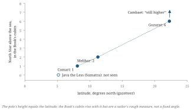

# Chapter III-6
## Mutfili to Kesmacoran: Diamonds, Brahmans, and the Westward Shore

> *“It is in this kingdom that diamonds are got… Now among these mountains there are certain great and deep valleys… the men who go in search of the diamonds take with them pieces of flesh… white eagles… And you must know that this kingdom of Kesmacoran is the last in India as you go towards the west and north-west… from Maabar on, this province is what is called the GREATER INDIA…”*
> — Marco Polo, Book 3, chs. 19–30 (Yule–Cordier)

**[R]**

---

Take the pearls out of the scales and keep the scales handy. The Book takes us up the coast from Maabar (Coromandel Coast) to Mutfili (Motupalli and the Andhra coast), where you could weigh a diamond. It puts a thousand miles between them, twice the figure in Ramusio [1]. The ruler here is a woman, admired in the Book for keeping her country at peace and doing justice. This is Rudrama Devi, daughter and successor of Ganapatideva, who ruled the Kākatīya kingdom from 1263 to 1289 [2].

A merchant putting in at Mutfili has reason to care how this family governs. Ganapatideva’s charter fixes duties and gives the rest of a wrecked cargo back to the merchants [3]. Someone whose fortunes are in a ship can live with knowing how much he will have to pay. What he needs to know in a storm is whether getting the cargo off will do him any good.

Rain sends torrents down out of the hills. Polo puts the men looking for diamonds in the stream beds after the water has gone down [4]. Now follow the story up to a place where you can look into one of the deep valleys. It fills the bottom with serpents. Men throw pieces of meat down, and the white eagles come for it. When one of the birds alights with its prize, the men drive it off and check the meat for the stones that stuck to it. In this telling you can even find diamonds where an eagle has swallowed some and flown back to its nest [5]. A tale like this can cross a mountain where a man with a shovel would find it difficult going.

Polo would have all the world’s diamonds come from this kingdom [6]. He gives the biggest and best to the princes of the East and sends the rest to buyers such as the Venetians. The cloth has a claim to notice in its own right. He calls the very finest cottons buckram and makes them as delicate as a spider’s web [7]. A man can wonder how a diamond came out of the ground and still be left to wonder how anyone has managed to spin that thread.

---

Turn west in the Book from the shrine of St Thomas and the province it names is Lar [8]. Its people include the Abraiaman (Brahmans), distinguished here by a thread that runs over one shoulder and under the other. The Book admires their restraint in food and drink and makes them traders of exceptional honesty [9]. Ramusio puts a stranger in their hands with goods to sell. They will find him a buyer and take the payment for their trouble that he chooses to give them [10]. A merchant can understand the recommendation the moment he thinks of coming ashore somewhere he has no acquaintances.

Another man needs to buy pearls for his king. The Book sends him to Soli (the Chola country) and makes the king pay him twice the cost of what he brings [11]. Yet before another dealer in Lar will close a bargain, he can go outside to look at the length of his shadow. There is a right length for the day of the week. The direction a spider comes from can make a difference too, as can a sneeze when you’re leaving the house or a swallow crossing the road [12]. Ramusio adds an unlucky hour for each day, the *Choiach* [13]. It’s a wonder the Book’s merchant ever gets his bargain concluded, but he goes about it with the same earnestness as the court astrologers in Cambaluc (Beijing).

Polo calls another group Chughi, a form of the word for a yogi. He credits them with lives of a hundred and fifty or two hundred years and tells of a drink made with mercury and sulphur which they believe will lengthen their lives [14]. He also describes ascetics who wear no clothes and keep a little metal ox at the forehead. The ash they use is made from burnt dung in one reading and bones in another. Ramusio has them put it on the forehead of someone who treats them well [15]. I’d keep the two readings in view. Either is easier to fit into a description of a certain practice than into the name of an entire group.

They serve food on dry leaves in the Book and avoid killing even the smallest creatures [16]. The same concern for lives very hard for other people to count comes into the explanation Polo gives for burning the dead. If worms come to feed on a body and starve, the burden of their deaths will fall on the deceased. The Book tells of a test for novices, too, in which women try to draw them away from their vows [17]. A stranger describing what people eat, what they wear and what they are allowed to touch can fit a good deal into an account of one group. It’s worth asking whether the people whose practices he describes would have put themselves all in the same company.

---

At Cail (Old Kayal), an Indian buyer can watch horses come ashore. They arrive from Hormos (Old Hormuz), Kisi (Kish), Aden and the Arabian ports. Ashar, the eldest of the brother kings in Polo’s account, gives merchants a welcome, and the Book gives Ashar jewels and hundreds of wives [18]. When the brothers fall out, their mother comes between them. In the story she threatens to kill herself in their sight, and they put off fighting [19]. She has a way of making each remember what it will cost him to make a battle of the quarrel.

In Ramusio’s Cail it’s a leaf you would look for in a man’s mouth. It’s called *tembul*, and a lord can prepare it with lime, camphor and spices [20]. A man who spits it in somebody’s face, in the same account, may have to answer for it in public. The ruler gives the men sword and shield for a duel [21]. The Book finds two ways of putting the leaves to use, one for a man on his own and one a whole crowd will come out to see.

At Coilum (Kollam), ships come from Manzi (southern China), Arabia and the Levant. Muslim and Hindu merchants can find a place here, and the Book also names Jewish and Christian inhabitants [22]. Out from the port you can see pepper being planted, watered and gathered in the months Polo names, from May to July [23]. Ginger and a local brazilwood go out by ship. Indigo takes work before it can travel. People gather the plant, take off the roots and put the rest in vats of water. The Book has them set the liquid in the sun until it thickens and divide what they get into small pieces for export [24]. A freight charge and a sale at a distant market are much easier to calculate when you have a lump of the stuff that will keep.

Put the Book’s egg in the river and the sun will cook it, Polo reckons [25]. He gives Coilum dark big cats, parrots and peacocks, and the people wine from the palm. He also makes large claims about whom they marry [26]. The heat is one part of what he wants a listener to imagine. A town a long way from anywhere the listener knows must come to life in a few things that can go in a ship and a few that make the same man pause over the page.

If you take the Book’s stops in order, you come next to Comari (Cape Comorin), although on the coast the cape comes before Coilum for a ship coming round from Maabar [27]. Thirty miles out, says Polo, the North Star makes it a cubit above the water [28]. The shore has monkeys you could take for people, in the Book’s view, and wild cats besides. For the man navigating around it, a little familiar light just off the water is worth more than a very fine story about a monkey.

---

At Eli (Ezhimala), look first at the mouth of a river. It offers a broad anchorage, but sandbanks make a poor substitute for a harbour. In summer the ships load in six or eight days and get on their way. The ships of Manzi, Polo thinks, have great wooden anchors that hold especially well [29]. There are pepper and ginger to buy. A man who put in on his way to somewhere else may find himself treated very differently from a man who came here to trade. The Book grants the ruler outright seizure of a ship driven in by weather [30]. The anchor can hold a load fast and still be unable to keep it for its owner.

The Book puts the North Star two cubits above the sea off Melibar (Malabar). From its ports and those of Gozurat (Gujarat), it sends out ships to take the cargoes of other merchants. In the story the crews spread out and come together at a signal when a merchant is sighted [31]. For the man coming into Melibar to buy his pepper, the people who want his goods are different from one port to the next, and sometimes from one hour to the next.

At the market, a ship from the east can exchange copper it has used as ballast, along with fine cloth, cloves and spikenard. It can take away pepper, ginger, coconut and buckram. Some of the pepper gets to Alexandria by way of Aden. Polo counts fewer than one ship going west for ten going east [32]. Follow the copper off the ship and the pepper on to it and you can see how much of the traffic a buyer in Europe never had occasion to know about.

The Book gives six cubits to the North Star at Gozurat and puts the kingdom closer to Melibar than it lies [33]. The people it likens to pirates worry that merchants will swallow their gems, and in the story make them take tamarind to bring the stones back [34]. From the workshops come better things for a merchant to remember. Polo distinguishes cotton good for spinning from what comes off an old plant and can only be used for stuffing [35]. The leather workers can turn red and blue hides into sleeping mats embroidered with birds and beasts in gold and silver wire. Polo prices a good one at ten silver marks [36].

At Tana (Thane) a man can fill his hold with leather, cotton or coarse brown incense [37]. The Book also has the king make a bargain with the pirates. They keep the other goods, and the horses they take go to him [38]. A ruler who can get enough horses that way has reason to keep the trade going, as long as there are merchants who can bear the loss.

Cambaet (Khambhat) has indigo, cotton and well-dressed hides, with ships bringing gold, silver and copper. Ramusio adds tutia to the cargo [39]. The North Star is higher still in Polo’s account. He reckons that it rises as he goes west. It is the ship’s northward passage that makes the difference [40]. Back at the cape, he thought it an achievement to make out a cubit of sky under it.

At Semenat (Somnath), merchants and craftsmen make the port rich. Polo credits both this town and Cambaet with people who earn their trade instead of taking it off other ships [41]. In Kesmacoran (the Makran coast), the Book has people doing business by land and sea, with rice, flesh and milk to live on. Ramusio adds other grain and puts Muslims in the majority [42]. This is the last shore of Greater India in the Book, which starts the region at Maabar and gives us only the places on the coast [43].

The coast can fall astern now. Head south from Kesmacoran and the Book puts two islands ahead, about thirty miles apart. On one, it says, you’ll find only men.

---

## Notes

[1] ~ Mutfili is associated with Motupalli, a port of the Kākatīya kingdom. The distances differ across versions and are only a rough indication of the coastwise journey [@yc, 3.19 n. 1].

[2] ✓ Rudrama Devi ruled in her own right as daughter and successor of Ganapatideva. Polo’s story of a widow succeeding her husband differs from the succession Talbot reconstructs [@yc, 3.19 n. 1; @talbot2001precolonial, pp. ix, 131, 135].

[3] ✓ The charter of 1244–45 is Ganapatideva’s. It sets down the fixed duties and leaves the remaining goods from wrecks to the merchants [@hultzsch1913motupalli, no. 22, pp. 188–197].

[4] ✓ Yule discusses diamond workings in the region, including the recovery of stones from alluvial deposits. Polo makes the seasonal flow of water part of the explanation [@yc, 3.19 n. 2].

[5] ? The diamonds brought out of the valley on meat belong to a travelling legend. Yule compares versions associated with Sinbad and Niccolò de’ Conti among others [@yc, 3.19 n. 2].

[6] ✗ The claim that diamonds come from this kingdom alone goes beyond the basis for associating it with the trade. The destinations of the very best stones are part of Polo’s account of the wealth of rulers [@yc, 3.19 n. 2].

[7] ✓ Yule identifies the buckram here as fine cotton and compares the regional cloth trade mentioned in the *Periplus*. The comparison with a spider’s web is Polo’s [@yc, 3.19 n. 3].

[8] ? Yule finds Lar difficult to place. Pelliot considers Lār or Lāṭa a likely name, while the match with a place west of the shrine and the group of traders remain open [@yc, 3.20 n. 1; @pelliot1959notes, vol. 2, “Lar”].

[9] ~ The sacred thread is recognisable in the description. The trader’s virtues are the Book’s portrait, and Yule and Pelliot discuss a possible conflation of Brahmans and Banyan merchants [@yc, 3.20 n. 1; @pelliot1959notes, vol. 2, “Lar”].

[10] ~ Ramusio-only in Yule’s edition. The details of selling for a stranger and leaving the commission to his discretion are bracketed. The praise of the traders is already in the earlier account [@yc, 3.20].

[11] ~ Yule identifies Soli with Chola country. The doubled price is part of Polo’s story about how the king accumulates jewels [@yc, 3.20 n. 2].

[12] ~ Polo gives the omens their role in deciding when to deal or when to travel. Yule compares later descriptions of augury in the region [@yc, 3.20 nn. 3–4].

[13] ~ Ramusio-only in Yule’s edition. The unlucky hours and the term *Choiach* are in brackets. Yule’s note compares the term with the hour names in an Indian calendar [@yc, 3.20 n. 3].

[14] ~ Indian medical and alchemical sources attest mercury preparations in the *rasāyana* tradition. The extraordinary life span and repeated use from childhood are Polo’s report [@yc, 3.20 n. 5; @wujastyk2013perfect].

[15] ? The ash suggests Śaiva practices, while the concentration on avoiding harm resembles Jain rules. The group’s identity is open. Yule discusses the dung and bone readings, and brackets the blessing of the guest with ashes from Ramusio [@yc, 3.20 nn. 6, 11].

[16] ~ The use of dry leaves and the care taken to spare creatures belong to the Book’s description of abstinence. Its account applies the same concern to the worms invoked in explaining cremation [@yc, 3.20 n. 7].

[17] ? The test of continence belongs to Polo’s account of admitting a new member. The combined particulars leave open whose practices the description gathers together [@yc, 3.20].

[18] ✓ Yule associates Cail with Old Kayal and compares other descriptions of the port and its horse trade. Wassāf reports horses shipped from Kisi to Maabar under a separate contract, giving context for the trade [@yc, 3.21 n. 1; @wassaf1871tarikh, pp. 32–34].

[19] ~ The Book gives the princes a mother who holds them back from war. More than one ruler in the Pāṇḍya country is historical, while the scene and the terms of her appeal belong to the narrative [@yc, 3.21 nn. 1–2].

[20] ~ Ramusio-only in Yule’s edition. *Tembul* is a Persian name for betel. Yule discusses the leaf and the preparation of it with other ingredients [@yc, 3.21 n. 4].

[21] ~ Ramusio-only in Yule’s edition. The insult and the duel with weapons supplied by the king are also part of the addition. Yule discusses the particular manuscript evidence for this passage [@yc, 3.21 n. 5].

[22] ✓ Coilum is Kollam, a port with trade across the Indian Ocean and several communities. Yule cites other travellers on its people and traffic [@yc, 3.22 n. 1].

[23] ~ The Book describes cultivated pepper and names the months in which it is gathered. The dyewood and ginger were also known as goods from Coilum in later descriptions [@yc, 3.22 nn. 2–3].

[24] ~ Polo describes preparing indigo through soaking and processing the liquid. Yule compares other means of preparing the dye, which leave particular steps and the role of the sun in Polo’s account open [@yc, 3.22 n. 4].

[25] ✗ The egg is an illustration of extreme heat in the Book. It gives that heat a visible effect on something almost any listener could recognise [@yc, 3.22].

[26] ~ The Book generalises about kinship and marriage in this region and then across India. Yule discusses the possibility that particular local or caste customs lie behind the larger claim [@yc, 3.22 nn. 5–6].

[27] ✗ Comari is Cape Comorin, which a vessel sailing from Maabar rounds before reaching Coilum. Yule’s comparative itinerary sets the geographical order and the Book’s sequence side by side [@yc, 3.23 n. 1; @yc, 3.30 n. 2].

[28] ~ The Book resumes its sighting of the star here and assigns a height to it. See [Diagram C10, the Pole Star](../media/diagrams/C10-pole-star.pdf) for the difference between the reported cubits and changing latitude [@yc, 3.23 n. 1].

[29] ~ The river-mouth anchorage and the wooden anchors belong to the Book’s arrangement of details. Yule compares reports of Chinese wooden anchors and different readings of the passage [@yc, 3.24 nn. 2, 5].

[30] ~ Yule cites ʿAbd al-Razzāq on seizures and on the different treatment at Calicut. Polo distinguishes ships that intended to come to the port from those diverted there by weather [@yc, 3.24 n. 4].

[31] ~ Yule compares piracy elsewhere on India’s western coast. The number and disposition of the ships, and their signal, belong to the Book’s account [@yc, 3.25 nn. 2–3].

[32] ~ The Book puts the large traffic in spices towards Manzi and the smaller one through Aden to Alexandria. Its rates of exchange and proportions are a merchant’s picture of scale, with the exact ship count unverified [@yc, 3.25 nn. 4–5].

[33] ✗ The Book gives six cubits off Gozurat and writes of it as near Melibar. Yule notes that the geography puts some of the later places inside the region the Book presents as a single intervening stop [@yc, 3.25 n. 1; @yc, 3.26 n. 1].

[34] ? The tamarind story explains an act of piracy through a trader’s fear of losing small valuables. It belongs to the Book’s account of what captors did [@yc, 3.26 n. 2].

[35] ~ Polo distinguishes cotton from younger plants for spinning from cotton used as stuffing. Yule compares descriptions of the area’s plants and products [@yc, 3.26 n. 3].

[36] ~ Yule cites comparisons for embroidery and inlay on leather from this region. The prices for mats and cushions are Polo’s reckoning [@yc, 3.26 n. 4].

[37] ✓ Yule identifies Tana with Thane and compares descriptions of its products and trade. The Book distinguishes the brown resin from the white incense of the Arabian coast [@yc, 3.27 nn. 1–2].

[38] ~ The ruler’s share of the horses is a separate claim from the presence of pirates. Polo explains it by the demand for horses already carried in ships [@yc, 3.27].

[39] ~ Ramusio-only in part. Cotton, indigo, hides and imported metals appear in the earlier account. The addition of tutia is in brackets [@yc, 3.28 n. 1].

[40] ~ The Book uses westward progress to describe its passage round India. The reported rise in the star’s height follows the northward change in latitude [@yc, 3.23; @yc, 3.25–28].

[41] ~ Polo praises the traders of both ports and assigns neither port a share in piracy. He retains a hostile judgement of the religion of the people of Semenat [@yc, 3.28; @yc, 3.29 n. 1].

[42] ~ Ramusio-only in part. Yule brackets the majority religion and the additional grain, while trade by sea and land is in the base text [@yc, 3.30 n. 1].

[43] ✓ The limits of Greater India are given as a definition within the Book. Its coastwise list, which leaves inland districts aside, belongs to that same sense of the region [@yc, 3.30 n. 2].
