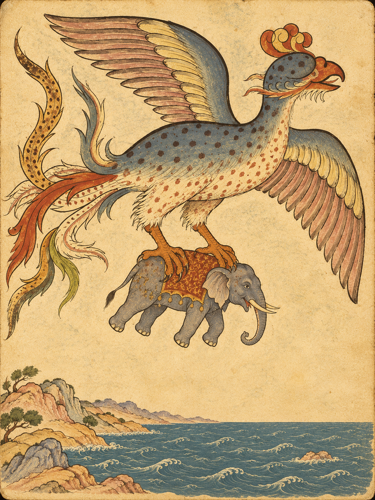

# Chapter III-7
## Male and Female, Scotra, Madeigascar, Zanghibar, Abash

> *“When you leave this kingdom of Kesmacoran… you go by sea some 500 miles towards the south; and then you find the two Islands, MALE and FEMALE… Scotra… Madeigascar… the bird Gryphon… The people of those isles call the bird Ruc… Zanghibar… giraffes… ABASH, which constitutes the MIDDLE INDIA…”*
> — Marco Polo, Book 3, chs. 31–34 (Yule–Cordier)

**[R]**

---

Leave the mainland coast of Kesmacoran (the Makran coast) astern and steer five hundred miles straight south into empty blue swell. Out on open ocean rise two small sister islands lying barely thirty miles apart: Male and Female [1]. All inhabitants are baptized Christians keeping strict Old Testament purity rules. Whenever wives fall pregnant, husbands withdraw completely until forty days after childbirth, never approaching their beds before that appointed span closes [2]. Stranger still runs their yearly calendar. Men keep house alone upon Male for nine months while women tend fruit groves and raise small sons upon Female. Every March, husbands hoist lug-sails and cross thirty miles south to live with their wives through April and May. Come June, they sail back north to fish, farm, and trade. Boys stay beside their mothers until age fourteen, then cross permanently to grow up among men—leaving mothers to nurse small girls and gather orchard fruit while husbands supply every household store of meat, milk, and rice [3]. Picture those thirty miles of open channel crowded each spring with little husband-boats crossing south, then emptying again at June’s first monsoon puff.

Ask a harbour purser rather than a romantic chronicler how those separated spouses paid their way, and solid freight steps straight onto the sand. Even a sailors’ yarn about divided marriages has to pay its anchorage, and here the cargo is plain enough. Drying frames along Male pile high with large cured sea-fish alongside fine grey lumps of ambergris, enough to feed every family year round and still fill visiting traders’ holds [4]. Merchants call for dried fish and ambergris rather than tall tales of divided households. Both little islands obey a single bishop answering upward to the great archbishop of Scotra (Socotra), though the Book leaves pilots with no fixed harbour bearing [5]. Henry Yule hunts across ancient Indian Ocean logs—probing everything from Abd al-Kūrī to the Maldives—without ever pinning these twin wonder-isles onto a real sea-chart [6].

---

Five hundred miles further south looms Scotra (Socotra), a rocky ocean crossroads smelling sharply of brine, resin, and salt-cured hides. Baptized Christian islanders walk bare like mainland Indians while trading woven cotton cloth, rich ambergris, and huge slabs of excellent salt fish over daily bowls of rice, flesh, and milk [7]. Their independent archbishop owes no duty to Rome, Marco notes carefully, looking eastward instead to the great patriarch presiding at Baudas (Baghdad), who rules bishops across these eastern seas much as Rome rules western Christendom [8].

Look past church bells onto Scotra’s open anchorage, and brisk illicit traffic hums along the sand. Ships bound for Aden pause to buy cheap bullion gold. Meanwhile, bold corsair squadrons beach hulls openly to spread captured Muslim and pagan silks along market mats—eagerly purchased by island Christians with few awkward questions asked [9]. Out past the breaking surf, Ramusio’s harbour expansion stages a breathless whale hunt. Whalers hurl barbed iron harpoons whose hooks lock fast inside blubber, trailed on long coils tied to a floating cask (*bottesella*). Once the wounded whale bleeds out and drifts beside the bobbing buoy, small boats tow the massive carcass ashore. Crews render clear lamp-oil from the head and slice grey ambergris out of its stomach [10]. Modern marine science places ambergris formation cleanly inside the sperm whale’s lower intestine rather than its belly, likely coiled round undigested squid beaks [11].

Yet no skipper clears Scotra without respecting local superstition. Marco hears that Scotran elders rank among the most cunning weather-sorcerers on earth. Should any dishonest captain cheat an islander, enchanters raise fierce contrary gales out of clear sky to whip his escaping vessel right back into harbour. They brush aside their archbishop’s stern sermons because, they argue stoutly, their fathers stirred the wind that way before them, and darker spells go unspoken in a polite book [12].

One can imagine a foreign supercargo weighing his coins twice at the water’s edge when the island’s elders are watching the horizon. Whether or not a wizard ever turned a ship about, a reputation for raising headwinds is a tidy insurance policy for an island without a war-fleet.

---

Sail a thousand miles south from Scotra and the Book brings you to Madeigascar (identified by Pelliot and Andreose with Mogadishu), pitched as a giant island measuring four thousand miles around [13]. Four Muslim elders (*esheks*) govern its crowded port wards. Townsmen slaughter camels in staggering numbers every week, swearing camel meat makes the wholesomest, tastiest roast on earth [14]. Beyond butcher booths, whole forests yield red sandalwood while coastal fishermen gather abundant whale and “Oil-head” ambergris alongside immense piles of elephant-tusk ivory traded keenly for cloth of gold and bright silks [15]. Leopards, bears, and lions prowl inland thickets.

— Watch a single copied name twist an entire shoreline across medieval desks. On Pelliot’s reading, a name from the Somali coast has come down to us in a story about a four-thousand-mile island. Andreose traces how the different readings might have arisen across the surviving manuscripts [16].

Ships sailing out from Maabar (Coromandel Coast) ride swift monsoon currents southward to these bays in barely twenty days, Marco observes, yet struggle over three gruelling months beating north against an unyielding current. Beyond these capes, mariners warn, that southbound torrent sweeps ships down into dark seas whence no hull ever claws home [17].

Out over those forbidden southern reefs wheels the Book’s grandest winged prodigy: the colossal bird islanders name the Ruc [18]. Forget European wall-hangings painting half-eagle, half-lion griffins, Marco warns firmly from his informants’ word. Shaped purely like a mountain-sized eagle spreading thirty paces from wingtip to wingtip, with thick quills twelve paces long, the Ruc dives onto grazing elephants. It sinks curved talons deep behind their shoulders, beats up into cloud, and drops heavy prey onto bare rock to smash before dining [19]. Curious for truth behind coastal tales, Cublay (Kublai) Kaan sent ambassadors south to recover a detained envoy and inspect those southern wonders [20]. Ramusio’s fuller court scene watches those envoys lay one single Ruc wing-feather before the emperor’s dais—measuring ninety spans long with a quill shaft two palms round. Older texts pair that feather with two fierce wild-boar tusks weighing over fourteen pounds apiece off beasts tall as great buffaloes, alongside giraffes and wild asses [21]. Ninety spans of feather and two palms of quill—lay that across a palace carpet and any courtier will ask what sort of bird left it behind.

{#fig-iii-7-rukh-elephant width=78%}

---

Swing past Madeigascar into Zanghibar (Zanzibar and the Swahili coast), pitched at two thousand miles around under its own independent king [22]. Marco’s coastal portrait mixes sharp animal eyes with ugly racial caricature borrowed from medieval travel convention. He paints dark, crisp-haired townsfolk with the strength of four men and appetites for five [23]. Turn thankfully toward pastures and wharves instead. Zanghibar herds distinctive white-bodied sheep crowned cleanly with pitch-black heads seen nowhere else [24]. Its ports load ships with heavy elephant ivory and whale ambergris, while folk live on rice, dates, meat, milk, and sweet fermented spice-and-sugar wines [25].

Best of all stands Marco’s quiet roadside sketch of the giraffe. Its short body slopes steeply downward toward brief hind legs, balanced by towering forelegs and a slender long neck. Above those shoulders, a gentle little red-and-white spotted head rises three paces high in the air [26]. Set those cool proportions beside European bestiary guesses, and you hear a crisp observer’s eye cutting straight through hearsay. Less reliable sits Zanghibar’s battlefield picture. Bare warriors ride camels and elephants crowned with tall wooden castles holding ten to sixteen fighters armed with lances, swords, and stones. First, grooms dose each beast with wine to stir battle fury—handing African elephants an Indian war-role that Masʿūdī explicitly denied [27].

Before turning north out of these southern waters, Marco pauses to count the whole charted ocean on mariners’ rolls: 12,700 inhabited and desert islands washing across India’s sea, ringed by thirteen mainland kingdoms of India the Greater from Maabar to Kesmacoran and eight mainland kingdoms of India the Lesser between Chamba (Champa) and Mutfili (Motupalli) [28].

---

Step ashore at last upon the cool plateau of Abash (Ethiopian highlands), which the Book honours as Middle India [29]. Six sovereign kings rule these high plains—three Christian and three Muslim—under one supreme Christian monarch holding court in the mountainous centre while his Saracen vassals guard lower eastern marches [30].

Walk through an Abash market town and note every neighbour’s brow marked cleanly beside the font. Christian subjects carry three hot-iron scars—one running straight from forehead down to mid-nose, one branding each cheek—as a solemn mark of noble birth completing baptism by water. Jewish subjects carry two cheek scars, Muslims one crisp line descending from brow toward the nose [31]. Long ago, priests remind visitors proudly, Messer St Thomas preached through these valleys and won their fathers to Christ before crossing the ocean to his martyrdom in Maabar [32].

The episode that anchors the chapter belongs to 1288, when a wounded bishop trudged home from Jerusalem [33]. Determined to kneel at the Holy Sepulchre, Abash’s Christian sovereign bowed to anxious barons who feared hostile borderlands, dispatching a holy bishop of spotless life in his royal stead to lay rich offerings beside the tomb [34]. Coming down safely from Jerusalem, the aged prelate marched homeward straight through the hostile territory of Aden, where Christians were hated unto death. Dragged before Aden’s fierce Soldan and ordered to renounce Christ for Islam, the bishop answered stoutly that guards might hack him to pieces before he betrayed his Maker. Burning with insult meant directly for his Christian king, the Soldan ordered soldiers to circumcise the old bishop by force and turned him bleeding onto the desert track [35].

Think of that bitter return inside the highland palace. First the scarred prelate knelt gladly to recount every stone he beheld inside Jerusalem’s walls while his king listened in pious reverence. Then he dropped his voice and showed Aden’s cruel outrage. Nearly choked with rage and grief, the Christian king swore aloud before every court baron never to wear golden crown or govern kingdom again unless his swords shook Aden to the sea [36]. Mounted squadrons, foot archers, and castle-bearing elephants poured down guarded border passes against three Muslim kings. They shattered their frontier lines, ravaged towns and plains across an entire month of fire and vengeance, and slew vast numbers of the Soldan’s host. Only when treacherous narrow mountain defiles blocked the advance—passes where a handful of men might ambush an army—did the victorious king turn his elephants homeward [37].

— Outside the Book, the surviving chronicles tell a more fragmented story. Yule picked King Yikunno Amlak fighting Adal roughly a decade earlier, while Trimingham favoured Yagbeʾa Ṣeyon reigning 1285–94 beside Adal—whereas Ibn ʿAbd al-Ẓāhir’s Arabic court chronicle independently records a genuine Ethiopian embassy to Cairo in 1290 whose royal envoy died en route at ʿAydhāb, leaving the true connection tantalisingly open [38].

Beyond steel and bugles, Abash settles back into honest trade across crowded markets. Farmers and weavers harvest sesame, rice, milk, donkey-tall ostriches, parrots, giraffes, and fine woven cotton buckram, alongside baboons and monkeys with all-but-human faces [39]. Pack-trains carry those woven cottons and hides down toward Red Sea ports before the monsoon shifts.

Step down out of those breezy highlands straight onto Aden’s blistering harbour apron—where a single sack of Indian pepper shifts ships twice before reaching Alexandria.

---

## Notes

[1] ~ Placing Male and Female five hundred miles south of Kesmacoran and thirty miles apart follows mariner legend without matching real Arabian Sea hydrography [@yc, 3.31 n. 1]. The twin islands belong to a widespread Indian Ocean folklore tradition rather than a plotted reef.

[2] ~ Baptism combined with a strict rule that husbands may not approach their wives after childbirth echoes Eastern Christian and Mosaic purification motifs woven into sailors’ stories [@yc, 3.31 n. 1]. See [Back Matter III-2, Glossary under “Male and Female”](back-02-glossary.md#place-male-and-female).

[3] ~ Crossing to the women's island for March, April, and May and sending boys at age fourteen to join their fathers on Male preserves an ancient Amazon-style island tale [@yc, 3.31 n. 1]. Yule traces versions of the same separated-sex island story from seventh-century Chinese Buddhist pilgrims through Arab and European geographers.

[4] ~ Dried sea-fish and ambergris traded to visiting merchant hulls anchor the legend in familiar western Indian Ocean commodities [@yc, 3.31]. Even a fabulous island in *Il Milione* has its market prices and export staples.

[5] ? Naming a local bishop subject to Scotra’s archbishop gives the myth an ecclesiastical anchor within Church of the East geography [@yc, 3.31 n. 1]. Socotra really did house an Eastern Christian see, lending concrete detail to the neighbouring island story.

[6] ? Yule reviews geographic proposals from the Maldives and Kuria Muria to Abd al-Kūrī off Socotra without locating any historical twin-island society [@yc, 3.31 n. 1]. Compare the map cautions in [Front Matter III-2](front-02-maps-seas-and-return.md#map-cautions).

[7] ✓ Baptized Christian islanders trading cotton, ambergris, rice, and large salt fish align accurately with medieval Scotra (Socotra) [@yc, 3.32]. Arab and later Portuguese accounts confirm an isolated Christian population living on the island into the sixteenth century.

[8] ✓ Submitting to an Eastern archbishop dependent on the *Jatolic* (Catholicos-Patriarch) at Baudas (Baghdad) accurately preserves Church of the East jurisdiction on Socotra [@yc, 3.32 nn. 2–3]. Polo notes that these island Christians followed Chaldean rather than Roman rites.

[9] ~ Hosting ships bound for Aden alongside brazen corsair fence-sales captures Socotra’s ambiguous crossroads along the Gulf of Aden sea-lanes [@yc, 3.32 nn. 2–3]. Polo reports that the islanders gladly bought plundered goods whenever pirates spared Christian vessels.

[10] ~ Ramusio-only in part. Yule takes the whaling account from Ramusio, whose version gives a single floating *bottesella* (cask) tied to the harpoon line. Burgio and Fornasiero print the related Zelada Latin passage with multiple small casks and boards marking the diving whale [@ramusio1559navigationi, vol. 2, fol. 57v; @burgio2011terzo, p. 133 nn. 19–20; @yc, 3.32 n. 1].

[11] ✓ Sperm-whale intestines, not stomachs, produce ambergris, likely formed around irritating squid beaks as Brito notes [@brito2016ambergris, abstract]. The Arabian Sea around Socotra and the Somali coast was one of the medieval world's prime sources of floating and harvested ambergris [@yc, 3.32 n. 1].

[12] ~ Claiming island enchanters raise contrary headwinds to force runaway debtors or pirate skippers back into port blends Socotra's widespread reputation for sorcery with mariners' yarns [@yc, 3.32 n. 4]. Later Arab and Portuguese pilots still dreaded the wind-raising wizards of Socotra.

[13] ✗ Expanding Madeigascar into a four-thousand-mile ocean island conflates the mainland Somali port of Mogadishu with huge island estimates [@yc, 3.33 n. 1]. Polo's description mixes continental East African camels, elders, and ivory with rumours of the great southern island.

[14] ~ Governing the port by four elders (*shaykhs*) and slaughtering camels daily for meat match Ibn Baṭṭūṭa’s Mogadishu observations and Brava’s council of elders cited by Yule [@yc, 3.33 n. 1]. Camel herds and shaykh councils point unmistakably to the Horn of Africa rather than Madagascar.

[15] ~ Red sandalwood groves, washed-up whale and *Capdoille* (“Oil-head” or sperm-whale) ambergris, heavy ivory trade, and silk-and-gold imports match the East African coastal emporia [@yc, 3.33 nn. 2–3]. Tusks from the interior poured through Mogadishu and the Swahili ports toward India and China.

[16] ? Andreose argues that Zelada’s *Mogdaxo*, V’s *Madaschor* and the *Mogclasio* of F’s chapter index preserve stages of a scribal misreading of Mogadishu. Pelliot proposes the same identification [@andreose2024textual, pp. 76–77; @pelliot1959notes, vol. 2, pp. 779–781].

[17] ~ Contrasting twenty-day southbound runs from Maabar against laborious three-month returns records the fierce Somali and Mozambique southward current magnified into a point of no return [@yc, 3.33 n. 4]. Arab pilots warned that vessels carried too far down the African channel struggled for months to beat back north. See [Chart C11](ch-09-cocachin-return.md#fig-c11-monsoon-cocachin) for the Indian Ocean’s seasonal winds.

[18] ~ Giant elephant-lifting eagles called *Ruc* replace European half-lion griffins with Arab *rukhkh* seafaring legends assembled by Yule [@yc, 3.33 n. 5]. Polo explicitly corrects his European listeners by insisting the bird is shaped like an colossal eagle rather than a winged quadruped.

[19] ✗ Thirty-pace wingspans, twelve-pace feather quills, and dropping full-grown elephants to smash on the rocks belong strictly to sailors’ giant-bird folklore [@yc, 3.33 n. 5]. Yule and Cordier discuss whether massive sub-fossil *Aepyornis* eggs or giant palm fronds from Madagascar gave rise to the quill trophies.

[20] ? Sending Yuan missions southward to gather island curiosities and free a detained envoy remains unconfirmed in court annals [@yc, 3.33]. Even so, Cublay did send maritime envoys across the western Indian Ocean during the 1280s to collect exotic animals and tribute.

[21] ~ Ramusio-only in part. Ramusio inserts the ninety-span, two-palm quill carried back to Cublay, while the base texts supply the fourteen-pound tusks from buffalo-sized wild boars [@yc, 3.33 n. 6]. Yule notes that giant raphia-palm midribs from Madagascar were sometimes displayed in Asian courts as *rukhkh* feathers.

[22] ✗ A two-thousand-mile circuit for Zanghibar turns the Swahili coastal trading zone (*Zanj-bar*, “Coast of the Blacks”) into a second oversized island continent [@yc, 3.34 n. 1]. Like Arab geographers, Polo's informants blurred the island of Zanzibar with the wider East African mainland.

[23] ✗ Giant four-man proportions and grotesque physical caricatures reflect hostile medieval racial tropes rather than honest observation [@yc, 3.34 n. 1]. The stereotyping stands in sharp contrast to Polo's sober commercial reporting on the coast's ivory and shipping.

[24] ✓ Black-headed white fat-tailed sheep accurately match the distinctive Somali and East African black-head breed (*Ovis aries steatopyga*) noted by Yule [@yc, 3.34 n. 2]. That exact colour pattern is a small, stubborn piece of real coastal zoology.

[25] ✓ Abundant ivory trade, ambergris, and fermented drinks brewed from dates, rice, spices, and sugar reflect Swahili coast staples [@yc, 3.34 n. 4]. Absence of Mediterranean grape-vines led coastal ports to brew palm and grain liquors instead.

[26] ✓ Long neck, tall forelegs, sloping hindquarters, small head, and red-and-white circular spots rising three paces high give an accurate sketch of the reticulated giraffe [@yc, 3.34 n. 3]. African rulers sent live giraffes as prized diplomatic gifts to both Cairo and the Yuan court.

[27] ✗ Mounting fighting castles on wine-drunk war elephants transfers Indian military habits to East Africa [@yc, 3.34 n. 5]. Yule notes that Masʿūdī explicitly stated the Zanj hunted wild elephants for ivory without domesticating them for war.

[28] ~ Counting 12,700 Indian Ocean islands, thirteen Greater India kingdoms, and eight Lesser India kingdoms frames Marco’s whole Asian sea map [@yc, 3.34 nn. 6–7]. He stresses that he has described only the principal countries rather than every island in the pilots' books.

[29] ✓ Calling Abash (Abyssinia, the Ethiopian highlands) Middle India reflects the standard medieval geographic division across three Indias [@yc, 3.35 n. 1]. European and Eastern writers regularly grouped Ethiopia with the Indian Ocean rim.

[30] ~ Pairing three Christian kings with three Muslim vassal kings beneath one supreme Christian sovereign sketches late thirteenth-century Solomonic and Muslim sultanate politics in the Horn of Africa [@yc, 3.35 n. 1]. A newly restored Christian dynasty in the highlands contended constantly with coastal and eastern Muslim emirates.

[31] ? Attributing three facial hot-iron marks across forehead and cheeks to Christian baptism—beside two marks for Jews and one for Muslims—conflates Ethiopian regional scarification with religious rites [@yc, 3.35 n. 2]. Early European accounts often mistook tribal or cautionary cautery marks for a literal “baptism with fire.”

[32] ~ Crediting St Thomas with preaching in Abash and Nubia before crossing to Maabar bridges African Christianity back to the Mylapore shrine of Chapter III-5 [@yc, 3.35; @yc, 3.18]. The notice reflects the pride of Eastern Christians across the western ocean basin.

[33] ? Anchoring the Abash war episode precisely to 1288 sets a crisp chronological claim unverified outside Polo [@yc, 3.35 n. 5]. Compare Note 38 on the historical rulers and the 1290 Cairo embassy.

[34] ~ Persuading the king to send a bishop in his place rather than risk an overland royal pilgrimage through Muslim territory to Jerusalem introduces the diplomatic insult tale [@yc, 3.35]. Ethiopian pilgrims and clerics did travel regularly through Egypt to the Holy Sepulchre.

[35] ? Forced circumcision of the captive bishop by the Soldan of Aden in spite against the Christian king stands unconfirmed in contemporary Muslim or Christian chronicles [@yc, 3.35 n. 5; @loiseau2019hati, pp. 642–643]. The outrage provides a personal chivalric trigger for an inland–coastal war.

[36] ~ Swearing off crown and kingdom until vengeance fell upon Aden renders royal outrage in Rustichello's high chivalric speech [@yc, 3.35]. The king's vow sets up the campaign against the Soldan's mainland allies.

[37] ~ Victory at a fortified frontier pass, war-elephant castles, and a month of devastation halting before narrow mountain defiles remain uncorroborated battle drama [@yc, 3.35 nn. 4–5]. The geography clearly points to the Muslim sultanates of the African mainland (such as Ifat or Adal) rather than Aden across the sea strait.

[38] ? Yule suggested Yikunno Amlak fighting Adal earlier, while Trimingham proposes Yagbeʾa Ṣeyon (r. 1285–94) cautiously [@yc, 3.35 n. 5; @trimingham1952islam, pp. 69–70]. Meanwhile Ibn ʿAbd al-Ẓāhir logs an actual 1290 Ethiopian embassy to Cairo whose envoy died en route at ʿAydhāb, studied by Loiseau [@loiseau2019hati, pp. 642–643, 652–653].

[39] ~ Sesame, rice, ass-sized ostriches, parrots, giraffes, and fine cotton buckram end the Abash chapter on abundant highland and Red Sea trade goods [@yc, 3.35]. From those African markets the narrative steps directly across the strait to Aden's customs quay.
