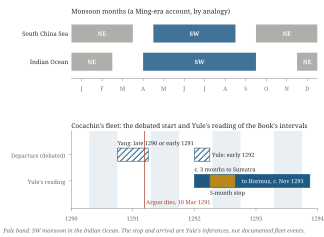

# Chapter III-9
## The Princess Cocachin: Departure, Sea Passage, and the Way Home

> *“Now it came to pass in those days that the Queen BOLGANA, wife of ARGON, Lord of the Levant, departed this life… The Kaan… sent for a lady whose name was COCACHIN… They put forth to sea… nearly all died by the way… And this was in the year 1295 of Christ’s Incarnation.”*
> — Marco Polo, Prologue, chs. 17–18 (Yule–Cordier)

**[V]**

---

A sewn-in pocket of rubies does a merchant little good if he cannot walk through the palace gate to spend them. Back at Cambaluc (Beijing), Niccolò, Maffeo, and Marco had spent years in the Great Kaan’s service, gathering immense wealth in gold and precious stones. Yet Ramusio adds the cold worry keeping all three awake at night [1]. Cublay (Kublai) Kaan had grown very old. If the emperor should die before his Venetian servants departed, how would three foreign courtiers ever fight their way home across unsettled roads without their patron’s shield? Even a rich man is a prisoner when his only protector sits on an ageing throne. Time and again they knelt politely to beg leave to go, yet Cublay loved having them about his court too dearly to let them slip away [2]. Every extra winter in Cambaluc filled their chests tighter and tightened the trap around their exit. If Cublay closed his eyes for the last time, rival princes and jealous court factions would never guard three wealthy Venetians on the road to the Black Sea. Years of royal favour could turn overnight into a gilded cage once a new ruler mounted the dais, leaving three foreigners stranded with trunks of gems they could never carry safely past the border posts.

Rescue rode in from Persia on mourning saddles. Queen Bolgana (Bulughan Khatun), wife of Ilkhan Argon (Arghun), had died beside the Kur in the spring of 1286. On her deathbed she charged her husband that no bride should take her throne unless chosen from her own Cathayan kin [3]. To honour her will, Argon dispatched three barons—Oulatay, Apusca, and Coja—with a gallant retinue across Asia to fetch a bride from Cambaluc [4]. Imagine the three Persian lords riding into the northern capital after months in the saddle, bearing letters of mourning and formal marriage gifts from the Ilkhanate. They had crossed mountains and deserts to bring back a royal kinswoman who could step into Bolgana’s place. Only a bride of the same noble blood could satisfy the dead queen’s dying charge.

Cublay welcomed the Persian lords with royal feasts and summoned seventeen-year-old Cocachin (Kököchin), a graceful maiden of Queen Bolgana’s lineage [5]. One look satisfied the envoys that they had found their lady. Yet when they turned westward overland, Ramusio records an eight-month march blocked by fresh wars between Mongol princes. Fighting along the steppe forced the entire bridal train back to Cambaluc [6]. With mountain roads slammed shut by rival armies, only the southern ocean remained open—and none of the Persian barons knew how to manage a fleet across strange monsoon seas. A landlocked caravan master could lead camels across Persia, not steer four-masted junks through the Straits of Malacca. Without experienced mariners to read winds and harbours, the royal bride could never reach her bridegroom’s court.

At that exact moment, Marco sailed back up the coast from an imperial mission across Indian waters. He spread fresh sea-charts and port intelligence before the throne, recounting harbours, currents, and winds he had just sailed through [7]. Seeing three seasoned Latins who knew both ships and southern seas, Oulatay, Apusca, and Coja begged Cublay as a favour to send the Venetians with their bridal fleet. Who better to guide a royal bride by sea than three Europeans who wished above all else to sail west toward home? Reluctantly—with visible displeasure darkening his face in Ramusio’s dramatic touch—the aged Kaan granted his permission at last [8]. Cublay could scarcely refuse a dying kinswoman’s last wish or an allied Ilkhan’s envoys when the sea lane was the only road left open. For the Polos, that royal nod meant freedom after more than twenty years abroad, provided they could survive the long voyage around Asia’s southern rim.

---

Imperial leave brought instant royal provision. Calling all three Polos before him, Cublay pressed two golden tablets of authority into their hands. Those tablets guaranteed free horses, rations, and safe passage across every province of his realm [9]. He charged them with letters for Christendom’s kings—whose names shift across manuscripts from France and Spain to England—and bid them carry his greeting to the Pope [10]. Then he ordered thirteen stout ocean ships fitted out for the voyage. Each vessel carried four masts, up to twelve sails, and two years’ sea stores, with crews Ramusio numbers at 250 or 260 men on the largest ships [11]. Picture dockyards clattering day and night to salt beef, fill water butts, pitch seams, and stow biscuit for hundreds of sailors and courtiers before a single anchor rose. Every rope, spar, and provision cask had to hold together across two different monsoon oceans. When the fleet finally weighed anchor, it carried not just three Venetians and a royal bride, but an entire floating court bound for Persia.

The Prologue leaves the port of departure unnamed, though Zayton (Quanzhou) fits every harbour clue in Volume Two [12]. Turn from Marco’s Prologue to a surviving Chinese administrative order preserved in the *Yongle dadian* (j. 19426), and dating shifts under your fingers. That court notice logs preparations in April and May 1290 for three Persian envoys and about 160 companions. From that order, Yang Zhijiu inferred a departure late in 1290 or early in 1291, whereas Yule counted backward along monsoon winds to place the sailing in early 1292 [13]. Preparation orders prove a fleet was provisioned; they cannot fix the morning its sails cleared the headland. Between the clerks’ ink in 1290 and the fleet’s arrival in Persia lies a silent stretch where only wind tables and survival logs speak. Historians still debate whether the fleet waited out an entire monsoon season in port or caught the autumn wind earlier.

![The Cocachin return. Dashes show the proposed Zayton departure, possible stops at Chamba and Samara, and the reconstructed Indian and Persian stages. The Prologue names “Java”; Yule links that passage to the Book’s five months at Samara. The solid western line joins the four named stages from Trebizond to Venice along an illustrative course. Rashid al-Din records the embassy at Abhar. Yule dates departure to early 1292; Ma reports Yang Zhijiu’s inference of late 1290 or early 1291. Hormos? marks the Minab area; the exact site of Old Hormuz is uncertain. *(Map: this edition, from the Book, Rashid al-Din and the gazetteer.)*](../media/maps/A16-cocachin-return.svg)

After three months at sea, the Prologue names a first landfall at “Java”. Yule reads that name as Java the Less (Sumatra), linking it editorially to the separate five-month monsoon halt at Samara (Samudera Pasai) described in Book Three [14]. Yet the Prologue itself never mentions palisaded trenches, five wooden towers, or five months ashore. Those camp scenes sit strictly in Chapter III-3 and must not be folded silently into Cocachin’s log. Eighteen months more at sea carried the convoy across Indian waters toward Hormos (Old Hormuz), which Yule sets around November 1293 [15]. Week after week, salt damp, bad water, and tropical fever wore down crews and passengers alike. Crossing from the China Sea through Indian straits and up toward Arabia meant waiting out seasonal winds, nursing leaking hulls, and burying comrades overboard. Even seasoned mariners dreaded a passage that stretched past two years without fresh pasture or clean wells.

Death thinned the fleet mercilessly along that long salt road. Yule prints about six hundred passengers setting out besides mariners, with only eight passengers surviving in his main text—or eighteen in the Franco-Italian F manuscript [16]. Ramusio reckons roughly six hundred dead including crewmen, claiming that Coja alone survived among the three envoys while only one waiting-woman died [17]. Whatever ledger you trust, a glittering royal embassy limped into the Persian Gulf broken to a handful of survivors. Think of Cocachin watching two of her three grey-bearded Persian escorts buried at sea or ashore before a single Gulf headland rose into view. Yet all three Polos—father, uncle, and son—stepped onto the Persian beach alive. Few medieval sea-accounts record so steep a toll for a diplomatic mission that still reached its shore intact.

---

Worse news waited ashore: the bridegroom was dead. Argon had died on 10 March 1291, leaving his brother Kiacatu (Gaykhatu) seated on the Ilkhanate throne since July [18]. Following Kiacatu’s orders—relayed up from the coast in Ramusio’s fuller scene—the Polos escorted Cocachin onward to Argon’s son Casan (Ghazan), then guarding the Persian frontier near the Arbre Sec (the Dry Tree), before riding back to Kiacatu’s court [19]. Wait—notice how Ramusio leaves the exact landing harbour unnamed here. Placing that initial dispatch specifically at Hormos belongs to Yule’s editorial commentary rather than Ramusio’s own words [20]. Even on the final shore, manuscripts and commentators part company over exact steps.

Step outside the Prologue for a sharp archival check. Persian historian Rashīd al-Dīn independently records Argon’s three envoys bringing Cocachin to Abhar, where Casan married her amid royal gifts from the Great Kaan [21]. Meanwhile the Chinese *Yongle dadian* notice names three envoys matching Oulatay, Apusca, and Coja. Yet as Peter Jackson points out, neither the Persian history nor the Chinese administrative notice names a single Polo [22]. Both outside archives confirm the embassy, the marriage, and the three Persian barons; neither confirms or denies the three Venetians riding beside them.

| Account | Evidence for the embassy | What it gives us about the Polos |
|---|---|---|
| Prologue | Three envoys seek a bride from Bolgana’s kin and escort her west | Names the three Venetians as escorts on the sea passage |
| Rashid al-Din | The envoys bring Cocachin to Abhar, where Casan marries her | Leaves their other companions unnamed and gives no sea route |
| Notice in the *Yongle dadian*, as discussed by Yang and Cleaves | Order in 1290 naming the envoys with about 160 companions | Names the envoys. Gives no names for Venetian companions and no date of sailing. |

When parting day came at the Persian camp, Cocachin wept bitterly, looking upon the three Venetians like fathers. Manuscripts naming a second charge add that the daughter of the king of Manzi (South China) wept beside her as they said farewell [23]. For more than two years on shipboard and desert tracks, three foreign merchants had been the young princess’s steady protectors, guarding her household through storms, fever, and mourning. Little else survives of the young princess’s voice; Yule traces her death in Persian chronology to June 1296 [24].

From Kiacatu’s court, the three Venetians rode west carrying four fresh golden tablets of authority—two blazoned with gerfalcons, one with lions, and one plain. Those tablets commanded fresh horses, rations, and escorts of up to two hundred horsemen along restless roads [25]. Soon grim riders brought news across the plateau that Cublay himself had died in early 1294, snapping the last thread that could ever have drawn them back to Cambaluc [26]. Their old fear back in China had come true almost to the season; only their lucky sea-escape kept them out of the succession storm. Had they lingered one more year in northern China, they might never have crossed Persian passes alive or reached the Black Sea with their fortunes intact.

At Trebizond (Trabzon) on the Black Sea, Maffeo’s 1310 will reveals a sharp sting at the threshold of home: nearly four thousand hyperpera lost in dealings involving the Comnenus ruler and his territory [27]. Even seasoned imperial envoys could still be fleeced at a Black Sea customs gate, where Mongol tablets no longer commanded Greek bailiffs or local harbour officials. From Trebizond the Polos sailed onward past Constantinople (Istanbul) and Negropont (Chalkida on Euboea), stepping onto the paving stones of Venice (Venezia) in 1295 after more than two decades in Asia [28]. After twenty-four years of silk roads, sea storms, and imperial courts, three weather-beaten merchants stood back beside the lagoon with their pockets lined in gems and their bodies scarred by salt wind.

Carry their sea-stained coats through one final doorway down a narrow Venetian alley—where startled cousins peer sceptically through the half-open shutter, measure the weathered strangers from head to foot, and refuse to believe these Tartar-speaking merchants belong to Ca’ Polo at all, even after twenty-four years abroad.

---

## Notes

[1] ~ Ramusio-only. The Polos’ gathered gold and jewels and their dread of Cublay’s death appear inside Yule’s brackets from Ramusio; Yule compares Pegolotti on foreign merchants’ peril at a ruler’s death [@yc, Prologue 17 n. 1].

[2] ~ Cublay’s deep affection and repeated refusals to grant leave stand in the base Prologue text [@yc, Prologue 17].

[3] ✓ Persian sources confirm Queen Bulughan’s death beside the Kur in spring 1286; the Prologue preserves her wish for a successor from her own family [@yc, Prologue 17 n. 2].

[4] ✓ Oulatay, Apusca, and Coja appear in the Prologue and match the three envoy names preserved in the Chinese *Yongle dadian* notice discussed in Note 22 [@yc, Prologue 17; @ma2025chinese].

[5] ~ Cocachin’s kinship to Bolgana and her age of seventeen come from the Prologue; Persian records confirm her Mongol court rank without stating her age [@yc, Prologue 17 n. 3; @yc, Prologue 18 n. 6].

[6] ~ Ramusio-only. The eight-month overland attempt turned back by inter-Mongol war appears solely in Ramusio’s version, which Yule treats as plausible [@yc, Prologue 17 n. 3].

[7] ✓ Marco’s timely return from an Indian Ocean mission gave the Persian envoys a practical reason to request Venetian sea pilots [@yc, Prologue 17].

[8] ~ Ramusio-only in part. Base manuscripts record Cublay’s reluctance and permission, while Ramusio adds the visible displeasure crossing the emperor’s face [@yc, Prologue 17].

[9] ~ Two golden *paiza* tablets guaranteeing supplies and free passage across Mongol territory stand in the Prologue [@yc, Prologue 18 n. 1].

[10] ~ Diplomatic letters to European kings belong to the Prologue; Yule notes the King of England enters only in Pauthier’s text [@yc, Prologue 18 n. 2].

[11] ~ Ramusio-only in part. Thirteen four-masted ships provisioned for two years come from the Prologue, while Ramusio adds crew counts of 250 or 260 [@yc, Prologue 18 n. 3].

[12] ? Identifying the unnamed departure haven with Zayton (Quanzhou) is a standard editorial reconstruction based on southern fleet logistics [@yc, Prologue 18; @yc, Introduction § 22].

[13] ? Jackson cites the *Yongle dadian* provisioning order of April–May 1290; Ma reports Yang Zhijiu’s inference of a late-1290 or early-1291 sailing, whereas Yule prefers early 1292 from monsoon seasons [@jackson1998travels, pp. 98–99; @ma2025chinese; @yc, Introduction § 22].

[14] ? Linking the Prologue’s three-month “Java” landfall to Samara’s five-month wait in Book 3 is Yule’s reconstruction rather than an explicit Prologue statement; see [Chapter III-3](ch-03-java-less-sumatra.md) [@yc, Prologue 18 n. 4; @yc, 3.10; @yc, Introduction § 22].

[15] ? Eighteen months at sea come from the Prologue; Yule’s landfall at Hormos around November 1293 assumes the detention fell inside that span [@yc, Prologue 18; @yc, Introduction § 22].

[16] ~ Manuscript witnesses diverge sharply on survival: Yule prints eight surviving passengers out of six hundred, whereas F counts eighteen [@yc, Prologue 18 n. 5; @moule1938description, vol. 1, p. 91].

[17] ~ Ramusio-only. Counting six hundred total dead including sailors, naming Coja as sole surviving envoy, and noting one lady’s death come from Ramusio; Waṣṣāf notes heavy deaths on a separate Cathay return [@yc, Prologue 18 n. 5; @wassaf1871tarikh, p. 47].

[18] ✓ Argon died on 10 March 1291 and Kiacatu acceded in July, leaving open when the bridal fleet cleared China [@yc, Prologue 18 n. 6].

[19] ✓ Delivering Cocachin to Argon’s son Casan matches Rashīd al-Dīn’s account of the marriage [@yc, Prologue 18 n. 6; @thackston1998rashiduddin, p. 606].

[20] ~ Ramusio-only in part. Sending word to Kiacatu and riding to Casan near the Dry Tree come from Ramusio without naming the landing port; Hormos is Yule’s inference [@yc, Prologue 18 n. 6].

[21] ✓ Rashīd al-Dīn independently places the marriage with Casan at Abhar around late 1293 [@thackston1998rashiduddin, p. 606; @yc, Prologue 18 n. 6].

[22] ✓ Ma reports Yang Zhijiu and Cleaves matching the *Yongle dadian* envoys to Polo’s trio, while Jackson stresses that neither Chinese nor Persian sources name the Polos; Boyle reads *khwāja* as Coja [@ma2025chinese; @jackson1998travels, pp. 98–99; @boyle1970rashidfranks, p. 66].

[23] ~ Cocachin’s weeping farewell stands in the Prologue, while the daughter of the king of Manzi appears in F and Crusca manuscripts [@yc, Prologue 18 n. 8].

[24] ? Yule renders Shaʿbān 695 AH as June 1296 for Cocachin’s death, though other dates circulate in secondary literature [@yc, Prologue 18 n. 6].

[25] ~ Four blazoned gold tablets and escorts of two hundred horse through Kiacatu’s unsettled realm come from the Prologue [@yc, Prologue 18 n. 7].

[26] ~ Ramusio-only for learning of Cublay’s early-1294 death along the Persian road [@yc, Introduction § 22; @rossabi1988khubilai, ch. 9].

[27] ✓ Maffeo’s will of 6 February 1310 (1309 Venetian style) records nearly 4,000 hyperpera lost in Trebizond under Comnenus without detailing the seizure [@moule1938description, vol. 1; @orlandini1926marco; @yc, Introduction § 23].

[28] ~ Trebizond, Constantinople, Negropont, and Venice in 1295 form the Prologue’s homeward arc; Haw and Larner treat 1295 as usable tradition despite chronological compression across “twenty-six years” in Asia [@yc, Prologue 18; @yc, Introduction § 22; @haw2006marco, ch. 3; @larner1999marco, ch. 2].
