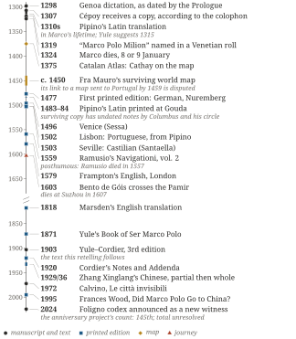

# Chapter III-11
## Afterlives: Maps, Columbus, and the Making of a Witness

> *“…he bethought himself that it would be a very great pity did he not cause to be put in writing all the great marvels that he had seen, or on sure information heard of, so that other people who had not these advantages might, by his Book, get such knowledge.”*
> — Marco Polo, Prologue, preamble (Yule–Cordier)
>
> *“…all the pavement of the Palace, and the floors of its chambers, are entirely of gold, in plates like slabs of stone, a good two fingers thick…”*
> — Marco Polo, Book 3, ch. 2 (Yule–Cordier)

**[reception]**

---

### A world on parchment, 1375

Open the painted sheets in the French royal library and look for the places the Venetian wrote about. The Catalan Atlas is dated to 1375 and associated with the Majorcan workshop of Cresques Abraham [1]. On its western panels, coastlines and the radiating lines of the compass give a sailor a way of recognising something he can use. Follow the sheets to the east and there are traders on land, rulers, mountains and waters for which the man looking at his compass would need other people’s testimony. Here a name from Polo’s book can take its place on the same piece of parchment as a crowned man whose rites and possessions no one in the workshop has ever seen.

Yule picks out Cathay (North China), Carajan (Yunnan), Mien (Burma) and Bangala (Bengal) in the Atlas [2]. A caravan inscription goes from Sarai to Cathay [3]. You can follow it along in the order in which its author sets down the places without knowing which travellers told him how to go. The maker of the sheet has managed to put a road where a reader can find the places along it and see something of their neighbours. Think how that changes a story about travelling from one kingdom to the next. A reader holding one place in mind can ask how it sits beside a place that comes much later in a book.

— The lines and the names make a tempting invitation to see one man’s journey on the page. Look a little longer at the very different kinds of knowledge placed beside each other. A place a pilot knows by a turn in a coast can sit next to a place a reader has only heard someone name [4].

There are ways of finding the Book in a house as well as on a map. An inventory can put a copy in the hand of an owner, sometimes a merchant, sometimes a reader at court or in a religious house. Gadrat-Ouerfelli finds that evidence for several kinds of ownership, and a different set of traces of what people actually used: maps, histories and religious writings [5]. On the painted sheets we have been looking at, we can see something another maker did with the material. With an inventory by itself the next question is what the reader made of the book after it came into the house.

### A friar’s map and a traveller’s book

By the middle of the fifteenth century, a broad circle of parchment could make fit an even larger stock of things travellers had told people in Venice. Fra Mauro’s surviving map is crowded with writing. To see what a place means to the man who put it there, you may have to go nearer and read. It has an early depiction of Japan under a name related to Polo’s Chipangu (Japan) [6]. A record of 24 April 1459 mentions that a map in the Portuguese commission has been sent away. Scholars disagree about how that map relates to the one that survives in the Marciana [7]. A date we can put on the despatch of an object belongs to the history of making maps. It leaves open what happened to the particular parchment someone finished lettering.

In later maps, old names could be moved to make room for new reports. In one sixteenth-century example Yule follows the name of Polo’s Pulisanghin, his river near Cambaluc (Beijing), very far north, draining into the Arctic under a changed spelling [8]. Take a map with a place called China and another one called Cathay. A man with two accounts he thinks he should respect can put the names in two places. Yule sees that happening when mapmakers add information reaching them by the Portuguese routes [9]. Set their labels on a map and the words look as if they have been given more certainty than ever. Some of the practice of reading them consists in working out which ones have moved.

### Print and the Admiral’s margins

In 1477 the book comes out in German at Nuremberg. A customer can buy a printed account even though no knight has brought him one from Venice. An Augsburg reprint follows in 1481 [10]. Then, between 1483 and June 1484, Gerard Leeu prints the Latin translation by Francesco Pipino at Gouda [11]. For the reader who can manage Latin and has a purpose of his own in opening it, a book made current by a Dominican now has the reach of a printer’s stock.

By 1496 a Venetian edition is available, printed by Giovanni Battista da Sessa. A Portuguese version appears at Lisbon in 1502, along with Niccolò de’ Conti’s travels [12]. In Seville in 1503, Rodrigo de Santaella’s Castilian makes the work available in yet another language [13]. Someone whose bookseller has kept the two travellers together in one volume can read an account of a port and then turn to ask what a different traveller makes of it. A person with the Latin in one hand and the Castilian in the other has a different comparison to make. Names and whole passages have had a life between the people who first wrote them and the people now paying for them at a shop.

In Seville there is still a copy of Leeu’s Latin with notes associated with Christopher Columbus and others in his circle. Handwriting as well as print has to be read when the book is opened [14]. Take the page that sends us to Chipangu. Juan Gil identifies notes on its gold and rose-coloured pearls as Columbus’s. The subject catches the eye at once. Polo makes the floors of the palace plates of gold two fingers thick. A reader can find that claim on the page and the report of precious goods marked in the margin [15]. You could take the book into your hands today and see that these two subjects mattered to the man making the marks. It is quite a different matter to see the instant at which he decided to put them down.

A letter from the merchant John Day in 1497–98 mentions a Polo book for the Admiral. Gil thinks it is the surviving copy in Seville and that we may be able to date the reading by the letter. Day’s words leave the book’s identity open [16]. The uncertain date matters if we want to know what Columbus had read when he was asking people to pay for his voyage. One can follow what he thought a reader should mark without being able to follow the ink back to 1492.

— Read alongside a man drawing attention to gold and pearls and you may be tempted to shut the book once the valuable things have turned up. In the same chapters there are other things a captain, a buyer or a man looking for converts might want. The marks give us one reader’s choices, with the dates still to be found [17].

In 1532 Polo is printed in the *Novus Orbis*, an anthology in which a reader can go from these journeys to others [18]. In 1559 the second volume of Giovanni Battista Ramusio’s *Navigationi et viaggi* appears after his death. There you can read about the travellers who came home to Venice and were scarcely known to their kin, as well as the work of a man who brings different sources together into Italian [19]. His book makes the company of travellers larger again. If you want to know how the same story moved from manuscript to manuscript, you have to keep a place open on your table for the words before he assembled them.

In 1579 John Frampton’s English version is printed in London. Marsden traces it to the Castilian [20]. A reader encountering the traveller for the first time in English would have a succession of people who had chosen words for him behind the words he now read. The English edition would still belong to the fortunes of Rodrigo de Santaella’s work, even if the buyer knew none of the books that Frampton had open before him.

### An overland test, 1603–07

Matteo Ricci reached his identification of Cathay with China before Bento de Góis made his way from India overland [21]. The route to a place a book has named can matter even to people who can get there another way. If the merchants coming from Central Asia mean the same country by Cathay that someone reaching the southern ports means by China, then traces of the two journeys can meet on the same ground. It has taken readers with different languages and different routes before them to be in a position to test it.

Góis crossed the Pamier (Pamir Plateau) late in the autumn of 1603. He reached Suzhou, where he died in 1607 [22]. Go back to the maps that gave Cathay a country of its own beyond China and think about the problem from the ground. A merchant can meet another party and find out where it is going, and the people with a chart back in Europe can ask what he found. Revising a name on the chart is an afternoon’s work once the news is in. Getting close enough to ask the man who knows what the name means can take years.

Readers had already begun to make a case for or against the man behind the book. The Jesuit Gabriel de Magalhães set out reasons for the traveller’s presence in China in a work published in 1688. In 1747 the geographer John Green drew attention to the lack of an account of the Great Wall [23]. What could a traveller see that someone reading after the fact expects to hear about? Agreement on where Cathay lay gives people a better idea what evidence to seek. It gives them no easy way to decide which things someone living in that country would have put into a book.

### Editors and readers in two centuries

In 1818 William Marsden publishes his English edition. Then comes Henry Yule’s in 1871, and later Henri Cordier’s additions [24]. Open Yule on a place where the traveller is hard to follow. There may be a paragraph of travel and several pages of people who came afterwards, people who came before, and people with a map who think somebody has heard the name wrong. The edition has room for a reader who wants to make a different journey from the one the author imagined. It also has the limits of the sources Yule and Cordier could consult. A confident judgement at the bottom of a page can give us a route to a book they used and leave the judgement itself very much in question.

There is a difference between asking for the best identification of a name and asking which copy a name is in. Benedetto’s edition in 1928, the comparison of witnesses by Moule and Pelliot in 1938 and Pelliot’s later *Notes* give readers different parts of the latter work as well as evidence about the places themselves [25]. If a phrase appears in two known versions and in a third it can be different again, a scholar with three books open can ask a question that the owner of one beautifully printed volume may never have noticed. The question can be about the whole episode, or it can turn on a few letters.

The traffic between readers is not all westward. Ma Xiaolin describes Zhang Xinglang’s partial Chinese translation of 1929 and complete translation of 1936, and Feng Chengjun’s annotated translation of the same year [26]. In 1941 Yang Zhijiu published his comparison of a Chinese notice about three envoys with the return voyage. The notice named people whose names could be compared across languages. The question of what it says about the people travelling with those envoys is a separate one [27]. That piece of scholarship went into discussion with the Persian evidence through later work. An editor can take the match of names seriously and still have to put the name of a source alongside each one he is comparing.

The space in which people have used the Book has room for other kinds of attention. In 1972 Italo Calvino gives Marco and the Kaan a new occasion to talk in *Invisible Cities* [28]. The two men are there by the time a reader opens it. What they can say to each other is the novelist’s, after centuries in which mapmakers, travellers and readers had found different things to do with the same pair. A title that can be picked off a shelf beside the traveller’s book has become a way to imagine what could happen when someone tries to tell a ruler about a city the ruler has never seen.

### A question in public, 1995

Frances Wood’s *Did Marco Polo Go to China?* made the question the title of a book in 1995. One strand was the absence of the Polos’ names from the Chinese and Persian records cited in connection with the family’s escort of Cocachin [29]. The question had a life well beyond the manuscripts. Igor de Rachewiltz replied in 1997. Stephen Haw examined the chronology and routes in 2006. Hans Ulrich Vogel turned to the particulars of money, salt and revenues in 2013 [30]. When someone takes a question out of a specialist journal and puts it where any reader can ask it, the replies need to show why an argument over a tax or a title can do more than settle a small point. The argument is taken up in [the closing essay](ch-12-reliability-essay.md#the-frances-wood-debate-and-principal-replies).

A reader following the work of editors can now use the edition of the Venetian V text published in 2019 and the recent facsimile of the Sessa printing. The digital critical edition in progress sets out to reconstruct the early work through several witnesses [31]. That changes what a reader can ask about the history of a sentence. Someone who comes for an account of a long-vanished court may find that it matters which of two familiar details was carried by which text, and when an editor put the two together.

In 2024, Venice’s Palazzo Ducale set out the traveller’s worlds in an exhibition. Anyone going to see those objects could ask anew what makes a good piece of evidence for a man who left very little in his own hand. The project working on his documentary record and the work of making new editions give different paths through the material [32]. That September, the anniversary project announced a manuscript found in Foligno, describing it as the 145th known codex in its census at the time [33]. A headcount for the surviving books can change because a person has looked again at a volume that had been under a librarian’s care for years.

To see what the books can tell us about the traveller, open the first page again where it promises to distinguish what he saw from what he heard.

---

## Notes

[1] ✓ The Atlas is associated with the Majorcan workshop and was later in the French royal library. Yule discusses the manuscript kept in Paris, with Cordier’s reference to the study of the atlas of Charles V [@liscak2018atlas; @yc, Introduction § 84].

[2] ✓ Yule lists these names and prints a reproduction of part of the map. His estimate of how far Polo supplied its information is an interpretation of the names and drawings [@yc, Introduction § 84].

[3] ✓ The caravan legend is part of the Atlas. It supplies neither named Polos nor an identified party of historical travellers in the particular scene [@liscak2018atlas].

[4] ~ The Atlas sets information from several routes and traditions together. The identification of individual contributions calls for comparison of each part [@liscak2018atlas; @yc, Introduction § 84].

[5] ✓ Gadrat-Ouerfelli examines ownership and gives examples of identifiable uses. She finds that the surviving evidence for merchant ownership does not by itself establish commercial use [@gadrat2024read, pp. 201–211].

[6] ✓ Fra Mauro gives an early named depiction of Japan. The surviving map dates broadly to the middle of the fifteenth century [@yc, Introduction § 85; @liscak2018atlas].

[7] ? The despatch is dated 24 April 1459 and concerns the Portuguese commission. The relationship to the surviving map remains disputed in the literature [Falchetta’s study of the two maps](https://www.cini.it/wp-content/uploads/2013/01/201103101000.pdf).

[8] ✓ Yule identifies the Polisacus on a map of 1522 as the river named Pulisanghin in the Book. Its depiction as flowing into northern waters is one of the displacements he describes [@yc, Introduction § 85].

[9] ~ Yule follows the survival of a separate northern Cathay alongside information about China in a series of maps. He treats it as one of the effects of fitting new and inherited information together [@yc, Introduction §§ 85–86].

[10] ✓ The German edition was printed at Nuremberg in 1477 and reissued at Augsburg in 1481. Cordier gives a description of the editions [@yc, vol. 2, Appendix H].

[11] ✓ The catalogue dating for the Latin printing by Gerard Leeu is 1483 to 11 June 1484. The text in that edition is Pipino’s Latin [@polo1484consuetudinibus].

[12] ✓ Cordier lists the 1496 Venetian and the 1502 Portuguese editions. The Lisbon book includes Niccolò de’ Conti [@yc, vol. 2, Appendix H; @polo2024sessa].

[13] ✓ The Castilian edition of Rodrigo de Santaella appeared in Seville in 1503. Cordier also records the later reprint at Logroño [@yc, vol. 2, Appendix H].

[14] ✓ The surviving copy is in the Biblioteca Colombina, Seville. Shawcross describes the annotations by Columbus and others in his circle [@polo1484consuetudinibus; @shawcross2023materiality].

[15] ~ Gil assigns the gold and red-pearl notes on fol. 57v to Columbus. The Book’s measurements and description of the palace are given in the base text of the Chipangu chapter [@gil2006marcocristobal, p. 30; @yc, 3.2].

[16] ? Gil relates John Day’s letter to the Seville copy and argues for a particular period of reading. The reference in the letter leaves the identification open [@gil2006marcocristobal, pp. 25–27, 30–34; @larner1999marco, ch. 9].

[17] ~ Shawcross finds a concentration on material things in the Admiral’s notes. Their date and sequence remain uncertain [@shawcross2023materiality; @gil2006marcocristobal, pp. 25–27, 30–34].

[18] ✓ Cordier lists the 1532 Basel *Novus Orbis* among the printed sources of the Book. A Paris edition followed that year [@yc, vol. 2, Appendix H].

[19] ✓ Ramusio died before the second volume appeared in 1559. The edition includes his preface and a composite version of the text [@ramusio1559navigationi; @ramusio2015viaggi; @yc, vol. 2, Appendix H].

[20] ✓ Cordier lists Frampton’s English version of 1579 and gives Marsden’s identification of its Castilian source. The exact Castilian impression is left between the Seville and Logroño editions [@yc, vol. 2, Appendix H].

[21] ✓ The studies describe Ricci’s identification of Cathay with China and the sequence leading to the overland mission. Ricci had already reached that view by the time Góis set out [@feng2006cathay; @hosne2018cathay].

[22] ✓ Yule places Góis on the plateau late in 1603. The studies of the mission give his death at Suzhou in 1607 [@yc, 1.32 n. 2; @feng2006cathay; @hosne2018cathay].

[23] ✓ Gadrat-Ouerfelli discusses these early arguments and the publication dates. They show the question of testimony was disputed long before the twentieth-century debate [@gadrat2026marco].

[24] ✓ Cordier lists Marsden’s 1818 edition and describes the bibliography of the English editions. Yule’s first edition dates to 1871 and Cordier’s work revises and extends the annotations [@yc, Prefaces; @yc, vol. 2, Appendix H].

[25] ✓ The editions and comparative works give different ways to follow the written witnesses and their place names. Larner surveys the collaboration and how the earliest texts were studied [@benedetto1928milione; @moule1938description; @pelliot1959notes; @larner1999marco, chs. 3, 6].

[26] ✓ Ma gives the dates of Zhang Xinglang’s translations and of Feng Chengjun’s annotated translation. The dates are given through that study [@ma2025chinese].

[27] ✓ Ma discusses Yang’s 1941 study and the comparison later made by Cleaves. Neither the Chinese notice nor the Persian record names the Polos, as Jackson notes. See [Chapter III-9](ch-09-cocachin-return.md) for the embassy [@ma2025chinese; @jackson1998travels, pp. 98–99].

[28] ✓ Calvino’s book was first published in 1972. The exchanges between Marco and the Kaan are part of its fiction [Bibliothèque nationale de France bibliography, p. 4](https://www.bnf.fr/sites/default/files/2023-10/Bibliographie_Italo_Calvino.pdf).

[29] ? Wood argues that the absence of the family’s names from the eastern records is significant. The question of the strength of that argument is taken up in the following essay [@wood1995did, conclusion; @jackson1998travels, pp. 98–99].

[30] ✓ De Rachewiltz, Haw and Vogel address the case with different historical and philological material. Vogel’s treatment of money and salt gives one way of examining the particular claims of the Book [@derachewiltz1997marco; @haw2006marco, ch. 4; @vogel2013marco, ch. 1].

[31] ✓ The edition of V, the facsimile of the 1496 printing and the developing critical edition make separate contributions. The digital project explains its approach to the witnesses [@simion2019devisement; @polo2024sessa; @simion2024integral].

[32] ✓ The Palazzo Ducale exhibition ran from 6 April to 29 September 2024. Recent documentary and editorial work includes editions of the records and manuscript studies [@curatola2024mondi; @formentin2024codice; @orlando2025novita].

[33] ✓ The *Le vie di Marco Polo* project announced the Foligno witness, Jacobilli A.II.9, on 6 September 2024. The number is its reported census total at the time [project announcement](https://leviedimarcopolo.it/en/node/6038).
