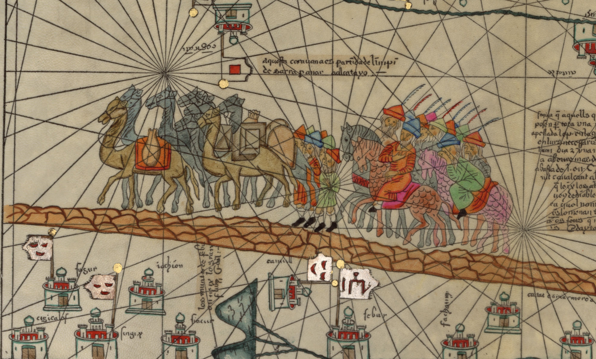

# Chapter III-12
## Closing Essay: Reliability, Silence, and the Art of the Book

> *“And we shall set down things seen as seen, and things heard as heard only, so that no jot of falsehood may mar the truth of our Book…”*
> — Marco Polo, Prologue, preamble (Yule–Cordier)

**[reception]**

---

The promise on the Book’s first page distinguishes two ways of knowing something. Marco saw some of it with his own eyes and heard the rest from people he thought credible [1]. A good deal hangs on that pledge. The Book gives scarcely any space to the merchants or pilots who told him the name of a harbour, yet devotes whole pages to the harbour itself. Whenever firsthand sight and second-hand report blur on the page, the historian has to ask both what the claim is worth and what a traveller in Polo’s shoes could actually have known. Separating eye-witness observation from table-talk is the first task of any critical reader.

{#fig-atlas-caravan}

### What kind of book *Il Milione* is

A Venetian merchant told what to buy at one end of a journey could still be surprised by what he found himself selling at the other. The Book’s eye for that practical gap is often razor-sharp. It asks who claims a tenth from pearl divers, why Arabian warhorses fetch silver fortunes across the sea, and what a ruler does when a stranger tries to spend metal coin where only stamped paper passes [2]. Think how many questions you would ask a factor promising to carry a bolt of silk to the next city: how the roads are guarded, what customs tolls are levied at the gate, and what coin the local moneychanger accepts. Trade intelligence fills chapter after chapter without ever pausing to describe the face of the man who carried the ledger.

The claim to have served a Mongol sovereign changes what enters the record. The Prologue brings a Venetian family to Cublay’s court, assigns young Marco official errands of his own, and makes his sharp eye for local marvels the very reason the emperor kept sending him abroad [3]. That framing tells us whose business the traveller believed he was conducting, even if it seldom follows him to bed at night. Service that collects reports on horseback or aboard ship can explain a vast store of administrative knowledge while still leaving open whether Marco personally witnessed every episode he narrates. A courier or commissioner hears as much in post-stations and governors’ halls as he sees along the road.

Another kind of craft takes over whenever a prince addresses troops before battle or a one-eyed cobbler steps before a congregation. Rustichello of Pisa already knew how to build chivalric scenes before he gave this Venetian a voice [4]. When a merchant with raw facts collaborates with a romance writer who knows when to let a king speak, both skills serve the Book. Separating their hands sentence by sentence is rarely possible—yet we can still watch how a dry report changes shape once it acquires a set speech, a dramatic challenge, or a courtly duel.

### Method: visited, reported, mixed; manuscripts; the Ramusio problem

Start by asking who would have needed to stand on the ground for a passage to hold true. A court steward knows the exact order of a banquet because he works inside the hall every day; a visitor can learn that order from the steward over dinner. When the Book places Marco himself at the scene, however, we face two separate claims: one about the ceremony, and one about Marco’s presence. Both deserve separate weighing. Different strands of testimony often tangle within a single chapter—such as when practical notes on Chinese hulls sit right beside an island cluster the Book expressly places beyond Marco’s own reach [5].

Next, ask whose manuscript hands you the sentence. Franco-Italian F, Pipino’s Latin, Venetian V, the Zelada Latin, and Ramusio’s sixteenth-century print diverge materially on names, numbers, and whole scenes. All descend from a work set down with Rustichello in Genoa in 1298 [6], during a captivity Ramusio links with the sea battle of Curzola while Jacopo d’Acqui places an earlier capture at Ayas in 1296 [7]. A variant can preserve an early reading lost elsewhere, introduce a later gloss, or reflect a translator’s tidy hand. Knowing that Yule took a passage from Ramusio traces that text back to 1559; settling whether it stood in the earliest Book requires comparing independent witnesses [8]. Samara’s camp in Book Three—plain wooden palisades in F and V, versus wide ditches and five towers in Zelada and Ramusio—shows what hangs on keeping versions apart [9]. Folding two witnesses silently into one scene hides the very seam where a later hand expanded the text.

### Hits: where the Book proves stubbornly right

Coal as black burning stone and stamped mulberry-bark paper money caught Polo’s eye because both answer questions any householder or trader asks at the market stall. The Book explains how official seals turn bark notes into legal tender across an empire. Hans Ulrich Vogel sets those details of manufacture, issue, and denominations directly beside surviving Yuan fiscal records, finding a remarkably tight fit [10]. The imperial postal relay and its requisitions likewise describe an institution from the perspective of a rider who knew what horses and rations a golden tablet could demand [11].

Along the coast, Ramusio’s version of the Book describes how a skipper can use compartments to limit the damage when water comes into the hull. The thirteenth-century wreck excavated at Zayton (Quanzhou) indeed carried twelve bulkheads and thirteen compartments, though Jeremy Green notes that limber holes along the keel complicate any claim of hermetically sealed holds [12]. Checking each structural feature gives a sharper picture than declaring the whole passage verified at a stroke. Inland at Chandu (Shangdu), excavated triple enclosures and court histories give Stephen Haw solid ground for taking the palace and park seriously, even though the exact bamboo cane pavilion Polo describes has left no identified trace [13].

The Cocachin embassy offers a different kind of check. Rashīd al-Dīn independently records Argon’s envoys delivering the Mongol princess to Abhar for her marriage to Ghazan [14]. A Chinese notice preserved in the *Yongle dadian* records 1290 preparations for three named envoys matching Oulatay, Apusca, and Coja—yet as Peter Jackson stresses, neither the Persian history nor the Chinese notice names a single Polo [15]. Meanwhile, Yang Zhijiu’s inference of a late-1290 or early-1291 sailing diverges from Yule’s early-1292 monsoon reckoning [16]. Knowing precisely which pieces check out gives both the confirmation and the silence their true weight.

Even apparent hits demand caution when similar names collide. In comparing the Book’s account of Ahmad’s assassination in 1282 with the Chinese records, E. H. Parker called attention to an official whose name was read as Polo. The man was Bolad, who had already received honours before the Polos’ conventional arrival in 1275 [17]. An episode’s historical core can survive even when personal links shift.

### Misses and silences

When the Book claims a ruler’s palace in Chipangu (Japan) was paved with gold plates two fingers thick, a reader can test the report directly. When the Book omits something altogether, we must ask both whether a man in Polo’s position would have seen it and why his Book would have recorded it. Tea was an everyday drink across China, and Odoric of Pordenone later noticed women’s bound feet—two omissions Frances Wood presses hard [18]. Yet silence depends heavily on company, itinerary, and what a merchant in male court and garrison circles thought worth dictating to a romance writer in Genoa.

The Great Wall poses a sharper test. The continuous brick-and-stone rampart familiar today belongs largely to the later Ming dynasty. Wood grants that earlier earthen walls are harder to picture, yet argues a traveller crossing northern passes should still have noticed them; Igor de Rachewiltz replies that no continuous Great Wall of the modern kind then stood to be seen [19]. Any argument from silence must measure itself against what actually stood along thirteenth-century roads, rather than projecting sixteenth-century stone battlements backward onto Kublai’s frontier.

Place-names pose a parallel puzzle. Many Chinese cities enter the Book in Persian or Mongol dress rather than Chinese syllables—which Wood reads as evidence of a Persian-language guide or source used west of China, while defenders point to the Persian-speaking court circles and interpreters an author heard [20]. Sparse Chinese personal names across the Book remain a real feature that any account of Marco’s linguistic world must explain, pointing us toward Persian-speaking administrators and Mongol garrisons rather than Confucian scholars.

| Claim | Evidence | Verdict |
|---|---|---|
| Yuan paper money and the post | *Chao* paper-money records, Vogel’s monetary audit, and *yam* relay parallels in [II-5](../vol-2/ch-05-ahmad-paper-coal.md) | ✓ Strong fit at the level of practice |
| Cargo compartments | Excavated 1974 Quanzhou wreck (twelve bulkheads, thirteen compartments) and Green’s limber-hole study in [III-1](ch-01-ships-chipangu.md) | ✓ Construction supported, perfectly sealed divisions qualified |
| Yanju office | *Seingneurie* vs. *séjourna* manuscript variants and local *Yuan shi* / gazetteer silence in [II-11](../vol-2/ch-11-yanju-saianfu.md) | ? The particular office remains unconfirmed |
| Saianfu engines | *Yuan shi* (1268–73 siege, Alawating and Ysemain) and Rashīd al-Dīn against 1275 arrival in [II-11](../vol-2/ch-11-yanju-saianfu.md) | ✗ The Polos’ role clashes with the chronology and named engineers |
| Kinsay bridge count | Mascherpa’s reported Chinese comparison (347 bridges, 35 *li*) against 12,000 in [II-13](../vol-2/ch-13-kinsay.md) | ~ Counts may describe different scopes and dates |
| Chipangu | 1274 and 1281 Mongol invasions and Takashima wrecks against Fujian gold-palace rumour in [III-1](ch-01-ships-chipangu.md) | ✓ Campaigns; ~ the palace as reported wonder |
| Cocachin | Rashīd al-Dīn’s Abhar marriage account and 1290 *Yongle dadian* envoy notice (no Polos named) in [III-9](ch-09-cocachin-return.md) | ✓ The embassy; ? the role of the Polos |
| Tea, foot-binding and the Wall | Ninth-century tea notices, Odoric on bound feet, and pre-Ming earthen wall chronology across [II-2](../vol-2/ch-02-person-palace.md) and [I-11](../vol-1/ch-11-lop-tangut.md) | ? Their force depends on what the traveller could have seen and chosen to tell |

### Famous stress-points

Yanju (Yangzhou) exposes how hard it is to pin Marco to a specific imperial post. One textual tradition claims he governed the city for three years; Wood adopts Yang Zhijiu’s reading of a mere stay and asks why local gazetteers never mention even a foreign resident [21]. De Rachewiltz rules out a full governorship in favour of a temporary commission, while other scholars propose a privileged merchant partnership, membership in the imperial household guard (*kesig*), or routine imperial errands [22]. Each hypothesis places Marco in a different relation to the city; none settles his exact office at Yanju.

At Saianfu (Xiangyang and Fancheng), the Book credits the Polo family with building counterweight trebuchets that broke the siege. Heavy siege engines and stone shot are genuine history—yet Yuan records name two Muslim engineers brought from the Islamic west, and the city fell in 1273, two years before the Polos’ conventional arrival at court in 1275 [23]. Here chronology and named records flatly contradict the family’s personal claim, showing how easily a famous siege story could attach itself to the narrators’ own name.

Numbers create stress-points of their own. A merchant needs to know how cargo barges cross Kinsay (Hangzhou); a storyteller praising the world’s grandest city easily rounds its bridges to twelve thousand. Giuseppe Mascherpa sets beside that figure comparative Chinese counts of 347 bridges and a 35-*li* circuit, while leaving exact boundaries and dates open for verification [24]. War figures stretch similarly: two Mongol invasions of Chipangu and a devastating typhoon are solid history (Morris Rossabi), whereas Marco’s tale of marooned troops capturing an island capital under seized banners supplies dramatic narrative numbers that external records do not confirm [25]. In each case, the underlying event holds firm while the round numbers swell to fit a grander tale.

### The Frances Wood debate and principal replies

Frances Wood’s 1995 challenge weaves these stress-points into a cumulative case: the absence of Polo names from Chinese and Persian embassy records, Persianised place-names, the impossible Saianfu siege claim, the unverified Yanju office, and glaring omissions such as tea, foot-binding, and the Great Wall [26]. Her alternative—that Venetians gathered eastern lore around the Black Sea or in Persia without reaching China—raises a serious question about how information travelled across Mongol Eurasia, though it works better against specific personal boasts than against the Book’s dense practical detail. A compiler in a Black Sea counting-house could easily pick up tales of golden roofs or wondrous trebuchets along caravan inns; explaining how he assembled coherent tax ratios, salt-monopoly figures, and provincial relay distances is far harder.

Replies came on three distinct fronts. Igor de Rachewiltz countered in 1997 and followed in 2002 with a paper that challenges the Great Wall objection and leaves a temporary inspection post at Yanju as a possibility [27]. Stephen Haw tested routes, fauna, and chronology in 2006, showing how tightly much of the northern and southern itinerary fits Yuan geography even where offices remain obscure [28]. Hans Ulrich Vogel’s 2013 study of Yuan paper currency, salt monopolies, and tax units narrowed the alternative still further: no armchair compiler in Venice or Tabriz could easily have fabricated such coherent fiscal detail [29]. Taken together, these three replies shift the burden of proof back onto any theory that keeps the Polos west of the Pamir, setting the stage for the last decade of manuscript and archival work.

Recent surveys by Pasquale Orlando, Ma Xiaolin, and Christine Gadrat-Ouerfelli situate the argument within centuries of doubt and recovery, leaving growing room for memory, dictation, and multilingual transmission [30]. A traveller can truly have ridden across China and still misdate a siege he heard about at court. Even firm proof of Marco’s presence in Yuan China still leaves half the Book’s wonders to account for—whether through court hearsay, sailors’ yarns, or Rustichello’s storytelling polish. Put every confirmed detail on one side of the desk and every blunder on the other, and the historian must still explain why the evidence is so strong for Marco’s presence in Yuan China yet so brittle on his personal roles. In that tension between verified fiscal detail and fragile personal claims lies the real puzzle of how the *Book* was made.

### Comparative travellers as control panel

Setting Marco beside contemporary travellers sharpens what belongs to him alone. William of Rubruck enters a Mongol camp as a Franciscan envoy, tasting mare’s milk for the first time and recording his own reaction—giving us a fixed witness against whom Polo’s court scenes can be measured [31]. Both men look at the same fermented drink, yet each notices what his own mission makes urgent: the friar records his private disgust and theological debates, while the merchant tracks ceremonial etiquette and herds. A generation later, Odoric of Pordenone describes magical banqueting cups rising through the air at court, offering a parallel performance without requiring the same entertainer, patron, or year [32]. Ibn Baṭṭūṭa’s Arabic travels describe ocean shipping at Calicut and Zayton, yet offer text-specific ship portraits rather than an archaeological cross-section of hull bulkheads [33]. Rashīd al-Dīn gives us the Persian court’s own memory of Cocachin’s marriage, though identifying his unnamed escort companions with the Polos remains John Andrew Boyle’s conjecture rather than Rashīd’s text [34]. Comparing independent witnesses side by side reveals where outside accounts genuinely touch Marco’s road—and where editors must resist filling in missing names.

### Principles of this retelling

Retelling lets a modern reader linger beside a pearl diver, a horse-broker, or a customs clerk before asking how much historical weight the scene can bear. Shepherds, sailors, and palace stewards each have their own business on the page, and their prices, taxes, and sea-winds deserve close attention before we reach for a verdict. Even when a story turns on marvels—a walled tower of gold or a martyr’s red earth—the Notes lay competing accounts beside the text at the exact moment provenance matters. A reader can enjoy the theatre of a court banquet without mistaking Rustichello’s flourish for a fiscal audit, or a mariner’s yarn for a harbour ledger.

This edition takes Yule–Cordier as its English base and checks disputed passages against Franco-Italian F, Pipino’s Latin, Venetian V, and Ramusio. It keeps the western Mongol wars alongside the imperial story in Volume II and gathers the sea-return into Volume III [35]. Explaining that structural choice plainly matters: reading the voyage home in one unbroken sweep can hide how scattered those chapters stood in medieval manuscripts, where the Prologue’s return voyage sat far away from Book Three’s Indian Ocean ports. Keeping the scaffolding visible lets readers follow both the narrative arc and the documentary seams beneath it.

### Open questions for future notes

Four live questions remain open for future scholarship, each tying a detail in the chapters back to how the *Book* was written and transmitted:

First, which passages in Ramusio preserve lost early material, and which grew during sixteenth-century editing? Samuela Simion’s ongoing critical edition and Giuseppe Mascherpa’s work on a fuller Zelada relative behind Ramusio sharpen that textual test, reminding every reader how much depends on manuscript stemmata [36].

Second, what languages did Marco actually command? Luo argues for Persian fluency, Haw doubts even Persian, and Gadrat-Ouerfelli reports Christopher Atwood’s case for partial Chinese—leaving the Polos’ linguistic toolkit one of the liveliest open debates in the field [37].

Third, where do itineraries across Persia, south-west China, and Chamba trace Marco’s own saddle, and where do they stitch together regional reports gathered from fellow merchants, pilots, and court officials [38]?

Fourth, which geographical puzzles spring from scribal misreadings—as Paul Pelliot and Alvise Andreose argue for *Madeigascar*—and which spring from mismatched counting units, as at Kinsay [39]?

The Book keeps its wonder intact when we give every marvel the exact foundation—seen, heard, or misremembered—on which its teller asked us to believe it. Only by holding wonder and evidence together in the same hand can we read Marco Polo fairly today, seven centuries after he first dictated his memories in a Genoese prison.

---

## Notes

[1] ✓ The distinction is explicit in the Prologue, as is the claim that trustworthy informants supplied the things Polo did not see. The pledge provides a standard against which to examine the work itself [@yc, Prologue, preamble].

[2] ✓ Larner and Critchley discuss the work’s composition and readership. The examples come from the chapters on the fishery, horse imports, paper money and the roads [@larner1999marco, chs. 6, 9–10; @critchley1992marco; @yc, 2.24–26; @yc, 3.16–17].

[3] ~ The Prologue describes Marco learning, observing and reporting in the service of the Kaan. The historical question of the nature of that service is addressed under “Famous stress-points” [@yc, Prologue 15–16].

[4] ✓ The Book names Rustichello. Larner and later scholarship discuss the collaboration and the literary experience Rustichello brought to it [@yc, Prologue, preamble; @larner1999marco, ch. 3; @andreose2024textual].

[5] ✓ The book’s account of ships is followed by reports about islands. It expressly says Marco was never in the outlying Sea of Chin region [@yc, 3.1–4].

[6] ✓ The Prologue dates the writing in Genoa to 1298 [@yc, Prologue, preamble; @andreose2024textual]. All surviving manuscript branches look back to that Genoese composition as their starting point.

[7] ~ Curzola is Ramusio’s tradition; Jacopo d’Acqui gives Ayas under 1296, often treated as a confusion with the 1294 battle. See [I-1](../vol-1/ch-01-genoa-prison.md) [@yc, Introduction §§ 36–38; @bolognari2024chronica].

[8] ✓ Comparing independent witnesses limits what a printed version can tell us about earlier forms. Yule, the Moule–Pelliot edition, and recent studies trace how early redactions and clerical Latin diverged from vernacular exemplars; Simion also treats Ramusio as an active editor whose choices belong to the transmission history [@yc, Introduction §§ 89–90; @moule1938description; @gadrat2022dominicans; @simion2018ipertesti, pp. 9–30; @simion2024integral].

[9] ✓ F and V describe wooden defences. Zelada and Ramusio have the number of men and the ditches. See [III-3](ch-03-java-less-sumatra.md) for the details and locators [@eusebi2018devisement; @simion2019devisement; @moule1938description; @yc, 3.10].

[10] ✓ Coal use and Yuan paper money have separate historical evidence. Vogel’s monetary comparisons have particular scope in judging the Book’s account of the currency [@golas1999mining; @vogel2013marco, p. xxiv and ch. 1; @yc, 2.24, 2.30].

[11] ✓ Yule compares accounts of provision at the posts. The travel authorisations and supply of horses belong to that institution, which leaves the figures in the Book open to separate tests [@yc, 2.26; @rossabi1988khubilai].

[12] ✓ The excavation reports distinguish twelve bulkheads from thirteen compartments. Green discusses limber holes. The fuller description of moving the cargo is in Yule’s Ramusio material [@pearson2002quanzhou; @green1998quanzhou; @yc, 3.1 n. 3].

[13] ✓ Haw discusses the three-walled city and the likelihood that Polo saw palace and park. Atwood discusses the site and its court functions, and the exact building Polo describes is a separate question [@haw2006marco, ch. 5, p. 69 in the 2009 paperback; @atwood2004encyclopedia, “Shangdu”; @rossabi1988khubilai, ch. 2].

[14] ✓ Rashīd al-Dīn places the marriage of Kököchin and Ghazan at Abhar [@thackston1998rashiduddin, p. 606]. His Persian chronicle confirms both the bride's arrival from Cathay and the substitution of the son for the deceased father Arghun.

[15] ✓ Ma reports Yang’s comparison of the three Chinese envoy names from the *Yongle dadian* with Polo's barons [@ma2025chinese; @lin2017chinese]. Jackson stresses that neither the Persian chronicle nor the Chinese administrative notice names the Polos [@jackson1998travels, pp. 98–99].

[16] ? Ma attributes the late-1290 or early-1291 sailing to Yang’s inference. Yule’s reckoning gives early 1292. See [the return voyage](ch-09-cocachin-return.md) [@ma2025chinese; @yc, Introduction § 22].

[17] ✓ Parker reports that the official’s honours predate Polo’s arrival. Later discussion identifies him as Bolad. See [II-5](../vol-2/ch-05-ahmad-paper-coal.md) for the distinct accounts of the affair [@ycadd, on 2.23; @ma2025chinese; @luo2024designations].

[18] ✓ Cordier compares the tea evidence and refers to Odoric for the practice of binding feet. Wood attaches weight to these omissions [@yc, Introduction § 73; @odoric1913travels, ch. 46; @wood1995did, chs. 8, 11].

[19] ? Wood grants the distinction from the later Ming brick-faced Wall while pressing earlier earthworks [@wood1995did, ch. 11]. De Rachewiltz replies in his 2002 ANU paper that no continuous Great Wall of the familiar modern form then stood along Polo's routes [@derachewiltz2002wood].

[20] ~ The language of particular names and Polo’s competence are related questions with different evidence. See also the proposals in Note 37 [@luo2024designations; @gadrat2026marco].

[21] ? Wood attributes the reading of a stay to Yang and argues that a stay by a foreigner should still figure in the gazetteers. The record gives the city a context for trade and administration without identifying a Polo governorship [@wood1995did, ch. 15; @yc, 2.68; @theobald2024military].

[22] ? The suggestion of a temporary inspector is a conjecture. Ma reports the privileged-partner argument, the 2024 household-guard study makes a separate case, and the Prologue provides the picture of service on imperial missions [@derachewiltz2002wood; @ma2025chinese; @haw2024kesig; @yc, Prologue 15–16].

[23] ✗ The Yuan record names the engineers; Yule prints the competing accounts of their origins and places the family’s court arrival about 1275. See [II-11](../vol-2/ch-11-yanju-saianfu.md) [@yuanshi1370, juan 7–8, 203; @yc, 2.70 n. 5; @yc, Introduction § 19; @wood1995did].

[24] ~ Mascherpa offers the comparison (35 *li* and 347 bridges, the latter from A. C. Moule) beside Yule's earlier *Hangzhou fuzhi* 35-*li* note and G. E. Moule's department and city bridge counts, and discusses how the Book’s figures might have arisen [@mascherpa2024quinsai, p. 138; @yc, 2.76 n. 2; @moule1957quinsai]. A. C. Moule's pages and the areas covered by the underlying Chinese gazetteer counts remain uninspected directly.

[25] ~ The two campaigns and the storm in the second are discussed by Rossabi. The number of survivors and the occupation are particulars of the Book that the comparison does not independently establish [@rossabi1988khubilai, chs. 4, 8; @yc, 3.2–3].

[26] ? Wood develops the challenge across the work, with the Wall and Yanju in chapters 11 and 15. The documentary scope of the bride’s embassy is independently discussed by Jackson [@wood1995did, chs. 8, 11, 15 and conclusion; @jackson1998travels, pp. 98–99].

[27] ✓ The 1997 reply precedes the later paper. The specific positions described here come from the 2002 text [@derachewiltz1997marco; @derachewiltz2002wood].

[28] ✓ Haw’s study tests the geographical and historical case. See his specific discussion of Chandu in chapter 5 and the assessment of the case in chapter 4 [@haw2006marco, chs. 4–5].

[29] ✓ Vogel treats currency, salt and fiscal matters as evidence about the origin of the Book’s particulars. His introduction addresses the controversy [@vogel2013marco, p. xxiv and ch. 1].

[30] ~ The surveys cover recent scholarship from different vantage points. Gadrat-Ouerfelli traces the history of the doubts and replies, while Ma covers studies in China and Orlando reports archival and editorial work [@gadrat2026marco, §§ 18–23; @ma2025chinese; @orlando2025novita].

[31] ✓ Rubruck describes mare’s milk and his reaction in Rockhill’s translation. Polo’s offering has a separate occasion [@rockhill1900journey, pp. 62–63, 66–67, 85; @yc, 1.61 n. 7].

[32] ~ Yule compares Odoric with the feat of the cups. The comparison concerns what is reported at court, with different circumstances in each version [@yc, 1.61 n. 11; @odoric1913travels, chs. 41–42].

[33] ✓ The 1929 selection gives ship details at Calicut and later shipping at Zaytun. Those passages do not establish bulkhead construction [@gibb1992asia, pp. 234–235, 286].

[34] ? Rashīd describes the marriage in the Persian history. Identifying the unnamed companions with the Polos is Boyle’s proposal [@thackston1998rashiduddin, p. 606; @boyle1970rashidfranks, p. 66].

[35] ✓ The English base, editions of the written witnesses and Kinoshita’s translation offer different ways into the work. The arrangement of the episodes is made for this edition [@yc; @eusebi2018devisement; @ramusio2015viaggi; @kinoshita2016description].

[36] ? Simion discusses reconstruction across witnesses. Mascherpa’s reading of the fuller material in Ramusio is a proposal about his source [@simion2024integral; @mascherpa2018fonte, pp. 62–63; @andreose2024textual].

[37] ? The studies cited differ over evidence for Persian. Gadrat-Ouerfelli reports the case for possible Chinese knowledge [@luo2024designations; @haw2020hangzhou; @gadrat2026marco; @atwood2016toponyms].

[38] ? See [I-7 on Hormos](../vol-1/ch-07-kerman-hormos.md), [II-7 on the south-west](../vol-2/ch-07-tebet-carajan.md) and [III-2 on Chamba](ch-02-chamba-java.md). The choice between explanations in each case turns on a different set of route and witness evidence [@yc, 1.19; @yc, 2.45–52; @yc, 3.5 n. 2].

[39] ? Andreose discusses the name and reading in distinct witnesses. Mascherpa treats the Kinsay figures with a separate set of sources and hypotheses [@andreose2024textual, pp. 76–77; @pelliot1959notes, vol. 2, pp. 779–781; @mascherpa2024quinsai, p. 138].
