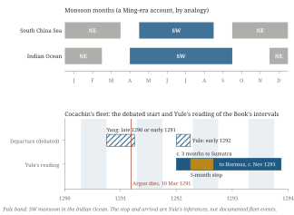

# Front Matter III-1
## The Indian Ocean World (and Why a Princess Boards a Ship)

> *“And when the ships had been equipt…”*
> — Marco Polo, Prologue, ch. 18 (Yule–Cordier)

---

::: howto
**Reading the marks.** Notes open with ✓ corroborated · ~ plausible · ✗ probably wrong · ? contested (◇ marvel or hearsay). Tags: **[V]** mostly seen or done · **[R]** mostly heard · **[M]** both · **[reception]** the Book's afterlife. A provenance label such as “Ramusio-only.” or “Ramusio-only in part.” in a Note identifies material from a later witness and defines its scope. Full key: Volume I, front matter.
:::

Volume III leaves the canal cities and takes the monsoon road. Ships of Manzi, the rumour of Chipangu (Japan), Chamba’s (Champa) coast, Java the Less’s (Sumatra) winter wait, Seilan’s (Sri Lanka) peak, Maabar’s (Coromandel) pearls, the long western shore toward Hormos (Hormuz) — and then the political errand that finally brings the Polos home: escorting the lady Cocachin for an Ilkhanid marriage. Before the chapters begin, here is the maritime weather system in plain storyteller’s talk.

Notice how Book III shifts gear from the overland road: much of what follows is report-heavy sea lore gathered from pilots and merchants rather than Marco’s own footsteps, until the return voyage in III-9 restores the autobiography. Across India and the African coast, the retelling keeps the Book’s own names — Maabar, Melibar, Abash, Madeigascar — with modern equivalents given once in brackets on first mention.

### Maritime Asia as a season, not a highway

The Indian Ocean and South China Sea of Polo’s day were not crossed by inventing a straight line on a chart and hoping. They were crossed by **monsoon logic**. Summer and winter winds reversed; captains waited in havens for the right breath; a wrong-season sailing could strand a fleet for months. When the book says the Polos wintered five months in Java the Less, that wait is not laziness — it is seamanship. Freight, diplomacy, and survival all obeyed the same calendar [1].

Ports formed a necklace more than a single empire: Zayton (Quanzhou) and the Manzi coast; Chamba on the Vietnamese shore; Malay and Sumatran polities; Seilan; Maabar and Melibar (Malabar) on India’s coasts; Gozurat (Gujarat) approaches; Kesmacoran (Makran); then the Arabian incense ports and Aden’s gate toward the Red Sea. Some of these Polo’s fleet touches; many he reports from mariners’ talk in the same shipboard evenings that fill wonder-books. Volume III is honest about that mix when the retelling keeps [V] and [R] in view [2].

Camphor from Fansur, pepper from Coilum (Quilon), pearls from Maabar, horses badly shipped to Indian courts, frankincense from Dufar — the commodities are the argument that these coasts were real even when a particular landing is soft.

### What “India” means in the book

Polo’s “India” is wider than a modern nation-state. It is a merchant-cosmology of coasts and islands stretching from the seas below China around to the western ocean approaches — pearls, pepper, horses, saints’ tombs, Brahmans, pirates, and wonder-tales included. Maabar, Melibar, Gozurat, Kesmacoran: the names arrive as a periplus, a sailing list with stories attached. Later writers (Ibn Baṭṭūṭa, Barbosa) can corroborate practices without proving Polo stood in every bazaar he describes [3].

If Volume II taught you to hear Cathay and Manzi as foreigner’s halves of China, Volume III asks you to hear “India” as a sailor’s wide word — useful, elastic, and not a census.

### Chipangu and the gold rumour

Before the fleet’s real southern road, Book III opens with ships and the island of Chipangu — Japan as gold-roof hearsay. Polo did not go there. Mongol invasion attempts against Japan (1274 and 1281) are historical; the book’s gold and idol splendour are the marvel dial turned up for European ears. Columbus later underlined that dial in a Latin copy, though when he did so is uncertain. Volume III’s first chapter is therefore half naval technology, half the most consequential rumour in the book’s afterlife [4].

### Ilkhanid marriage politics — why Cocachin matters

The homeward push is not only homesickness. In the book’s frame, the Polos obtain leave to depart by joining a maritime embassy: a bride for the Ilkhanate. **Cocachin** (Kököchin) is to travel by sea to Persia for marriage into the line of Argon (Arghun). Ilkhanid–Yuan marriage diplomacy is a real feature of Mongol politics. Rashid al-Din records Argon’s envoys bringing Kököchin from the Kaan’s court to marry Casan (Ghazan), and a Chinese notice of 1290 names three envoys whom Yang Zhijiu matched to the Book’s; neither names the Polos. The sea passage and the deaths are the Book’s telling [5].

That political errand explains the shape of Volume III’s ending better than a tourist’s whim. The same ocean that carries pepper and camphor carries a woman whose wedding is statecraft. Many of the escort die on the passage, according to the book; the Polos survive to deliver their charge and continue overland via Trebizond (Trabzon) toward the Black Sea and Venice. Without Cocachin, the return is a merchant’s wish; with her, it is an imperial commission that happens to point home [6].

Hold the monsoon calendar in mind: leave Zayton with Yuan ships; coast and island-hop with the seasons; wait when the wind says wait; make Hormos; then finish as land travellers again through Ilkhanid country.

{#fig-c11-monsoon-overview}

### Wonder-coasts and soft edges

Not every Volume III shore is equal. Seilan’s Adam’s Peak and Maabar’s pearl fishery sit nearer to checkable custom. Angamanain’s dog-headed men, islands of men and women, Madeigascar’s roc-shadowed hearsay — these are medieval wonder geography riding the same waves. The retelling will keep the marvels and label them. A companion chapter’s job is only to say: the ocean world was real enough to sail, and wide enough to fill with stories [7].

### What you are about to read

Chapters III-1 to III-8 give ships, islands, and coasts. III-9 returns to autobiography with Cocachin’s voyage. III-10 and III-11 shift to Venice reception and the book’s afterlives — maps, Columbus, print. III-12 closes with a reliability essay for the whole series. Front maps in the next file show the seas; the back matter collects the trivia and afterlives.

The road became a sea-road. The sea-road, under a princess’s commission, became a way home. That is Volume III’s hinge — monsoon first, marriage politics second, legend along the gunwales.

---

## Notes

[1] ✓ Monsoon wind reversals governed every sailing schedule across the South China Sea and Indian Ocean [@hall1985maritime; @chaudhuri1985trade]. Polo’s five-month wait on northern Sumatra (Java the Less) matches the seasonal rhythm between the north-east and south-west monsoons; see [Chart C11, the monsoon](#fig-c11-monsoon-overview).

[2] ? Many islands and western coasts in Book III are described expressly from pilots' and merchants' reports rather than personal landfalls [@yc, 3.1–40]. The `[V]`, `[R]`, and `[M]` chapter tags and individual Notes distinguish likely ports of call along the Champa–Sumatra–Ceylon–India route from outlying hearsay.

[3] ~ Polo divides “India” into Greater, Lesser, and Middle India across an arc running from Champa to Abyssinia [@yc, 3.30 n. 2, 3.34 nn. 6–7, 3.35 n. 1]. Later travellers such as Ibn Baṭṭūṭa and Duarte Barbosa confirm many of the coastal customs he records without establishing that Marco landed at every port in the periplus.

[4] ~ The Mongol invasions of Japan in 1274 and 1281 are firm historical campaigns, whereas the gold-plated palace of Chipangu belongs to Fujian quay rumour [@yc, 3.2–3; @rossabi1988khubilai, chs. 4, 8]. For Columbus’s undated marginal annotations on Chipangu in his Seville Latin copy, see [Chapter III-1, Note 31](ch-01-ships-chipangu.md#notes) and [Chapter III-11, Notes 15–18](ch-11-afterlives.md#notes).

[5] ✓ Rashīd al-Dīn confirms that Argon’s envoys brought Kököchin from the Great Kaan’s court to marry Ghazan at Abhar [@thackston1998rashiduddin, p. 606], and a 1290 *Yongle dadian* provisioning entry names the three envoys matched by Yang Zhijiu [@ma2025chinese]. Neither source names the Polos or details the sea passage, and the fleet's exact departure year remains debated; see [Chapter III-9, Notes 13 and 21–22](ch-09-cocachin-return.md#notes) [@jackson1998travels, pp. 98–99].

[6] ~ Heavy passenger mortality at sea and the overland journey from the Persian Gulf through Trebizond to Venice in 1295 rest on the Prologue narrative [@yc, Prol. 18]. Maffeo’s 1310 will independently corroborates a financial loss at Trebizond; see [Chapter III-9, Note 27](ch-09-cocachin-return.md#notes).

[7] ~ Book III interleaves verified commercial staples—sappanwood, camphor, pearls, pepper, and Arabian warhorses—with classical and Arab maritime folklore such as the dog-headed men of Angamanain and the *Ruc* of Madeigascar [@yc, 3.13, 3.33]. Keeping the marvels in the narrative while marking their provenance in the Notes honors the Prologue's division between sight and report.
