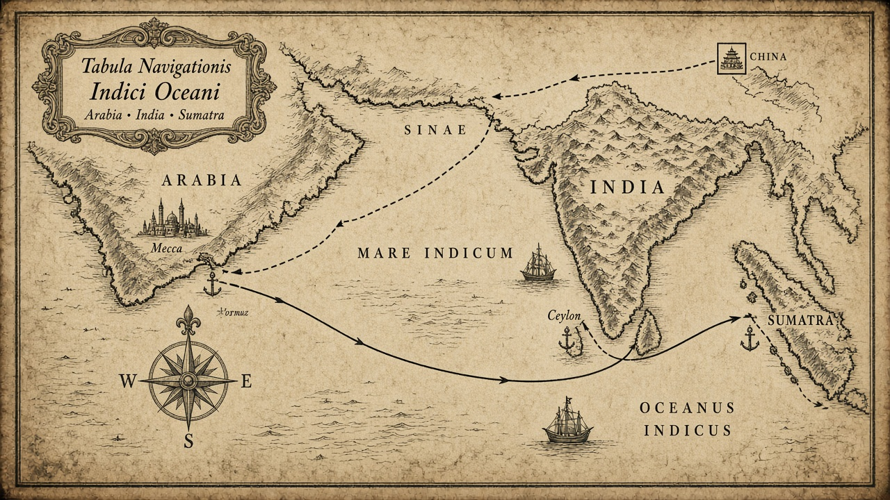
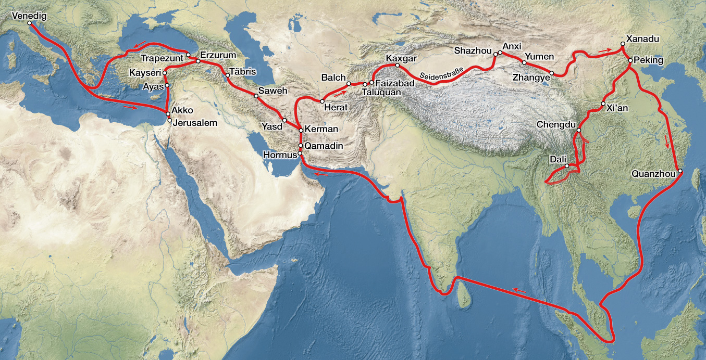

# Front Matter III-2
## Maps for the Seas and the Return

> *“And from Zayton they sailed…”*
> — Book III itinerary hinge (Yule–Cordier tradition)

---

Volume III’s maps are wet. One chart should hold the monsoon necklace from Fujian down through island Southeast Asia to Seilan and India’s coasts; another should sketch the return logic — sea to Hormuz, then land toward Trebizond and the Black Sea homecoming. Place tables use gazetteer rows with volume = 3. Image paths point at `../media/` placeholders. [1]

### How to see the maritime book

Read the sea chapters as a **coastal rosary**, not as a claim that Marco inspected every inland kingdom named. Zayton out; Chamba touch; Java mostly hearsay wealth; Locac and Pentam as peninsula/strait geography; Sumatra (Java the Less) as the long wait; Nicobars and Andamans as island rumour with a few likelier landfalls; Seilan firm; Maabar and Malabar as the Indian pearl-and-pepper stage; then west along reported shores toward Kesmacoran and the Arabian gates. [2]

Chipangu sits off the main sailing line as a northward marvel island — on the mental map more than on the logbook.

### Indian Ocean and Southeast Asian seas

*Caption:* Monsoon-world schematic — Zayton to Sumatra, Seilan, Maabar/Malabar, and the western approaches toward Aden and Hormuz. *(Wikimedia Commons — credit in media/ATTRIBUTIONS.md)*

Use this map while reading III-1 through III-8. When a name goes soft (Locac, Dagroian, Sememant), the map’s job is orientation, not false precision.

### Return route — sea, Hormuz, and the Black Sea gate

*Caption:* Return schematic — Cocachin voyage landfall logic at Hormuz (Hormos), Ilkhanid delivery, overland toward Trebizond, Black Sea passage, Venice. *(Wikimedia Commons — credit in media/ATTRIBUTIONS.md)*

The return map is political as much as nautical: a bridal embassy’s success condition is Persia, not tourism.

### Place table — island and Southeast Asian road

| Book name | Modern | Role in Vol. III |
|-----------|--------|------------------|
| Chamba (Champa) | Central Vietnam coast | Early fleet touch on the southern road |
| Java | Java, Indonesia | Great Java wealth — largely reported |
| Locac | Malay Peninsula (S. Thailand/Malaysia) | Soft peninsula ID |
| Pentam | Bintan / Riau Islands | Near Singapore Strait approaches |
| Java the Less (Sumatra) | Sumatra, Indonesia | Five-month monsoon wait |
| Ferlec | Perlak, Aceh, Sumatra | Muslim conversion noted |
| Samara | Samudera Pasai, Sumatra | Likely wintering locale |
| Lambri | Lamuri (Aceh headland) | North Sumatra headland |
| Fansur | Barus, NW Sumatra | Camphor coast — reported |
| Necuveran | Nicobar Islands | Naked-islanders motif; likelier touch |
| Angamanain | Andaman Islands | Dog-headed men — legendary ethnography |
| Seilan (Ceylon) | Sri Lanka | Adam’s Peak, rubies; firm island |

### Place table — India, west shores, return hinge

| Book name | Modern | Role in Vol. III |
|-----------|--------|------------------|
| Maabar | Coromandel Coast, Tamil Nadu | Pearl fishery coast |
| Cail (Kayal) | Kayalpatnam / Old Kayal | Pandya-realm port |
| Coilum (Quilon) | Kollam, Kerala | Pepper port of Malabar |
| Comari | Kanyakumari (Cape Comorin) | Cape and shrine |
| Melibar | Malabar Coast, Kerala | SW Indian coastal region |
| Gozurat | Gujarat | Pirates and trade — reported |
| Cambaet | Khambhat (Cambay) | Gulf of Cambay port — reported |
| Kesmacoran | Makran coast (Gwadar/Pasni), Pakistan | Kij-Makran — reported |
| Male / Maldives | Maldives | Cowries and ambergris — reported |
| Scotra | Socotra, Yemen | Christians and ambergris — reported |
| Madeigascar | Madagascar | Name enters Europe via Polo; mixed hearsay |
| Zanghibar | Zanzibar / Swahili coast | East African ethnonym/region — reported |
| Aden | Aden, Yemen | Red Sea trade gate — reported |
| Dufar | Dhofar (Salalah area), Oman | Frankincense coast — reported |
| Kalhat | Qalhat, Oman | Omani coast port — reported |
| Trebizond | Trabzon, Turkey | Black Sea embarkation on the way home |
| Chipangu | Japan | Gold-island hearsay; not visited |

*(Hormuz / Hormos and Tauris also serve the return; their main gazetteer rows sit in volume 1 because of the outbound itinerary, but Volume III reuses them as landfall and road home.)*

### Map cautions

**Java vs Java the Less:** Great Java is the island of that name in modern speech, mostly hearsay in Polo; Java the Less is Sumatra, where the wintering claim sits. **Madeigascar** mixes a name-first with African-coast marvels — do not force every sentence onto the modern island’s interior. **Islands of Men and Women** stay legendary (coordinates blank in the gazetteer on purpose). **Chipangu** is a reception magnet, not a landfall. [3]

Monsoon arrows matter more than straight rhumb lines. If a chapter feels like it pauses, it probably should.

Anyway, with these charts in hand, the storyteller can say *next he mentions Seilan* without losing you in the empty blue.

---

## Notes

[1] Gazetteer `volume=3`; media placeholders `map-indian-ocean.jpg`, `map-return-route.jpg` — credits in `media/ATTRIBUTIONS.md`.

[2] ✓ / ~ Periplus reading of Book III — standard in Yule; visited vs reported tags prevent over-claiming autopsy.

[3] ? Soft and legendary toponyms — see gazetteer reliability; III back matter on Chipangu / Cocachin / Columbus.
