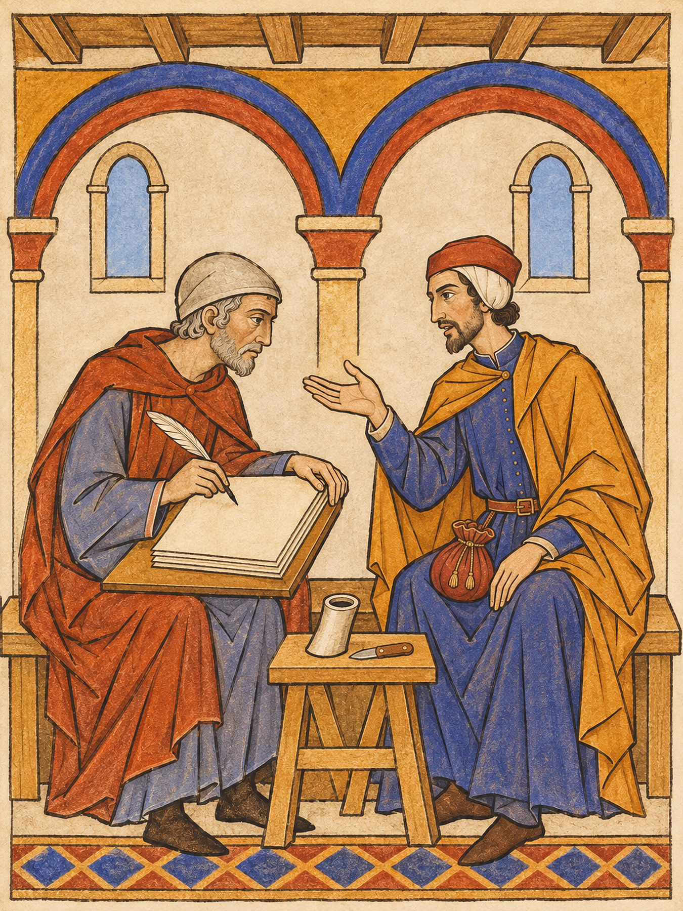

# Chapter I-1
## In a Genoese Prison: How This Book Was Made

> *“Take this Book and cause it to be read to you.”*
> — Marco Polo, Prologue, preamble (Yule–Cordier)

---

Before the clash of Venetian and Genoese oars fades from your ears, step behind those iron bars in Genoa in the autumn of 1298 and listen to a voice calling a crowded room to order. Someone has to read this Book aloud. The man speaking in its opening lines expects to be heard by restless people who have plenty of other business on their minds. He calls first on emperors, kings, dukes, marquises, counts, and knights—as medieval court manners required—but listen for the burgesses right behind them. Those are the townsmen and working merchants, the people who make their living by trade and judge a traveller’s story by whether its ports, distances, and prices add up. To reach their ears, that voice had travelled twenty-four years across Asia and survived a bitter sea war, only to land the Venetian merchant Marco Polo under the same Genoese prison roof as Rustichello of Pisa, a veteran writer of King Arthur romances [1].

How a Venetian merchant came to be sitting in a Genoese cell is a question the Book itself never pauses to answer. Later tellers filled in the gap with a sea-fight. Before we watch the fleets collide, though, put yourself in the shoes of a real Venetian shipowner standing on the Rialto docks in the 1290s, trying to keep his business afloat while two maritime republics tore at each other’s throats.

In 1298, Venice and Genoa were at war again. For decades the two cities had fought over harbours, customs privileges, and honour from Acre to the Bosphorus. When Acre fell in 1291, the southern spice routes from India were half closed to Latin merchants, turning every surviving northern outlet into a prize worth fighting for. Genoese warships in the Black Sea pressed hard on Venetian access to the caravan roads through Trebizond (Trabzon) and Tana (on the Sea of Azov). Four years earlier, in 1294, a Genoese squadron had already smashed a Venetian merchant convoy in the bay of Ayas (Yumurtalık) [2]. By the summer of 1298, Genoa was no longer content to raid distant eastern ports—she meant to strike Venice in her own waters [3].

Try reckoning the year’s ledger like a merchant before you hear what happened next. A ship that waits in port for safer winter weather may still carry its cargo to market, even if its owner sells for less than he hoped. A ship pinned inside the lagoon by word of a hostile fleet is a different kind of ruin. Every day the galley sits idle at the quay, its owner is paying wages and rations to a crew he cannot send out, while he scours the waterfront for rumours of which harbours remain open. Worse still is the man who has borrowed silver against a spice cargo due home from the Levant. He watches the Adriatic horizon with his stomach in his throat, listening for news of a sail as anxiously as any father waiting for a son.

That summer, the Genoese war fleet put to sea under Admiral Lamba Doria. Steering past Messina into the Adriatic, Doria’s ships were scattered by a gale at the gulf’s mouth. The admiral gathered some seventy sail, raided along the Dalmatian coast, and fell upon the island of Curzola (Korčula), where his men took and burned the chief town. Soon word reached the anchorage that the Venetian fleet was bearing down on them [4].

Venice answered with haste and wounded pride. Admiral Andrea Dandolo sailed with a great armament, reinforced until Venetian strength approached a hundred galleys. Among the gentlemen-commanders—each known as a *sopracomito*—who stepped aboard those crowded decks was Messer Marco Polo of Venice, home only a few years from his long decades in the East [5]. Think of the difference between backing a voyage on paper and commanding one on the water. A merchant who invests from his counting-house can write down the exact bales of silk or sacks of pepper he stands to lose. A *sopracomito* stepping onto a narrow war galley (*galea sottile*) packed with rowers and crossbowmen has the hull, the crew, and his own skin on the line. The fortunes of the city hung on how many of those ships came home.

On the afternoon of Saturday, the sixth of September, the two fleets sighted one another near the eastern end of Curzola. Sunset was already near, so both sides held off until morning. Venetian memory later insisted the Genoese were shaken and asked for terms; Genoese song remembered it the opposite way, celebrating a council of captains who voted eagerly to attack. At dawn on Sunday the seventh, the Venetians drove forward with the wind at their backs and the low morning sun glaring straight in their eyes. They struck hard and took ten Genoese galleys, yet in the fury of boarding their own line broke into confusion. In the afternoon, the missing ships of Doria’s scattered fleet—fifteen or sixteen fresh sail—swept down on the exposed Venetian flank. The battle turned in an hour. Almost the entire Venetian armament fell into Genoese hands, with more than seven thousand men taken prisoner [6]. Among those hauled away into captivity, Venetian memory singled out Marco Polo of the parish of San Giovanni Grisostomo [7].

Curzola was not the only story people told about how Marco lost his freedom. An earlier Lombard chronicle placed his capture after a sea-fight off Ayas instead [8], though the recorded Genoese victory there took place four years before, when Marco was still on his way home from China. What the oldest French opening of the Book gives us for certain is simpler: a prison in Genoa, and the year 1298.

{#fig-a18-adriatic-inset}

Picture how fast a world can flip upside down in twenty-four hours. At dusk on Saturday, the Venetians might have thought the raid was as good as stopped. By Sunday evening, most of the men who had rowed out expecting to teach Genoa a lesson were staring at a very different harbour ahead of them. Chroniclers count the captured hulls—galleys to be valued, refitted, and crewed again—but behind every ship number sat real households back in Venice waiting months to learn whether their husbands and sons were drowned or chained in a foreign port.

The captives were carried west across the Tyrrhenian Sea. Admiral Dandolo, broken by despair, is said to have refused food and ended his own life before reaching port. On the evening of the sixteenth of October, Genoa welcomed Doria’s victorious fleet with public rejoicing [9]. As the returning captains paraded through the city, what life inside the prison looked like for a captured Venetian gentleman depends on which later witness you trust.

In Genoa’s detention quarters, Marco met Rustichello of Pisa, a writer already well known for compiling Arthurian romance. Years earlier, Rustichello had abridged and stitched together adventures of Tristan, Lancelot, and the Round Table from a manuscript linked to Prince Edward of England. His literary French was the polished tongue of courts and prose romance: grand formulas of address to emperors and barons, set pieces of marvel and prowess, and the brisk pace of a working writer who cared more for fullness than tidy order [10]. Whether Rustichello had already spent fourteen years in Genoese custody since the disaster at Meloria in 1284—when Pisa’s manhood was swept into Genoa’s prisons—or had landed there by some later twist, the oldest preamble sets him under the same roof as Messire Marc in 1298 [11].

Put those two men across a wooden table from each other for a moment. Marco knew what a merchant would buy in a port, what cargo would pay its freight, and why an eastern emperor could print money on mulberry bark lighter than any silver coin you held in your hand. Rustichello knew how to make a noisy hall full of knights stop talking and listen to a speech. The merchant needed a way to show someone who had never left Italy why a distant city mattered; the romancer knew how to usher the listener straight into an emperor’s throne room. Franco-Italian, the hybrid literary language they chose, could do both jobs at once [12]. Anyone reading the pages aloud could tell in five minutes which passages held the room.

Day by day through that winter, Marco talked through what he had seen with his own eyes and what he had heard from men he trusted, while Rustichello shaped the memories into a sequence [13]. Their opening preamble makes a clear promise to the listener: things seen would be set down as seen, and things heard as heard only, so that no invention might spoil the truth of the record. Whether that promise holds in every chapter is a question we will test backstage in the Notes as we travel east.

{#fig-i-1-genoa-dictation width=78%}

Yet this meeting of voices was never a dry clerk’s transcription. The scribe who had once invited readers to delight in the adventures of errant knights now framed a merchant’s testimony with the exact same ceremonial music. Listen to how the Book calls its audience to attention in the opening lines [14]:

:::: parallel-text

::: witness
**Franco-Italian · Witness F**

Seingnors, enperaor et rois, dux et marquois, cuens, chevalers et borgiois, […] si prennés cestui livre et le feites lire

BnF fr. 1116, fol. 4a, Prologue § 1. Eusebi’s critical text [-@eusebi2018devisement, p. 35], [CC BY 4.0](https://creativecommons.org/licenses/by/4.0/).
:::

::: witness
**English · Traditional Opening**

Great Princes, Emperors, and Kings, Dukes and Marquises, Counts, Knights, and Burgesses! […] take this Book and cause it to be read to you.

Prologue, opening address [@yc, Prol. preamble].
:::

::::

That grand roll-call promises all the countries of the East, starting with Greater Hermenia (Armenia), and boasts that no man since Adam has seen or learned so much of the world. It gives its Venetian traveller a round twenty-six years to gather his knowledge [15]. Listen to the sheer lungful of titles the reader has to intone before the two Polo brothers even set foot on a ship.

Pause and hear what Rustichello is doing with those superlatives. Imagine the same voice announcing an unknown knight riding into a foreign court. When the Great Kaan welcomes the Polos later in the Book, the phrasing echoes the very welcome Rustichello once wrote for Sir Tristan arriving at Camelot [16]. A turn of a sentence can make a Mongol palace you have never seen feel as vivid—and as strangely familiar—as an old Arthurian hall.

Between them, merchant and romancer forged something neither man could have built alone: a working geography that could hold its own beside a chanson, and a merchant’s memory dressed for court. Peace came sooner than Meloria’s Pisans had dared hope. On 25 May 1299, ambassadors of Venice and Genoa signed a treaty mediated by Matteo Visconti of Milan—equal and reciprocal terms showing that Curzola had bruised Venetian pride far more than Venetian power [17]. The Doge ratified the peace on 1 July, and before the end of August Marco Polo was likely back in the family house in San Giovanni Grisostomo [18]. A separate truce between Genoa and Pisa at the end of July freed the remaining Pisan prisoners, and Rustichello almost certainly walked out with them, though no release roll survives with his name [19]. After that summer, the writer vanishes from history. The speaker left a Venetian court testimony in February 1301 concerning a business payment—a record that has even led one modern archival reading to argue he was already back in Venice as early as October 1298 [20].

Once the pages left Genoa, the Book did not sit quietly in libraries. Copies travelled the way medieval books travelled: lent to neighbours, recopied by hand, translated, trimmed down, or padded out by scribes who wanted an even bigger marvel. Within a generation, the Dominican friar Francesco Pipino turned a version into Latin for clerical readers, adding assurances of Marco’s Christian faith. Chroniclers in northern Italy began calling the Venetian *Milione*—a nickname suggesting wealth beyond counting—while manuscripts in French, Tuscan, Venetian, and Latin reshaped episodes and added colour the prison winter never knew [21]. Early French copies appear to have been produced right inside Genoa by Pisan prisoners before the text underwent fresh reworkings in Venice [22]. Centuries later, Venetian tradition would even forget the Pisan romancer’s name altogether, dressing the captivity with a kindly Genoese gentleman who dropped by the cell to help write the memoirs down [23].

Watch what happens when the same book passes through different hands. A friar wondering what Christian missions might achieve in the East copies down the churches and congregations. A winter-evening reader lingering by the fire gives extra pages to the emperor’s banquet or a ruler’s treasure. Give the same pages to two people reading for different reasons, and see which pieces of the story they choose to carry away. Try to trace those layers backwards, and you reach a family of related versions—with the first 1298 parchment from Genoa itself beyond recovery [24].

Yet behind the prison bars, the lost manuscripts, and the romance flourishes, the family that lived the story was waiting in the Venetian archives all along. Step outside the cell of 1298 and rewind thirty-eight years to meet the Polos as they actually were—real Venetian merchants caught in a changing world, before two brothers set out with a pouch of jewels across the Greater Sea.

---

## Notes

[1] ~ The French preamble places Marco and Rustichello together in prison in Genoa and gives 1298 as the year of composition. It leaves the daily method of working open [@yc, Prol. preamble].

[2] ✓ Yule discusses the chronology of Genoa’s victory in the bay of Ayas in 1294 [@yc, Introduction, § VI, § 31]. That action cost Venice a valuable merchant convoy in Cilician waters and deepened the commercial war that led to the Adriatic campaign of 1298.

[3] ✓ Yule draws on the chronicles and Genoese verse for the war and the conditions of Venetian commerce [@yc, Introduction, § VI]. After the loss of Acre in 1291, competition over the Black Sea and Levantine termini turned every fleet movement into a struggle for survival.

[4] ✓ Yule reconstructs Doria’s route, the storm and the burning of the town from the chronicles and verse [@yc, Introduction, § VI, §§ 32–33]. Raiding Curzola forced the Venetian fleet to give battle on the Dalmatian coast.

[5] ? The early French preamble places Marco in a Genoese prison in 1298 without naming a battle or naval rank. His service as *sopracomito* (gentleman-commander) of a galley at Curzola comes from later Venetian biographical tradition, notably Ramusio, combined with inference from the year [@yc, Introduction, § 33, § 37].

[6] ✓ The battle was fought on 7 September 1298. Yule compares the Venetian and Genoese reports of the engagement and gives the reported haul of prisoners [@yc, Introduction, § VI, §§ 34–35].

[7] ~ Ramusio-only. Ramusio’s 1559 account names Marco Polo of San Giovanni Grisostomo as a prisoner taken at Curzola, a fit that Yule–Cordier accepted as the best editorial synthesis. The early French preamble supplies neither the battle nor a command at sea [@yc, Introduction, § 37].

[8] ? Jacopo d’Acqui places the capture at Ayas and dates it to 1296, where the known Genoese victory of 1294 is the proposed substitution. Yule rejects the place while allowing the notice some weight as an early account of capture, and Bolognari discusses the chronology [@yc, Introduction, § 37; @bolognari2026venezia].

[9] ~ Yule places the arrival on 16 October 1298 and gives the rival accounts of the prisoners’ treatment. Dandolo’s reported death after refusing food belongs to the same reconstruction [@yc, Introduction, § VI, § 35].

[10] ✓ Paulin Paris, Yule, and Benedetto [-@benedetto1928milione] identify Marco’s collaborator with the Arthurian romance compiler “Maistre Rusticien de Pise” [@yc, Intro. § 37]. Both the romance compilation and the Franco-Italian *Devisement* open with the same distinctive address to emperors, kings, dukes, and burgesses.

[11] ~ Meloria captivity since 1284 is a fair conjecture rather than a documented fact: Cigni makes a contextual case that Rustichello was among the Pisan prisoners taken at Meloria, though no individual capture roll names him [-@cigni2017rustichello]. The oldest Polo preamble places him in the Genoa prison with Marco in 1298 [@yc, Prol. preamble].

[12] ✓ The preamble survives in the Franco-Italian literary register of the early manuscript tradition [@eusebi2018devisement, p. 35]. That hybrid French served across northern Italy as a prestige language for secular prose and chivalric storytelling.

[13] ~ The preamble announces a method of distinguishing things seen from things heard [@yc, Prol. preamble]. It sets the standard of eyewitness and reported testimony by which the whole Book asks to be judged.

[14] ✓ The public address stands in witness F and appears at the head of Yule’s translation [@eusebi2018devisement, p. 35; @yc, Prol. preamble]. See the parallel-text box in this chapter for the Franco-Italian wording alongside Yule’s English.

[15] ~ The comparison with Adam and the twenty-six years in the East belong to the preamble’s opening claim about the traveller’s unequalled experience [@yc, Prol. preamble]. From the 1271 departure to the 1295 homecoming runs twenty-four years, rounded up in the opening flourish.

[16] ~ Larner [-@larner1999marco, chs. 3, 5] defends the 1298 Genoa collaboration and argues that Rustichello cast Marco’s geography in the conventions of Arthurian prose, noting that the Great Kaan’s welcome echoes Tristan’s arrival at Camelot in Rustichello’s *Meliadus*. He also suggests Rustichello shaped the self-promoting Yangzhou and Saianfu episodes while Marco’s own commercial and administrative matter stayed largely impersonal. How far that literary shaping extends remains debated, as romance diction can colour set-pieces even where the underlying notice is mercantile.

[17] ✓ On 25 May 1299 Venice and Genoa signed peace terms mediated by Matteo Visconti of Milan [@yc, Introduction, § 36]. The treaty was equal and reciprocal and provided for the mutual release of prisoners.

[18] ~ The Doge ratified the treaty on 1 July 1299; Polo’s return to San Giovanni Grisostomo by the end of August is a reasonable inference from the ratification dates, not a dated document. The exact day is unknown [@yc, Introduction, § 36].

[19] ~ A separate Genoa–Pisa truce at the end of July 1299 freed the remaining Pisan prisoners [@yc, Introduction, § 36]. That Rustichello left Genoa under that truce is an inference rather than a surviving release roll bearing his name.

[20] ? Bolognari reads Marco’s February 1301 testimony about a payment in October 1299 as implying a contract made in October 1298, and infers Marco’s presence in Venice then. The reported testimony supplies an argument about his whereabouts [@bolognari2026venezia].

[21] ✓ Pipino’s Latin and Jacopo’s notice attest early circulation, while Pipino’s translation carries no independent capture record. The dates of Pipino’s work are discussed in Chapter III-10 [@yc, Introduction, § 18, § 37].

[22] ✓ Andreose places witness F among French manuscripts copied by Pisan prisoners at Genoa and traces subsequent reworkings in Venice [@andreose2024textual]. That workshop setting explains how copies could begin circulating quickly in both French and Italian dialects.

[23] ? Ramusio-only. Ramusio supplies a Genoese gentleman as helper. The early French preamble names the Pisan writer Rustichello [@yc, Introduction, § 37; @yc, Prol. preamble].

[24] ? The textual witnesses—from the Old French preamble F and Pipino’s Latin to Jacopo d’Acqui and Ramusio—preserve separate versions with differences in what they give and the order in which they give it. The early stages of their relationship remain debated [@benedetto1928milione; @moule1938description; @dutschke1993francesco; @andreose2024textual].
