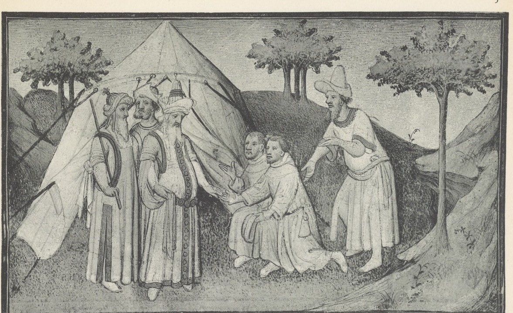

# Chapter I-2
## The House of Polo and the Elder Voyage

> *“The Great Kaan hath never seen any Latins, and he hath a great desire so to do.”*
> — Marco Polo, Prologue, ch. 3 (Yule–Cordier)

---

Step outside that stone cell in Genoa, turn the clock back thirty-eight years to 1260, and follow two Venetian merchants down to the docks before anyone had ever heard the name Polo. The Book itself scarcely bothers to introduce them. It takes Venetian wills, ledgers, and property deeds to sketch the family behind the legend [1]. They belonged to the solid merchant class that money made comfortable without ever making famous. They held a warehouse base at Constantinople (Istanbul), a trading post across the water at Soldaia (Sudak) on the Crimean shore, and enough real estate to keep clerks busy stamping names on parchment. Old family tradition traces the line back to Andrea Polo of the parish of San Felice [2] and his three sons. Marco the Elder minded the Constantinople and Soldaia counting-houses. Niccolò, the middle brother, would father our traveller, and Maffeo worked beside him as his partner on the road [3]. They dealt in jewels, fine cloth, credit, and sharp timing. In 1260, two of those brothers packed their capital into a leather pouch for a routine trading run across the Greater Sea—never guessing that a continental war was about to slam the door behind them and march them all the way to the throne of the Great Kaan.

In Constantinople, the air already smelled of changing masters. Emperor Baldwin II still wore the Latin crown in a city whose empire had shrunk to a shadow. Within twelve months, Michael Palaeologus would seize Constantinople back for Byzantium [4]. Men the Book calls *“singularly noble, wise, and provident”* did not wait for the roof to cave in. Niccolò and Maffeo sat down above their ledgers, took counsel together, and made a merchant’s bet. They converted their goods into a portable store of jewels and sailed across the Greater Sea to their family foothold at Soldaia [5]. That crossing took place around 1260, ten years later than an early copyist’s slip of the pen would have it [6].

Pause on that pouch of stones for a moment, because every decision that follows turns on what is inside it. When a regime wobbles and harbour tariffs look ready to flip overnight, a merchant with bales of wool, barrels of wine, or sacks of pepper is chained to heavy carts, customs sheds, and storage rents. Convert your silver into cut rubies, sapphires, and pearls, and your whole working fortune fits inside a belt strapped under your tunic. Two men can step onto a single Black Sea ship. They can buy two horses on the Crimean quay and carry a Venetian counting-house across a continent without paying warehouse fees to anyone.

After resting a while at Soldaia, the brothers decided the market justified pushing farther inland. They rode north and east out of Crimea into the steppe until they reached the court of Barca (Berke), third son of Juji and the first Muslim sovereign of his line. He held his residences at Sarai on the lower Volga and farther upriver at Bolghar (Bolgar) [7]. Among Tartar princes, the Book remembers Barca as open-handed and courteous beyond the common run. He welcomed the two Venetians with honour and looked over the gems they laid before him. Then he sent them back at least twice the value of what they had brought—a princely gift-exchange disguised as trade, or trade dressed as royal courtesy [8]. For a full year, the brothers stayed at his court, turning their capital and watching the markets of the Volga.

Then the road behind them snapped shut. In the summer of 1262, war erupted between Barca, lord of the Tartars of the West, and his cousin Alaü (Hulagu), lord of the Tartars of Persia and the Levant. Great armies collided across the Caucasus passes. Though the Book remembers Barca getting the worst of the fighting, the truth ran the other way. Alaü’s forces under his son Abaga (Abaqa) were shattered when Barca rallied and drove them back across the frozen Terek in the winter of 1263 [9]. Either way, the consequence for two Italian merchants was immediate and brutal. Nobody could ride west toward Crimea or Constantinople without walking straight into patrolling horsemen and confiscation. Behind them lay war. Ahead of them lay open steppe.

Leaving Bolghar behind, Niccolò and Maffeo rode downstream and south-east to Ucaca (Ukek), the frontier town marking the edge of Barca’s realm toward the Russian hills [10]. From there they crossed the broad Volga—which the Book, letting a classical river name drift far off its map, calls the Tigris. Ahead stretched seventeen days of open desert where no walled town or stone village stood, only the felt tents of nomadic Tartars moving with their herds [11].

Beyond that emptiness rose the mud-brick walls and turquoise domes of Bocara (Bukhara), a rich oasis city ruled by Barac (Baraq) of the house of Sigatay (Chagatai). Speaking with a merchant’s sense of cultural reach rather than a cartographer’s ruler, the Book hails Bocara as the finest city in all Persia [12]. There the brothers hit a wall of suspicion and border warfare. They dared neither press farther east nor double back west, and in Bocara they stayed for three whole years [13].

Think about what three years actually looks like when you left home on a single season’s trading turn. That is thirty-six months without a ship’s letter from Venice. You have no word of whether your wife is well or how tall your young son has grown, and no embassy to carry you home. You cannot sit in a caravanserai courtyard for three winters staring at your boots without eating through your silver. So you rent a room and a stall beneath Bocara’s brick arcades. You strike quiet partnerships with local brokers, learn which weights are shaved and which coins ring true, and spend a thousand evenings in the markets picking up the Tartar tongue word by word. You never realize that the language you are learning just to buy bread and horse-fodder is the very skill that will soon win you an audience at the far end of the earth.

{#fig-a3-elder-voyage}

Then, out of the dust of the western road, came the turn that remade the family’s fate. Envoys travelling from Alaü’s court in Persia toward the court of the Great Kaan stopped in Bocara. They stared in disbelief at two Latin Christians standing in the bazaar—men of a kind never seen in that quarter of the world. *“If ye will take our counsel”*, the envoys urged, *“great honour and profit shall come thereof.”* The Great Kaan, they said, had never laid eyes on a single Latin and burned to meet one. If Niccolò and Maffeo would ride in their train, they would travel under safe-conduct and find a welcome generous enough to make their fortunes [14]. The brothers looked at the closed road behind them and asked how soon the party rode. They packed their saddlebags and turned north-east into a year-long journey across Asia.

Of the wonders along that twelve-month track, the Book deliberately says nothing here. It holds every snow pass, strange beast, and desert post-house in reserve for the day young Marco would ride the same road with his eyes wide open [15]. For now, the elders’ march is a fast-forwarded corridor leading straight to a tented throne room.

Imagine the nerve required for what happened next. Two working merchants from a Venetian parish—men who had left home to sell gemstones on the Black Sea—suddenly found themselves kneeling before Cublay (Kublai) Kaan, sovereign of the largest empire on earth. The Kaan welcomed them with open warmth, seated them at his feast, and began an imperial interrogation. How did the emperors of the West keep their courts, administer justice, and lead armies into the field? How did Latin kings and princes rule? How did the Pope stand at Rome, and what laws and customs did Christians keep? Step by step, Niccolò and Maffeo answered him plainly and in order. They spoke directly in the Tartar tongue they had picked up during their years on the steppe and in Bocara [16]. No translator stood between two Venetian shopkeepers and the Lord of all the Tartars.

{#fig-brothers-audience width=60%}

Cublay was delighted—so delighted that he decided to turn his unexpected guests into his own ambassadors to Rome. He summoned a high baron named Cogatal and bade him ride west alongside Niccolò and Maffeo, carrying letters drafted in the Tartar tongue to the Pope. By the Book’s account, those letters asked the Pontiff to dispatch a hundred learned Christians, masters of the Seven Arts. They were to dispute openly with the idolaters of the East and prove the Christian faith superior to all others. If they prevailed, the Kaan promised, he and all his subjects would accept baptism and become liegemen of the Church. At the close of the letter, Cublay added a quieter, far more intimate request: bring back holy oil from the lamp burning at the Holy Sepulchre in Jerusalem [17].

Listen closely to that letter like a merchant auditing a contract. Asking for a hundred scholars and oil from a famous shrine fits everything we know of Mongol rulers, who collected foreign astronomers, physicians, and sacred talismans from across Eurasia. Yet the sweeping pledge to baptize an entire empire has the unmistakable polish of two Venetian envoys—or a later storyteller—sweetening the offer so a Roman Pope could not possibly say no [18].

Before dismissing them, Cublay placed something far more tangible than parchment in their hands: an inscribed Tablet of Gold, the imperial *paiza* [19]. Hold that small plaque of hammered gold in your palm for a second, because it is the closest thing to magic in the entire Prologue—and completely real. Etched with the Kaan’s command, it turned every post-station, ferry, and governor’s storehouse across thousands of miles into the brothers’ personal supply line. Local officials were ordered to hand over fresh horses, food, lodging, and armed escorts at no cost wherever they passed.

They needed every bit of its authority. Only a few days down the westward road, the Mongol baron Cogatal fell too sick to keep the saddle and stayed behind in a town along the route. With his full consent, the brothers pressed on alone with the Kaan’s letters [20]. For three gruelling years they fought their way west through snowdrifts, spring torrents, and mountain passes. At last they smelled salt water again at Ayas (Yumurtalık) on the Gulf of Scanderoon in Lesser Hermenia (Cilician Armenia)—the rising Mediterranean hinge where camel trains out of Tauris (Tabriz) met Italian merchant galleys. From Ayas they took ship down the coast to Acre. They stepped ashore in April 1269 with one shattering piece of news waiting on the quay: the Pope, Clement IV, was dead [21].

At Acre they carried their gilded credentials to a wise churchman serving as Legate for the kingdom of Egypt: Tedaldo (Theobald) of Piacenza, Archdeacon of Liège. Fortune was about to raise him far higher than any Venetian merchant could have guessed. Tedaldo listened in astonishment to an errand from the far side of the world and saw at once what honour and profit it could bring to Christendom. *“Ye see that the Pope is dead”*, he told the travellers, *“wherefore ye must needs have patience until a new Pope be made”* [22].

Wait for a papal election in Acre, or sail home while the cardinals argued? The choice took no time at all. After nine years away from the lagoon, Niccolò and Maffeo boarded ship for Negropont (Euboea) and sailed on to Venice. When Niccolò stepped across his own threshold, the grand adventure fell suddenly silent. His wife was dead, and standing in the house was a fifteen-year-old son named Marco, born around 1254 [23]. Later Latin tellers could not resist heightening the pathos. They claimed Niccolò had ridden east before knowing his wife was with child and laid eyes on his boy for the very first time that afternoon, though the oldest French tradition leaves the scene in quieter reserve [24]. Nor was there any ragged-coat banquet with rubies spilling from ripped linings onto a bewildered table. That famous sixteenth-century Venetian legend belongs to the final homecoming of 1295, not this quiet return [25].

Instead, two weathered merchants settled into their lagoon house for two years, ledgers thickened by Barca’s gifts and Bocara’s long exile. Inside the family chest rested the Great Kaan’s golden tablet beside a promise still unpaid. Cublay was waiting for a hundred learned men and oil from Jerusalem. Christendom was waiting for a Pope. Inside locked chambers at Viterbo, the cardinals were stalling month after month. On the Venice lagoon, Niccolò and Maffeo were losing patience—and beside them, fifteen-year-old Marco was watching every move, ready to turn a family venture into the journey that would carry his name across the world.

---

## Notes

[1] ✓ The records are Venetian: Marco the Elder’s will (1280) bequeaths his Soldaia house to the Franciscans there [@yc, Prol. 1 n. 2], and Yule’s Introduction assembles the family’s base at Constantinople and its Soldaia business from wills and property notices. The house that made the name famous, in the parish of San Giovanni Grisostomo, is attested only after the return.

[2] ~ The Andrea of San Felice genealogy is Ramusio tradition, not an archival fact [@yc, Introduction, § 11]. Ramusio said that older records named Andrea as father of the three brothers, and Tanase reports that no surviving record of him has been found [-@tanase2025educazione].

[3] ~ The division of the brothers’ roles fills in the same tradition where the Book is silent [@yc, Prol. 1]. Maffeo’s will of 6 February 1310 (1309 by the Venetian calendar) names his late wife Marta and calls the nuns Juliana and Clara his spiritual daughters [@orlandini1926marco, doc. 6]. The bequest leaves open whether Maffeo had children. Yule reports an earlier date for a will in his summary of a 1328 proceeding [@yc, Introduction § 23].

[4] ~ The year 1260 is Yule’s correction of the manuscripts’ “1250”, discussed in Note [6] [@yc, Prol. 1 nn. 1–2]. It fits the end of Baldwin II’s Latin reign at Constantinople, which ran until Michael Palaeologus retook the city in July 1261.

[5] ~ In the Prologue tradition, the brothers laid in a store of jewels and crossed the Greater Sea to Soldaia [@yc, Prol. 1]. The Crimean port was a real commercial hinge where Venetian merchant houses met Mongol steppe routes by mid-century [@yc, Prol. 1 n. 2].

[6] ~ Manuscript “1250” for the crossing cannot stand beside the 1269 return and Marco aged fifteen. Yule’s corrected date of about 1260 is the working chronology [@yc, Prol. 1 n. 1], whereas Stephen G. Haw [-@haw2006marco, ch. 3] dates the first journey by outside reigns instead: at Soldaia before 1260, held at Bukhara under the Chaghadaid Barak (r. 1266–71) until 1266 or early 1267, and at Khubilai’s court about 1267.

[7] ~ Barca (Berke), third son of Juji and the first Muslim sovereign of his line, is historical, with his courts at Sarai and Bolghar attested. Yule dates the brothers’ arrival at Sarai to 1261, a year before the war closed the road west [@yc, Prol. 2 nn. 1–3].

[8] ~ The doubled-value exchange of jewels is book tradition, the royal largesse the Prologue likes to report [@yc, Prol. 2]. The twelvemonth stay is its round companion.

[9] ~ The war is solidly dated — it began in the summer of 1262 and ended about eight months later, as Rashid al-Din and Polo’s own later war chapters both witness [@yc, Prol. 2 n. 3] — though the winner the Book gives is backwards. Alaü’s army under Abaga was routed when Barca rallied and driven back across the frozen Terek, so that Yule calls Polo’s account “anything but an accurate” one [@yc, 4.25 n. 3].

[10] ~ Ucaca (Ukek, near modern Saratov) marked the Ponent’s frontier toward Russia [@yc, Prol. 2 n. 4]. Abulfeda describes it as the extremity of the Barka Tartars' realm, and Ibn Baṭṭūṭa confirms its position one day from the Russian hills.

[11] ~ The “Tigris” is the Volga under a classical name, as Pauthier showed and as the monk Pascal of Vittoria also calls it in 1338 [@yc, Prol. 2 n. 5]. The seventeen days fits one stretch of desert, not the whole crossing.

[12] ~ Calling Bocara “the best city in all Persia” reflects merchant cultural geography rather than modern political borders [@yc, Prol. 3 n. 1]. Hayton likewise folds Bukhara into a Persian horizon, and Vámbéry notes that those Transoxanian cities belonged to the Persian cultural sphere before the Mongol conquest; Barac is Baraq Khan, great-grandson of Sigatay (Chagatai) and ruler of the Chaghadaid ulus.

[13] ~ Three years’ sojourn at Bocara sits on the Prologue’s fondness for round durations — one, three, three — as much as on any itinerary record. Borrak’s reign dates only partly overlap the stretch the brothers say they spent there [@yc, Prol. 3–4].

[14] ~ The meeting with the Great Kaan’s envoys at Bocara and the year-long ride north and north-east are the Prologue’s own narrative, plausible in outline and rounded in its duration [@yc, Prol. 3–4]. The marvels of that road the text deliberately defers — Marco promises them in the Book that follows.

[15] ~ The envoys’ identity is not recoverable from the Book. Yule suggested they may have been the Great Kaan’s own men returning from Hulagu’s court, and that Sartak’s return party of 1265 could have been theirs — a suggestive identification, not proof [@yc, Prol. 3 n. 2].

[16] ~ The audience is Prologue theatre in outline and plausible in substance [@yc, Prol. 5–6]. The questions about emperors, kings, the Pope, and Latin customs track Cublay’s known curiosity, and years on the steppe make the brothers’ claimed fluency credible even though the Turkic or Mongol idiom is never named.

[17] ? The embassy letter survives in no Mongol original. The request for a hundred learned Christians, masters of the Seven Arts, and for oil of the Sepulchre comports with Chinghizide interest in skilled foreigners and with Latin Holy Land piety; the exact wording and the baptism pledge remain contested [@yc, Prol. 7 nn. 1–3].

[18] ? The promise that Cublay and his people would embrace the Law of Christ if the disputants prevailed reads as conversion rhetoric rather than a recorded policy pledge. Yule doubted purely religious motives [@yc, Prol. 7 n. 3], while Allsen sets the request for learned foreigners in a court culture that collected expertise across Eurasia [-@allsen2001culture, ch. 1]; Arghun’s and Öljeitü’s later letters to Philip the Fair show the diplomatic form without proving these clauses.

[19] ✓ The golden tablet (*paiza*) was a real instrument of imperial logistics, attested in Yuan archaeology and across Persian administrative writing [@yc, Prol. 8]. The Book’s report of its order — supplies, horses, escorts for the three ambassadors — matches the genre. For the Book’s rank tablets alongside the Yuan record, see Diagram C5 in Volume II, chapter 1.

[20] ~ Cogatal’s illness and abandonment at an unnamed city along the route is an uncorroborated personal detail [@yc, Prol. 8]. Leaving an ailing colleague behind explains why the two Venetians arrived at the Mediterranean coast as the sole bearers of the Kaan's letters.

[21] ✓ The return date is firm — Acre, April 1269, with the papal see vacant after Clement IV — while the even three years on the road is a Prologue rounding [@yc, Prol. 8–9]. The dead Pope’s name is left blank in the oldest French texts and supplied as Clement IV in the Crusca and Ramusio [@yc, Prol. 9 n. 1].

[22] ~ The consultation with Tedaldo Visconti (later Gregory X) at Acre is widely accepted [@yc, Prol. 9 nn. 1–2]. His precise legatine title varies across the manuscripts between “legate for the whole kingdom of Egypt” and a churchman of great authority.

[23] ~ The homecoming beat — wife dead, a son named Marco aged fifteen — is core early tradition, consistent with the return of 1269 [@yc, Prol. 9]. The received 1254 birthdate is itself inferred from that fifteen rather than independently documented in a baptismal register.

[24] ✗ Pipino-only. The claim that Niccolò left Venice before the child was born and met him for the first time in 1269 rests on Pipino’s Latin and its dependents, whereas the oldest French texts report only that the mother was dead and the son was fifteen. Yule was inclined to reject the melodramatic first sight of a son [@yc, Prol. 9 n. 3].

[25] ✗ Ramusio-only. The unrecognised kinsmen, the Tartar coat, the banquet of crimson robes and the jewels cut from the lining belong to Ramusio’s account of the final return of c. 1295, filtered through Gasparo Malipiero’s neighbourhood legend; they are not facts of 1269 and are not used as such here. Modern criticism treats them as later embroidery [@yc, Prol. 9].
