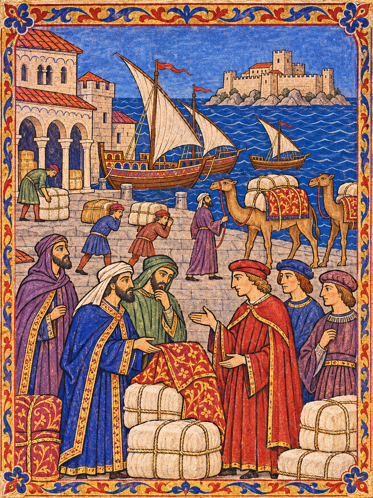

# Chapter I-4
## Lesser and Greater Hermenia; Turcomania; Georgiania

> *“Whatsoever persons would travel to the interior… they take their way by this city of Layas.”*
> — Marco Polo, Book 1, ch. 1 (Yule–Cordier)

---

The small flask of Jerusalem oil has reached the Great Kaan’s hall. Step back now onto the salt-sprayed quay at Ayas (Yumurtalık), with Mediterranean galleys creaking behind you and the mountain passes rising ahead. From this harbour, the Book changes gear. No more family diary, no more papal couriers—from here on, we read the continent like a merchant’s overland atlas, city by city, pass by pass, and ware by ware.

Ayas is where silk, cloth of gold, and spices pour down from the interior, and where a Venetian or Genoese factor off a galley finds buyers for his own woollens [1]. Watch a bale of inland cloth get weighed, marked, and hoisted into a Mediterranean hull beside stacked crates and coiled hawsers. For the Polos, this was the last harbour where a letter home could catch a familiar deck. It was also the first gate where an inbound camel-driver could tell you whether snow still choked the ridges ahead.

See [the map of the outbound road, I-3](ch-03-second-setting-forth.md#map-of-the-outbound-road).

That busy port sits in Lesser Hermenia (Cilician Armenia), whose king rules his own towns and castles while bowing to the Mongol overlords. Those two loyalties hold together cleanly enough until the ruler of Egypt marches north [2]. Suddenly a merchant on the quay discovers that his road inland hangs on border politics. One raid shuts the passes overnight and leaves his hired mules eating their own value in barley at the inn. Inland, the hills offer bright hawking and game, though the flat coast carries a grim reputation for fever [3]. As for the Armenian nobles, once famed for battlefield valour, the Book dismisses them as men who now excel chiefly at draining wine cups. That is the brisk verdict of an outsider looking for moral decay to explain a precarious kingdom.

For a trader loading pack-saddles at dawn, though, royal politics and noblemen’s goblets matter far less than the string of mules waiting outside the gate and the armed escort ready to climb into the Anatolian plateau.

{#fig-i-4-layas-quay width=78%}

Up in Turcomania (central Anatolia), three peoples divide the high country. Turcoman herdsmen roam the breezy pastures with their flocks and horses, while Armenian and Greek craftsmen pack the walled towns. Step into a horse-yard and a breeder trots out stout, sure-footed mounts known as *Turquan*, beside heavy-boned mules that haul packs over broken slate without stumbling [4]. Unroll the weavers’ bales in the bazaar and you see what the Book hails as the finest carpets in the world, alongside silks steeped in rich crimson and vivid dyes [5]. Between the horse-yard and the dye-vat, a caravan has plenty to load before it ever quits the plateau.

Pause to watch those two worlds trade in a single afternoon. Up on the windy uplands, felt tents shift with the grass while shepherds guard strings of *Turquan* colts. Down inside the stone walls, dye-vats steam and looms clack in shaded courtyards. A merchant needs both: the herdsmen’s beasts to carry his bales, and the townsmen’s carpets to fill them.

In the leading cities—Conia (Konya), Savast (Sivas), and Casaria (Kayseri)—the Mongol ruler of Persia governs through his own commanders and garrisons [6]. The Book knows who weaves the carpets and who holds the citadel. Yet it has little patience for the hill herdsmen, dismissing them as a rude folk with an ugly speech [7]. A drover hunting clean pasture, a blacksmith, and a stone well would judge them far more kindly than a Venetian gentleman hurrying toward grander courts.

---

Climb east into Greater Hermenia (the Armenian Highland) and halt at Arzinga (Erzincan). The town boasts an archbishopric, churches, and monasteries, yet a merchant’s eye snaps straight to the local buckram—a cloth so prized it travelled trade lists under the town’s own name [8]. Forget the stiffened bookbinder’s canvas we call buckram today. Picture a fine, lightweight fabric worth wrapping in oiled felt against mountain rain and selling at a handsome margin on the Mediterranean coast.

Hot springs bubble near the town for bathers nursing saddle-sores and road-weariness [9], while Arziron (Erzurum) and Arzizi (Erciş) anchor the rest of the highland [10]. Every summer, Mongol armies drive vast herds of horses, sheep, and cattle up into these cool meadows. Every winter, bitter gales and deep snow drive them down again to warmer plains, because no beast can survive out in the open [11]. Keep a stall or a stable along this road and you read the calendar from the hooves at the gate. Quiet streets mean snow on the passes; crowded markets mean the highland grass has greened.

Farther along the road from Trebizond (Trabzon) toward Tauris (Tabriz) rises the castle of Paipurth (Baiburt), guarding a rich silver mine beside its walls [12]. Rumours of silver always travel faster than assayers, and a merchant might jot down a castle’s name long before he ever laid eyes on the ore-seam.

Look up now to the towering cone of Ararat (Mount Ararat), where the Book places Noah’s Ark resting high above the plain [13]. Eternal snow bars anyone from climbing to its summit. Yet down on the lower slopes, meltwater feeds thick summer grass for the flocks—and churns the caravan tracks into axle-deep mud [14]. A pilgrim stares up at the peak hunting for timber from the Flood. A muleteer stares down at the ruts praying his cartwheels will not snap before nightfall.

Every pack-train crossing Greater Hermenia learns to read that mountain like a weather-vane. Push across too early in spring and snowdrifts block the high saddles. Linger too late in autumn and an early blizzard traps the mules before they reach the plain. In these highlands, geography is never mere scenery; it is the timetable that decides whether a merchant keeps his profit or loses his beasts.

Think about what an early blizzard actually means for a Venetian factor three weeks inland from the sea. You cannot simply park your bales beside the road and ride back to the coast for help. Every mule carries silver-worth of silk or buckram on its back, and every day stranded in a mountain village burns through your silver for barley, stabling, and firewood. A smart caravan master watches the snowline on Ararat the way a sea-captain watches a dark cloud bank on the horizon: when the shepherds start driving their flocks down the slopes, you tighten your saddle-girths and push for the lower valley before the pass locks shut behind you.

---

Near the Georgian border, a stranger marvel awaits: earth-oil gushing straight out of the ground without a press in sight—enough, by the Book’s count, for *"a hundred shiploads"* at a time. It is useless in a stewpot, the warning goes, yet it burns brightly in a lamp and cures a camel of the mange [15].

Wait beside that black spring for a moment and see how one natural wonder serves two completely different trades. A townsman buys a clay jar of oil to light his courtyard after dark. A caravan master buys it by the skin to keep his mangy pack-camels on their feet across the next range of hills. Neither man cares how deep the seam runs underground. Nor does it bother him that the great oil-wells of Baku (Bakı) actually lie farther east on the Caspian shore, already famous centuries earlier, so that a merchant buying naphtha in a frontier market simply named it for the country whose caravans hauled it over the pass [16].

Across the frontier in Georgiania (Georgia), men crop their hair short, carry bows, and worship as Christians of the Greek rite [17]. Their king styles himself David Melic—a royal name repeated so often in Georgian lists that pinning down which David is meant remains a puzzle [18]. Old kings of the line, local lore adds, bore an eagle birthmark stamped on the right shoulder [19]. When Mongol horsemen swept across the open valleys, the Georgian king held fast inside his mountain fortresses [20], where stone walls and steep gorges let a garrison take a distinctly cooler view of imperial tribute.

Notice how swiftly the Book’s gaze hops from haircuts and archery to Greek churches, a royal birthmark, and mountain strongholds. Every detail belongs to a traveller sizing up who holds the passes and how safe a loaded mule-train is outside the walls. If a king still commands steep stone citadels above the valleys, a merchant knows local tolls may be collected by two different masters—one in the valley town, another watching from the crags—and he budgets his silver accordingly.

Ride now into the narrow four-league defile between the Caucasus crags and the Caspian surf—the famous pass of Derbend (Derbent, the Iron Gate). Here a handful of defenders can cork the bottle against an entire army. The Book links the barrier to Alexander shutting wild Comanian tribes behind the pass, carefully reminding listeners that Tartars did not yet exist in Alexander’s day [21]. In truth, the real stone walls standing at Derbend are Sasanian frontier works built centuries after Alexander for another empire’s wars [22]. Even so, anyone riding through that rocky funnel between cliff and sea understands why storytellers reached for Alexander’s name to explain who first locked the gate.

Even where fortresses bar the passes, Georgian silk, cloth of gold, and prized goshawks for the fist still move out to market [23]. Before leaving the shore, the Book pauses at a lakeside convent of St Leonard’s where fish appear on cue on the first day of Lent and vanish on Easter Eve [24]. It is a quiet monastic marvel dropped neatly between two stretches of merchant geography—and for a traveller packing his rod or net, the church calendar tells him which morning to arrive.

Now look out from the peaks over the Sea of Ghel—the Caspian. Genoese merchants, word says, hauled ships overland for twelve days from the nearest sea to launch and sail these waters. Dragging ship-timbers across twelve days of mountain tracks is a mad gamble unless you know what prize waits on the far shore: the coveted silk called *Ghellé* [25]. Sturgeon and salmon crowd the river-mouths [26], even if the Book sends the Euphrates emptying into the Caspian by mistake [27]. A merchant who knows *Ghellé* silk by touch can still tangle his river basins on paper.

A factor standing on that Caspian shore has come a long way from the Mediterranean galleys at Ayas, yet his ledger asks the exact same questions. Which lord holds the pass? Which quay weighs the bale? And how many pack-mules will it take to haul a load of *Ghellé* silk back across the hills before snow closes the saddles?

All these mountain chapters stitch together several caravan roads and their wares. While Ayas belongs to the Polos’ own departure, no one can trace every pass their boots crossed [28]. Follow those bolts of silk and cloth of gold south-east out of the highlands, down the Tigris corridor, and the fabric itself announces the next city waiting on the plain: Mausul (Mosul).

---

## Notes

[1] ✓ The Book’s Layas is Ayas, the port used in the Prologue. Yule cites Pegolotti and other sources for its trade and place on the road inland [@yc, 1.1 n. 4].

[2] ✓ The Cilician king’s own rule and his submission to the Mongols were compatible. Yule describes the Hetumid relationship and the pressure from Egypt [@yc, 1.1 n. 1].

[3] ~ Sanudo and other writers also report the unhealthy coast. The account of the nobles’ past and present behaviour is the Book’s [@yc, 1.1 n. 3].

[4] ✓ Yule discusses the horses and mules as goods people could buy in the region. The tariff he cites gives evidence of the trade at Ayas [@yc, 1.2 n. 2].

[5] ~ The Book singles out carpets and rich coloured silks. Yule compares how Hayton describes the people of the region and their different occupations [@yc, 1.2 n. 2].

[6] ✓ These are the towns named by Polo. Yule relates Turcomania to the Seljuk country of Rûm and gives the context for Mongol overlordship [@yc, 1.2 n. 2].

[7] ~ Ricold offers a similarly hostile characterisation. These are judgements of their authors, alongside the particular information the two writers give about the people [@yc, 1.2 n. 1].

[8] ✓ Yule and Cordier compare trade notices and later accounts of cloth from Arzinga. The term buckram covered fabrics with uses and values different from the modern stiffened textile [@yc, 1.3 n. 1].

[9] ~ Yule has a report of local confirmation through Lazari and discusses other springs on the proposed route. The Book places the baths in Arzinga [@yc, 1.3 n. 1].

[10] ✓ Yule compares the forms of the town names. Arzizi lies by Lake Van [@yc, 1.3 n. 2].

[11] ~ Summer pasture and winter departure are the pattern described by Polo. Its reach over the whole host is the Book’s account [@yc, 1.3].

[12] ~ Ramusio-only. The castle stands on the road from Trebizond. Yule discusses silver-bearing lead in the region and reports of mines, without establishing the precise working in the description [@yc, 1.3 n. 3].

[13] ~ The Ark is in the base text, and Yule compares the tradition reported in Josephus. This is the story attached to the mountain [@yc, 1.3 n. 4].

[14] ~ Ramusio-only in part. The snow barring the summit is shared by Zelada and Ramusio, while the summer pasture, flocks and mud are the development in Ramusio [@moule1938description, ch. 22, p. 97; @yc, 1.3].

[15] ~ The fuel and treatment for mange are given by the Book. The hundred shiploads are its estimate of abundance [@yc, 1.3 n. 5].

[16] ✗ The placement on the Armenian and Georgian border is difficult to reconcile with the best-known sources around Baku. Floor reports tenth-century notices of the oil and its transport [@yc, 1.3 n. 5; @floor2005lighting].

[17] ~ The cropped hair, archery and rite are the Book’s observations or reports. Yule compares Barbaro on the hairstyle [@yc, 1.4 n. 2].

[18] ? Yule and Cordier discuss the repeated name in the Georgian royal lists and the two Davids who shared power under Mongol arbitration. The precise identification is open [@yc, 1.4 n. 1].

[19] ~ The birthmark is a dynastic story in the Book. Yule compares another account of a sign on the king’s shoulder [@yc, 1.4 n. 1].

[20] ~ Ramusio-only. The division of territory is expressed in terms of the king’s ability to keep forts. The main text also gives the defiles and fortresses a part in limiting the conquest [@yc, 1.4 n. 1].

[21] ~ Polo makes the connection to the tale of Alexander and distinguishes the names of peoples. Yule discusses whether Derbend and related barriers are the places meant in the tradition [@yc, 1.4 n. 3].

[22] ✓ The protected remains at Derbend include Sasanian fortifications. The history of the site and the identification of the pass in the tale require separate evidence [@unesco2003derbent; @yc, 1.4 n. 3].

[23] ~ The silk and the goshawks are in the Book’s description of the country. Yule treats the name for the birds in the bracketed detail separately [@yc, 1.4 n. 5].

[24] ~ The calendar of the fish is the miracle as it is told in the Book. The identity of the convent and the claim about the fishing are open [@yc, 1.4 n. 6].

[25] ✓ Yule discusses the name for the sea, the silk of Ghelan and reports of Genoese activity in the Caspian. Twelve days to another sea is Polo’s distance. He compares forms for the silk in the merchants’ books [@yc, 1.4 nn. 7–8].

[26] ~ Ramusio-only in part. Sturgeon appear in V and Zelada, and salmon also appear in Zelada. Yule’s bracketed detail about the river-mouths is from Ramusio [@simion2019devisement, 12.4; @moule1938description, ch. 23, p. 99; @yc, 1.4 n. 9].

[27] ✗ The Euphrates drains in a different direction. Yule discusses the Caspian’s extent and the source of the names used for it [@yc, 1.4 nn. 7–8].

[28] ? Ayas is named as a stage of the Prologue. The places and goods named through the Caucasus give routes and comparisons, with no clear evidence of a personal visit to each [@yc, Prologue 9–12; @yc, 1.1–4].
