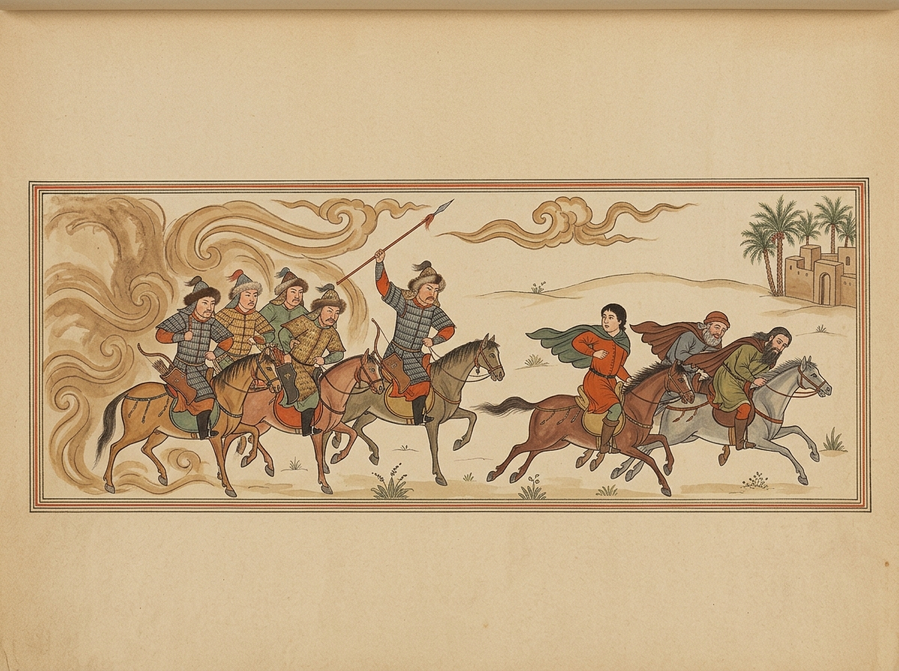
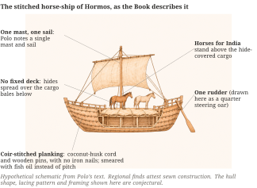

# Chapter I-7
## Kerman, Camadi, Hormos: Heat, Stitched Ships, and the Road Back to Kerman

> *“Their ships are wretched affairs… They have one mast, one sail, and one rudder.”*
> — Marco Polo, Book 1, ch. 19 (Yule–Cordier)

---

The silk from Yasdi (Yazd) has seven days of plain behind it when the gates of Kerman (Kermān) open. Step inside a workshop here and watch what skilled hands do with fine thread: women and their daughters stitching birds, beasts, and flowers in gold and coloured silk into cushions, quilts, and wall-hangings for noble halls [1]. Down the street, armourers and saddlers hammer out spurs, bows, quivers, and blades. One craft dresses the banquet hall; the other outfits the rider for the road.

Once, Kerman obeyed its own hereditary prince; after the Mongol conquest, the sovereign sent governors from court [2]. Smiths and embroiderers below care far less who holds the citadel, provided buyers keep riding through the gates. Up in the mountains, miners dig veins of turquoise [3] and smelt steel called *ondanique*, prized across Europe for sword-blades and gleaming mirrors [4]. Higher still, falconers trap a hawk smaller than a peregrine, red across the neck and breast, so swift that no quarry in the sky can outfly it [5].

Watch how the Book’s gaze sweeps from a needle in a back-street room to an *ondanique* blade in a nobleman’s belt, and from a turquoise vein in the cliff to a red-breasted falcon stooping over the crags. Kerman is an inventory of everything a Persian lord buys for his hall and his hunt.

Pause inside that armourer’s alley for a heartbeat to hear the ring of hammers. A European knight knows Damascus blades and Toledo steel; here, a Persian smith beats *ondanique* iron until its surface flashes like dark water. A merchant buying mirrors and sabres in Kerman is not merely shopping for curiosities. He is stocking wares that will fetch twice their weight in silver at every court between here and the Mediterranean, provided he can pack them dry against rust across the passes.

Seven days more carry the road through towns and hunting country to a high mountain pass. Wrap your cloak tight: in winter, a rider can pile on sheepskin after sheepskin and still freeze in the saddle. Then comes one of the sharpest drops in the entire journey—two days of steep descent down into fruit orchards, scattered herdsmen, and ruined villages [6]. By the time the hot plain opens below, the mountain chill feels like a dream, and every rider is unlacing his heavy furs as warm air thickens around the horses’ ears.

Think of what that forty-eight-hour plunge feels like to a muleteer leading loaded pack-animals. At dawn on the high pass, frost coats the leather straps and your breath hangs white in the air. Two evenings later, you are sweating under date palms in the bottomlands, swapping woollen cloaks for thin linen and checking your cargo for heat-spoilage. Few roads in the world drop a traveller from winter into summer in the space of two sleeps.

---

At Camadi (Qamādin, near Jiroft), repeated raids have battered what was once a thriving market town on the edge of the hot plain of Reobarles (Rudbar) [7]. Dates and pistachios thrive beside a fruit the Book calls the apple of Paradise [8]. Turtledoves flutter unmolested through the orchards because locals consider them unfit to eat [9], while red-beaked, red-legged francolins strut through the scrub—a country rich in birds and cattle, if you can keep them out of raiders’ hands.

Here stands a white humped ox waiting for its pack. It kneels like a camel while the driver hoists bales over its hump, then rises smoothly to its feet [10]. Beside the cattle graze sheep as big as asses, dragging fat tails weighing thirty pounds [11]—carrying their own cooking grease and lamp-tallow right behind them on the hoof. Stand beside a shepherd’s pen on the plain of Reobarles and you see why a traveller remembers the livestock: cattle that kneel like camels save half a morning’s labour when loading heavy bales, and fat-tailed sheep carry their own kitchen lard into camp.

Now climb a mud village wall and scan the plain. That earthen rampart is high enough to be worth spurring for. The bands known as Caraonas (Qaraunas) sweep across open country, sometimes ten thousand strong, bringing a darkness so thick a rider loses sight of the comrade at his elbow. The Book blames sorcery; anyone caught outside the walls is killed or carried off for ransom or sale [12]. A desert dust-storm needs no magic to hide a troop of horse, and it explains why merchants listen so nervously for hooves pounding toward the gate.

Their captain is named Nogodar (Negüder), styled nephew to Sigatay (Chagatai)—whom the Book mistakenly calls Cublay (Kublai)’s brother rather than his uncle, who died in 1242 [13]. In frontier legend, Nogodar marches through Badashan (Badakhshan), Pashai-Dir, and Keshimur (Kashmir), losing men and horses before seizing Dalivar from Asedin Soldan [14].

At Canosalmi, Marco puts himself squarely in the saddle. The sudden darkness nearly delivered him to the raiders too; only with seven companions did he reach safety inside a walled village, while the rest of his company were killed or taken [15]. Picture the dust settling outside that mud rampart while the seven survivors catch their breath and count empty saddles—the exact moment a merchant’s journey nearly ended before he ever smelled the sea. Whether that blinding darkness was a desert dust-storm or a frontier yarn sharpened in the telling, it marks how thin the line was between a profitable caravan and an unmarked grave.

{#fig-i-7-carauna-escape width=86%}

---

Past five days of plain and another steep descent, the road drops among clear streams, date palms, and bright birds, then crosses two days of the Plain of Formosa until the sea opens ahead [16]. After so many leagues measured by horse-stages, cargo meets an oceanic scale. At Hormos (Old Hormuz, in the Minab area), spices, pearls, silk, and ivory arriving by sea from India change hands for caravans bound inland [17]. Yet before investing heavily here, remember one sharp local law: if a foreign merchant dies in port, the ruler seizes every bale he brought [18]. That ruler, Ruomedam Ahomet, owes allegiance to Kerman—a tie that snaps the moment tribute falls behind.

At table, a visitor sits down to salt tuna, onions, and dates. Locals save meat and wheaten bread for days when they fall ill, and pour a spiced date wine that hits a newcomer harder than he expects [19]. Notice how practical Marco’s eye becomes whenever a port’s climate turns against a stranger: he tells you what local people eat to stay well, what they avoid until fever strikes, and why a single cup of date wine can knock a newcomer off his stool.

Down at the harbour, a shipwright twists cord from coconut husks, beaten fine and spun until it looks like horsehair. The hull planks are stitched together with this twine and wooden pins—not a single iron nail in sight—then rubbed with fish oil to seal the seams [20]. Salt water leaves the cord sound, yet a Venetian raised on oak and iron nails eyes those stitches nervously whenever a gale blows up, dismissing the craft as *"wretched affairs"* in the epigraph above.

Peer down into the hold before the cargo is stowed. Above those stitched planks rise a single mast, a single sail, and one rudder, with no proper deck at all. Bales go in the bottom, hides go over the bales, and the prize Persian horses bound for India stand on top, exposed to salt spray and sun [21]. Were you buying a passage, you would ask as many questions about those stamping hooves above the spices as about the coconut-husk stitches holding the hull together.

Yet step back and weigh the Venetian’s fear against the Indian Ocean’s reality. Oak planks fastened with iron nails rot and snap when coral reefs scrape a keel in shallow straits, whereas coconut twine flexes with the swell and lasts for years in warm salt water. Those stitched hulls carried horses, pearls, and spices across the Indian Sea for centuries before European carracks ever rounded the Cape. Polo’s nervousness is simply the instinct of a lagoon sailor raised on caulked oak and iron spikes, staring at a ship built for a different ocean and a different carpenter’s craft.

{#fig-c13-sewn-plank-hormos}

When summer heat clamps down over Hormos, anyone who can leaves town to sleep in gardens beside running water, under palms and awnings. When the scorching wind blasts off the desert, people wade into the water up to their chins until the gust passes [22]. You can judge a gale by how it bends a palm; this one is measured by how little of a man stays in the open air. Picture an entire harbour town—brokers, porters, moneychangers, and shipwrights—abandoning stone alleys at noon to sit neck-deep in shaded orchard channels while hot sand hisses through the palm fronds overhead.

Port yarns even send that same killer wind against an entire army: sixteen hundred horse and five thousand foot dispatched from Kerman to collect unpaid tribute, lost by their guide in the desert and baked so dry that their corpses crumble at a touch when townsfolk come out to bury them [23]. It has the unmistakable ring of a harbour tall tale told in the shade to impress a newcomer with how fierce the Gulf summer can get—nobody from Kerman came back to contradict it, and the desert kept the bones.

The calendar here belongs to the sun: grain sown in November, reaped in March, dates gathered in May, and the rest of the year parched bare [24]. Wives mourn dead husbands for four years with daily laments [25], swelled by paid mourners hired to lift the chorus [26]. Between chin-deep garden pools, stitched hulls, and four-year laments, Hormos feels like the edge of another world—yet the Book is not ready to cross the Indian Sea. Even a Venetian trader accustomed to strange harbours must pause before trusting his silver to a coast where the sun dictates the harvest and the sea-wind decides when a ship can weigh anchor.

---

India will wait for Volume III. For now, the Book turns back toward Kerman along a second inland road and leaves the ships riding at anchor [27]. Pleasant valleys, cheap provisions, dates, and partridges line the return march, along with natural hot baths said to cure skin ailments and fevers. Bread is plentiful too, though the local water bakes it so bitter that a stranger can scarcely choke down a mouthful [28]. Between healing springs you can soak in and loaves you can barely chew, the inland road tests a traveller’s stomach almost as sharply as the coast tested his tolerance for heat.

At Kerman, buy bread if you wish—but fill every leather water-skin to the stopper before riding out again. On the first three days toward Cobinan (Kuhbanan), even the puddles you find will be too bitter for a horse to drink, and a rider who forgets his water-skins learns quickly how fast a desert stage turns lethal.

---

## Notes

[1] ~ The Book makes silk embroidery a household skill and gives it a market among the nobility. Its list runs from hangings to cushions and quilts [@yc, 1.17 n. 4].

[2] ~ Polo treats the conquest as a switch from hereditary rule to appointments. The local Kutlugh-Khanid dynasty continued under Mongol suzerainty, making the transition more complicated than his account suggests [@yc, 1.17 n. 1].

[3] ~ Polo places turquoise in the mountains without naming a mine. Yule proposes a locality on the strength of a much later notice quoted by Ouseley [@yc, 1.17 n. 2].

[4] ~ Yule connects *ondanique* with *hundwānī*, the word for Indian steel. He cites Edrisi on good iron in the district and compares Mediterranean references to the blade metal [@yc, 1.17 n. 3].

[5] ~ Yule cites later reports of falcons from the region. The bird’s colouring and unsurpassable speed belong to Polo’s description [@yc, 1.17 n. 5].

[6] ~ The stages are given in days, and the change from cold upland to warm country is consistent with the approach to Jiroft. See [Map A4, the outbound road](ch-03-second-setting-forth.md#map-of-the-outbound-road) [@yc, 1.17 n. 6; @yc, 1.18 n. 1].

[7] ~ Pelliot places Qamādin by Jiroft without fixing the ruins. Polo contrasts its former prosperity with its condition after raiding and gives Reobarles as the name of the hot plain [@yc, 1.18 n. 1; @pelliot1959notes, vol. 1, p. 139].

[8] ? The “apple of Paradise” is a name the traveller carried with him. The plant behind it is disputed, with proposals including a citrus and the *konār* [@yc, 1.18 n. 1].

[9] ~ Zelada and Ramusio. The turtledoves and the reason given for leaving them alone are shared by the two witnesses. The base account has the fruit and the francolins [@yc, 1.18; @moule1938description, ch. 36, p. 120].

[10] ~ Polo says the humped cattle kneel for loading. Yule cites later observations of humped cattle in the region, and the action under the pack is the Book’s report [@yc, 1.18 n. 2].

[11] ~ Fat-tailed sheep are well attested, while the thirty pounds belongs to Polo’s description of an extreme specimen. Yule compares several travellers’ accounts of such tails [@yc, 1.18 n. 2].

[12] ~ The raiding bands have historical parallels, and Polo’s darkness fits the experience of poor visibility on the plain. The explanation by enchantment and the ancestry assigned to the raiders belong to the account. Yule cites Wassāf’s particularly hostile description of the bands [@yc, 1.18 n. 4; @pelliot1959notes, vol. 1, “Caraunas”].

[13] ✗ Sigatay was Cublay’s uncle and died in 1242. Pelliot found no nephew of Sigatay named Negüder and places the events of the account after Alaü reached Persia. See [Chapter I-10, “Pamier, Cascar, Samarcand, Yarcan, Cotan”](ch-10-pamier-cotan.md) [@yc, 1.18 n. 4; @pelliot1959notes, vol. 1, “Caraunas”].

[14] ? Pelliot notes the name of the raiding bands in records from 1270 and links Asedin to Ghiyāth al-Dīn. Dalivar is Lahore for Marsden and Yule and possibly Delhi for Pelliot [@yc, 1.18 n. 4; @pelliot1959notes, vol. 2, “Dilivar”].

[15] ? Yule’s account follows Pauthier for the seven survivors. Polo places himself in the danger, but the site of Canosalmi and the timing of the incident remain open [@yc, 1.18 n. 5].

[16] ~ The Book names the last stretch the Plain of Formosa and fills it with streams and palms. Yule compares routes into the littoral, whose stages remain approximate [@yc, 1.19 n. 1].

[17] ✓ The mainland predecessor of the island port lay in the Minab region, and the removal to Jarun followed around 1300. The exact archaeological identification within the region remains a hypothesis [@yc, 1.19 n. 1; @floor2004hormuz; @potts2022minab].

[18] ~ Polo makes the ruler, Ruomedam Ahomet, heir to a foreign merchant’s goods if the merchant dies there. The ruler’s dependence on Kerman and the terms in which Polo reports it are discussed by Yule [@yc, 1.19 nn. 1, 6].

[19] ~ Polo describes the coastal foods and the use of date wine in the same breath as people’s explanations for staying well. Yule’s comparisons give some support for the pattern, while the rules and their effects belong to the account [@yc, 1.19 n. 2].

[20] ✓ Sewn joints occur on reused marine timbers studied in the Red Sea. That evidence also includes nailing and leaves the date of the planks’ original use uncertain, so the construction can be placed in a wider tradition with variation [@yc, 1.19 n. 3; @blue2011ships]. Reused timbers at al-Balīd in Oman also preserve evidence of sewn construction [@vosmer2019sewn, pp. 310–11].

[21] ~ The single rig and the horses over the hides are Polo’s observations or reports about ships in the harbour. Yule compares other accounts of sewn ships and the traffic in horses, with the precise form of the steering gear open [@yc, 1.19 n. 3].

[22] ~ The seasonal hot wind is the *samūm*. The practices of sleeping outside the town and taking to the water are described by Polo and compared with other Gulf reports by Yule [@yc, 1.19 n. 4].

[23] ✗ Ramusio-only. The force and its destruction occur in the bracketed account, including the claim that Marco was present at the time. The army story is a much stronger claim than the account of the hot wind [@yc, 1.19 n. 5].

[24] ~ Polo gives a winter sowing, a spring harvest and a separate month for dates. The exact timing and the blanket statement about vegetation belong to his description [@yc, 1.19].

[25] ~ The Book’s account gives the mourning a duration of four years and has relatives and neighbours join the daily lament. The paid participants are a separate addition [@yc, 1.19].

[26] ~ Zelada and Ramusio. Hired mourners appear in both witnesses. Yule brackets the clause about them in his edition [@yc, 1.19; @moule1938description, ch. 37, p. 125].

[27] ? The Book moves from Hormos back to Kerman and defers India. Yule and Haw read the sequence as a decision to abandon a sea route. The Book gives the order of its narrative and leaves the relation between the outward journey, the return and the description of the port disputed [@yc, 1.19; @yc, Intro. § 19; @haw2006marco, ch. 3].

[28] ~ Polo gives the bitter bread as a consequence of the local water. The use of natural hot baths belongs to the road account, with the cures presented as claims [@yc, 1.19 n. 7].
