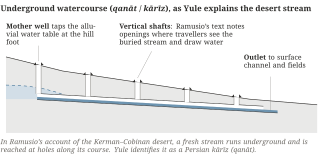
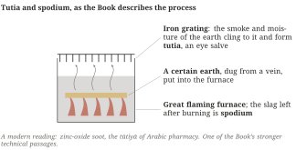
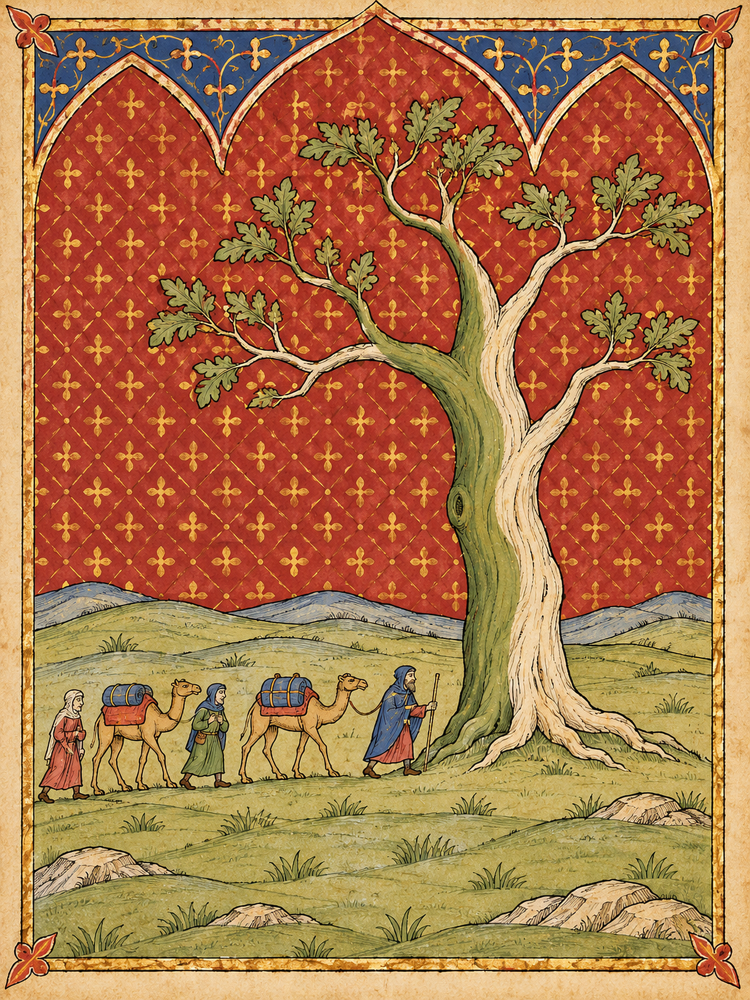

# Chapter I-8
## Cobinan, the Arbre Sec, and the Old Man of the Mountain

> *“It is a tall and thick tree… and there are no other trees near it nor within a hundred miles of it.”*
> — Marco Polo, Book 1, ch. 22 (Yule–Cordier)

---

The water that baked bitter bread on the road from the coast was at least wet enough to knead dough. Out of Kerman (Kermān), you carry your own or go dry. Seven days span the desert track, with scarcely a drop of sweet water in the first three [1]. What puddles glint in the hollows run green and salt-crusted, and pack-horses—thirsty enough to drink *"will they nill they"*—sicken and die [2]. No village greets a rider here, and no scrub feeds a wild beast. Even the salt crusting the margins of those pools works against the caravan, turning every watering-stop into a gamble. Think of how much of a caravan’s business hangs on a single leather water-skin: you can measure your miles on parchment and still stand stranded the hour a mule collapses. On a desert crossing, water is not a free gift of nature; it is the heaviest cargo on the pack-train, taking up saddle-room that ought to carry silk or steel. Every skin that leaks at a seam, every green puddle that poisons a thirsty pack-horse, turns a routine three-day stage into a silent race against thirst.

Reach the end of that third day, though, and suddenly water runs beneath your boots. Peer down into vertical shafts cut straight through the desert sand, and you hear a cool underground stream gliding along its buried channel, wide enough to lower a bucket and water every beast [3]. A Persian irrigator knows well enough how covered channels carry snowmelt from distant hills under the desert floor. Up on the surface, there is a world of difference between knowing water flows somewhere in the dark and being able to lower a leather bucket into it. To a farmer who dug those shafts, every drop was meant for distant fields; to a parched caravan, it is a miracle hidden under the gravel.

{#fig-c15-qanat}

Four days more past wild asses bring the road to Cobinan (Kuhbanan)—and suddenly the hills ring with iron and steel. Great steel mirrors are forged here, polished bright enough to catch a buyer’s eye across a crowded courtyard [4]. Set one on a merchant’s trestle and any customer can judge its temper at a glance, turning the blade-bright surface to catch the street light and test the polish for flaws. Yet two humbler powders sit beside those mirrors in the stalls, born inside the same smithy by opposite paths.

Watch the iron grating suspended above the furnace fire. A special earth goes into the coals; rising vapour settles as a crust along the iron bars, and workers scrape off that deposit as *tutia*, prized far and wide as a salve for sore eyes [5]. Meanwhile, what remains in the belly of the furnace after the firing is raked out as *spodium* [6]. One man scrapes the grate while another shovels the ash-pit, and both carry their baskets out to the same bazaar. You could walk the stalls all morning without guessing how differently those two powders were born—one condensed out of rising smoke, the other left behind in the cinders. Soon muleteers pack that *tutia* into small wooden boxes bound down to Hormos (Old Hormuz, in the Minab area) and the Indian Sea [7]. A merchant’s ledger rarely asks how a powder was born once it reaches the quay, yet at Cobinan smoke and cinders feed the same ocean trade from opposite sides of the fire.

{#fig-c6-tutia-furnace}

---

Load water again. Beyond Cobinan stretches an eight-day waste, bare of trees or fruit and cursed with the same bitter pools. At Tonocain (the Tun and Qaen region), the Book reaches the northern rim of Persia [8]. Towns and villages reappear, the air settles into a gentle mildness neither frozen like the passes nor blistering like the coast, and households have surplus bread and fruit to sell. After eight days of salt-crusted pools and empty gravel, even a modest village market with warm loaves and fresh apricots feels like a small kingdom of plenty.

Out on a flat plain in that country stands the Arbre Sec (the Dry Tree), which the Book also calls the Arbre Sol [9]. One side of its bark shows green, the other white. Pick up one of its fallen husks: rough as a chestnut bur, it promises a kernel inside, yet cracks open hollow. Its wood is yellow and dense as boxwood [10]. To meet another tree, you must ride a hundred miles in almost any direction—or ten if you take one open quarter. I would dismount by the one we have.

Turn that empty husk over in your palm for a moment. Whether *Arbre Sol* meant the Lone Tree standing sentinel on an empty horizon or echoed the Alexander romances, any tired rider squinting across dry sand knows why a solitary trunk earns a story before anyone asks who fought beneath its boughs. After days of scanning bare gravel for a well-shaft or a patch of scrub, a tall tree with two-coloured bark feels like a beacon planted at the edge of the world. Local people point to the plain as the ground where Alexander clashed with Darius [11]—a famous battle turned into a milestone long after the banners rotted. Put the tree and the battle together, and a traveller carries the whole district home in a single unforgettable image, even if the next rider has a hard time pinning that lone trunk to a modern map.

{#fig-i-8-dry-tree width=78%}

---

The next valley is as lush as this plain is bare, though you enter it by local hearsay rather than the caravan track. People in the region told Marco of the Old Man of the Mountain (associated with Alamut, in the country the Book calls Mulehet) [12]. Behind a massive fortress blocking a narrow mountain pass, the Old Man—named Aloadin (ʿAlāʾ al-Dīn Muḥammad)—spread out fruit orchards, gilded and painted pavilions, and four conduits running through the grass: cool water alongside wine, milk, and honey [13]. Young women sang, played instruments, and danced in the shade, turning the hidden valley into a living paradise where every appetite was answered before it was spoken. For any caravan master resting in a dusty bazaar, it was the most irresistible winter tale on the road.

First impressions did all the work. Guards sealed the pass, and recruits woke inside the garden after drinking a sleeping draught [14] without ever seeing the gate or the mountain road. For a few days, their own senses were the only witnesses they had—and the drugged cup and the sentries at the pass had already settled what those senses would swear to. Picture a young hill-man waking among golden pavilions and shaded fruit trees after a deep sleep, listening to lutes beside streams of wine and honey: how could he doubt he had stepped through death’s door into paradise itself?

Soon enough, the youths woke again inside the grim stone castle, summoned before the one ruler who held the key back to paradise. Now someone who had only heard of heaven could listen to a comrade who had walked its paths and drunk from its four streams. From there, the Book turns the traffic between garden and fortress into the engine of the Old Man’s power when he dispatches assassins abroad [15]. A follower convinced that death on a mission returns him straight to those four conduits obeys without flinching. Neighbouring rulers paid tribute simply to sleep safely in their beds [16], while the Old Man stationed deputies around Damascus and in Curdistan (Kurdistan) [17].

Think of how cleanly that story explains a political terror that baffled outsiders across Eurasia. When a ruler falls to a lone dagger in a crowded courtyard and the killer smiles at the scaffold, onlookers hunt for a hidden spell—and the Book hands them a locked valley, a sleeping draught, and a promise of four sweet streams.

Where you stand decides which story you think you are watching. Down by the pavilions, a boy swears the music drifts from heaven. Up at the gatehouse, a captain logs every arrival and every dose. Picture the sheer theatrical grip of that rumour on medieval listeners far away in Europe: a hidden mountain paradise turned into a weapon of political terror, where young men step off palace rooftops or plunge daggers into princes without a flicker of fear.

Behind that tidy outsider thriller lay real Nizārī strongholds and communities whose own histories tell a very different tale [18]. Mountain castles really did guard narrow passes, and their garrison captains really did weigh alliances and survival against overwhelming odds. When the Mongol army finally arrived, real walls and real politics decided the siege.

---

An army has a plainer way of opening a valley. Alaü (Hulagu) sent a force against the Old Man, and in the Book’s telling his troops sat outside the castle for three years until hunger broke the defenders, slaying Aloadin and levelling both fortress and paradise garden in one stroke [19], [20]. Once the pavilions and conduits are wiped out in a single sentence, nowhere remains in the tale for any recruit to return to.

The real campaign kept a sharper calendar. Kitbuqa was already pressing the Nizārī castles in the early 1250s. Aloadin died before the end, his son Rukn al-Dīn Khurshāh yielded in 1256, and his main stronghold fell that December [21], while stubborn fortresses like Girdkūh held out for years afterward [22]. Chronicles separate the strongholds, the commanders, and the stages of the war: a father dies while his walls still hold, leaving a son to negotiate terms with the Mongol besiegers. Follow the people rather than the legend, and the neat ending opens out again: the Mongols broke the Nizārī state, yet Nizārī communities endured long after the fortress gates were pulled down [23].

A storyteller can travel a long way on a tale about a valley he never entered. Marco is careful to name his local informants at the start and step cleanly back onto his own road at the close [24], and that seam is worth keeping visible. The story makes it easy to picture four bright streams running through a shaded orchard, even if Marco never set foot inside the pass. Beyond these mountains, though, the road opens onto pastures and markets where a soldier or a merchant can put real food on a plate, and where a caravan no longer has to ration every drop of water from a leather skin.

Inside a besieged castle, every crust is counted and every day without relief shrinks the garrison’s hopes. Every sentry on the wall watches the horizon for dust, and every empty granary brings surrender one step closer. Step out beyond those hills onto the road to Sapurgan (Shibarghan), where the grass grows thick and the orchards hang full—and where a caravan finally packs away its empty water-skins beside a clear mountain stream and rests its tired horses in the shade after days of dust.

---

## Notes

[1] ~ The Book counts seven days from Kerman to Cobinan. Houtum-Schindler, quoted by Cordier, proposes a longer route east of the mountains to account for the stages and waterless stretches [@yc, 1.20 n. 1]. See [Map A4, the outbound road](ch-03-second-setting-forth.md#map-of-the-outbound-road).

[2] ~ Yule compares accounts of saline watercourses in the region. Polo makes the shortage and the consequences for livestock part of the description of this particular crossing [@yc, 1.20 n. 2].

[3] ~ Ramusio-only. The openings and the underground stream are bracketed. Yule compares the passage with Persian watercourses called *qanāts* or *kārēzes* and suggests that this example may once have supplied cultivated land [@yc, 1.20 n. 3].

[4] ✓ The place is identified with Kuhbanan, which Yule finds named by medieval geographers. Later reports also mention metalworking resources in the district, including the material associated with the iron and the steel that Yule discusses, while the size of Polo’s town is open to question [@yc, 1.21 n. 1].

[5] ~ Yule compares other accounts of the material marketed as tutia and its use in preparations for the eyes. The collection above the furnace is the practical detail Polo supplies [@yc, 1.21 n. 2]. See [Diagram C6, the Cobinan furnace](ch-08-arbre-sec-old-man.md#fig-c6-tutia-furnace).

[6] ~ The Book distinguishes the material left from the firing from what collects on the iron. Yule discusses different uses of the name *spodium*, which make an exact modern identification uncertain [@yc, 1.21 n. 2].

[7] ~ Teixeira, cited by Yule, describes tutia from the region travelling in boxes to Hormos. His later account concerns the trade and gives a different preparation from the one in the Book [@yc, 1.21 n. 2].

[8] ~ Tonocain is usually read as Tun and Qaen, with a wider region intended in Polo’s account. Yule and the writers quoted by Cordier discuss different approaches to the district [@yc, 1.22 n. 1].

[9] ? The Book gives the two names. Pelliot argues that *Arbre Sol* means “Lone Tree”, while Yule discusses the Tree of the Sun and the Dry Tree alongside the Alexander tradition [@yc, 1.22 n. 2; @pelliot1959notes, vol. 2, p. 628].

[10] ~ Marsden and Yule compared the features with the oriental plane. The identification of an individual tree and the extent of its isolation remain open [@yc, 1.22 n. 2].

[11] ? The association with a battle belongs to the legend of Alexander in the region. Yule traces the parallels in stories of extraordinary trees associated with Alexander [@yc, 1.22 n. 2].

[12] ~ Polo presents the account as something told to him in the region. Yule links Mulehet to *Mulāḥidah*, an epithet applied to the Nizārī Ismāʿīlīs by their opponents [@yc, 1.23 n. 1].

[13] ? The garden of honey, milk, wine and water belongs to a story about the Old Man’s rule. Virani examines the tradition as a later paradise-garden legend [@yc, 1.23; @virani2021garden].

[14] ? Polo gives the drink an effect and leaves the substance unspecified. Lincoln discusses an earlier story by Arnold of Lübeck with an intoxicant and deceptive visions, which establishes a parallel in the legend [@yc, 1.23 n. 1; @lincoln2006terrorism, pp. 250–252].

[15] ? The promise of return to the garden gives Polo’s tale its explanation of obedience. Yule compares other versions of the story, while Daftary discusses the tradition in the context of the history of the Ismāʿīlīs [@yc, 1.24 n. 1; @daftary1990ismailis].

[16] ~ The Book presents the ruler’s reputation as a motive for the payment of tribute. Its explanation is part of the portrait of his power [@yc, 1.24].

[17] ~ There were Nizārī communities and strongholds in Syria, while the relationship between those communities and the Old Man’s deputies in this story is uncertain. Polo gives Damascus and Curdistan as their territories [@yc, 1.24 n. 2].

[18] ~ The strongholds are historical, as is the Mongol campaign against them. The combination of a fortress, a hidden garden and young men deceived into obedience belongs to the legend as Polo tells it [@yc, 1.24 n. 1; @daftary1990ismailis; @virani2021garden].

[19] ✗ Yule follows a text giving 1252, with other readings of 1242 and 1262. The three-year siege and the Old Man’s death at its end combine events that the historical accounts keep distinct [@yc, 1.25 n. 1].

[20] ~ Ramusio-only in part. The V text already has the castle levelled. The garden destroyed with it is the additional detail in Ramusio’s version [@yc, 1.25; @simion2019devisement, 21.10].

[21] ✓ Kitbuqa’s operations preceded Alaü’s arrival. Khurshāh surrendered in 1256 and Alamūt was handed over that December [@yc, 1.25 n. 1; @daftary2000khorshah].

[22] ✓ Some strongholds did not yield when Khurshāh did. Yule distinguishes Girdkūh’s much longer resistance from what happened at Alamūt [@yc, 1.25 n. 1].

[23] ✓ The Nizārī state lost its strongholds and political power. The history of the communities continued beyond the conquest [@yc, 1.25 n. 1; @daftary1990ismailis].

[24] ~ The Book locates Marco’s hearing of the story in the region and describes no visit to the valley. Alamūt is well away from the itinerary usually reconstructed between Cobinan and Tonocain [@yc, 1.22 nn. 1–2; @yc, 1.23; @yc, 1.25].
