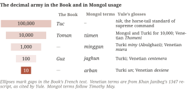

# Chapter I-12
## Caracoron, Chinghis, Prester John, Tenduc: How the Tartars Became Lords

> *“When Chinghis Kaan heard the brutal message that Prester John had sent him, such rage seized him that his heart came nigh to bursting within him…”*
> — Marco Polo, Book 1, ch. 48 (Yule–Cordier)

---

At Etzina (Khara-Khoto), twelve days north of Campichu (Zhangye), every conversation at the gate begins with rations. Stocked with camels, cattle, and fine sakers and lanners for hawking [1], the oasis is the last trading counter before forty days of northern emptiness. In summer, a caravan might spot scattered camps. In winter, with the cold biting down and wild asses sheltering in thin woods, anyone promising you a hot meal along the track would have plenty to answer for [2]. Every sack of flour and dried meat must be lashed to your camels before the oasis gate closes behind you.

See [the map of the desert and Tangut road, I-11](ch-11-lop-tangut.md#map-of-the-desert-and-tangut-road).

At the far side of that waste stands Caracoron (Karakorum), the first city the Tartars held after riding out of their native pastures in the Book’s telling [3]. An earthen rampart rings the town for want of stone, guarding a citadel and a governor’s palace [4]. Earlier Franciscan envoys knew its foreign merchant quarters and the famous mechanical silver tree pouring drinks at court. Modern excavations have shown the great hall in the south-west was a Buddhist temple, leaving open whether Marco ever saw the city himself [5].

To explain how the Tartars won that capital, the Book rides back out onto the grass. Once, it recalls, their clans paid a tenth of their beasts and goods to a lord called Unc Can (Toghrul)—known across Europe as Prester John, the fabled Christian king of the East [6]. Growing uneasy at their numbers, Unc Can tried to scatter them across his lands. Instead, they drifted north across the desert and cut off his tribute altogether [7].

Out of those clans rises Chinghis (Chinggis Khan), swelling his ranks by shielding the defeated and winning their loyalty [8]. Soon he sends envoys asking for Prester John’s daughter in marriage. Picture the ambassadors riding back across the steppe with the answer: Unc Can swears he would sooner burn his daughter alive than give her to a man he still counts as his vassal [9].

Both hosts march onto the plain of Tenduc (the Hohhot region, provisionally) and camp two days apart. Before the trumpets blow, Chinghis summons Muslim and Christian astrologers to read the outcome. Only the Christians produce a sign. Splitting a cane down the middle, they name one half for Chinghis and the other for Unc Can, lay them apart untouched, and chant a psalm. Before both watching armies, Chinghis’s cane climbs cleanly on top of his rival’s [10].

{#fig-i-12-cane-divination}

At dawn the battle breaks. The Book has Prester John fall on the field [11] and kills Chinghis himself a few campaigns later with an arrow to the knee at a fortress called Caaju [12]. In truth, Unc Can’s final defeat came in 1203 along the Tula and Kerulen rivers—not at Tenduc in 1200. He escaped the field only to die at Naiman hands, while Chinghis lived another twenty-four years [13].

From the founder, the Book leaps straight down the throne-line: Chinghis, Cuy (Güyük), Batuy (Batu), Alaü (Hulagu, called Alacou here), Mongou (Möngke), and Cublay (Kublai), whom it ranks above all the rest combined [14]. That brisk dynastic roll skips the supreme reign of Ögedei between Chinghis and Cuy. It also promotes Batuy and Alaü—western appanage lords of the Volga and Persia—onto the imperial throne itself [15].

Even in death, a Great Kaan keeps moving. Every ruler is carried to a mountain called Altay (Altai), no matter how far away he dies. The funeral escort slays his finest horses and anyone unlucky enough to cross its path so they may serve him in the next world [16]. At Mongou’s burial, the Book puts that slaughter at over twenty thousand—a romance-scale figure unsupported by surviving Mongol and Persian accounts [17].

---

Step away from the funeral road and watch a living steppe camp on the move. Households shift between winter valleys and summer grass, carrying their round houses of wooden rods wrapped in felt. When struck, they leave no wall behind; when pitched again, their doors always face south [18]. A stranger seeking a camp soon learns not to ask how many miles lie to last month’s site. You ask where the grass is green today, and how long the herds will linger before the wagons roll again.

Black-felt wagons roll behind teams of oxen or camels, keeping women and children dry under rain and snow [19]. Meanwhile, the women handle all buying and selling so the men can hunt and drill for war [20]. Moving day is a market calculation as well as a march: someone has to know what hides or wool will fetch at the next crossroads.

Dinner comes from the herds and the chase, down to burrowing marmots and fermented mare’s milk—*kemiz* (kumis), praised like white wine [21]. Noble wealth shows in sable and ermine lining robes of silk and cloth of gold [22]. A bridegroom pays his bride’s mother, a man takes as many wives as he can support with the first holding chief rank, and custom binds a widow to her kinsmen so no household drifts untended [23].

Inside the felt tent stands a smaller family of cloth and felt images: Natigay, guardian of children and livestock, with his wife to his left and his children before him. At mealtime the household smears fat on each figure’s mouth and tips a spoonful of broth outside the door [24], [25]. They also burn incense above the hearth to the god of Heaven for sound mind and body [26].

Pause inside that felt doorway for a moment to watch how natural religion looks in a nomad home. There are no stone pews, no stained-glass windows, and no marble altar—only a hearth-fire, a kettle of mutton broth, and small stitched felt figures propped beside the tent-pole receiving the first warm grease of supper before any rider lifts his own spoon.

When a trooper rides out on campaign without his wagons, watch how light he travels: leather flasks, a cooking pot, and a small shelter. His horse grazes as it goes. The rider packs dried milk paste and shakes it with water in a leather bottle until the gallop itself churns his supper [27], [28]. What catches a merchant’s eye is not what the army carries, but what it can leave behind when mounts feed themselves and riders travel light.

Pause to compare that cavalryman with a European knight riding to war. A knight needs pack-horses for oats, grooms for his armour, and supply wagons lumbering behind the column. A Mongol trooper carries his kitchen in his saddle-pouch, sleeps under a felt strip, and turns his mount loose to crop grass by night—turning an entire army into a fast-moving storm that outruns every supply line.

Orders travel just as cleanly down a decimal chain—commanders of ten, a hundred, a thousand, and ten thousand [29]—leading cavalry that can feign flight and wheel to ambush a careless pursuer [30].

{#fig-c4-decimal-army}

Out on shared pastures, hot-iron brands separate every owner’s herds without fences while shepherds guard the sheep [31]. Horse-thieves pay ninefold ransom; lesser thefts draw counted blows starting at seven [32]. Stranger still to European ears is the wedding of dead children. Two bereaved families draw up a marriage contract, burn it, and commit paper dowries to the fire so the parents become kin as though the couple had lived [33]. Even in grief, steppe custom turns paper and smoke into a binding legal bond between two living households.

North of Caracoron, the Book glances toward Bargu (the Lake Baikal region), where riders mount deer [34] and catch moulting waterbirds too heavy to fly [35]. Along a distant northern ocean, cliffs breed peregrines and islands breed gerfalcons—and the Book knows which court buys them: not Europe’s, but the Great Kaan’s [36]. Even at the frozen edge of the world, rare hunting birds still flow south into the same imperial treasury.

---

Back at Campichu, the road strikes east to Erguiul (the Liangzhou region) with a south-east spur to Sinju (Xining). Here sturdy highland yaks out-pull lowland oxen at the plough; herders cross them with domestic cows, and Marco even carried white yak-hair home to Venice [37], [38]. From the same hills comes musk, prized by every apothecary: a small, hornless deer with sharp fangs whose belly-sac yields the scent—mistaken in the Book for congealed blood. Marco also brought its dried head and feet back to Venice so sceptical neighbours could count the teeth themselves [39], [40].

Imagine a Venetian neighbour standing in Marco’s courtyard back home, turning a shaggy white yak-tail and a dried deer’s jawbone over in his hands. Words on parchment can be doubted over dinner, yet a tangible trophy pulled out of a sea-chest forces even a sceptic to lean closer and ask where on earth such beasts grazed.

Eastward from Erguiul lies Egrigaia (the Ningxia region), where white camels yield snow-white camlets woven for distant buyers [41]. Farther east still, Tenduc offers dyed camlets and azure stone [42] under King George (Körgüz of the Önggüd), a Christian vassal styled a descendant of Prester John and wedded to imperial princesses [43]. Outside the Book, a 1305 missionary letter from Cathay confirms a real Prince George who embraced the Latin rite and built a church—fixing the man far more firmly than anyone has fixed the town of Tenduc [44].

Past *Argons*—sharp mixed-ancestry traders—and a nod to Gog and Magog [45], the road enters weaving towns turning out gold-and-silk *nasich* and *naques* as familiar locally as woollens in Venice [46]. At Sindachu (Xuandezhou), smiths arm the Kaan’s troops, while nearby Ydifu hides a silver mine and rich hunting grounds [47]. A merchant passing through swaps silver-mine gossip for cloth prices without climbing a single ridge, tracking every craft and metal seam within reach of the capital.

At last the track reaches the palace of Chagannor (Chaghan Nor), where swans glide across white lakes and Cublay rides out to fly his falcons [48]. Five distinct cranes strut before the reader: jet-black, great white with gold peacock-eyes on its wings, giant grey, smaller plumed, and the familiar common sort [49]. Meanwhile, keepers in a nearby valley rear partridges by the hundred for the emperor’s sport [50]. By the time the imperial hunting party arrives at Chagannor, every lake and covert has been stocked and watched for months. That quiet valley of kept birds is a neat reminder of how much unseen labour props up every imperial afternoon in the saddle: while the emperor slips his hawk, dozens of local keepers have spent all spring guarding nests and scattering grain so the royal sport never disappoints.

From the cranes on the plain of Chagannor, three days in the saddle north-east bring you to the sixteen-mile outer wall of the emperor’s summer park, where marble halls, a portable bamboo palace, and ten thousand milk-white mares await the court. Every league of that final ride leaves the open steppe behind and carries the traveller straight toward the gilded gates of Chandu (Shangdu), where summer court life awaits.

---

## Notes

[1] ✓ Etzina is the Khara-Khoto area. Polo names the two kinds of falcon [@yc, 1.45 nn. 1–2].

[2] ~ The forty days are the Book's figure. Yule identifies the wild asses as *Asinus hemionus* [@yc, 1.45 nn. 2–3].

[3] ~ Caracoron is the historical Mongol capital in the Orkhon valley, though the Book does not establish that Marco visited it in person [@yc, 1.46 n. 1]. His description introduces a broad historical and ethnographic excursion on the steppe Mongols.

[4] ~ Ramusio-only. The rampart, citadel and palace are in his bracketed passage [@yc, 1.46].

[5] ✓ Rubruck describes the city and the silver tree; its maker was from Paris [@rockhill1900journey, account of Mongou’s palace at Caracarum]. Archaeology identifies the excavated Great Hall as a Buddhist temple. The palace under Erdene Zuu remains a proposal [@bemmann2021karakorum; @dai2015hall].

[6] ~ Unc Can recalls the Kerait lord Toghrul. Prester John brings the European legend to his story [@yc, 1.46 n. 4].

[7] ~ Paying cattle tribute to Unc Can and migrating northward into the steppe to escape his authority belong to the Book's simplified account of early Mongol vassalage [@yc, 1.46]. The story compresses decades of steppe confederation politics into a single break.

[8] ✗ The Book dates Chinghis's rise to 1187, early for the title conferred in 1206. Its peaceful conquest of the eight provinces is idealised [@yc, 1.47 n. 1].

[9] ~ The embassy and its insult are in the Book. Yule compares the failed double marriage with Unc Can's house [@yc, 1.47 n. 2].

[10] ~ The camps and cane are the Book's staging of the war. Yule compares Christian divination among the Mongols [@yc, 1.48–49].

[11] ✗ Unc Can survived the battle in which Chinghis broke his power [@yc, 1.49 n. 1; @yc, 1.50]. In the historical accounts he fled the field and was killed soon afterward among the Naiman.

[12] ✗ Chinghis died in 1227 during the Tangut campaign. Yule considers possible sources of the confusion over his wound and Caaju [@yc, 1.50 n. 1].

[13] ✓ The earlier engagement and the final one are distinct in the chronology Yule takes from Gaubil. The Naiman killed Unc Can after his flight, in the account cited by Yule [@yc, 1.49 n. 1].

[14] ✗ This is the order in the Book. Its argument for Cublay's superiority is praise [@yc, 1.51 nn. 1–2].

[15] ✓ Yule's commentary distinguishes the supreme Great Kaans—adding the omitted Ögedei after Chinghis—from Batuy and Alaü, who ruled regional uluses on the Volga and in Persia [@yc, 1.51 nn. 1–2].

[16] ? Altay is the Book's name, with the site disputed. The reported killing of people and horses is part of its funeral account [@yc, 1.51 nn. 3–4].

[17] ? Yule relays an escort story about Chinghis from Rashid. Pelliot translates an excerpt of Rashid on Mongou's mourning and burial. Its ellipsis leaves the omitted text unavailable as evidence for Polo's figure [@yc, 1.51 n. 4; @pelliot1959notes, vol. 1, “Cinghis”].

[18] ✓ Circular felt-covered framework tents (*yurts* or *gers*) pitched with their doors facing south match the eyewitness accounts of Rubruck and Carpini [@yc, 1.52 n. 1; @rockhill1900journey]. Seasonal movement between winter valleys and summer highland pastures structured nomadic life across the steppe.

[19] ✓ Two-wheeled and four-wheeled carts covered in black felt and drawn by oxen or camels appear in the thirteenth-century accounts of Rubruck and Carpini compared by Yule [@yc, 1.52 n. 2; @rockhill1900journey]. The rain-tight coverings allowed entire camps to carry household goods and families dry across open country.

[20] ~ Assigning buying, selling, and household management to women while men devoted themselves to hunting and warfare matches the observations of early Franciscan envoys to the Mongol courts [@yc, 1.52 n. 4]. Elite and ordinary Mongol women exercised wide economic responsibility whenever the men rode out on campaign.

[21] ✓ Yule compares Rubruck's detailed account of churning and fermenting mare's milk (*kumis*) and identifies the burrowing *Pharaoh's rats* of the text with steppe marmots [@yc, 1.52 n. 3; @yc, 1.53 n. 2; @rockhill1900journey]. Fermented mare's milk and game sustained the camps without reliance on grain.

[22] ~ Summer and winter robes of gold cloth and silk lined with costly sable, ermine, and fox pelts belong to the Book's portrait of wealthy steppe nobles [@yc, 1.53]. Fur linings marked rank and wealth inside the mobile camps just as silk brocades did at court.

[23] ~ The Book describes the marriage payment, senior wife and rules for marrying widows. Yule compares other reports of the customs [@yc, 1.52 n. 5].

[24] ~ The figures and their portion of a meal are in the main account. Yule compares the household images described by Carpini and Rubruck [@yc, 1.53 n. 1].

[25] ? Pelliot follows Banzarov in linking Natigay, Carpini's Itoga and Etügen. Mostaert's reading, discussed by Ragagnin, is *Načigai*, attested in a fragment dated 1312 [@pelliot1959notes, vol. 2, “Natigai”; @ragagnin2017natigay].

[26] ~ Ramusio-only. The opening of the chapter in his version gives the god of Heaven, the incense and the prayer [@yc, 1.53].

[27] ~ Ramusio-only in part. The kit and the use of dried milk belong to the Book, while the preparation and the bottle churned by the ride are in the bracketed passage [@yc, 1.54 nn. 3–5].

[28] ~ The Book treats grazing and the capacity to travel without supplies as advantages. Its account includes prolonged endurance and drinking horse blood in extremity [@yc, 1.54 nn. 3–4].

[29] ✓ Organizing the army in units of ten, a hundred, a thousand, and ten thousand is recorded in the *Secret History of the Mongols* [@derachewiltz2004secret, §§ 121 and 191]. The Book's French text leaves the names for ten and a thousand blank, and Yule gives Turkic parallels for both [@yc, 1.54 n. 2]. See [Diagram C4, the decimal army](#fig-c4-decimal-army).

[30] ~ Ramusio-only in part. Polo gives the pursuing army's view of the mounted archers, while the elaboration about avoiding a mêlée and pretending to flee is from Ramusio [@yc, 1.54 n. 6].

[31] ~ Marking horses, cattle, and camels with each owner's brand allowed large herds to graze unpenned across shared pasturelands [@yc, 1.55 n. 2]. Flocks of sheep and goats, by contrast, required constant watching by mounted or foot shepherds.

[32] ~ The numbers are Polo's. Yule compares a similar scale of punishment in other accounts [@yc, 1.55 n. 1].

[33] ~ The account of the dead couple is Polo's. Yule gives close comparisons in Chinese sources [@yc, 1.55 n. 3].

[34] ? Yule links Bargu with the Baikal region. The identification of the Mescript, whose animals are ridden in the story, is disputed [@yc, 1.56 n. 1].

[35] ~ Ramusio-only. The moulting birds and fish are in the bracketed passage [@yc, 1.56 n. 2].

[36] ~ The nests, far northern ocean and different destinations for hawks are the Book's account. The North Star behind the traveller towards the south is an exaggeration [@yc, 1.56 nn. 3–4].

[37] ✓ Yule identifies the shaggy wild and domesticated cattle of the Tangut highlands as yaks (*Bos grunniens*) [@yc, 1.57 nn. 1–3]. Their strength at the plough and burden-carrying across high mountain passes were prized throughout the Tibetan marches.

[38] ~ Ramusio-only. The hair taken to Venice and the crosses with domestic cattle are in bracketed passages [@yc, 1.57 n. 3].

[39] ~ The animal is the Siberian or Alpine musk deer (*Moschus*), whose abdominal pod yields the prized perfume [@yc, 1.57 n. 4]. Polo mistakes the glandular secretion for congealed blood and gives the buck four tusks instead of its two elongated upper canines.

[40] ~ Ramusio-only. The dried head and feet brought to Venice are a claim of the later witness [@yc, 1.57 n. 4].

[41] ~ The distinction between the white camlets and the rest belongs to the Book. Yule discusses several proposed identifications for the capital [@yc, 1.58 nn. 1–3].

[42] ~ The azure stone is usually read as lapis. The Book gives the cloth and stone together as wares of the district [@yc, 1.59 n. 3].

[43] ✓ King George is historical: Chinese records and John of Monte Corvino attest Körgüz, the Christian ruler of the Önggüd who married into the Yuan imperial house [@yc, 1.59 nn. 1–2]. Making him the sixth-generation descendant of Prester John blends his real Nestorian-turned-Catholic dynasty with European legend.

[44] ✓ John of Monte Corvino's letter of 1305 describes King George's adherence to the Latin rite, his royal church, and his death [@yc, 1.59 n. 2]. Pelliot's proposed identification of Tenduc with Dongsheng (*Tung-shêng*) remains one candidate alongside proposals for modern Hohhot and Sichintingiu [@pelliot1959notes, “Tenduc”; @atwood2016toponyms].

[45] ? Polo gives *Guasmul* as a translation of *Argon*. Yule and Cordier discuss the name and the European association with Gog and Magog separately [@yc, 1.59 nn. 4–5].

[46] ✓ The gold-brocade names *Nasich* and *Naques* correspond to *nasīj* and *nakh*, the celebrated gold-and-silk textiles woven across the Mongol realms [@yc, 1.59 n. 6; @allsen1997commodity]. Colony workshops of Muslim and Chinese weavers produced these cloths for court distributions and trade.

[47] ~ Iron harness workshops at Sindachu (Xuandezhou), a mountain silver mine at Ydifu, and abundant game are reported by Polo along the approach to the summer court [@yc, 1.59 n. 7]. Yule notes that Xuandezhou was a major frontier prefecture northwest of Beijing, while the exact valley of Ydifu remains unfixed.

[48] ~ The palace and the emperor's hawking are in the Book. Yule discusses the identification of the White Pool [@yc, 1.60 nn. 1–3].

[49] ~ Some cranes can be compared with known species. The gold eyes on the white bird's wings remain unidentified [@yc, 1.60 n. 4].

[50] ~ The valley and its *cators* are the Book's account. Yule discusses the proposed kinds of partridge [@yc, 1.60 n. 5].
