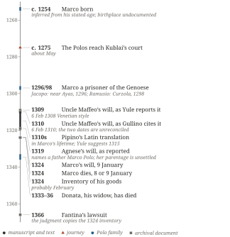
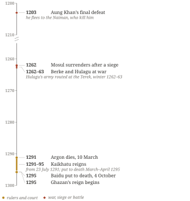

# Front Matter I-1
## The World Before the Road

> *“It came to pass in the year of Christ 1260, when Baldwin was reigning at Constantinople…”*
> — Marco Polo, Prologue, ch. 1 (Yule–Cordier)

---

For a long time, whenever I pictured the Mongols, I saw a horseman yelling while swinging a sword—and not much else. Movies and popular stories almost always cast them as faceless barbarians: warmongers, grim and intimidating from a distance. So I came to this story wanting to find the human beings behind the grandiloquent descriptions—real people you can see laughing, bargaining, talking, and living.

If you go looking for that thirteenth-century world, Marco Polo’s *Il Milione* is the obligatory reference. Those living, breathing people are hiding inside his book, which began in 1298 inside a stone prison in Genoa, where the Venetian merchant poured out twenty-four years of Eastern memories to a fellow captive—Rustichello of Pisa, a writer of King Arthur romances. Their collaboration was meant to be read aloud to rooms full of people who wanted hard merchant truth (what pepper costs, how mulberry-bark paper money works, where desert water holes lie) alongside grand court spectacle (twelve thousand horsemen in robes of beaten gold). Yet if you pick up a literal medieval translation today, you trip over repetitive scribe formulas on every page (*Now let us quit this province and tell you of the next…*); if you open the monumental 1903 Yule–Cordier edition, every sentence is ambushed by fifty lines of tiny Victorian footnotes.

So I decided to try a new voice-over: to imagine what I would actually enjoy reading, and how I would want to experience this journey from my couch—even in an age when you can just ask an AI for a quick summary or watch an animated video essay. Onstage, one narrator walks the road with you in living modern English, keeping the Book’s own names first with modern equivalents in parentheses on first mention. Backstage, small numbers beside claims point to the chapter Notes, where I put on the historian’s spectacles to weigh Chinese annals, Persian chronicles, and seven centuries of detective work without stopping the show; a full [reader’s key to the Notes and conventions](back-01-trivia-and-disputes.md#how-to-read-this-book) sits at the back of this volume, and the closing essay in Volume III explains the [principles of the retelling](../vol-3/ch-12-reliability-essay.md#principles-of-this-retelling).

### A changing world — and a family caught in the maelstrom

To see the people of the Mongol world—and the Venetians who rode out to meet them—as real human beings, we first have to feel how violently their world was shifting around 1260 [1]. When we imagine the thirteenth century today, we usually picture stone castles, feudal kings, and Crusades, and easily overlook the fierce commercial wars between merchant republics like Venice and Genoa. In eastern Mediterranean ports like Acre (Akko), a Crusader foothold and spice hub until its fall in 1291 [2], Venetian and Genoese traders worked side by side as bitter rivals. In 1255, a quarrel in Acre over the boundary church of St Sabba exploded into years of open sea war [3]. Venice drove Genoa out of Acre, yet neither republic could sail safely afterward without armed convoys—a feud that followed every cargo out to sea and returns in [Chapter I-1](ch-01-genoa-prison.md), where it puts Marco Polo behind iron bars in Genoa in 1298 [4].

{#fig-b1-polo-family}

While Venice and Genoa fought over Mediterranean harbours, the ground shifted beneath their counting-houses. At Constantinople (Istanbul), Venetians had unloaded cargo duty-free since the conquest of 1204—until Michael Palaeologus retook the city in 1261 with Genoese backing and flipped the customs ledger in Genoa’s favour overnight [5]. At the very same moment, across the Black Sea, an even larger upheaval had remade Eurasia. Within two generations, Mongol conquests had toppled Khwarezm, the Abbasid caliphate at Baudas (Baghdad), and the Jin in northern China. Under the uneasy peace historians call *Pax Mongolica* [6], a rider carrying a khan’s metal *paiza* tablet could claim relay horses and supplies across thousands of miles [7]—yet that vast expanse was fracturing into four rival Mongol realms: Cublay (Kublai) in China and Mongolia (later the Yuan), the Ilkhanate in Persia and Iraq, the Golden Horde on the Volga steppe, and the heirs of Sigatay (Chagatai) in Central Asia [8]. Whenever war flared between Barca (Berke) and Alaü (Hulagu), or between Caidu (Kaidu) and Cublay, whole frontiers could snap shut without warning [9].

![Map A2. Approximate spheres around the time of the elder voyage. The eastern Mongol realm predates the Yuan dynastic name. Constantinople was still Latin in 1260, with Nicaea the principal Byzantine successor in the region. Soldaia and Constantinople had Venetian links, Acre was contested, and Ayas (Yumurtalık) was a port in Lesser Hermenia (Cilician Armenia). Genoa secured new privileges at Constantinople in 1261. *(Map: this edition, after Peacock, map 1, and the trade sources in the media credits.)*](../assets/maps/A2-world-in-1260.svg){#map-of-the-world-in-1260}

{#fig-b2-mongol-politics}

Caught right at the seam where those Mediterranean and Mongol storms met was one real Venetian family: the Polos. They were not mythic heroes, but practical merchants trying to make their homeland wealthier and more powerful while earning a handsome profit along the way. To stay ahead of shifting markets around 1260—the reconstructed date of the epigraph [10]—they kept a foothold across the Black Sea at Soldaia (Sudak) in Crimea, where Marco’s uncle, Marco the Elder, owned a house he later left to the Franciscans in his will while reserving life residence for his children [11]. Moving abroad in search of new business, this family stepped straight into a geopolitical maelstrom—and found far more than they ever bargained for ([Maps for the Outbound Road](front-02-maps-outbound.md) charts the geography ahead).

Let us start at the exact point where the original Book starts, when that maelstrom has come full circle. Listen first for the clash of Venetian and Genoese oars—because our story opens behind iron bars in Genoa in 1298, where a captured merchant is telling a romance-writer to pick up his pen and call the room to order.

---

## Notes

[1] ✓ Historical context is drawn from the Yule–Cordier introductions, Larner’s [-@larner1999marco, chs. 9–10] reception history, Mongol-empire surveys by Morgan [-@morgan1986mongols] and Rossabi [-@rossabi1988khubilai, chs. 1–2], and Allsen [-@allsen2001culture] on Eurasian cultural exchange. This opening companion frames the political and commercial stage rather than retelling a chapter of *Il Milione*.

[2] ✓ The Venetian and Genoese quarters at Acre served as key bases for trade through Syria. Yule describes the fall of the port in 1291 as a heavy blow to the southern route for Asian goods [@yc, Intro. § 31].

[3] ✓ Yule dates the boundary dispute over St Sabba at Acre to 1255 and describes the war that followed as lasting for years, spreading from the walled trading quarters to armed attacks on shipping [@yc, Intro. § 31].

[4] ? The old French Prologue dates the composition of the Book in Genoa to 1298 [@yc, Prol. preamble]. Yule favoured Ramusio’s tradition placing Marco’s capture at Curzola (Korčula), whereas Jacopo d’Acqui put the capture at Ayas [@yc, Intro. § 37]. See [Chapter I-1](ch-01-genoa-prison.md), Notes 7–8.

[5] ✓ Under the Latin Empire established in 1204, Venice enjoyed tariff exemptions and trading rights that Genoese merchants lacked. Yule traces Genoa’s counter-alliance with Michael Palaeologus, who displaced Baldwin II in 1261 and rewarded his Genoese backers [@yc, Intro. § 31; @yc, Prol. 1 n. 1].

[6] ~ *Pax Mongolica* is a modern historian’s term for the relative security Mongol rule could provide across Eurasia. Actual routes and travel conditions varied sharply with local politics [@morgan1986mongols; @larner1999marco, ch. 1].

[7] ✓ The Prologue gives the Polos a gold tablet authorising supplies, horses, and escorts for their embassy [@yc, Prol. 8]. Yule compares that privilege with wider Mongol uses of inscribed tablets of authority [@yc, 2.7 n. 2].

[8] ✓ The four successor realms took shape over several decades, and the claim to supreme Mongol authority outlasted effective rule over all four. Morgan [-@morgan1986mongols] surveys the khanates, and Rossabi [-@rossabi1988khubilai, chs. 1–2] traces the background to Cublay’s rise.

[9] ✓ Open war between Barca of the Golden Horde and Alaü of the Ilkhanate broke out in 1262. Caidu’s resistance to Cublay was a longer conflict centred on Central Asia [@yc, Prol. 2 n. 3; @morgan1986mongols].

[10] ~ The principal manuscripts give 1250 in the opening line. Yule used the internal chronology of the brothers’ eastern venture and their return to Venice in 1269 to propose 1260 as the likelier year of their Black Sea crossing [@yc, Prol. 1 n. 1].

[11] ✓ Yule dates the Venetian trading post at Soldaia to about the middle of the thirteenth century. The elder Marco’s 1280 will names his house there and spells out the life-residence provision for his son and daughter [@yc, Prol. 1 nn. 1–2].
