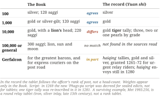

# Chapter II-1
## Cublay Kaan: Puissance, Nayan, and the Ordo of Victory

> *“Now am I come to that part of our Book in which I shall tell you of the great and wonderful magnificence of the Great Kaan now reigning, by name CUBLAY KAAN.”*
> — Marco Polo, Book 2, ch. 1 (Yule–Cordier)

**[M]**

---

The white mares’ milk has scarcely soaked into the August grass at Chandu (Shangdu), and the silk guy-cords of the summer cane palace are still warm from the carpenters’ hands. Now Volume II leaves the caravan road behind and throws open the iron gates of imperial statecraft. We are stepping onto a grassy plain beneath battle horns, where an elephant-borne wooden fortress is lumbering into line and a rebel prince bearing the Christian cross on his banner is about to test what the Great Kaan’s throne is made of. At the centre stands Cublay Kaan (Kublai), who holds winter and spring court at Cambaluc (Beijing) and wears a title that announces supremacy before he speaks a syllable: Lord of Lords. From its opening line, the Book sets out to convince Latin Christendom that no mortal sovereign has ever commanded broader pastures, deeper silver chests, or swifter obedience across the inhabited earth [1]. Merchants ride for months through his toll gates without stepping off imperial turf. Before we ever walk his palace corridors, however, we watch what happens when an ambitious kinsman far across the northern grass decides his own bloodline deserves half the realm.

See [the map of imperial realm and its Nayan inset, II-F2](front-02-maps-cathay-manzi.md#map-of-kublais-realm).

By Polo’s dating, the crown came to Cublay in 1256 at the age of forty-three [2]. Stranger still, the Book keeps him reigning in 1298 while Rustichello dips his pen inside a Genoese prison. Eastern annals instead place Cublay’s accession in May 1260 amid his succession struggle against Ariq Böke, and record his death in February 1294 [3]. Keep that shifted calendar in your pocket as the Book tallies his campaigns and winter levies. By Marco’s sweeping rule, only one crisis after his enthronement forced the Great Kaan personally into the field [4].

The prince who breaks the peace is Nayan. Polo styles him Cublay’s thirty-year-old uncle, though Mongol genealogies trace Nayan to a junior branch descended from Temüge Otchigin, youngest brother of Chinghis (Chinggis Khan) [5]. First the Book paints a portrait of reckless youth, vast grazing grounds, and three or four hundred thousand mounted followers—the kind of frontier warlord who awes a wandering horse-dealer at sight. To a trader stopping for an afternoon to barter wool, tanned hides, or stout colts, Nayan already looks like an independent king. Yet the real hinge of the quarrel is obedience: where Nayan thinks his vassal duty ends and where imperial rule bites [6]. Seated over wealthy eastern territories, he refuses to kneel before Cambaluc’s gate.

Enter Caidu (Kaidu), Cublay’s fierce Ögedeid rival already riding unchecked across the western frontier. In Polo’s telling, Nayan sends secret mounted envoys westward to Caidu proposing a twin hammer-blow from east and west at once. Caidu greets the scheme warmly and pledges to lead a hundred thousand horsemen across the plains [7]. Spoken court promises belong to the Book’s dramatist rather than an audited letter bag. Even so, the danger of a concerted alliance uniting Central Asia with eastern pastures holds genuine historical weight [8].

No sooner do whispers of treason reach Cambaluc than Cublay clamps down news on every post road, forbidding any rider or horse-trader to slip eastward toward Nayan’s camps. Sentries seal the passes day and night so no herald slips through. Under that tight secrecy, the Book marshals three hundred and sixty thousand horsemen and a hundred thousand footmen within ten or twelve days, styling those mounted regiments the court’s own falconers and hunting retinue [9]. Pause right here and stand beside an army quartermaster rather than a herald in scarlet. Try calculating the barley sacks, water troughs, and autumn grass needed to keep nearly half a million mounts moving across empty steppe in under two weeks. You hear that hunting-retinue boast with a wry grimace, yet the Book has a tidy administrative explanation for why the emperor avoided stripping distant borders bare: standing garrisons stayed pinned inside their own provincial circuits to keep local order [10]. Before hoofbeats drum north-eastward out of the capital, palace astrologers cast their wooden rods, read favourable omens across the sky, and promise Cublay an effortless triumph [11].

Twenty forced marches carry the imperial banners onto Nayan’s pasturelands—a distance any ordinary army would spend thirty days crossing. Forward scouts swept up stray herdsmen and silenced every track so thoroughly that Nayan still lay sleeping beside his favourite wife when dawn broke over imperial spears along the low eastern crest [12].

Up on a rising bluff, the Great Kaan commands the field from a towering battlemented timber castle slung across four war elephants. Its carved oak boarding rises like a fortress tower above the dust of circling squadrons, topped by the sun-and-moon standard [13]. From down in the tall autumn grass, dusty bowmen scarcely glimpse their aging sovereign behind heavy timber planks, guiding their charges by his cloth banner snapping above the ridge. On several cavalry mounts beside the forward ranks, armoured foot soldiers perch pillion behind the saddle, ready to leap down into the thick of the melee [14].

{#fig-ii-1-nayan-elephant-tower}

Picture the silence across that meadow just before the storm breaks. Deep rows of riders rein in beside their standards and hold long lances upright. Only chorus songs and the pulse of two-stringed lutes drift across the grass until the Great Kaan’s deep *naqqāra* kettle-drum thunders first, answered by Nayan’s drums across the flat [15]. In that measured symmetry of music, song, and marshalled rank, you can hear Rustichello shaping a steppe clash to the stately cadence of an Arthurian tournament [16].

Storms of feathered shafts darken morning sunlight from sunrise until noon while struck mounts crash into torn turf. Combining both hosts, Polo counts seven hundred and sixty thousand riders colliding on one green plain [17]. At midday the rebel wing buckles inward under imperial pressure, leaving young Nayan and his great barons prisoners in custody while scattered remnants break toward distant hills [18]. Step back from the dust for half a heartbeat. Half a million horsemen cannot wheel on a single meadow without churning the earth into mud, yet in the Book’s telling the entire rebellion rises and shatters between breakfast and the noon meal. That is the romance tempo at work.

Open the official *Yuan shi* annals beside that dawn-to-noon pageant, and the edges shift under your hand. Chinese records confirm Cublay’s personal command in the sixth month of 1287, yet they trace Nayan as a junior cousin rather than an uncle, put Tabudai’s attacking vanguard at sixty thousand rather than four hundred thousand, and credit General Li Ting’s crossbows and fire-*pao* with breaking the rebel camp. They mention neither a four-elephant timber castle nor a Christian cross on Nayan’s banner, and they log Nayan bound and executed without spelling out the carpet method [19]. Because imperial clerks spread the fighting across separate regional clashes, their sober fragments refuse to fit neatly inside one dramatic morning.

Down in the trampled grass lies Nayan’s captured standard: stitched across its field gleams a Christian cross, for Polo proclaims the slain rebel a baptised Christian [20]. Even treason could not blot out sacred imperial blood. Four stout guards roll Nayan tightly inside heavy woollen carpets and haul the bundle back and forth until breath stops—keeping royal blood off open ground and hidden from daylight and steel [21].

Submission follows across the Book’s map of Nayan’s four provinces—Chorcha (Jurchen country), Cauly (Korea or its borderland), Barscol, and Sikintinju—all yielding fresh homage to Cambaluc, though several frontier names drift across old maps [22]. Worse still for tidy endings, breaking Nayan’s banner failed to pacify the north-eastern borders, where stubborn kinsmen under rebel leaders like Hatan kept spears raised long after summer ended [23].

Jeering voices soon hunt another quarry beside the captured felt tents. Muslims, Jews, and idolaters mock the humiliated Christians for trusting a standard that could not shelter its own baptised prince. Summoning every faction before his seat, Cublay turns their taunt squarely back onto its speakers: the Christian cross did rightly to withhold aid from an oath-breaking traitor [24]. Historical evidence complicates that camp anecdote: carved stone tablets preserved at Nanghin (Kaifeng) anchor a Jewish synagogue community there securely back to 1163 [25], and *Yuan shi* fiscal rolls name Jewish taxpayers intermittently during the fourteenth century [26], yet placing Jewish onlookers inside Cublay’s northern war-camp in 1287 rests on thin conjecture.

Triumphant, Cublay rides back under Cambaluc’s high gates into autumn palace feasts while distant Caidu still keeps cold steel oiled along the western frontier [27].

Inside the throne hall on Christian high festivals such as Easter, an unexpected ceremony unfolds. The Great Kaan sends for an ornate book of the Gospels, incenses its gilded binding, and presses his lips to the page before bidding noble barons follow in turn [28]. A devout Jew, Muslim, or Buddhist ambassador standing beside those lacquered pillars watches identical outward honour paid to his own holy calendar. Cublay explains calmly that he reveres four supreme prophets alike—Jesus, Muhammad, Moses, and Sakyamuni—and asks whichever reigns highest in heaven to hear his prayer [29]. Think of the masterclass in imperial stagecraft inside that marble room. Every foreign envoy rides home convinced his faith holds the Emperor’s favour, while the sovereign himself commits his soul to none of them.

The memory of that tolerance loops back to the day Cublay first sent Marco’s father and uncle westward to Rome. Why should the Kaan accept bare Latin sermons while court sorcerers float brimming gold wine-cups untouched across the banqueting air? Let the Roman pontiff dispatch a hundred subtle Christian masters capable of confounding pagan wonders in public debate before court—and in the Book’s rosy telling, Cublay and every baron will step gladly to the font [30].

When victory spoils are weighed across Cambaluc’s courtyard flags, a Venetian merchant’s eye checks every tray. Loyal marshals march down terrace steps laden with chased silver plate, winter sable furs, and heavy belts [31]. Beside chests of pale pearls and rubies, fortunate captains who entered audience commanding a hundred riders walk away holding seals over a thousand [32]. Such open-handed rewards turn raw battlefield fear into lasting court dependence before snow falls across the walls.

On a clerk’s oak table, the imperial pass-tablets lie side by side for inspection. A plain silver plaque marks command over a hundred men, heavy gold or silver-gilt over a thousand, and solid gold stamped with a crouched lion over ten thousand. Silver and gilt plates tip scales at a hundred and twenty *saggi*; the myriarch’s heavy lion weighs two hundred and twenty [33]. Engraved across the metal runs a blunt warning demanding instant obedience under pain of death—a sealed passport carrying far greater authority along muddy post tracks than any tall boast of past courage [34]. Without those stamped characters in a traveller’s belt, no stablemaster opens a door after dark.

Above even the myriarch’s gold lion shines the grand marshal’s highest badge: privilege of a silver chair, golden state umbrella, and a three-hundred-*saggi* gold tablet showing a lion under sun and moon [35]. Fewer still earn a tablet stamped with a poised gerfalcon. Whoever lays that bird across a wayside post-master’s counter claims fresh court horses, armed escorts, and hot supper across every province without counting one silver groat [36]. Hold that heavy metal plaque in your palm for a moment: the hunting falcon that flies out to return at dusk now flies in hammered gold across an entire continent, bending every village elder to the sovereign’s word.

{#fig-c5-paiza}

You have weighed the iron-backed warrants by which every traveller along the imperial road bows before the Great Kaan’s name. Now step through Cambaluc’s lacquered gates and look straight at the sovereign who stamps them—his sturdy frame, his four empresses, his crowded sons, and the stone-flagged palace rising at the capital’s core.

---

## Notes

[1] ~ Calling a Kaan “Lord of Lords” and setting Cublay’s wealth above all other rulers launches Book II’s imperial portrait [@yc, 2.1]. That sweeping superlative sets the rhetorical pitch for every court chapter ahead.

[2] ✗ Assigning Cublay’s accession to 1256 at age forty-three compresses the true calendar by four years [@yc, 2.2 nn. 1–2]. Born in 1215, he actually claimed the throne in May 1260 rather than 1256.

[3] ✗ Claiming Cublay still reigned in 1298 forgets that the Great Kaan died in February 1294, four years before Rustichello composed the prison text in Genoa [@yc, 2.2 nn. 1–2]. The civil war against his younger brother Ariq Böke dominated his opening years after 1260.

[4] ✗ Saying Cublay fought in person only once after his accession overlooks early field engagements, including contests with Ariq Böke [@yc, 2.2 n. 3]. The Book further assigns Nayan’s rebellion to 1286 rather than summer 1287.

[5] ✓ Pelliot traced Nayan cleanly to the princely lineage of Temüge Otchigin (Yule’s *Uchegin*), Chinghis’s youngest full brother [@pelliot1959notes, vol. 2, “Naian”; @yc, 2.2 n. 4]. That genealogy makes Nayan a junior-generation cousin of Cublay rather than his uncle.

[6] ~ Describing Nayan as thirty years old and able to raise three or four hundred thousand riders expresses steppe princely danger in epic scale [@yc, 2.2]. Territorial sovereignty across Chorcha and the eastern plains formed the authentic political flashpoint.

[7] ~ Invented court dialogue between Nayan and Caidu bringing a hundred thousand western horsemen follows medieval dramatic convention [@yc, 2.2]. No court transcript preserves such explicit diplomatic pledges.

[8] ✓ Rossabi [-@rossabi1988khubilai, ch. 8] confirms that coordinated pressure from Caidu in Central Asia alongside eastern princes created a serious strategic threat [@yc, 2.2]. That broader alliance gives Nayan’s rising its credible historical frame.

[9] ✗ Levying 360,000 horse and 100,000 foot within twelve days out of capital hunting retinues wildly multiplies sustainable steppe logistics [@yc, 2.3; @rossabi1988khubilai, ch. 8]. Rossabi shows real expedition forces numbered far smaller detachments alongside Chinese gunpowder units.

[10] ~ Ramusio-only. Explaining that standing provincial garrisons remained behind to hold local offices appears solely in Ramusio [@yc, 2.3 n. 1]. Yule and Cordier compare Palladius’s notice of the Yuan *aolu* military reserve organization.

[11] ~ Astrological consultation promising swift victory sets the stage before Cublay’s rapid northern march [@yc, 2.3]. Diviners formed a routine presence inside Mongol royal camps.

[12] ~ Covering a thirty-day route in twenty forced days while Nayan sleeps beside his favourite wife builds crisp narrative surprise [@yc, 2.3–2.4]. Surprise attacks matched genuine steppe cavalry doctrine without verifying the bedroom anecdote.

[13] ? Polo uses the Old French *bretesche* for Cublay’s wooden castle riding atop four elephants [@yc, 2.4 n. 1; @yuanshi1370, j. 14, 154, 162]. Inspected *Yuan shi* chapters mention no war elephants, leaving the suggested parallel in Rashīd al-Dīn unverified here.

[14] ? Foot soldiers riding behind cavalrymen match a comparison Yule pulled from Gaubil’s eighteenth-century extracts [@yc, 2.4 n. 2]. Whether Gaubil’s Chinese summary stood free of European echoes remains open.

[15] ~ Pre-battle singing and instrumental accompaniment waiting on the deep *naqqāra* kettle-drums reflect documented Turco-Mongol war music [@yc, 2.4 n. 3]. Yule supplies contemporary Muslim parallels for royal drum signals opening battle.

[16] ~ Larner notes how Witness F stages the Nayan battle (chapter 79) with measured symmetries closely echoing European Arthurian prose [@larner1999marco, ch. 6, p. 109 in the 2001 edition]. Rustichello brought French chivalric rhythm straight onto the eastern steppe.

[17] ✗ Combining both armies into seven hundred and sixty thousand riders relies purely on Marco’s hyperbole [@yc, 2.4]. *Yuan shi* annals record much more modest troop numbers such as Tabudai’s reported sixty thousand.

[18] ~ Framing the fight cleanly from sunrise to noon capture turns an untidy frontier campaign into one crisp morning scene [@yc, 2.4]. Capture by midday anchors the moral climax before Nayan’s sentencing.

[19] ✓ Inspected *Yuan shi* annals and biographies confirm Cublay’s personal presence, the sixth-month 1287 clash, and Li Ting’s decisive crossbow and fire-*pao* action [@yuanshi1370, j. 14, 154, 162; @rossabi1988khubilai, ch. 8]. Discrepancies in troop counts and scattered detachments keep the Book’s exact battlefield site and grand numbers unconfirmed.

[20] ? Nayan’s baptism and emblazoned cross banner rest directly on Polo’s telling [@yc, 2.4 n. 6]. Nestorian Christianity was indeed widespread among eastern Mongol and Onggirat nobility, giving the claim cultural plausibility without direct annalistic proof.

[21] ~ Wrapping Nayan in carpets and suffocating him to avoid spilling royal blood accords with traditional Mongol aristocratic taboo [@yc, 2.5 n. 1]. *Yuan shi* records bound execution concisely without spelling out the carpet method.

[22] ? Chorcha represents Jurchen lands and Cauly refers to Korea or its frontier, while Barscol and Sikintinju remain disputed on northern maps [@yc, 2.5 n. 2]. Four named territories map Nayan’s eastern sphere only approximately.

[23] ✗ Suggesting Nayan’s execution ended rebellion in those provinces ignores years of continuing warfare [@yc, 2.5 n. 2]. Cordier cites later *Yuan shi* campaigns against Nayan’s persistent kinsman Hatan across Liaodong and Korea.

[24] ~ Repartee where Cublay defends the Christian cross by branding Nayan a traitor showcases imperial wit in Rustichello’s hands [@yc, 2.5 n. 3; @yc, 2.6 n. 2]. Ramusio groups Christians, Muslims, and Jews together in a parallel court episode.

[25] ✓ Memorial stones preserved at Kaifeng (Nanghin) attest a settled Jewish synagogue community there dating back at least to 1163 [@yc, 2.5 n. 3]. Evidence confirms small inland Jewish communities under Song and Yuan rule.

[26] ? Loewe documents specific *Yuan shi* notices referencing Jews (*Zhuhu*) in fiscal entries from 1329, 1340, and 1354 [@loewe1987jewish; @yc, 2.5 n. 3]. Still, positive evidence placing Jews inside Cublay’s northern war-camp during 1287 remains thin.

[27] ~ Celebrating victory back at Cambaluc while noting Caidu’s simmering hostility closes the rebellion episode on an uneasy truce [@yc, 2.6 n. 1]. Renewed steppe conflict stays looming along the northern border.

[28] ~ Ramusio-only. Ceremonially incensing and kissing the Christian Gospels at Easter belongs solely to Ramusio’s 1559 court addition [@yc, 2.6 n. 2]. The medieval French text omits this palace ritual.

[29] ? Ramusio-only. Cublay’s famous statement honouring four supreme prophets—Jesus, Muhammad, Moses, and Sakyamuni—mirrors William of Rubruck’s parallel dialogue with Mongou Kaan decades earlier [@yc, 2.6 n. 2]. Whether Marco heard a similar imperial sentiment or Ramusio expanded court tolerance remains uncertain.

[30] ? Ramusio-only. Challenging Niccolò and Maffeo to fetch a hundred learned men capable of out-performing court sorcerers to win Cublay’s baptism adapts their papal embassy request [@yc, 2.6 n. 2]. Yule brackets the entire speech from Ramusio’s text.

[31] ~ Awarding chests of silver plate and costly jewels to loyal nobles after victory matches standard Mongol court *qubi* patronage [@yc, 2.7 n. 1]. Publicly sharing out the spoils reinforced the personal bond between the sovereign and his battlefield commanders.

[32] ~ Promoting captains of a hundred directly to chiliarchs over a thousand captures rapid wartime advancement under imperial reward [@yc, 2.7 n. 1]. Advancing through the decimal command grades brought higher tablets of authority and larger retinues.

[33] ~ Metal rank tablets (*paiza*) weighing 120 and 220 *saggi* align closely with surviving Yuan finds, though Chinese records pair the myriarch with a tiger rather than Polo’s lion [@yc, 2.7 n. 2; @hsiao1978military]. See [Diagram C5, tablets of authority](ch-01-cublay-nayan.md#fig-c5-paiza).

[34] ✓ Engraving commanding warrants directly onto metal tablets matches surviving Phags-pa and Mongol passport inscriptions [@yc, 2.7 n. 2]. Travellers along post stations honoured the sealed plaque on sight.

[35] ? Assigning a silver chair, gold umbrella, and 300-*saggi* sun-and-moon lion tablet to top commanders finds no direct equivalent in surviving *Yuan shi* rank lists [@yc, 2.7 nn. 2–3]. Polo likely embroidered imperial regalia on the grandest scale.

[36] ~ Issuing special gerfalcon tablets empowered high envoys to commandeer postal horses and provisions across any circuit [@yc, 2.7 n. 4]. Yule adduces surviving museum warrants confirming bird-and-feline imperial *paiza* seals.
