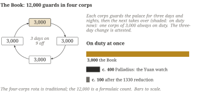
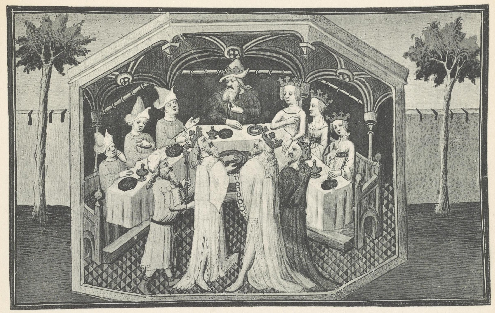

# Chapter II-3
## Feasts, Robes, and the Twelve Thousand Keshican

> *“You must know that the Great Kaan, to maintain his state, hath a guard of twelve thousand horsemen, who are styled Keshican, which is as much as to say ‘Knights devoted to their Lord.’”*
> — Marco Polo, Book 2, ch. 12 (Yule–Cordier)

**[V]**

---

We have seen the outer walls, the chess-board avenues, and the midnight curfew bell. Now the doors swing open and the Book walks us straight into the greatest dining hall on earth. Nothing Marco Polo has described so far—not the jewelled markets of Hormos (Hormuz), not the jade-green hill planted with uprooted forests—prepares the reader for what happens inside the palace at Cambaluc (Beijing) when the Great Kaan sits down to eat. Twelve thousand horsemen guard the hall. Five thousand elephants parade his tableware. Gold cisterns the size of wine casks stand between the tables. And if any guest so much as brushes the wooden threshold with his foot, two towering wardens will beat him senseless or strip the clothes from his back. This is court life under Cublay (Kublai) Kaan, and every detail in it is designed to make you feel very, very small.

The guard comes first. Polo calls them Keshican [1]—*“Knights devoted to their Lord”*—and the name is no invention. It is the Mongol *keshikten*, the personal bodyguard created by Chinghis (Chinggis Khan) himself to keep watch over the imperial tent. But Rustichello, writing in his Genoese cell with a mind trained on King Arthur's romances, cannot resist presenting them as a chivalric Round Table magnified beyond all earthly measure. Four captains divide twelve thousand horsemen into companies of three thousand [2]. Each company serves three full days and three nights inside the palace walls, dining from the imperial larders and sleeping under the palace roofs, before being relieved by the next company in an unbroken annual rotation. One body is always awake, and the calendar runs without a hitch. It is not an army camped around a frightened tyrant; it is a pageant on a timetable, the kind of military calendar that runs like clockwork precisely because nobody expects it to fight an invader inside the palace gates. Chinese court records put the actual active watch at around four hundred picked men. The difference between four hundred guards and twelve thousand knights is the difference between an imperial payroll and a romance of chivalry.

{#fig-c3-keshig}

Walk through the double gates into the banquet hall and you see political hierarchy laid out as physical architecture. A later Parisian reader could see the Khan presiding over [a table beneath a canopy](#fig-khan-at-table). The Great Kaan sits on an elevated northern dais [3], raised well above the floor and facing south toward the midday sun, exactly as Chinese emperors had done for two thousand years before nomad horsemen ever set foot across the Great Wall. His chief empress sits beside him on the left. The sons, nephews, and imperial princes take their meals at lower tables to his right, but their seats are carefully sunken so that no royal head, no matter how ambitious, can rise above the level of the Sovereign's boots. Below the princes sit the great barons, and below the barons—in a vivid scene preserved in sixteenth-century Italian texts—the ordinary soldiers and court officers sit cross-legged on vast woolen carpets across the stone floor of the hall [4]. Beyond the carved doorways, out in the open courtyards where the winter winds blow, more than forty thousand visitors, foreign ambassadors, and tribute-bearers gather on felt mats [5]. The banquet is not merely dinner; it is an imperial census made edible, a diagram of world dominion enacted three times a day.

{#fig-khan-at-table width=83%}

At the center of the hall, near the Emperor’s dais, stands an astonishing piece of furniture: a massive square buffet chest of carved and gilded wood [6], three paces on each side, decorated with dragons and beasts. Inside sits a colossal golden cistern holding enough wine or fermented mare's milk to fill a tavern cask, flanked at each corner by four smaller golden vessels the size of firkins. Between every pair of guests along the long tables stands a heavy gold pitcher called a *vernique* [7]—a mysterious word that has teased scholars ever since, likely drawn from the Persian *bārnīya* or the Venetian *vernegal*, meaning a glazed or varnished flagon. Each pitcher holds enough spiced wine to satisfy eight or ten men, flanked by two deep golden drinking cups with handles. Marco, the Venetian merchant's son, watches the servants carry the flagons back and forth, mentally weighing the bullion on display, and confesses that the sheer tonnage of gold and silver beggars his arithmetic. Barons acting as stewards move gracefully among the tables, ensuring that foreign envoys are placed according to rank and that no cup ever runs dry [8].

At every door stand two colossal wardens armed with heavy staves [9]. If an entering guest so much as clips the wooden threshold with the toe of his shoe, the staves come down [10]: the guards will strip the robes from his back on the spot, or beat him bloody unless he pays an immediate fine. This is not arbitrary cruelty; it is sacred Mongol custom. To nomadic tent-dwellers, the threshold of a dwelling is sacred to the hearth-spirits, and treading upon it brings disaster to the master of the house. Friars Carpini and Rubruck both recorded the taboo when they rode across the steppes, and Odoric found it unchanged a generation after Polo. Ushers stationed outside patiently explain the rule to nervous foreign envoys—though enforcement is politely relaxed on the way out, when courtiers who have drunk too much spiced wine can hardly be expected to mind their footing.

The servers who wait upon the Emperor are themselves high-ranking barons. Before approaching the royal table, they tie cloths of fine silk and beaten gold thread over their mouths and nostrils [11], ensuring that neither human breath nor odor can drift across the imperial food. Whenever the Great Kaan lifts his golden cup to drink, a fanfare of horns and pipes blares through the room. At the very first note, the entire hall—princes, barons, stewards, and the forty thousand guests outside—drops in unison to its knees, prostrating itself while the Sovereign sips. When the cup touches the table, the assembly rises. This miniature earthquake repeats itself at every swallow. Once the feast is cleared, the tables are pushed aside and a troupe of jugglers, acrobats, and court players floods the central hall [12]. Rustichello passes over the food itself—the chivalric writer always preferred pageantry to menus—but he lingers on the explosion of laughter that follows the acrobats' leaps. The Great Kaan looks on, amused by the show, until the final drum beat sounds and the company retires into the night.

---

The calendar of Cambaluc revolves around two immense state gatherings. The first is the Emperor’s birthday feast, which Polo fixes on the twenty-eighth day of the September moon [13]. It is the grandest gathering of the autumn. Cublay appears in a robe of beaten gold leaf that gleams across the hall like sunlight on water. Beside him, twelve thousand barons and knights sit clad in silk-and-gold robes of the exact same color and pattern, each wearing a heavy golden belt presented by the Sovereign's own hand [14]. The entire court forms a living mirror of its ruler, with only the finer cut and precious jewels of the Kaan’s personal robe distinguishing master from servant. Some of these festive suits, Polo swears without blinking, are encrusted with enough pearls and rubies to be worth ten thousand gold bezants apiece [15].

The birthday is also an empire-wide harvest of gifts. Every subject province sends tribute suited to its wealth, while ambitious provincial clerks flock to the capital bearing rare jewels and furs, hoping a well-timed gift will catch the eye of the court. A council of twelve senior barons sits throughout the day to hear their petitions [16] and award government postings—an administrative civil-service exam disguised as an imperial birthday party. Outside the walls, the empire’s religions pray simultaneously for the Emperor’s long life [17]. Nestorian Christians in their black cowls, Muslim imams in turbans, Buddhist lamas with prayer wheels, and Daoist priests at their incense altars all chant their distinctive liturgies, united under a single royal decree. The Yuan court does not care which god its subjects worship, provided every altar includes an invocation for the throne.

Polo links these birthday robes to an astonishing annual cycle: thirteen major festival distributions every year, one for each moon of the calendar, with the Kaan and his twelve thousand guardsmen appearing in thirteen entirely different colors. Thirteen distributions multiplied by twelve thousand men yields a wardrobe of one hundred and fifty-six thousand tailor-made silk suits every single year [18]. The arithmetic is almost certainly an exaggeration born of campfire retellings, though friars Rubruck and Carpini both confirm that nomad khans loved to dress their entire entourages in identical festival colors. The waste is the point: these are not uniforms handed out for military duty; they are royal gifts that wrap the bodies of the warrior nobility in the emperor's own colors. Even the boots match: each man receives a pair of high riding boots of *Camut* or *Borgal* [19]—Russian shagreen horsehide, tanned with bark and embroidered with fine silver thread—locking the imperial retinue into a single aesthetic machine from scalp to spur.

---

The second great festival begins in February: the White Feast, the Mongol New Year [20]. On this morning the entire city sheds its autumn gold and puts on white. Every person who enters the palace gates—from the princes of the blood down to the grooms in the stables—wears plain white silk or sheepskin. To the Chinese, white was the dreaded color of funerals and mourning, but to the Mongols it was the hue of pure milk, the sacred color of beginning and good fortune. Subjects exchange white gifts, embrace in the snow-dusted avenues, and shower the throne with silver ingots, pearls, and white cloths. The crowning tribute is livestock: Polo claims that more than one hundred thousand milk-white horses, without a single dark blemish on their hides, are driven past the palace gates as a New Year offering to ensure that the emperor’s herds never lack abundance [21].

The tribute of the White Feast is governed by the sacred arithmetic of the steppes: everything must be given in multiples of nine. Where a province can afford it, gifts arrive in sets of nine times nine [22]: eighty-one white stallions, eighty-one bolts of gold brocade, eighty-one chests of silver coin. The mystic reverence for the number nine echoes through nomad law, shamanic rites, and diplomatic gifts, and at the White Feast it sounds in every tribute coffer opened before the throne.

Before the banquet tables are laid, a deafening parade shakes the earth outside the hall: five thousand elephants [23], imported from the jungles of Mien (Burma) and Carajan (Yunnan), march past the Emperor in single file. Each beast is draped in silk blankets patterned with lions and dragons, and each carries upon its back two massive wooden coffers bound in brass, packed with the gold cups, flagons, and ceremonial plate needed to feed forty thousand courtiers. Lines of pack camels follow behind, laden with tents, wine skins, and festive meats [24]. The parade turns the domestic drudgery of catering into high drama: the nation’s pantry walks past the throne on the backs of five thousand armored pachyderms. Five thousand is an impossible stable for northern China, but the spectacle was real enough: Cublay kept captive war elephants as walking symbols of his conquest of the tropical south.

{#fig-ii-3-white-feast-procession}

When the parade concludes, the dignitaries take their places inside the great hall: kings, princes, astrologers, physicians, and royal falconers, all arrayed strictly by rank. At a signal from a high prelate, the herald calls out, and the entire gathering prostrates itself four times [25], forehead to floor, worshipping the Kaan as if he were an earthly divinity. The dignitaries then file past a small altar bearing a vermilion lacquer tablet inscribed with the Emperor’s sacred name, each man burning a pinch of fragrant incense in a gold brazier before returning to his station [26]. The gifts are formally unveiled; the tables are laid; the flagons are tipped; and the music begins anew.

One final image remains, and it is Rustichello's strangest. At the height of the feast, an unchained lion is led into the banquet hall and released before the dais [27]. Without cage or rope, the beast pads across the carpet, looks up at the elevated throne, and lies quietly down at the Emperor’s feet like a faithful hound, acknowledging its master without a growl. Medieval travellers routinely used the word "lion" for the striped tigers of Chorcha (Manchuria) and Bangala (Bengal); whatever the cat was, the show was a triumph of imperial animal training. The great predator sleeps upon the floor, enormous, relaxed, and utterly subdued, while the court watches in breathless silence. The court's feasts turn guard duty, rank, tribute, and dress into grand public theatre [28]; once the last guests step carefully back across the wooden threshold into the February air, the carts and hounds of the imperial hunt are already waiting beyond the gates.

---

## Notes

[1] ✓ The name *Keshican* reflects the historical Mongol institution of the *keshikten*, the hereditary imperial bodyguard established by Chinghis to watch over the sovereign's person and household [@yc, 2.12 n. 1]. In the Persian chronicles Rashīd al-Dīn calls them the *Kishīkān*, while Friar Odoric heard the Chinese court term as *Cuthé* [@odoric1913travels, ch. 39]. See [Back Matter II-2, Glossary under “Keshican”](back-02-glossary.md#term-keshican).

[2] ~ The four-corps rotation across three-day watches is authentic steppe practice, but twelve thousand horsemen is a traditional courtly round number [@yc, 2.12]. Chinese Yuan records cited by Palladius [-@palladius1876elucidations] put the active palace watch at around four hundred men, reduced to one hundred in 1330 [@yc, 2.12 n. 1]. See [Diagram C3, the keshig rota](#fig-c3-keshig).

[3] ✓ The Kaan facing south from an elevated northern dais while kinsmen sit below his foot-level matches both Chinese imperial cosmology and Mongol tent protocol [@yc, 2.13 n. 1]. William of Rubruck observed the same north-facing elevated seat at the court of Mongou (Möngke), and Odoric later described the ranked tables at Cambaluc [@rockhill1900journey, p. 210; @odoric1913travels, ch. 39]. See [Map A9, Dadu city plan](ch-02-person-palace.md#fig-a9-dadu-city-plan).

[4] ~ Ramusio-only. The detail that most soldiers and their officers ate on carpets inside the hall comes from Ramusio's 1559 Italian text [@yc, 2.13]. It reflects the practical division between raised banquet tables for the high nobility and floor seating for the wider guard.

[5] ~ Forty thousand visitors and tribute-bearers outside the doors is an epic courtly crowd total rather than a steward's headcount [@yc, 2.13]. Even so, the great court feasts routinely drew large numbers of foreign envoys, merchants, and provincial petitioners to the palace courtyards.

[6] ✓ Ramusio-only in part. The carved, gilded square buffet chest and the firkin measure of the four corner vessels come from Ramusio, whereas the great central gold wine cistern appears in the older texts [@yc, 2.13 nn. 2–3]. At Caracoron (Karakorum), William of Rubruck saw a mechanical silver tree made by the Parisian goldsmith William Buchier that piped wine, clarified mare's milk, honey mead, and rice beer into silver basins, while Odoric later admired a colossal jade wine jar in the palace hall at Cambaluc [@rockhill1900journey, pp. 208–209; @odoric1913travels, ch. 37].

[7] ~ The golden *vernique* set between every two guests echoes the Venetian sea-term *vernegal* (a mess bowl or flagon) and the Persian *bārnīya* (a glazed vessel), while Bretschneider [-@bretschneider1888mediaeval] compared a silver-lined varnished wooden jar recorded at the Yuan court [@yc, 2.13 n. 2]. Whatever the underlying vessel, the golden service illustrates how Mongol khans displayed bullion at public banquets [@yc, 2.13 n. 3].

[8] ✓ Ramusio-only. Assigning barons to seat foreign guests by rank and keep their cups filled comes from Ramusio's fuller banquet narrative [@yc, 2.13]. The arrangement matches the strict protocol recorded by other envoys to Mongol courts.

[9] ~ Ramusio-only. In Tao Zongyi's *Nancun chuogeng lu* (*Ch’ue keng lu*), juan 1, the club-bearing attendants (*yundu-chi*) and the unusually tall picked palace guards (*dahan*, the “big men”) appear in two separate entries, and the tall guards are not given clubs [@tao1959nancun, juan 1]. Palladius's [-@palladius1876elucidations] paraphrase in Yule adds two guards beside the Khan holding “natural” jade axes, a detail absent from juan 1, while Polo's staff-bearing “giants” combine the club-bearers and the tall guards into one pair at the doorway [@yc, 2.13 n. 4].

[10] ✓ Ramusio-only. The taboo against stepping on a tent or palace threshold—and the penalty of stripped clothes or blows, relaxed for tipsy guests on the way out—is bracketed from Ramusio in Yule [@yc, 2.13]. Carpini, Rubruck, and Odoric all independently record that touching the threshold of a Mongol ruler's dwelling was a grave offence punished by beating or death [@rockhill1900journey, p. 104; @odoric1913travels, ch. 37; @yc, 2.13 n. 4].

[11] ✓ Mufflers of silk and gold over the servers' mouths and noses, together with instrumental fanfares and universal prostration whenever the ruler drank, are multiply attested across Mongol and later Chinese court ceremonial [@yc, 2.13 n. 5]. The 1421 embassy of Shah Rukh observed eunuchs with paper mouth-guards and music sounding at every cup, and Odoric describes the same kneeling salute at the Kaan's table [@odoric1913travels, ch. 39; @yc, 2.13 n. 5].

[12] ✓ Post-dinner jugglers, acrobats, and illusionists (*tregetours*) were a staple of Yuan and wider Eurasian court feasts [@yc, 2.13 n. 6]. Odoric and the Shah Rukh ambassadors both describe troupes performing after imperial banquets, and Chaucer evoked the same courtly illusionists in *The House of Fame* and *The Franklin's Tale* [@odoric1913travels, ch. 39; @yc, 2.13 n. 6].

[13] ✓ The Emperor's birthday in the eighth lunar month (September–October) was one of the two supreme festivals of the Yuan court calendar [@yc, 2.14 nn. 1, 4]. Palladius [-@palladius1876elucidations] notes from the Mongol-Chinese administrative code that officials and religious communities across the provinces held formal longevity services for the Kaan on that day [@yc, 2.14 n. 4]. See [Back Matter II-1, “Two capitals, one gravity”](back-01-trivia-and-disputes.md#trivia-worth-keeping).

[14] ✓ Dressing the sovereign and his bodyguard in matching robes of beaten gold (*chisun*) with golden girdles reflects the steppe custom of binding companions to their lord through shared festival dress [@yc, 2.14 nn. 2–4]. Odoric likewise noticed the golden girdles and ranked robes worn by the barons at the Cambaluc feasts [@odoric1913travels, ch. 39; @yc, 2.16 n. 2]. See [Back Matter II-1, “Robes of one colour”](back-01-trivia-and-disputes.md#trivia-worth-keeping).

[15] ~ Valuing the richest pearl-and-ruby robes at ten thousand gold bezants apiece expresses merchant wonder rather than a treasury inventory [@yc, 2.14]. Even so, the *chisun* garments woven with beaten gold strips (*nasij*) were among the costliest textiles in Eurasia [@allsen1997commodity].

[16] ✓ The twelve senior barons assigned to answer petitioners seeking court office reflect the centralized personnel boards of the Yuan administration [@yc, 2.14]. Birthday gatherings doubled as occasions for receiving provincial tribute and reviewing candidacies in the capital.

[17] ✓ Yuan policy required Christians (*erke'un*), Muslims, Buddhists, and Daoists to chant public prayers and call out *Wan-sui* (“Ten thousand years”) for the Emperor's health on his birthday [@yc, 2.14 n. 4]. Palladius [-@palladius1876elucidations] cites a 1304 edict from the Yuan code settling a dispute in Jiangnan over whether Christian clergy should march behind Buddhist and Daoist priests during the birthday supplications [@yc, 2.14 n. 4].

[18] ? All early French manuscripts insist on thirteen annual robe distributions (156,000 suits), and Ramusio links them to thirteen lunar months, whereas Chinese dynastic records cited by Pauthier [-@pauthier1865livre] and Hammer [-@hammer1842geschichte] describe three major seasonal feast issues [@yc, 2.14 n. 3; @yc, 2.16 n. 1]. Yule suggested an early dictation slip between French *trois* and *treize*, while Rubruck and Carpini confirm the underlying steppe practice of changing into a new matching colour on successive festival days [@rockhill1900journey, p. 247; @yc, 2.14 n. 3].

[19] ✓ *Camut* and *Borgal* denote fine granulated shagreen (*saghri* or *kīmukht*, from horse or camel hide) and Russia-leather named from Bolghar on the Volga [@yc, 2.16 n. 2]. Ibn Baṭṭūṭa praised winter boots of *borghāli* horse-leather on his journey to the Volga, and Pauthier [-@pauthier1865livre] cited Yuan wardrobe lists that included red leather ceremonial boots [@yc, 2.16 n. 2]. See [Back Matter II-2, Glossary under “Bolghar”](back-02-glossary.md#place-bolghar).

[20] ✓ The February New Year feast was the Mongol *Chaghan Sara* (“White Month”), when white clothing honoured the auspicious colour of mare's milk and good fortune [@yc, 2.15 n. 1]. The custom was purely Mongol: when Shah Rukh's envoys attended the Ming New Year court in February 1421, they were expressly warned not to wear white because Chinese tradition reserved it for mourning [@yc, 2.15 n. 1].

[21] ~ Presenting white horses to the sovereign at the New Year was a genuine steppe prestige ritual, though Polo's tally of more than one hundred thousand milk-white mounts is a romance hyperbole [@yc, 2.15]. White herds held sacred status at court, as already seen in the August milk libations at Chandu [@yc, 1.61].

[22] ✓ Ramusio-only. Presenting provincial tribute in sets of nine times nine (eighty-one pieces) comes from Ramusio's text and reflects well-attested Mongol and Turkic ritual arithmetic [@yc, 2.15 n. 2; @hammer1842geschichte, p. 208]. Yule compares Hayton's account of the nine-fold Mongol reverence and Central Asian gift-giving customs that reckoned horses, silks, and coin by nines [@yc, 2.15 n. 2].

[23] ✗ Parading five thousand elephants at Cambaluc vastly inflates the imperial stud, which came from campaigns and tribute in Mien and Carajan [@yc, 2.15 n. 3]. Later travelers to Beijing saw only a few dozen ceremonial elephants harnessed for state processions, dwindling to a single beast by 1862 [@yc, 2.15 n. 3]. See [Back Matter II-2, Glossary under “Mien” and “Carajan”](back-02-glossary.md#place-mien).

[24] ✓ Appliqué cloth housings (*draps entaillez*) worked with beasts and birds and paired with pack camels carrying feast furniture match Indian and Inner Asian court transport traditions [@yc, 2.15 n. 3]. Pairing tropical elephants with steppe camels turned the palace catering train into an emblem of the empire's geographic reach.

[25] ✓ The fourfold prostration (*k'o-tow*) at the herald's cry is corroborated by the official Yuan court ceremonial directory quoted by Pauthier [-@pauthier1865livre], as well as by Carpini's four knee-bends before the Great Khan [@yc, 2.15 n. 4]. Ramusio expands the prelate's call into a longer liturgical dialogue in which the court repeatedly answers *“So may it be!”* [@yc, 2.15 n. 4].

[26] ✓ Burning incense before a vermilion tablet inscribed with the sovereign's name reflects Cublay's adoption in 1263 of Chinese ancestral tablet rites, adapted at court so vassals reverenced the living Emperor's tablet [@yc, 2.15 n. 4; @gaubil1739histoire, p. 142]. Dutch envoys in 1794 still performed the same tablet obeisance upon entering China [@yc, 2.15 n. 4].

[27] ~ Leading an unchained “lion” to lie peacefully before the dais is corroborated by Odoric, who saw court mummers bring trained lions to salute the Emperor with reverence [@odoric1913travels, ch. 39; @yc, 2.16 n. 3]. In medieval Latin and French travel writing “lion” often denotes the striped Asian tiger, though western embassies also sent true lions as diplomatic gifts to the Mongol and Ming courts [@allsen2006royal; @yc, 2.16 n. 3]. See [Back Matter II-2, Glossary under “Chorcha” and “Bangala”](back-02-glossary.md#place-chorcha).

[28] ✓ Court ritual and festival dress have close parallels in Rubruck, Carpini, Odoric, Rashīd al-Dīn, Wassāf [-@wassaf1871tarikh], and Yuan ceremonial records, but these parallels corroborate the court customs rather than Marco's personal presence at the feasts [@yc, 2.12 n. 1; @yc, 2.13 nn. 1, 3–6; @gaubil1739histoire; @demailla1777histoire]. Morris Rossabi's modern biography draws directly on Polo for its feast descriptions and therefore does not serve as an independent witness [@rossabi1988khubilai, ch. 6]. For the wider debate over court service claims and eyewitness reliability, see [Back Matter II-1](back-01-trivia-and-disputes.md#disputed-claims--the-volume-ii-shortlist) and the evidence ledger in [Chapter III-12](../vol-3/ch-12-reliability-essay.md#misses-and-silences).
